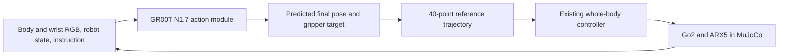

# Vision-language control for a Go2 quadruped with an ARX5 arm

The research question is whether a vision-language-action policy can grasp and lift a block on the simulated Go2–ARX5 while an existing whole-body controller (WBC) keeps the quadruped standing. In a MuJoCo diagnostic, a fine-tuned GR00T policy with a trajectory decoder completed the task in four runs on four training layouts. The separate Spatial-Language-Action (SLA) experiments investigate joint post-training across robots and datasets.

## Yu Liu’s contributions

- **Simulation observations and GR00T adaptation.** Configured a body-mounted camera in MuJoCo, paired its images with the wrist view, and checked target visibility through approach, grasp and lift. Adapted the action module using 100 simulated demonstrations while keeping the vision-language backbone frozen. The new camera input was checked across 1,450 supervised windows. [Camera implementation](https://github.com/Leo-6-maker/go2-arx5-hierarchical-vla/blob/0557c2e762b91f1218f58aeb95e49800f5c68aba/src/go2arx5_vla/world_model/native_camera_transfer_v1.py) · [Camera and dataset validation](https://github.com/Leo-6-maker/go2-arx5-hierarchical-vla/blob/0557c2e762b91f1218f58aeb95e49800f5c68aba/reports/WM02/native-arx5-transfer-20261112/P1_CAMERA_TRAIN100_AND_FINAL_PROCESSOR_ACTUAL.json) · [Training checkpoint](https://github.com/Leo-6-maker/go2-arx5-hierarchical-vla/blob/0557c2e762b91f1218f58aeb95e49800f5c68aba/reports/WM02/task-learning-core-hopper-20261109/FORMAL_SFT2000_RESTORE_PACKAGE_ACTUAL.json)
- **Policy-to-controller interface.** Implemented a decoder that anchors each trajectory at the current end-effector pose and last consumed gripper command. It connects these to the predicted endpoint with 40 reference points at 50 ms intervals, using a minimum-jerk profile for position and quaternion interpolation for orientation. The existing WBC and leg policy execute the resulting references in simulation. [Decoder implementation](https://github.com/Leo-6-maker/go2-arx5-hierarchical-vla/blob/0557c2e762b91f1218f58aeb95e49800f5c68aba/src/go2arx5_vla/world_model/task_learning_endpoint_basis_v3.py)
- **SLA post-training and diagnostics.** Integrated Go2–ARX5, RoboDojo and LIBERO demonstrations for joint post-training from the released SLA base checkpoint. Kept each dataset’s state and action conventions in its own reader. Implemented checks for gripper closure timing against expert commands and for discontinuities when successive commands meet. [Dataset readers](https://github.com/Leo-6-maker/go2-arx5-hierarchical-vla/blob/0557c2e762b91f1218f58aeb95e49800f5c68aba/src/go2arx5_vla/sla_adapter/scale20k_data.py) · [Training code](https://github.com/Leo-6-maker/go2-arx5-hierarchical-vla/blob/0557c2e762b91f1218f58aeb95e49800f5c68aba/src/go2arx5_vla/sla_adapter/scale20k_training.py) · [Evaluation code](https://github.com/Leo-6-maker/go2-arx5-hierarchical-vla/blob/0557c2e762b91f1218f58aeb95e49800f5c68aba/src/go2arx5_vla/sla_adapter/scale20k_evaluation.py)

## What the experiments show

| Experiment | Result and scope |
| --- | --- |
| GR00T with the trajectory decoder | In four MuJoCo trials, one per training layout, the standing robot grasped a block, lifted it at least 20 mm and held it for at least one second. These trials used the existing SFT2000 checkpoint with body and wrist observations. Held-out layouts and hardware are outside this evaluation. [Four trial records and scoring criteria](https://github.com/Leo-6-maker/go2-arx5-hierarchical-vla/blob/0557c2e762b91f1218f58aeb95e49800f5c68aba/reports/WM02/native-arx5-transfer-20261112/T0_SFT2000_NATIVE_TRAIN4_FINAL_ACTUAL.json) |
| SLA joint post-training | A saved checkpoint records 1,380 optimizer updates across the three datasets. Training and gripper checks are reproducible milestones. A reliable closed-loop SLA grasping policy remains an open research objective. [Checkpoint and evaluation record](https://github.com/Leo-6-maker/go2-arx5-hierarchical-vla/blob/0557c2e762b91f1218f58aeb95e49800f5c68aba/reports/WM02/sla-multisource-goal-v2-20261120/MIX1380_COLD_AND_VANDA_QUEUE_ACTUAL.md) |
