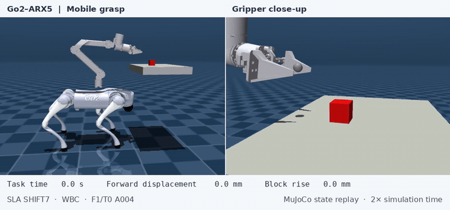
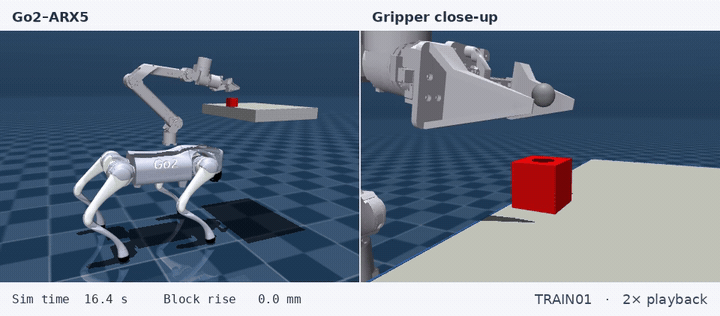
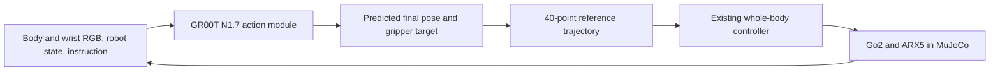
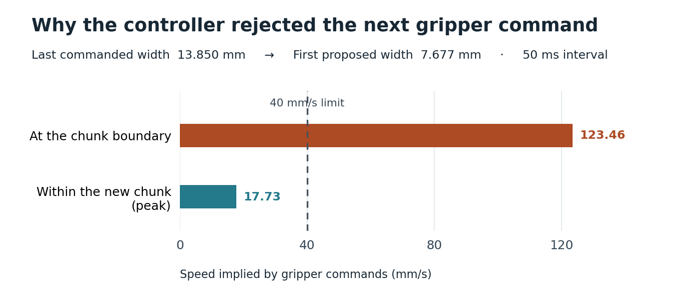

# Vision-language control for a Go2 quadruped with an ARX5 arm

Can a learned policy guide a quadruped-mounted arm to a block, grasp it and lift it? These MuJoCo experiments connect vision-language-action policies to the lab’s existing whole-body controller (WBC). GR00T was tested with the base standing. A separate SLA policy, SHIFT7, was tested with the base free to move.

## Mobile grasp with SLA SHIFT7

**Yu Liu’s role.** I trained SHIFT7, ran the closed-loop MuJoCo evaluation, analyzed the logs and made this replay from the recorded states. The lab provided the whole-body controller.

**The base approached first, then the arm lifted the block.** In trial F1/T0 A004, the base finished **10.30 cm forward** of its starting position. The block rose **2.64 cm** and met the grasp-and-lift criterion continuously for **1.30 s**. The frozen student policy issued 70 predictions from body and wrist images, robot state and the previous command. The WBC executed the motion without expert takeover or an explicit base-motion reference. [Play mobile grasp (MP4)](https://cdn.jsdelivr.net/gh/Leo-6-maker/go2-arx5-hierarchical-vla@cabb29254d508b69a7cabc0ee829e7ede8a223c5/docs/media/sla-shift7-mobile-grasp.mp4) · [Run record and scoring criteria](https://github.com/Leo-6-maker/go2-arx5-hierarchical-vla/blob/dbf222b41cb666bff4dd5412b864d023aec69399/reports/WM02/sla-sim-only-v51-20261117/FIRST_STUDENT_SUCCESS.md)

The replay shows archived states from a known layout at 2× simulation speed. The simulator paused for policy inference during the original run.

Across the known layouts, frozen SHIFT7 passed 3 of 7 valid mobile-grasp trials (8 attempts, one technical interruption). All three successes came from layout family F1. The [gripper diagnostic below](#multi-dataset-sla-gripper-diagnosis) uses a separate multi-dataset SLA checkpoint and six fixed trials to investigate what happens after the gripper closes.

## Experimental progress

| Date (2026) | Research question | What the experiment established |
| --- | --- | --- |
| 12 Nov | Can live GR00T targets drive the existing WBC? | The standing robot grasped, lifted and held the block in four MuJoCo trials, one per training layout. [Trial records](https://github.com/Leo-6-maker/go2-arx5-hierarchical-vla/blob/0557c2e762b91f1218f58aeb95e49800f5c68aba/reports/WM02/native-arx5-transfer-20261112/T0_SFT2000_NATIVE_TRAIN4_FINAL_ACTUAL.json) |
| 17 Nov | Can a frozen SLA SHIFT7 policy complete the grasp while allowing the base to move? | Success required at least 8 cm of net base displacement in the task direction, a 2 cm lift and a 1 s hold. The policy passed 3 of 8 attempts (3 of 7 valid trials, one technical interruption). All three successes were in layout family F1. [Mobile evaluation](https://github.com/Leo-6-maker/go2-arx5-hierarchical-vla/blob/dbf222b41cb666bff4dd5412b864d023aec69399/reports/WM02/sla-sim-only-v51-20261117/FINAL_RESULT.md) |
| 18 Nov | How consistently does mobile grasping work across two layout families? | On the same eight development conditions, the frozen baseline passed 5/8 and two training variants each passed 6/8. The variants failed different conditions. None met the criteria for broader testing. [Results by policy and layout](https://github.com/Leo-6-maker/go2-arx5-hierarchical-vla/blob/14886acdf739484cac914578e72736e63cedef62/reports/WM02/sla-mobile-f2-v52-20261117/E2_FINAL_ACTUAL.md) |
| 22–23 Nov | In a separate multi-dataset SLA study, why does execution stop after a grasp? | A gripper command crossed the controller’s 40 mm/s limit. Prioritizing grasp-related training windows improved some offline commands. Both policies remained at 0/6 for the 2 cm lift in the matched MuJoCo retest. [Diagnosis and retest](https://github.com/Leo-6-maker/go2-arx5-hierarchical-vla/blob/b6869988b90851baf0e4ce207df3985fef1d2dc7/reports/WM02/sla-main3800-native-diagnostics-20261122/ACTUAL.md#L195-L223) |

## Standing grasp with GR00T

**MuJoCo · live policy inference · training layout TRAIN01**

The two views replay the recorded robot and block poses at 2× simulation speed. During the full trial, GR00T received 15 live observation updates. The block rose 26.2 mm and met the grasp, lift and hold criteria continuously for 5.95 s. [Play standing grasp (MP4)](https://cdn.jsdelivr.net/gh/Leo-6-maker/go2-arx5-hierarchical-vla@cabb29254d508b69a7cabc0ee829e7ede8a223c5/docs/media/groot-train01.mp4) · [Original run record](https://github.com/Leo-6-maker/go2-arx5-hierarchical-vla/blob/0557c2e762b91f1218f58aeb95e49800f5c68aba/reports/WM02/native-arx5-transfer-20261112/T0_SFT2000_NATIVE_TRAIN4_FINAL_ACTUAL.json)

Each new observation yields a predicted final pose and gripper width. The decoder generates a 40-point reference trajectory from the current end-effector pose and last executed gripper command.

## Yu Liu’s contributions

- **Simulation observations and GR00T adaptation.** Configured a body-mounted camera in MuJoCo, paired its images with the wrist view, and checked target visibility through approach, grasp and lift. Adapted the action module using 100 simulated demonstrations while keeping the vision-language backbone frozen. The new camera input was checked across 1,450 supervised windows. [Camera implementation](https://github.com/Leo-6-maker/go2-arx5-hierarchical-vla/blob/0557c2e762b91f1218f58aeb95e49800f5c68aba/src/go2arx5_vla/world_model/native_camera_transfer_v1.py) · [Camera and dataset validation](https://github.com/Leo-6-maker/go2-arx5-hierarchical-vla/blob/0557c2e762b91f1218f58aeb95e49800f5c68aba/reports/WM02/native-arx5-transfer-20261112/P1_CAMERA_TRAIN100_AND_FINAL_PROCESSOR_ACTUAL.json) · [Training checkpoint](https://github.com/Leo-6-maker/go2-arx5-hierarchical-vla/blob/0557c2e762b91f1218f58aeb95e49800f5c68aba/reports/WM02/task-learning-core-hopper-20261109/FORMAL_SFT2000_RESTORE_PACKAGE_ACTUAL.json)
- **Policy-to-controller interface.** Implemented a decoder that anchors each trajectory at the current end-effector pose and last consumed gripper command. It connects these to the predicted endpoint with 40 reference points at 50 ms intervals, using a minimum-jerk profile for position and quaternion interpolation for orientation. The existing WBC and leg policy execute the resulting references in simulation. [Decoder implementation](https://github.com/Leo-6-maker/go2-arx5-hierarchical-vla/blob/0557c2e762b91f1218f58aeb95e49800f5c68aba/src/go2arx5_vla/world_model/task_learning_endpoint_basis_v3.py)
- **SLA post-training and diagnostics.** Integrated Go2–ARX5, RoboDojo and LIBERO demonstrations for joint post-training from the released SLA base checkpoint. Kept each dataset’s state and action conventions in its own reader. Implemented checks for gripper closure timing against expert commands and for discontinuities when successive commands meet. [Dataset readers](https://github.com/Leo-6-maker/go2-arx5-hierarchical-vla/blob/0557c2e762b91f1218f58aeb95e49800f5c68aba/src/go2arx5_vla/sla_adapter/scale20k_data.py) · [Training code](https://github.com/Leo-6-maker/go2-arx5-hierarchical-vla/blob/0557c2e762b91f1218f58aeb95e49800f5c68aba/src/go2arx5_vla/sla_adapter/scale20k_training.py) · [Evaluation code](https://github.com/Leo-6-maker/go2-arx5-hierarchical-vla/blob/0557c2e762b91f1218f58aeb95e49800f5c68aba/src/go2arx5_vla/sla_adapter/scale20k_evaluation.py)

## Multi-dataset SLA gripper diagnosis

This study jointly post-trained SLA_BASE on Go2–ARX5, RoboDojo and LIBERO. The diagnostic below follows that training run. [Multi-dataset checkpoint record](https://github.com/Leo-6-maker/go2-arx5-hierarchical-vla/blob/0557c2e762b91f1218f58aeb95e49800f5c68aba/reports/WM02/sla-multisource-goal-v2-20261120/MIX1380_COLD_AND_VANDA_QUEUE_ACTUAL.md)

In the red-block hold trial at 3,800 training updates, the standing robot grasped the block. The last executed command set the gripper width to 13.850 mm. The next action chunk proposed 7.677 mm after 50 ms. That change implied 123.46 mm/s at the boundary, so the controller rejected the chunk before executing it. [Command trace](https://github.com/Leo-6-maker/go2-arx5-hierarchical-vla/blob/b6869988b90851baf0e4ce207df3985fef1d2dc7/reports/WM02/sla-main3800-native-diagnostics-20261122/ACTUAL.md#L12-L28)

In a follow-up comparison, two policies received 500 further training updates from the same checkpoint. One prioritized grasp-related windows for auxiliary supervision. On two held-out post-grasp windows, this reduced the boundary speeds from 69.09 to 23.82 mm/s and from 57.19 to 44.80 mm/s. In matched MuJoCo trials, the two policies grasped the correct object in 1/6 and 0/6 runs respectively. Neither reached the 20 mm lift criterion. [Offline evaluation](https://github.com/Leo-6-maker/go2-arx5-hierarchical-vla/blob/b6869988b90851baf0e4ce207df3985fef1d2dc7/reports/WM02/sla-main3800-native-diagnostics-20261122/ACTUAL.md#L189-L206) · [MuJoCo trials](https://github.com/Leo-6-maker/go2-arx5-hierarchical-vla/blob/b6869988b90851baf0e4ce207df3985fef1d2dc7/reports/WM02/sla-main3800-native-diagnostics-20261122/ACTUAL.md#L210-L223)

The open question is whether training can keep the transition after grasping within the speed limit while preserving timely closure and enough upward motion to complete the lift.
