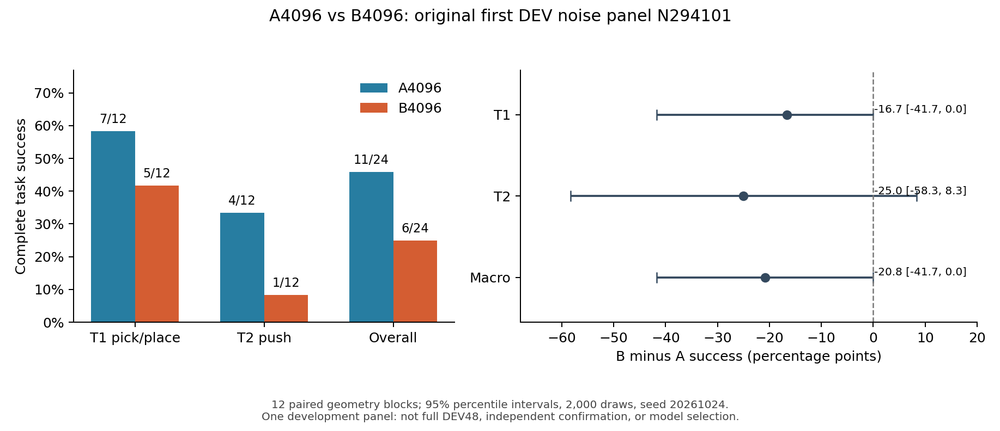

# A4096 / B4096 原首噪声面板：完整闭环结果

2026-10-25，SGT。原 N294101：12 个几何 × T1/T2 × A/B，共 48 个有效条件。B 后台于 **13:56:10** 完成终态；VPN 恢复后在 **14:34** 起独立回读原件、账本和关闭凭证。

**这份完整首面板没有显示新增示范覆盖带来收益：A 成功 11/24，B 成功 6/24，B−A 为 −20.8 个百分点。** 它支持暂缓更多相同干预的扩采／训练，先解释已有失败；不能据此宣称新增覆盖普遍有害，或正式选定 A。完整 DEV48、B0 保持比较和独立泛化确认仍未完成。

## 完整结果与真正的配对单位

| 任务 | A4096 成功 | B4096 成功 | B−A | 几何组配对 95% 区间 |
|---|---:|---:|---:|---:|
| T1 抓取—放置—释放—撤离 | 7/12（58.3%） | 5/12（41.7%） | −16.7 pp | [−41.7, 0.0] pp |
| T2 推送—脱离—保持 | 4/12（33.3%） | 1/12（8.3%） | −25.0 pp | [−58.3, +8.3] pp |
| 两任务宏平均／总体 | 11/24（45.8%） | 6/24（25.0%） | −20.8 pp | [−41.7, 0.0] pp |

每个几何组的两任务和两模型一起重采样，独立 block 数为 12；没有把 48 条当成 48 个独立场景。沿已发布原 `paired_development.compare`：2000 次经验百分位 bootstrap，seed 20261024，2.5%／97.5% 分位。小样本离散区间上端为 0，不是普遍有害或等效的证明；本报告不作显著性或正式模型发布资格主张。

24 个同条件配对中，A 成 B 败 6 条、A 败 B 成 1 条、共同成功 5 条、共同失败 12 条。按几何宏平均差，5 组偏向 A、1 组偏向 B、6 组持平。两任务方向都没有正向均值，但 T2 的不确定性仍宽。

| 原有效失败类别 | A | B |
|---|---:|---:|
| 原参考门拒绝 | 1 | 0 |
| S1 执行前拒绝 | 8 | 11 |
| 执行完整但物体任务未成功 | 4 | 7 |
| 有效失败合计 | 13 | 18 |
| 实际 live 原生安全故障 | 0 | 0 |
| 工程缺失／未审计条件 | 0 | 0 |

S1 预执行拒绝不等于真实机器人已经发生安全故障。原参考速度门及其 TEST_ONLY 历史出处保持；没有修改评分、S1、阈值或重跑有效失败。全部 48 条均通过原 raw、动作／实际 ACK 和两角色因果链审计；最终原件清单与实际 native inventory 完整关联。纯汇总函数保留的“不能自行枚举远端”说明仍按其作用域解释，本次另有实际 inventory 和双关闭证明。

## 不用一个失败标签掩盖不同机制

F0/F1/F2 的每模型几何数为 2/5/5；任务分解如下。旧 family 联动了几何、外观等因素，这不是 GEN1 的单因素试验，不能从某个 family 的差异直接归因颜色或布局。

| family | A T1 | B T1 | A T2 | B T2 |
|---|---:|---:|---:|---:|
| F0 | 1/2 | 0/2 | 1/2 | 0/2 |
| F1 | 3/5 | 3/5 | 2/5 | 0/5 |
| F2 | 3/5 | 2/5 | 1/5 | 1/5 |

已有原始时间线显示至少三种应分开的现象：

- F2/000/T1 的 B 已抓握、抬升、搬运，但终态仍接触、未完成释放／撤离／目标保持；A 完成成功。
- F2/000/T2 的 B 已脱离并满足最终释放／撤离相关保持，仍因目标区与不抬升谓词未通过而失败，不能统称缺少 withdraw 行为。
- F2/002/T1 两臂都成功，A 接触结束约 9.106 秒、首次搬运后 TCP clear 11.4 秒；B 为 24.182／26.3 秒，最终保持均为 41/41。这是成功条件内部的时序差异，不应另判失败。

完整 [48 条原评分及事件时间线](../../../reports/PI0294/design/parallel-science-20261022/V4A_A24_B24_COMPLETE_FAILURE_ATLAS_ACTUAL_20261025.json)保留每条实际证据 hash。DEV 轨迹用于归因和提出假说，不能直接转作下一轮 TRAIN 标签。

## 模型、训练匹配和解释范围

[实际模型／数据卡](V4A_AB4096_MODEL_AND_DATA_CARD.md)已逐项关联完整保存、固定交付和实际加载。两臂各保留 4096 更新／131072 次 anchor 消费，T1/T2 各 65536，C1 完整消费直方图相同。B 的新库贡献 49152 次消费，替换部分原数据；不是多训练了相应步数。8 个共同 C1 导出映射 4 个父场景，不能当成 8 个独立几何。

16 个指定科学源文件和整个 `src` tree 在两 Eval 版本间相同；运行／账户／恢复层版本及 GPU 共享条件仍有差异，不声称整个环境字节或吞吐完全匹配。旧 source-relative 初始化也不构成视觉泛化证据；GEN1 共同 home 是独立、尚未合格的准备版本。上述限制与单一 DEV 噪声面板、小几何数一起限制外推。

## 后台终态与一次结算

| 本次原面板费用／效果 | A | B |
|---|---:|---:|
| GPU 分配秒（含原保守垫量） | 14092 | 15091 |
| 神经进程 CPU 秒 | 1247 | 1615 |
| 真实模型查询／模型加载尝试 | 1619 / 1 | 1574 / 1 |
| 物理 worker CPU 秒 | 8448.254144 | 8206.427257 |
| 控制 CPU 金融 upper 秒 | 7800 | 7200 |
| live ticks / shadow ticks | 322000 / 322753 | 312600 / 313601 |
| main starts / engine starts | 24 / 1738 | 24 / 1694 |

控制 upper 不是精确进程 CPU；不同站点账本中的投影不再相加当额外独立消耗。engine starts 含实际原生影子构造，不能解释成同数量的独立物理 episode。每臂 38,346,128,184 字节新增 resident 输出 upper 保留；已完成的公共模型传输没有重复收费。两臂均是已实际成功结束的神经进程、完整原结果、一次实际结算、GPU／physical 双 lease CLOSED、对应 hold0／unknown0。旧启动失败、训练丢失更新及费用完整保留。

B owner 的暂态 systemd unit 已被回收，其原终态文件、日志和闭合账本均已读取；当前没有独立保留的 owner OS exit code，不把回收后默认显示的 `Result=success` 单独当退出码证据。GPU unit 保留实际 Exit0。B 完成发生在本机 VPN 恢复前，证明本轮执行／审计／结算关闭由服务器自主接续，不需前台 agent 保活。

原始结算 proposal 单文件约 4.56 MB，第一次只读收集触及 2 MiB 界限。保留失败后先核文件大小，再用有界 6 MiB/成员、16 MiB/总量读取，原 once intent／receipt 和账本全字节核对通过。未重发任何结算或关闭写，也没有热改服务器。

## 当前决策与下一项最小阻断

原 V4A 第一阶段 A24+B24 已完成，科学结果、失败图谱、模型／数据卡和实际费用现可审阅。**暂缓自动扩采、重训或第二噪声面板；先审阅这份完整 A/B 结果，核新增数据分布、质量和旧能力保持。** 是否扩评由信息价值和实际成本决定，已批准上限不是必须消耗的预算。

GEN1 M0/M1 已完成；M2 六 TRAIN 双外观／双相机共24图仍 NOT_RUN，缺有效隔离执行范围。M4 的12次 Teacher pilot 仍须完整 A/B 审阅及有效范围，不从本次结果发布自动获得执行资格。原停止新作业和训练时间已过，原物理停止／硬关闭及最终保护不变。

完整长程 goal 仍未完成：正式 DEV48／B0完整比较／独立确认未完成；固定旧 CORR2048/R0 的目标完整 prefix／安装 ACK／任务资格未通过，core64=0。目标未执行项保持 NOT_RUN，不能当迁移失败，也不能用 A/B 新模型替代旧 CORR 核心比较。

## 可复算材料

- [完整机读结果、实际关闭及成本](../../../reports/PI0294/design/parallel-science-20261022/V4A_A24_B24_COMPLETE_PAIRED_RESULT_AND_CLOSURE_ACTUAL_20261025.json)
- [24 行同条件配对 CSV](../../../reports/PI0294/design/parallel-science-20261022/V4A_A24_B24_N294101_PAIRED_RESULTS_20261025.csv)
- [独立复算／绘图脚本](../../../reports/PI0294/design/parallel-science-20261022/V4A_A24_B24_REPRODUCE_20261025.py)：实际 CSV 成功计数、均值和全部区间与原 reader 逐值相同；只复算已审计类别，不替代 raw 审计。使用原已安装依赖，未升级环境。
- [矢量图 SVG](../../../reports/PI0294/design/parallel-science-20261022/figures/V4A_A24_B24_N294101_RESULTS_20261025.svg)／[PDF](../../../reports/PI0294/design/parallel-science-20261022/figures/V4A_A24_B24_N294101_RESULTS_20261025.pdf)。图已实际渲染检查。

本次新操作仅为保存原件的只读回收、本地分析与文档发布。没有新模型／物理／训练／采集／PBS／原生账本写；GitHub CI 未宣称通过。
