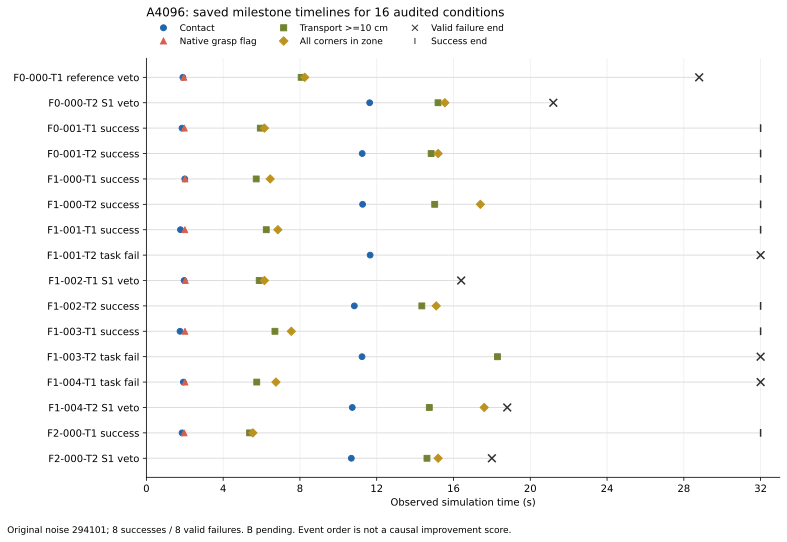
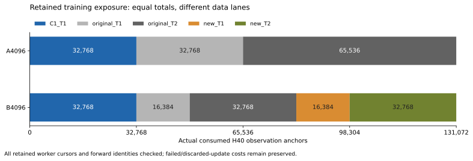
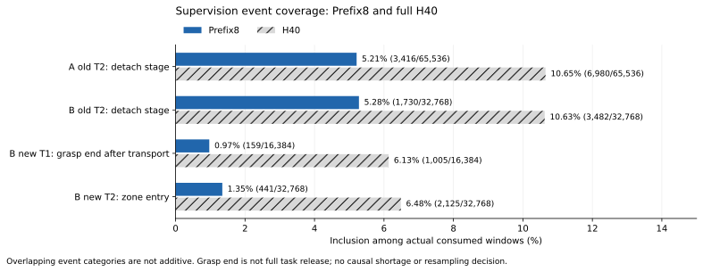

# A/B Failure Atlas、实际训练曝光与 TRAIN 候选准备

当前第一阶段继续由服务器自动串行执行 A24→B24。本次只分析已有回执，不新增训练、采集、物理执行或资源预留。完整 V4/V4A 目标保持 ACTIVE；固定 CORR2048/R0 的 core64 仍为 0。

最新补充回读为 **A22/24＝11 成功＋11 有效失败**（参考门1／S1门7／完整任务失败3），B有效0，配对增益未知。服务器同一健康 owner／GPU 进程自行继续；下方 A16 图表及 A19 补充均按各自冻结队列保留。

## P0：保存证据的失败时间线

本次冻结分析队列中的 A4096 前 **16/24** 条有效条件：**8 成功、8 有效失败**。T1 为 5/8，T2 为 3/8；这些是顺序部分结果，F2 目前只进入首个几何组，不能作为完整面板成功率。B 在同一回执中仍未产生有效结果，B−A 未知。

发布前另一次精确只读显示：同 PID／proc-start 的后台 owner 仍健康，A 已自行推进到 **18/24＝9 成功＋9 有效失败**，B 仍 0 条；该较晚运行快照与本报告冻结的 16 条逐条件图谱分开保存，后两条尚未加入此图谱。

- 1 条原参考速度门拒绝；保留原 TEST_ONLY 阈值出处。
- 4 条 S1 执行前拒绝；被拒前缀无实际 live 执行，不能冒充真实碰撞。
- 3 条完整任务未成功；保留原物体任务谓词、失败标签和分母。
- 实际原生安全故障 0；各条件原始审计及命令—实际 ACK 因果链通过。

图谱从原 500 Hz 接触/抓握记录、20 Hz 物体状态及参考/ACK 记录提取首次接触、原生抓握、10 cm 搬运、搬运后抓握结束、进入目标区和 TCP 撤离时间。每条条件保留原 score、原文件与因果链哈希。部分 episode 缺失的尾部不补齐；抓握结束不等于完整释放成功；事件先后不能直接充当因果收益或新评分。

### T1 完整任务失败：实际 H40 持续闭合，物体未完成放置

[原参考、实际 ACK 与保持窗口诊断](../../../reports/PI0294/design/parallel-science-20261022/V4A_A_T1_F1_004_HOLD_GRIPPER_DIAGNOSTIC_ACTUAL_20261025.json)进一步核对了 F1-004／T1。该条件完整执行 32 秒，原抓取／抬升／搬运均通过；原 28–30 s 保持窗口的 41 个采样中，放置高度、目标区、释放和 TCP 撤离均为 0/41。

按原夹爪语义，0 是闭合行程目标，1 是张开行程目标。在这 41 个真正提交且有执行 ACK 的点中，夹爪目标为 **0.0106–0.0533**；对应 6 次 draw 的**完整 H40**目标均不超过 **0.0688**。原生抓握标记为 **41/41**，物体中心高度 **0.529–0.546 m**，原放置目标高度为 **0.460 m**。这段完整 H40 的输出也保持接近闭合端，单用 Prefix8 截断不能解释该条件的放置—释放—撤离链路未完成。

实际策略观测的夹爪开度约 0.431–0.436，与闭合目标的差值本身不能证明夹爪执行器故障；物体仍被抓住，物理开度与目标开度需分别解释。此处使用原 Teacher／engine 源码只确认行程语义，没有运行 Teacher、替换学生命令或生成新标签。仅凭这条 DEV 轨迹不能认定“只要开爪就能恢复”，也不能证明新增覆盖、重采样或某种 loss 会解决它。原始 3.31 MB 参考文件仍在私有存储，公开的只是窗口统计及证据哈希。

## P1：独立轨迹、目标窗口与真实消费分开计数

原始 96 条 T1＋30 条 T2、PV1 新覆盖库 75 条 T1＋64 条 T2，以及 C1 的 8 个导出变体属于不同数据层。C1 对应 **4 个原始学生父轨迹**，不能把 8 个导出变体当成 8 次独立恢复。新增库 139 条轨迹对应 77 个几何组，其中 62 组有 T1/T2 配对。

最终 checkpoint 所保留的 **7 段**消费链已全部核对：每个已保留 cursor 唯一且连续，worker 摘要等于保存的 sampler 哈希，实际 forward 微批次身份逐一相符。A/B 分支各自是在同一原 CORR2048 初始化后新增 4096 步、消费 **131,072** 个观察 anchor；既有共享父模型的历史训练不计入该数，所有失败及丢弃更新的收费仍保留。

| 实际消费通道 | A4096 | B4096 |
|---|---:|---:|
| C1 T1 | 32,768 | 32,768 |
| 原始 T1 | 32,768 | 16,384 |
| 原始 T2 | 65,536 | 32,768 |
| 新覆盖 T1 | 0 | 16,384 |
| 新覆盖 T2 | 0 | 32,768 |
| 合计 | 131,072 | 131,072 |

A 的 reader 虽加载新库支持，但实际新库通道消费为 **0**；B 为 **49,152**。旧 EXPECTED_TRAINING_EXPOSURE.tsv 保留其预期草案身份，不回写成历史实际回执。

### 关键事件到底进入了多少 Prefix8？

这里 Prefix8 指**实际被训练消费窗口的前 8 个目标点**（0–0.35 s），不是证明学生执行了这些事件；完整 H40 监督为 0–1.95 s。Teacher 阶段和物理事件是两套不同定义。

| 原始 T2 阶段监督 | A：65,536 个原 T2 样本 | B：32,768 个原 T2 样本 |
|---|---:|---:|
| anchor 位于 detach 阶段 | 2,669 | 1,349 |
| Prefix8 包含 detach 阶段 | 3,416（5.21%） | 1,730（5.28%） |
| H40 包含 detach 阶段 | 6,980 | 3,482 |
| Prefix8 包含 detach 起点 | 854 | 435 |
| Prefix8 detach 覆盖的独立父轨迹 | 30/30 | 30/30 |

原库 detach anchor 占比 756/18,030＝4.193% 是**所有合法源窗口的可用性**，与上表实际采样次数、阶段相交窗口和起点事件不能混用。

新覆盖 T1 的 75 条轨迹均有“搬运后原生抓握结束”事件；B 的实际 16,384 次新 T1 消费中，Prefix8 命中 **159** 次、覆盖 **67/75** 条；H40 命中 **1,005** 次、覆盖 **75/75** 条。另 8 条的该事件未进入已消费窗口的 Prefix8，但并非没有进入 H40；这不是完整释放事件缺失或学习不足的证明。

新覆盖 T2 的目标区进入事件在实际 32,768 次消费中，Prefix8 命中 **441** 次、覆盖 **63/64** 条；H40 命中 **2,125** 次、覆盖 **64/64** 条。两项事件原始转换次数均仅为 1 或 2，因此可由原回执的 first/last 无损恢复；未把其他高频接触抖动事件臆测成完整事件掩码。

重复窗口是固定采样配方的实际曝光，不是新的独立示范。C1 共消费 32,768 次，涉及 1,665 个不同“导出 episode＋anchor”键，约每键 19.68 次；该键数尚未折叠到 4 个父轨迹的底层状态，不能被当成独立状态数，也不自动构成过采样错误。此次不改混合比例或 loss。

### C1 短导出的重复曝光：已量化，配方不改

[后续精确消费补充](../../../reports/PI0294/design/parallel-science-20261022/V4A_C1_MATCHED_SINGLE_ANCHOR_EXPOSURE_AND_A19_ACTUAL_20261025.json)显示：C1 的 4 个短导出各只有一个被消费的合法 anchor，分别消费 4,041／4,090／4,103／4,131 次，每臂合计 **16,365** 次，即 C1 通道的 **49.942%**、全分支的 **12.486%**。这些短导出来自 2 个原始学生父轨迹，不是 16,365 次独立示范；尚未声称把短／完整导出折叠为底层状态的精确唯一数。

原冻结 sampler 按 cursor 固定通道，再在 C1 的 8 个导出 episode 中等概率选一个、最后在该导出内等概率选合法 anchor，因此 4 个单锚点导出获得约一半 C1 曝光与原配方一致。该源文件已逐字节匹配 A、B 和当前 Eval 的冻结源码。A/B 的逐 episode／anchor 消费直方图完全一致，这部分是已匹配控制项；不能只凭重复次数判为 dataloader 错误，也不能单独用它解释 B−A。此次不修改采样或 loss。

同一次补充已回收 A 的第 17–19 条原终态：2 条 T1 成功、1 条 T2 S1 拒绝。后者在 20.4 s 的下一前缀影子第 56 tick 预测非法接触而被拒，拒绝段 live=0，无真实原生安全故障。此时 A19＝10 成功＋9 有效失败（参考门1／S1门5／完整任务失败3）；T1 已测10为7成功，T2已测9为3成功。图表仍明确冻结原 A16，新增3条时间线保存在补充 JSON；B 为未知，配对效应与正式比较仍待。

## 候选准备：24 条件，仅设计

从原冻结 DATA_COV1 的 12 个 appearance×方向×距离分层各取既有 replicate1：**12 个几何、每个 T1/T2，共 24 个任务条件**。选择只依赖原 TRAIN 分层和预冻 replicate；DEV 结果不参与选样或生成标签。与当前 128 个 PV1 几何元数据及其余 12 个 COV1 几何按原 2 mm XY／2° yaw、忽略外观规则复核，冲突为 0。原更早的几何排除历史继续保留，没有声称本次重新审计了全部历史资产。

这些条件有旧静态 PASS 回执，**当前动态 Teacher 可行性、完整 R0 codec 与标签准入仍为 NOT_RUN**，不把旧静态通过升级为实际成功。T1 重点记录放置—释放—撤离—保持；T2 重点记录推送—脱离—撤离—保持。未来只有实际安全成功、原始实际 ACK/提交标签、分区独立及全新资源时钟准入全部满足，才能形成新数据包。不得重启旧 closed 请求、拿 S1 拒绝动作作正标签，或将 DEV 失败状态偷偷改成 TRAIN 标签。

## A/B 结果之后的决策

| 配对证据 | 待检验假说与下一步 |
|---|---|
| B 在两任务均改善 | 先考虑原第二噪声面板确认，按实际成本和授权再决策；不自动发起 |
| 仅 T2 改善 | 对齐同条件接触、脱离及保持的时间线，区分何处发生变化 |
| 两臂均大量参考/S1 拒绝 | 检查参考与接触可行性，保留拒绝本身的有效负结果，不放宽安全门 |
| B 退化 | 审计新增分布、质量、混合和保持，不自动追加覆盖数据 |
| 两臂闭环弱而离线尚可 | 先检验 TRAIN-only 恢复 Oracle 资格，不把成功专家数据等同于 DAgger |
| 源域可用而目标失败 | 优先原执行接口与域迁移接线，不直接归咎示范数量 |

目标零步反馈、双相机、STOP／ACK 和既有 CPU 接口资格均复用。完整原生整机 prefix、参考安装及实际任务执行资格仍有缺口，不扩展为通用 WBC 逆向或新 WBC 训练。

## 可复核产物与边界

- [Failure Atlas JSON](../../../reports/PI0294/design/parallel-science-20261022/V4A_FAILURE_ATLAS_AND_TRAIN_AUDIT_20261025_FAILURE_ATLAS.json)
- [TRAIN 覆盖与真实消费 JSON](../../../reports/PI0294/design/parallel-science-20261022/V4A_FAILURE_ATLAS_AND_TRAIN_AUDIT_20261025_TRAIN_COVERAGE.json)
- [逐 episode 消费表](../../../reports/PI0294/design/parallel-science-20261022/V4A_FAILURE_ATLAS_AND_TRAIN_AUDIT_20261025_ACTUAL_PARENT_EXPOSURE.csv)
- [24 个 TRAIN-only 候选条件](../../../reports/PI0294/design/parallel-science-20261022/V4A_FAILURE_ATLAS_AND_TRAIN_AUDIT_20261025_TEACHER_CANDIDATES.json)
- [分析笔记本](../../../reports/PI0294/design/parallel-science-20261022/V4A_FAILURE_ATLAS_AND_TRAIN_AUDIT_20261025.ipynb)

主要来源是原 [T2 TRAIN30 事件审计](../../../reports/PI0294/20261016T191445Z-localpc-mp1/T2_TRAIN30_EVENT_AND_H40_COVERAGE.json)、[PV1 新库物理事件审计](../../../reports/PI0294/PV1/20261018T182956Z-localpc-pv1/PV1_ADMITTED_TRAIN_PHYSICAL_EVENT_EXPOSURE.json)、[冻结候选总体](../../../reports/PI0294/DATA_COV1/DATA_COV1_FROZEN_POPULATION.json)，以及本次原始 checkpoint／worker／forward／Eval 回执的精确哈希。新读取只作用于终态文件；未运行新的模型、训练或物理任务，未宣称新的 CI 成功。笔记本已从头到尾执行 8 个代码单元，原字节事件连接／16 条 score 等值复核全部通过，3 张图及原笔记本 HTML 已渲染检查。

原 T0、预算、矩阵与最终保护不变。停止新增 job／候选为 **2026-10-25 02:29:56 SGT**，停止新增物理为 **18:29:56 SGT**，硬关闭为 **2026-10-26 02:29:56 SGT**。这份分析和未来候选元数据不延长战役。

## 2026-10-25 — first A panel complete; B startup known-zero and closed

A4096 has completed all 24 original N294101 conditions: 11 success and 13 valid task failures (T1 7/12, T2 4/12). The failure categories are 1 original reference-speed rejection, 8 original S1 preexecution rejections, and 4 complete object-task failures; actual native safety faults are zero. Independent full-panel audit, once GPU/control settlement and both actual lease closures are complete. This is one original noise bank, not complete DEV48 or independent confirmation.

The subsequent B4096 process failed before model load, query or physics. The original owner hit the strict owned-read-only evidence gate because 73 exact closed-A evidence files were writable. Its STOP request is preserved as the secondary B exit cause. B has zero valid outcomes, so B−A remains unknown. The failed process has been independently read back terminal, charged once (70 GPU seconds and 1 GPU-process CPU second, original output/control bounds retained), and both leases are closed.

The narrow cold repair prepares one fresh B24 request with exact audited A bytes copied into its own sealed inputs. It retains the original two-row accepted queue, both historical rows, all failed costs, A24 results, the strict read-only gate and all original clocks. There is no automatic retry pool, A replay, new noise bank or new training. CPU preparation alone is not native adoption: full fresh resources, unique registration and the original native communication qualification still precede model permission.

Actual report: [A24 terminal and B known-zero closure](../../../reports/PI0294/design/parallel-science-20261022/V4A_A24_COMPLETE_AND_B_ZERO_START_CLOSED_ACTUAL_20261025.json). P0/P1 remain the existing Failure Atlas and actual retained training exposure audit; future Teacher candidates remain metadata-only and NOT_RUN. Full goal remains ACTIVE and core64=0.

### 2026-10-25 — human approved exactly the two storage changes

The human directly approved only GPU-site storage 810→811 GiB and Core storage 300→329 GiB for the one original B24 cold replacement. [Exact authorization](../../../reports/PI0294/design/parallel-science-20261022/V4A_B_ZERO_START_TWO_STORAGE_CAP_AUTHORIZATION_20261025.json). The captured-byte full all-resource proposal now has zero shortfalls, retains the 70-second failed startup and its full output bound, original three matrix jobs, and final 20 GPUh/40 GiB protection. GPU/CPU/PBS/query/physics/transfer caps, all clocks and scientific gates are unchanged.

This approval is not yet actual dual-ledger adoption, registration, native model permission or an Eval result. The cold-only helper and related tests pass 152 cases. A broader local environment attempt is not represented as an all-green suite (missing Torch/safetensors, old pytest fixture compatibility and separate target ABI tests); no CI success is claimed. The next action is exact dual-ledger once adoption, fresh unique request/resources, standard registration, and the original native qualification before B model load.
