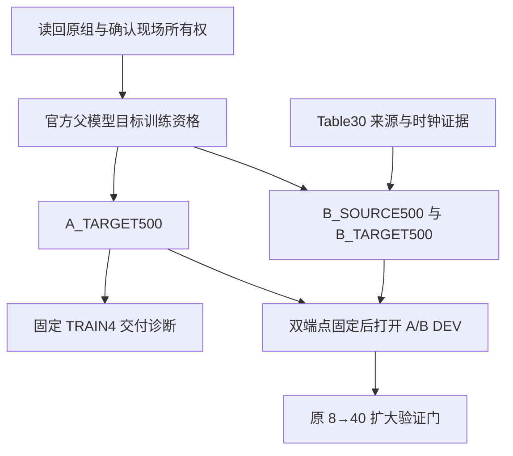

# 目标侧优先的后续实验计划 · 2026-11-12

状态：**执行顺序补充；不是实际训练完成回执。** 本文件基于执行 PR #376 的 `41111540d33398e916224dd07cd2638db2a5675f` 和 [本次进度审查](../../reviews/2026-11-12_NATIVE_ARX5_PROGRESS_AND_SOURCE_PROVENANCE.md)。

## 1. 目标与边界

先完成官方 GR00T 父模型在已通过的新 body＋wrist TRAIN100 上的 A_TARGET500，取得可恢复、可普通 RGB 推理的端点及完整 TRAIN 诊断。Table30 采集来源核验在旁路推进，只控制 B_SOURCE 准入。

[原 V1 协议](../../protocols/NATIVE_CAMERA_PUBLIC_ARX5_TRANSFER_V1_20261111.md)、[机器规格](../../../experiments/native_arx5_transfer/native_camera_public_arx5_transfer_v1.json) 与 [新 DEV 注册](../../../experiments/native_arx5_transfer/dev_panel_v1.json) 的科学设定保持冻结。此次补充拆开实现依赖，并明确 A500 的 TRAIN 交付诊断；没有修改目标预算、训练参数、正式评估端点、解码器或扩大验证门。

本轮仍为完整 Go2＋ARX5 的站立整机仿真；WBC、腿策略、动力学、2 ms 步长及原生安全冻结。暂不引入 WM、视觉骨干解冻、公开数据回放混合、新大卡作业或自动追加同分布训练。正常工程修复沿用项目授权，按缺陷证据修复受影响接口，不新增逐项人工审批。

## 2. 当前可复用身份

| 对象 | 固定身份／已完成事实 |
|---|---|
| 官方父模型 | `nvidia/GR00T-N1.7-3B@2fc962b973bccdd5d8ce4f67cc63b264d6886495`；七文件完整字节身份已通过 |
| 新相机 | `BODY_BASE_FIXED_V1_20261111`；BASE pos `[0.25,-0.24,0.45]` m，固定看向 BASE `[0.38,0,0.34]` m，up BASE+Z，vertical FOV 75°，256×256；腕部原配置 |
| 新目标 manifest | `11ac2104e72ddb091045bb2ae0f8cba56bd4002022fc44825e983173565efbe1` |
| 原目标 manifest | `ff94fc77c5a8309dc1460032b308c2f213c96c088449ee1821b3e46e045107b0` |
| 原 target stats | `0faba237b8922ed9bbd53bd6732a9f449f46dcb6fc19017eae8f3cffa3afd9f2`，保持不变 |
| 数据分母 | 100 episodes／1,450 监督窗口；1,500 captures 中 50 个干预 captures 保留但不纳入 BC |
| 推理解码器 | `H40_CURRENT_STATE_PREDICTED_GOAL_QUINTIC_REPRESENTATION_V3_01`；raw H40 另列 |
| 已读 SFT 诊断 registration hash | `e1fa1d744497a5f961829df2efe7a10ce1f79fe3192417c1c51e7e46e774670c` |
| 诊断实际执行 source | `0df567220e61d8b5b1e56bd1180889e6a5d126d1` |
| LR 序列 SHA256 | `0d044913097f94796624a672d1aa3f5de17804fad80376e9dd05635776ebc31a` |
| 公开源 revision | `RoboChallenge/Table30@1eda76b8935b5c7a59cd635ca9e3fab882943e11`；仅 metadata 证实的 ARX5 子集 |

上述身份来自 [P1 回执](https://github.com/Leo-6-maker/go2-arx5-hierarchical-vla/blob/41111540d33398e916224dd07cd2638db2a5675f/reports/WM02/native-arx5-transfer-20261112/P1_CAMERA_TRAIN100_AND_FINAL_PROCESSOR_ACTUAL.json)、[实际诊断回执](https://github.com/Leo-6-maker/go2-arx5-hierarchical-vla/blob/41111540d33398e916224dd07cd2638db2a5675f/reports/WM02/native-arx5-transfer-20261112/P3_TRAIN4_FIRST_COMPLETED_CONDITION_ACTUAL.json) 和 [新训练 profile](https://github.com/Leo-6-maker/go2-arx5-hierarchical-vla/blob/41111540d33398e916224dd07cd2638db2a5675f/src/go2arx5_vla/world_model/native_arx5_training_profile_v1.py)。

相机、数据、模型文件未变时复用已有核验，不重新全量渲染或全流重哈希来延迟下一步。新官方起点的 cache 必须独立生成，不能复用旧 SFT2000 的骨干缓存。

## 3. 依赖顺序

源 reader 不在 A 的依赖链上。A 的普通 RGB／Processor endpoint 重建必须完成。两个训练分支在同一 Core 4080S 上按现场所有权顺序执行，图中的独立性不表示并发抢占同一 GPU。

## 4. 阶段 T0：收齐已发出的 SFT2000 TRAIN4

只读恢复对现役组、进程／owner、journal 与已落盘结果的可见性。读取原 TRAIN01／07／13／25 的当前状态与终态，复用已完成 TRAIN01；不要重新派发整组。

最新回执只证明 TRAIN01 成功，最后一次读取时下一项为 TRAIN07。relay timeout 既不能证明旧组仍运行，也不能证明 GPU／物理 owner 已释放。健康活动作业自然到达冷边界；技术终态按原身份封存，未知写入先查清，不盲目重试。

交付一张现有四条件表：registered、requested、attempted、verified terminal、success、technical failure、unread，以及逐项结果 hash／来源。该读取过程不新增评估请求，不把“未读回”补成任务失败。

## 5. 阶段 T1：目标侧真实训练资格

### 实现拆分

依据现有 `native_arx5_training_profile_v1.py`、`native_arx5_training_runtime_v1.py` 和 `native_arx5_training_jobs_v1.py` 完成下列最小真实检查。当前 44 项软件检查仅说明 CPU 软件路径可用；不能替代 GR00T、CUDA backward 或真实存储的核验。

| 检查 | 所需实际证据 | 计划更新成本 |
|---|---|---:|
| 父模型 load／参数 inventory | 官方七文件对应的真实 load；category10 七类接口和 DiT30/31 的精确白名单；冻结参数指纹 | 0 |
| 新 target 冻结骨干 cache | 实际 body/wrist＋语言经固定 Processor／骨干编码；缓存键含父身份、Processor、图像、相机、语言 | 0 |
| 完整有效 batch32 对照 | 相同输入／噪声／初态，full-RGB 与 cache 的 loss、梯度及更新差；冻结 DiT 前缀保留到接口的反向链 | 2 个非候选更新 |
| 新进程恢复 | 连续4更新，对照2更新保存＋新进程2更新；完整参数、Adam、scheduler、RNG、cursor、Processor／stats 恢复一致 | 8 个非候选更新 |
| 普通 RGB 推理重建 | checkpoint 可由通常推理入口加载，在无训练 cache 的 RGB 输入上恢复相同 Processor／H40 语义 | 0 |

资格合计按现有实现为 **10 个非候选 optimizer updates**，有效 batch32 时为 320 次访问，独立记账，不算进 A500 或 B 的候选预算。数值容差与比较项执行前固定在现有资格配置中，不能看到差异后放宽通过线。

同时记录 GPU peak allocated／reserved、常驻权重／梯度／Adam／输入 cache 的字节预算、每个有效更新耗时及恢复耗时；参数、梯度、优化器状态和训练激活保持在 GPU，CPU 仅负责解码、存储与审计。13 GiB 的 SFT 推理成功不自动证明训练可容纳。

若 OOM，先定位实际常驻项、分配上限和生命周期，修复确定的工程原因；不原样反复启动，不静默改 dtype、H40、有效 batch、参数白名单或搬训练状态到 CPU。维持既定 Core 4080S 范围；若在该范围确实不可行，报告具体内存缺口而非伪造训练开始。

**进入 T2 的条件只有目标侧资格和现场资源可用；Table30 来源／reader／source cache 不是条件。**

## 6. 阶段 T2：A_TARGET500

正式候选从已核验的官方父模型重新开始，资格更新不沿用。固定：microbatch1、accum32、AdamW lr1e-4／weight decay1e-5／betas(0.9,0.999)／eps1e-8、grad clip1、500更新cosine／25warmup、seed20261111、原 FM，视觉／语言骨干与其余参数冻结。

目标采样应保留实际实现的 exposure 语义：100 个 episode 各 32 个 `optimization_anchors`，组成 3,200 项列表，覆盖 1,450 个唯一监督窗口；PCG64(seed+cycle) 的 5 个 permutation cycle 产生 16,000 次访问。**不是直接对 1,450 个唯一窗口均匀采样。** 报告各窗口实际访问次数和独立窗口数，不把重复访问称为新数据。

在250与500保存完整状态；250仅作保存／恢复／诊断端点，正式比较固定500。记录每次已使用 LR 与 next LR，500 次实际更新 LR 为正，第500次完成后的下一 LR 为0。保存／评估不得推进训练采样或 FM 噪声 RNG。恢复只继续剩余更新，不追加预算或重算已完成更新。

交付：`A_TARGET250`、`A_TARGET500`、普通 RGB 推理重建结果、实际500更新／16,000访问 trace、完整白名单／冻结指纹、loss分项与GPU／墙钟成本。A500 即使闭环分数差，仍是该固定配方的有效候选，不能据此改选250或追加同分布训练。

## 7. 阶段 T3：A500 的固定 TRAIN4 交付诊断

本文件新增一个有限交付诊断，ID 为 `A_TARGET500_TRAIN4_DELIVERY_DIAGNOSTIC_V1`。它须在首次运行前写成实际注册并封存配置／hash；当前只是待执行计划。

- TRAIN01／07／13／25，各一次重启，每条件最多15查询；固定一次四条件，最大60查询。
- 使用新 body/wrist、原状态／语言、同一完整 H40 basis／消费者及原夹爪映射；对应沿用已登记 SFT 诊断的 query seed bases 202611110100、202611110700、202611111300、202611112500，不临时按结果改种子。
- 逐条件保留 raw H40、重建 H40、参考拒绝、实际消费、夹爪事件、接触／抬升／保持及首次失败阶段。
- 技术问题保留原终态，修复后是否有必要做独立技术复核要依据受影响接口；不得把有效策略失败重跑以挑成功。
- 这是 TRAIN 上的交付和失败归因，不能报告为独立泛化、A/B迁移增益或正式 DEV；结果不用于改写本轮 A/B 固定配方。

评分明确绑定 `TASK_LEARNING_GRASP_LIFT_HOLD_SCORE_V1` 及其 `TASK_LEARNING_GRASP_STANDING_SCORE_V3`：实际双侧接触／相对运动规则，抬升≥20 mm，连续保持≥1 s，物体最大线速度0.02 m/s；base≤20 mm／5°、足平面位移≤5 mm、至少3足满足原实际地面支持力≥0.05 N。保持原 native safety，保留旧2 mm／0.5°pose诊断，记录所用评分代码身份与完整合同hash。该阈值继承已运行合同，不是看到新结果后放宽。

SFT2000继续保留为已验证历史基线；A500是新共同起点的受控实验，不因生成了新checkpoint就自动替换更有效的现役端点。

## 8. 源分支 S：有限准入，随时不阻塞 A

### S1：优先补能改变来源判断的证据

按 [来源审查](../../reviews/2026-11-12_NATIVE_ARX5_PROGRESS_AND_SOURCE_PROVENANCE.md) 的一手链接和最小问题核查。当前只有 SDK 接口语义、官方回放索引惯例、子集 FK／PTS 一致性。增加同类数值样本不能自动回答实际反馈／命令及采集时间，因此不反复以扩大样本代替 writer／字段来源证据。

可并行完成 native TCP／frame 审计：由当前本体模型和封存关节状态计算 target EEF，与 source 145 mm TCP 的物理点和固定变换核对，验证正反变换；不假定同为ARX5就同TCP，也不以目标物体真值改坐标。该工作无需等待采集者说明。

### S2：证据充分后完成 reader 和数据准入

只在原固定 revision、metadata 证实的11项ARX5任务范围内取样；先按完整 episode 分 TRAIN／holdout，再按任务／episode 固定最多3,200训练窗口与400保留窗口。任何实际不足和排除原因须给完整分母。

按证实的 state／video 时钟配对，不用 `frame_index/fps` 伪装未知历史时间；逐路最近不晚于 anchor 的帧，image age≤50 ms，双路skew≤25 ms。已有8个episode支持timestamp单位为秒，reader对实际纳入范围验证而非盲目遵循README的毫秒描述。

H40 knot固定0…1950 ms，间隔50 ms；平移插值、旋转SLERP，不跨episode、不外推尾端。源标签仅在来源证实后登记为future-achieved EEF／measured width，保持source独立统计；不能将未知setpoint标为ACHIEVED，也不能把source width除以target44mm后冒充nominal command。

source统计仅用source TRAIN拟合；source holdout仅作离线指标，不当真实任务闭环结果。新source reader、stats、cache和短批语义检查在B前完成，不重新要求A等待。

### S3：源准入的停止规则

到 A500＋TRAIN4 交付检查点时，若仍没有新的可接受来源／时钟证据，封存当前核查为 `SOURCE_NOT_ADMITTED`，发布目标侧实际结果，并把B列为未实施。以后获得新证据可按原身份继续；在此之前不把B写为0%成功，也不宣称公开数据无益。

如果决定继续做A-only独立泛化，另立人口／版本和预算。不得先用原A/B锁定DEV调A，再把同一人口用于声称公开迁移比较。

## 9. 阶段 B/E：准入后恢复原 A/B 设计

源完成准入后，从同一官方父模型执行 B_SOURCE500，再仅承接白名单权重到 B_TARGET500。B_TARGET重新初始化与A相同的优化器、日程、seed、sampling cursor、噪声规则；目标数据／Processor／统计／cache模式一致。

两个target500端点固定、普通推理通过、技术问题处理完毕，且新DEV输入身份与旧人口重叠检查完成后，才打开原新DEV。身份检查只读布局／reset等定义，不读取旧TEST结果。

| 项目 | 固定内容 |
|---|---|
| 首筛 | X=±4.5 mm、Y=±2.5 mm四布局，各两重启；每方法8请求，共16 |
| 配对 | 相同布局／restart／reset seed／query noise，方法顺序交替，实际初态差异单列 |
| 扩大门 | B比A至少多成功2/8；B无新增硬安全／技术问题；任一方法均无未解决技术故障 |
| 扩展 | 原其余16布局×2重启＝新增32请求／方法；已有8项计入，共40／方法，不重跑 |
| 报告 | Stage1、Stage2与合并各报完整分母；扩样门只是决定是否继续，单seed／按layout聚类的限制保持 |

若B没有达到门，封存首轮结果，再根据首次失败阶段决定新版本问题，不自动追加同分布训练。若B技术故障，归为技术未完成，不能解释成负迁移。

## 10. 预算与最终交付

| 工作 | 有界预算 | 与正式比较的关系 |
|---|---:|---|
| 现有SFT TRAIN4收尾 | 只读原已登记4项；不重复新增 | 历史基线诊断 |
| 目标真实资格 | 10个非候选更新／320访问（batch32） | 不进入A/B候选权重 |
| A_TARGET | 500更新／16,000访问 | 固定target500候选 |
| A500 TRAIN4诊断 | 4请求，最多60查询 | TRAIN交付诊断 |
| B_SOURCE＋B_TARGET | 准入后各500更新／16,000访问 | 候选总计1500更新／48,000访问 |
| 新DEV | 首筛16请求；触发后新增64请求 | 最多80请求；未激活项不是失败 |

训练ETA依据本次真实资格中的有效更新时间、cache时间和保存／恢复时间计算并给范围；当前没有新官方A500实际吞吐，不能借用旧C500速度作承诺。资格、源接口必要核验、失败尝试、推理和物理仿真成本分开记录。

最后交付保持 `QUESTION / CHANGED / ACTUAL / NEGATIVE / DECISION / NEXT`：实际更新数、非零LR更新数、访问数／唯一窗口数、250／500端点身份、普通RGB重建、完整条件分母、首失败谱系、全部拒绝／技术终态、消费审计和资源成本。仅补新边界必要证据，不重复建立已通过相机／旧消费者的整套资格。

最终应能区分：`A_TARGET_DELIVERED_SOURCE_PENDING`、`SOURCE_NOT_ADMITTED`、`AB_COMPLETED_NO_EXPANSION`、`AB_EXPANDED_COMPLETED` 和技术未完成；这些状态回答不同问题，不能合并成一个总成功率。
