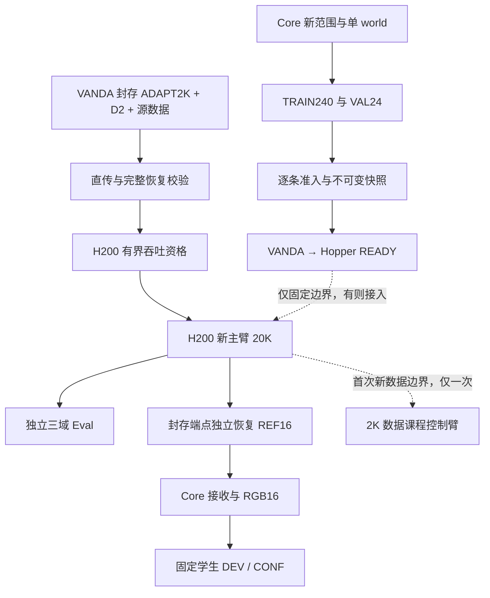

# SLA Corelab 采集 × Hopper H200 多源后训练 · V1

**计划日期：2026-11-21（Asia/Singapore）。Goal：`SLA-CORE-HOPPER-PARALLEL-V1`。状态：计划，尚非服务器执行回执。**

## 1. 决策与完成目标

立即建立两条独立的服务器任务链：Corelab 采集 Go2+ARX5 完整本体示范；Hopper 从已经封存的 **ADAPT2K** 完整状态启动新的 **`HOPPER-ADAPT20K-V1`**。H200 先用已经准入的 D2／R200／LIBERO 开训，不等待 A40 ADAPT5K、Corelab MIX、旧 Eval、旧 HOLD4 或新采集成功。VANDA 是已封存资产的交接站，**VANDA↔Hopper 直传不依赖 VANDA 的 GPU 训练作业结束**。

本轮有四个可分别验收的目标：

1. **工程完成**：H200 单卡完成正确的批处理、恢复及吞吐资格；原配方新增 20,000 步可恢复训练，真实访问和时间有据可查。
2. **数据完成**：Core 在最多 240 条 TRAIN 尝试中争取 120 条新合格完整轨迹，覆盖六指令、F1/F2 和不同几何；每一条通过原审计的轨迹都可入库，不等整套 Teacher 资格全通过。120 是目标，不是保证或开训门。
3. **科学完成**：固定端点离线诊断、独立留出数据和学生原生 DEV；首次新增数据接入时做一次有界配对控制，区分训练时长收益与数据课程收益。
4. **无人值守完成**：现场 Codex 将训练、传输、采集、Eval、收尾挂到实际 PBS／既有服务器持久服务。关闭本地电脑不影响其生命周期；首次挂载回执包含真实作业身份与依赖，不以本计划替代。

本轮仍是原生 MuJoCo 科学仿真。未授权真机运动；仿真积分速度、离线生成或暂停仿真成功都不构成连续实时机器人资格。

## 2. 为什么现在这样推进

截至用户提供的 **11 月 21 日 10:55 SGT** 现场快照：MIX2K 已封存、其独立 Eval 为 0；ADAPT 账本 2,350，最近完整封存 2,250；ADAPT2K 的独立评价 424/424、独立恢复 48/48。24 个到期闭合窗已全部及时闭合，但只有 **9/24 同时通过原 H40 和接缝门**，其余 15 条首超限为 P10 内夹爪速度。ADAPT0 固定 DEV24 抓持、抬升与任务成功 **0/24**，23 次非法接触 STOP，1 次 H40 拒绝。

这些证据支持“继续多源训练，同时增加真实消费证明的本体覆盖”，不支持仅靠增加步数就会解决碰撞。现有 D2 只有 26 条／2,031 窗；R200 与 LIBERO 的大窗口数不能补齐 Go2 腕部、桌面、干扰物和放置路径的覆盖。**ADAPT2K 的改善来自 D2 切换之前**；后继结果才能评价 D2。

原 A40 的 microbatch 1 每步串行 128 次 FM 前反向，加四次十步完整 H40 辅助反向。H200 的第一目标是减少串行小批计算和主机同步，保持 global batch 与损失定义。新 H200 谱系允许正常浮点差异，但不能改标签、缩短辅助反向、放松安全门来制造吞吐。

以上现场数字是用户快照；本次计划发布只核对 GitHub 源码、已公布报告与固定身份，未登录服务器刷新账本。来源见 [审计与依据](../../reports/WM02/sla-core-hopper-parallel-20261121/AUDIT_AND_PLAN.md)。

## 3. 独立任务图

实线是本角色必要前置，虚线是条件事件。**旧 A40／Core 训练完成、Eval 科学分数、新数据数量、所有 Teacher 单元通过均不在 H200 开训依赖中。** Core 仍只有一个已资格 physics owner；采集与学生评价在条件边界交替，不并发修改同一 world。跨站并行不等于跳过实际资源、所有权和完整恢复检查。

## 4. 固定起点、完整交接与实现改造

### 4.1 父端点和数据

父端点固定为 [ADAPT2K 公开身份](https://huggingface.co/datasets/leoyuer/sla-goal-v2-checkpoints/tree/5c460f195f6509f2f4da55dea32c356b45e00d37/ADAPT5K/step-02000-2bff547b6f2c)：

- HF revision：`5c460f195f6509f2f4da55dea32c356b45e00d37`。
- 相对目录：`ADAPT5K/step-02000-2bff547b6f2c`。
- 现场从该封存清单解析并固定完整 checkpoint SHA；目录中的 12 位前缀不能替代完整校验。**不可悄悄换成 ADAPT5K、MIX2K 或“最新最优”模型。**
- 恢复完整 **140 个模型／Adam／RNG 状态数组**及形状、dtype、树结构、优化器步数、随机与采样游标；携带同版冻结 SLA 底座、tokenizer、原状态／动作统计量与模型配置。父训练 ancestry 与新 `phase_step=0…20000` 分列。
- 起始 Go2 为 D2：26 条、2,031 窗；RoboDojo 为 R200：200 条、210,398 窗；LIBERO：1,261 条、209,146 窗。计数与完整哈希必须由封存资产回读，若与快照不符则该交接待查，不能换库凑数。
- 源域保持 SOURCE_NATIVE 各自标签、坐标、时钟、统计量和输入输出层；不得把 RoboDojo 的记录参考状态转换成 Go2 已执行命令。

### 4.2 直传与后台保管

使用现场已配置且获准的 VANDA↔Hopper 直连账号、路径和传输入口。历史 Hopper 作业证明站点曾可用，**不代表现在的 project、queue、GPU allocation 仍有效**；从现场现有 profile 核实，不猜 SSH 主机、账号或项目。

1. 读取封存源目录；传输任务不得读取仍在写入的“latest”。
2. 在目标文件系统独立 `.partial` 目录接收，验证精确成员、大小、SHA256、数组树与数据划分。
3. 完成真实 CPU 样本读取与全状态 restore；`fsync` 后在同一文件系统原子发布 READY。训练只读 READY 内容。
4. 冻结权重、本体数据和三域采样银行分别缓存；不把整个数据集塞进显存。不使用 `rsync --delete` 或删除旧 checkpoint 腾空间。
5. 新 Core 数据沿已经批准的 Core→VANDA 路径保管，再由 VANDA→Hopper 直传；不假设 Core↔Hopper 另有直连。
6. H200 新完整端点封存后直接回传 VANDA 冗余保存。HF 公开资产只用于核对或经许可的既有下载；新模型公开发布不是本轮开训／接续依赖，也不自动发布新私有数据。

传输和验证使用实际 CPU／传输队列或现有服务器持久服务，不依附笔记本 SSH。不用“nohup 已启动”作为退出登录后仍存活的证明；仓库历史已有 Hopper nohup 随登录退出而终止的记录。

### 4.3 必须修正的真实代码缺口

现有 `adapt5k_endpoint_transport.py` 只传 **29 个 Go2 推理参数数组**，并绑定旧 Goal、2K/5K 与旧 Eval；不能拿它恢复完整三域训练。`scale20k_portable_endpoint.py` 也不能未经版本化就当作通用 ADAPT2K 恢复器。旧 ADAPT 合同／worker 将 5K、数据银行长度和旧站点身份写死。

现场 Codex 应在独立执行 worktree 内完成以下有界改造：

| 改造 | 复用内容 | 新身份必须明确的部分 |
|---|---|---|
| 完整状态搬运 | 现有 SHA、成员校验、原子写入 | 140 数组、完整父 hash、三域头、优化器／RNG／游标、数据绑定 |
| 新 Go2 推理包 | 原严格 RGB16与codec | 新schema；独立恢复REF16；不再要求旧FORMAL424包装回执 |
| H200 20K 合同与 worker | 现有 ADAPT 训练、恢复、账本、site 验证 | 新 Goal／phase／LR／20K 银行／Hopper 本站绑定 |
| H200 批处理 | 已有预取、域末 loss 回读工程 | FM／aux microbatch、固定逐样本随机输入、加权归约、显存峰值 |
| Core 新采集入口 | 已有 Teacher、native ABI、G7、scorer | 新 scope／计划哈希／lease／人口，不伪装旧 HOLD4 |
| 持久接续 | 既有 PBS、Journal／onceIO、owner 机制 | 本 Goal 的有界角色、截止、封存触发和终态 |

使用 [机器计划](SLA_CORE_HOPPER_PARALLEL_V1_20261121.json) 中的固定代码来源。有选择地整合所需模块及依赖到从当前 main 建立的普通执行分支，记录实际可运行树 SHA；不盲合整个实验栈、不热改正在运行的 capsule、不另建大型调度器／账本体系。文档分支本身不包含已资格 H200 worker。

## 5. H200 高效率资格与正式训练

### 5.1 配方固定

| 参数 | 固定值 |
|---|---|
| FM global batch | Go2 64＋RoboDojo 32＋LIBERO 32＝128 |
| 域均值 FM 权重 | 2／1／1；按域均值，不能误按 microbatch 数加权 |
| Go2 辅助 | 每步 4 个完整 H40，原十步生成及全程反向 |
| 参数训练范围 | 原 VLM LoRA、完整动作专家、各域输入输出层；视觉骨干冻结 |
| 精度 | 原冻结权重 BF16、训练参数／梯度／Adam FP32；不加入 FP8 |
| 其他 | 原 25% 状态 token dropout、codec、P10、H40、接缝、安全与评分 |
| 本轮不混入 | 新 loss、OmniVGGT 对齐、变大 global batch、两卡并行、WBC 调参 |

从父账本读取最后实际学习率 `lr_start`，训练前固定新阶段余弦序列：

`lr(k) = 1e-6 + 0.5*(lr_start-1e-6)*(1 + cos(pi*(k-1)/19999))`, `k=1…20000`。

不重置 Adam；父最后 LR 与第一步新 LR 连续，optimizer step 保留祖先计数。LR 全序列哈希预先封存。控制臂使用主臂相同 phase 的 LR 前缀，不重新 warmup。若父账本缺失，先从父固定配置重建并验证最后实际值，不能任意填写。

### 5.2 有界性能候选

每候选从同一父状态重置，最多 16 次真实更新（4 次暖态＋12 次计时）；六候选共 96，另有一个 16 更新技术保留组，总上限 **112 工程更新、8 H200 GPU 小时**。OOM、编译失败、未提交计算都保留，不无限试参。

| 候选 | FM microbatch | aux microbatch | 目的 |
|---|---:|---:|---|
| E1 | 1 | 1 | 同 H200 原串行基准，固定原计算与同步顺序 |
| E2 | 4 | 1 | 减少 FM 调度与同步 |
| E3 | 8 | 1 | 扩大单次矩阵计算 |
| E4 | 16 | 1 | 每步三域只需 4＋2＋2 个 FM 批 |
| E5 | 最快合格 FM | 2 | 两路辅助批处理 |
| E6 | 最快合格 FM | 4 | 四路辅助批处理，保持原 remat 与十步反向 |

E6 不额外加入取消 remat 或精度变化，避免同一候选混杂多个改变。若 batch OOM，则该候选失败；不削减 global batch 或辅助数量。E2–E6可同时复用已有预取／域末回读作为同一明确登记的高效实现组合；它们的测速比较是整个后端组合，不将倍率归因于单一microbatch因素。数据预取从 4 worker、有界队列 2 个 global batch 起步，最多 8 worker／4 batch，保存固定采样次序和恢复游标；Python worker 数不改变训练样本和 RNG。

资格的reference固定为E1首步原串行计算，直接缓存该步已有loss／gradient，不另做未记账参考前反向。相同输入／逐样本随机数、相同父状态下，分别对三个域FM和aux的loss检查 `abs(candidate-reference)/max(abs(reference),1e-12)≤1e-4`，对各分项及总gradient检查相对L2≤`1e-3`（分母 `max(norm(reference),1e-12)`）；所有值有限，四个辅助槽完整。FM每个实际microbatch均值按 `m/B_domain` 累加，再施加2/1/1域权重；aux均值按 `m/4` 累加，保持原外部辅助系数。仍然一次全局clip／一次Adam，避免只查总gradient掩盖辅助归约错误。此数值门在测量前固定，不能根据候选成绩放宽。每个完整候选最多48条固定输出＋48条独立恢复，要求**同H200后端恢复输出48/48一致**。

不要求旧 A40 和 H200 长期参数逐位相同，也不要求当前模型的所有 H40 提案合格。报告原物理门结果与物理差值，**不沿用旧“跨卡等价已通过”的标签**。若资格不能证明新候选的正确性，就使用通过恢复的 E1；工程优化失败不得无限阻挡长训。工程后权重全部隔离，正式主臂重新恢复 ADAPT2K。

记录完整 `block_until_ready` 更新耗时、编译／首步／暖态 p50/p90、FM／辅助／数据／同步／保存时间、GPU 利用与峰值显存、主存、样本每秒、更新每小时。输入准备旧估计 12–18% 不是完整 GPU profile。按**完整更新 p50**选择最快合格后端，不按 DEV 分数挑后端。相对同 H200 E1 达到 1.5× 是优化目标；没达到仍可正常训练，不预报未经实测的 H200 倍率。

### 5.3 分段、恢复与计算上限

新主臂新增 **20,000 个逻辑 phase 更新**。每步 64/32/32，共目标 1,280,000、两源各 640,000 次正式优化访问；80,000 次训练内 H40。不得把祖先 ADAPT2K 的访问计入新增成果。

PBS 每段 walltime 按本站合法 queue 上限选择，最多 6 小时，至少为保存和退出预留 15 分钟；用已测 p90 推算本段更新上限，不凭空保证整段能完成。每 100 步或 30 分钟（先到者）封存可恢复状态；所有课程／评价边界另行封存。节点 local scratch 作缓存，真正恢复状态须写入持久存储。

已提交但未能恢复的旧后缀不能抹掉。允许最多 **256 次额外实际 Adam 重放更新**，与逻辑 phase 分开计数，保留丢弃后缀；超出则冷态终止该角色。另给最多 **32 次未提交 Adam 的失败更新尝试**，记录各域实际读取、前反向与生成，不能叫优化更新。OOM 候选和恢复故障共用相应工程／技术上限，不能凭重启清零。

主臂完成、Goal14天截止、总H200320GPU小时、真实项目grant失效／权限撤回会结束对应长期链；**单个PBS allocation截止只结束当前capsule**，后继在新的实际allocation中继续。`capsule_deadline=min(goal_deadline,current_allocation_deadline,segment_deadline)`，退出前保存可恢复前缀。320GPU小时包括本Goal新H200工程、训练、控制和Eval；不迁移或重置原A40／MIX账本。

## 6. Corelab 新数据采集

### 6.1 登记人口与数量

[人口文件](SLA_CORE_HOPPER_PARALLEL_V1_POPULATIONS_20261121.json) 固定逻辑 condition ID、任务、F 家族、scene family、seed 与请求上限。现场先用现有合法 scene builder 将数值几何绑定并封存：TRAIN 每家族 20 个布局，VAL／DEV／CONF 各每家族两个不同布局。布局随机数相同不代表场景相同；必须按实际几何键审查划分，避免仅换 seed。

| 人口 | 结构 | 最大请求 | 用途 |
|---|---|---:|---|
| TRAIN240 | 六指令×F1/F2×20 几何变体 | 240 | 新 Teacher 完整示范；80 HOLD＋160 PLACE |
| VAL24 | 六指令×F1/F2×2 留出布局 | 24 | Teacher 留出数据，不训练、不用于选采集参数 |
| DEV24 | 六指令×F1/F2×2 独立布局 | 每登记模型 24 | 配对学生闭环，不回流 TRAIN |
| CONF24 | 六指令×F1/F2×2 新布局 | 最终 20K 一次 24 | 最终确认；不替换旧 TEST |
| TECH2 | 两条单独登记 HOLD | 2 | 接口验证，不计正式成功率或示范库 |

TRAIN／VAL／TECH每个condition跨所有producer版本最多一次实际原生请求；DEV／CONF每个 `(condition,endpoint)` 最多一次。**请求已经初始化或积分后发生技术中断也消耗本条件和总原生预算**，不能排除出上限或换producer重跑。前置校验明确0请求时可修复后执行尚未消费的槽。所有实际请求进入总458上限；科学有效条件、技术失败、接口条件另列结果分母。

TRAIN最多240条实际原生尝试，技术中断也计已派发槽。争取120条合格示范，至少40HOLD、80PLACE、每F×任务单元至少5条；达到这些目标可提前结束TRAIN，否则运行到人口／时间上限，**TRAIN达标不取消VAL**。历史采集15次只准入3条，因此 **120不能被当成必然产出**。优先交错覆盖F1蓝HOLD、F2红HOLD、红左放、蓝右放，同时维持六任务轮转，不能把预算全耗在最容易的红HOLD。

几何设计优先覆盖物体相对位置／间距、腕部靠近侧、桌面净空、携物绕行、左右落区与目标yaw。只能在现有模型合法范围内生成；scene builder和生成算法／全数值人口哈希在首次原生运行之前固定。不存在合法几何的身份标记`STATIC_INVALID`，不得看过学生成绩后换成更容易条件。冻结旧TEST仅可读取身份做去重，不读取结果。

为避免VAL在48小时冻结时尚未排到，前48个专家条件槽固定为 **TRAIN12→VAL12→TRAIN12→VAL12**（就绪学生仍可按公平规则插入），之后继续TRAIN。VAL的producer版本及参数在第一条VAL前冻结，此后不因VAL失败修参或补挑轨迹；TRAIN的后续producer修复不追溯修改VAL。

### 6.2 Teacher 改善、准入和故障处理

不要等所有 Teacher 单元通过：某条完整原生轨迹若 `TASK_SUCCESS`、G7、逐捕获 RGB/H40、实际 P10 消费证明、时间／frame／统计支持／划分全部合格，即可准入。失败轨迹保留为失败，不作为正例 BC；未消费后缀不改写成已消费动作。窗口沿现有 G7 masks 导出。

先修复旧 HOLD4 暴露的**计划与 scope 绑定**入口问题：建立本 Goal 新的合法执行卡和 owner；不能改回执字段冒充旧范围，不复活过期 watcher。旧 HOLD4 的 0 请求保留；其修复验证不成为新人口前置。

每个 F×指令单元若连续两次出现同一 producer 版本、同一首失败机制，暂停该版本在该单元的新派发，检查具体几何／接触／控制轨迹。每单元最多两个有原因、有静态检验的新 producer 版本，使用后续**尚未派发条件**；所有原失败留存，全部请求计入 240。不要重跑有效科学失败来挑成功；若修复仍失败，该单元封存，其余单元与 H200 继续。

仅在版本变化时验证受影响接口，复用原 WBC、腿策略、完整 H40／接缝、STOP 和评分。STOP 后积分必须为 0。未知写入先查 native request／owner／终态，不能盲重发。零请求的技术入口失败与已积分的科学失败分开。

### 6.3 原生资源与时间预算

保持已资格 N1 单 world。N2 的旧状态容差和 STOP 同伴隔离尚不完整，本轮不把多 world 当默认吞吐。按原始任务时限 HOLD60秒、PLACE90秒及最多 5,703 初始化 tick：

| 任务 | 每请求最大 tick | 每请求最大查询／生成 |
|---|---:|---:|
| HOLD | 35,703 | 120 |
| PLACE | 50,703 | 180 |

若现场实际初始化不能在该上限内完成，修复／停止该入口，不偷偷扩大预算。每条件另受原 timeout 和本 Goal 截止约束。Core 调度最多连续 12 条采集条件后运行最多 6 条已就绪学生条件；无已就绪学生则继续采集。正在执行的条件不因新模型到达中断。日志、视频与审计可用独立 CPU worker，但只有一个物理积分 owner。

## 7. 数据快照和在线课程

完整episode即刻封存；每新增4条合格TRAIN或距上次发布6小时，发布一个累计不可变快照，只有新成员时才发布。小于4条也可到时发布，不能等够整套任务。**发布/转运是producer增量事件，不等TRAIN240全部结束，任何VAL24终态也不阻塞TRAIN快照。** VAL始终独立，不能混入TRAIN。

H200 只在 phase **2K、5K、10K、15K** 边界查看已 READY 的最新合格 TRAIN 快照。边界先封存当前父状态，再固定成员、银行、配额和 hashes；新数据从下一步生效。没有新数据时 `NO_NEW_DATA_CONTINUE`，立即沿旧版本训练，不等待传输或采集。

沿用任务→episode→阶段→窗口的已有分层采样和阶段一半关键、一半普通的定义。原 23 条 legacy 集合永久固定；Go2 每步新旧配额：

`q_new = min(48, 4 * N_nonlegacy_complete_episodes)`，`q_legacy = 64 - q_new`。

D2的三个nonlegacy episode给出 **12新＋52旧**；更多本体数据接入后至多48新＋16旧，RoboDojo／LIBERO始终各32。不得把“关键阶段”全部改称闭合槽，也不得按大量重复帧冒充新增episode。两源完整20K采样银行在主臂启动前冻结；每次数据课程只生成目标域新银行，源索引、noise和游标不受目标采样随机调用次数影响。

若现有reader对重复scene SHA的处理会拒收同一布局下不同任务，先按有provenance的 `(scene_id,instruction,episode_id)` 身份版本化准入并作定向测试，仍拒绝重复native capture来源或完整内容仅换ID的重复入库；**不得通过改scene SHA或复制轨迹制造独立场景**。同scene family的六任务使用相同环境reset seed，并回读实际初始几何一致；每次真实请求身份独立。报告独立场景数和轨迹数两种分母。数据切换不重置Adam／全局RNG；新段银行从封存随机游标和明确版本派生并持久保存。

冻结统计量与 codec。新成员超出既有表示支持时隔离不兼容成员并记录机制；能独立证明剩余成员合法才形成明确的新子集，否则拒绝该快照。没有合格新版就沿旧版继续。扩展 codec／动作空间／统计量需要另一版本实验，不在长训中热改。

## 8. 一次 2K 数据课程配对控制

第一次在边界 `b∈{2000,5000,10000,15000}` 实际接入本 Goal 新 Core 数据时，保留边界前共同完整父状态。主臂用新快照运行到 `b+2000`，额外封存配对端点；控制臂从同一父状态，用切换前目标数据运行同样 **2,000 更新**。它测量的是**新增数据＋预登记采样配额课程整体效果**，不声称纯 episode 数量因果效应。

两臂使用相同H200后端、学习率phase前缀、源域样本序列、逐样本随机输入规则、64/32/32与辅助定义。控制臂逐字复用主臂 `b+1…b+2000` 的两源索引、noise与游标记录；不能因新目标银行多消耗RNG而重抽源。主臂的这2K区间不得再接另一个快照；登记边界间距保证这一点。双方目标episode身份有意不同，不能要求目标样本相同。主臂在`b+2000`的已完成前缀直接复用，不重跑一条“主对照”。

控制臂只触发一次，实际最多 2,000 更新。可在独立可用 H200 排队，只有一张卡时放在主臂完成之后；**主臂不等待控制或其 Eval**。至 15K 边界还无新快照则 `NOT_TRIGGERED_NO_NEW_SNAPSHOT`，不把预算挪给新 loss。主臂不足 `b+2000` 或截止前控制未完成时，配对结果标缺失，不能用不等暴露比较冒充固定 2K 对照。

## 9. 独立评价与闭环证据

### 9.1 固定评价端点

主臂 phase **0、2K、5K、10K、20K** 各一次；15K 用于数据切换与恢复，不另加一套正式 Eval。条件配对最多另加主臂 `b+2000` 和控制 2K 两端点，共 **最多七端点**，重复身份只评一次，不可因得分更好追加候选。

每端点保留原三域 288、原阶段诊断 88、独立恢复 48，即 **424 次生成**。原目标面板及 88 阶段窗若来自 TRAIN，只报告拟合／时序诊断，不能称新留出泛化。RoboDojo／LIBERO 保留原划分，分别报告源能力遗忘。

新增VAL24不参与训练与采集参数选择。它的数值场景先封存；在24条全部终态或T0＋48小时（先到者）冻结实际可用验证集，之后不补挑成功轨迹。每条合格完整VAL轨迹最多选择四个不同capture：最早合法APPROACH窗、最早P10包含原标注到期闭合事件的窗、最早合法抬升/搬运窗、HOLD最早完整保持事件对应窗或PLACE最早释放事件对应窗。只依原专家label/阶段/原生事件确定、时间并列取最早capture；若事件附近没有合法窗口或多阶段选同capture则缺项，不补挑。选择函数、阶段映射与其哈希在任何该面板模型预测之前封存，总上限96。不足如实报告，不拿TRAIN填满。主臂不等待这些窗，可对封存端点稍后补固定VAL附录。

每端点报告 timely／H40／seam 联合通过、P10 内夹爪速度和加速度、闭合时刻误差、任务阶段误差、源域遗忘。**22 mm 闭合诊断不是抓持成功。** 不因联合科学指标未达到阈值而阻断健康训练后继；保存结果供同一固定实验解释。

### 9.2 Core 接收与学生请求

每登记模型部署前，使用**新schema的Go2推理包**绑定本Goal、完整端点seal、固定RGB输入／ordinal／noise、tokenizer、冻结底座及统计量。Hopper16参考必须由该封存端点在独立推理进程冷态加载后生成，不能用训练进程RAM或旧端点缓存；Core16沿用原严格迁移比较与物理门。每包最多Hopper16＋Core16＝32生成，不修改旧BF16／跨卡REJECT。

完整seal并行触发三域Eval和上述REF16／部署分支，**学生部署不再依赖旧FORMAL424包装完成**。不得伪造旧formal／restore回执；424/48未完成就标`OFFLINE_EVAL_PENDING`，只汇报实际RGB16与学生分母，不宣布三域保留或48/48恢复通过。源Eval缺包等局部工程故障只阻塞该Eval；已知checkpoint损坏、父身份或统计量错配等共同完整性故障则冻结所有受影响端点及其下游，不能以并行掩盖错误。

严格RGB16失败只暂停该端点学生派发；采集、未受影响的训练和离线Eval继续。允许在既有技术保留内修复实际序列化／RNG／环境差异，不能放宽物理门来放行。

主臂五端点使用同一新 DEV24，最多 120 条学生条件；20K 最终端点再用新 CONF24 一次，共144。一次配对主／控各 DEV24 可再加48，总 **192 条学生科学请求**。新DEV/CONF身份不得覆盖原ADAPT0 DEV24、原96计划或旧TEST。缺少20K时 CONF 不以其他端点替补。

科学分母按任务、F、布局报告：正确目标抓持、抬升20mm、持续1秒、底座定向80mm、完整任务、首次非法接触部件、提案H40拒绝、未安装、预算耗尽、技术失败及STOP后tick。PLACE必须完整正确区、桌面支撑、释放、开爪≥0.9、撤离≥50mm及速度<20mm/s稳定≥1秒，复用原scorer，不用宽度或到区替代完整成功。

最终确认是有限新人口证据，不是正式 TEST 或长程语言规划证明。若最终仍0抓持，应以实际失败相位和数据覆盖解释，不以训练 loss 下降宣称适配完成。

## 10. 全局上限与账本定义

所有上限来自同一 [JSON 计划](SLA_CORE_HOPPER_PARALLEL_V1_20261121.json)。未触发、不完整和失败各自如实计数，不能按上限预填实绩。

| 更新类别 | 最大实际 Adam 更新 | Go2访问 | RoboDojo访问 | LIBERO访问 | 完整训练H40上限 |
|---|---:|---:|---:|---:|---:|
| 主臂逻辑20K | 20,000 | 1,280,000 | 640,000 | 640,000 | 80,000 |
| 条件控制2K | 2,000 | 128,000 | 64,000 | 64,000 | 8,000 |
| 工程含技术组 | 112 | 7,168 | 3,584 | 3,584 | 448 |
| 断点丢失后缀重放 | 256 | 16,384 | 8,192 | 8,192 | 1,024 |
| **总上限** | **22,368** | **1,431,552** | **715,776** | **715,776** | **89,472** |

最大优化访问2,863,104；另有最多32次未提交更新尝试，对应最多4,096次额外FM输入、128次训练H40生成尝试，单列，不冒充优化更新。失败／部分生成照计尝试，并同时记录完整数。

| 非训练生成／原生项 | 上限 |
|---|---:|
| 工程固定输出与独立恢复（七组×96） | 672生成 |
| 正式原面板（七端点×424） | 2,968生成 |
| 新VAL附录（七端点×最多96） | 672生成 |
| 七个部署包（各16＋16） | 224生成 |
| 学生192条件（64 HOLD＋128 PLACE） | 30,720生成 |
| TECH2独立学生HOLD接口 | 240生成 |
| 额外失败／中断评价与部署技术尝试 | 128生成 |
| **全部新模型生成尝试合计上限** | **125,224**（含训练、失败更新、重放） |
| TRAIN240＋VAL24专家查询 | 42,240次；专家规划查询不混算学习模型生成 |
| 科学原生请求 | 456（240 TRAIN＋24 VAL＋192学生） |
| 含TECH2原生请求 | **458** |
| 科学原生tick | 20,840,568 |
| 含TECH2最大原生tick | **20,911,974** |

技术保留不是额外的成功重试人口。到限前预检所需剩余额度；达到上限则封存该角色，不自动挪用旧Goal、CLOCK、M2、D4/D5/J或历史未派发条件。

## 11. 服务器自治、接续与停止

首次实际挂载时间为T0，持久化一次，Goal截止为 **T0＋14天**；重启不重置。H200总320GPU小时，按实际持有GPU数量×墙钟时间累计，包含编译、恢复、保存和持卡等待，不只算暖态更新。Core单world受固定人口／tick／查询及14天限制。单个PBS allocation／queue时限只限定当前capsule；每段真实分配后的截止取 `min(goal_deadline,current_allocation_deadline,segment_deadline)`，保存退出后后继可在新allocation接续。真正project grant失效、授权撤回、总额度或Goal期限耗尽才停止相应长期链。Core租约按现场原规则合法续接，不把用户目标伪造成集群额度。

现场 Codex 自主完成用户空间代码、路径、序列化、依赖环境、计划／scope、恢复、owner生命周期等可逆修复，然后提交真实后台任务。无须再为每项小修复索取GO。只有实际账号／资源授权缺失、无法安全归属的活动owner等真实边界才阻塞相应角色；清楚写出缺项，其他已具备条件角色继续。

每个有限PBS capsule只恢复自己的已封存前驱、写自己的终态与接续。不能仅因前驱退出0就假定已到预定步；受控保存退出也不能被 `afterok` 误判成全链失败。复用现有Journal／onceIO按实存phase发布唯一后继，启动时验证父seal、实际allocation、站点GPU UUID、deadline和剩余额度。

`UNKNOWN`作业／不确定写入先读scheduler、日志和终态核对；不重复提交同role。PBS队列中已有正确后继则复用；健康旧A40与其他人的GPU作业保持。Core若旧训练占用特定GPU，只记录资源局部阻塞，使用实际空闲且获准的渲染／推理资源；**不把“必须等旧训练完成”写成依赖，也不抢占未知资源**。

训练后继与独立Eval同时放行，后继不等待Eval科学分数。无独立Eval GPU时将Eval放入可用授权队列，或本H200封存段间的有界评价窗口；不要求新增第二张H200。控制臂低于主臂优先级。传输验证在CPU队列完成，不占着H200等待大文件。

复用最少持久材料：执行manifest（代码／计划／资源／时间／父数据）、更新账本、数据／checkpoint seal、每角色RESULT。保持原onceIO与唯一owner，不新增并行调度系统。私有资源路径、原始RGB、权重、WBC资产、凭据不写GitHub；只发布可追溯统计和固定公开引用。

挂载完成必须回读：实际PBS job ID／状态／依赖，Core持久服务与owner，T0／deadline，启动代码SHA，父checkpoint与数据hash，断开交互后服务仍存活的证据。每日或每完整端点由服务器发布有界摘要；无须本地实时监控。完成／截止时保存、退出子任务、关lease、释放owner；不要终止无关任务。

## 12. 故障时继续哪条线

| 情况 | 本角色动作 | 继续的角色 |
|---|---|---|
| VANDA GPU训练仍运行 | 从已封存ADAPT2K和D2直传 | Core采集、H200资格／训练 |
| 新Core数据未准入／未到 | 固定边界记录NO_NEW_DATA_CONTINUE | H200旧数据长训、其他采集单元 |
| 大microbatch资格失败 | 回落合格H200 mb1 | 正式训练、数据生产 |
| H200实际资源尚未分配 | 留在真实PBS队列，CPU完成交接 | Core采集和数据审计 |
| Core同一单元连续同因失败 | 修producer或封存该单元 | 其他单元、H200训练 |
| RGB16迁移失败 | 该模型学生分支停在部署资格 | 采集、训练、离线Eval |
| Eval源包或依赖缺失 | 修复本Eval，不伪造结果 | 训练后继 |
| 控制臂排队／未触发 | 如实记录，不改主臂 | 主臂、采集、正式Eval |
| integrity／非有限梯度／STOP后仍积分 | 停止受影响角色并封存证据 | 仅经证明独立的其他角色 |
| 总期限／计算额度耗尽 | 保存实际完整前缀，停止本Goal后继 | 原有其他Goal保持其原授权 |

## 13. 启动与验收顺序

**最先执行（不等旧训练）：**只读核对现场owner和现有PBS，建立新Goal T0与预算；同时启动VANDA→Hopper封存资产CPU交接与Core新人口数值绑定／采集入口修复。随后Core开始TRAIN240／VAL24，H200完成有限资格后从原父状态正式训练。

**首个可检查里程碑：**真实后台挂载回执、140数组恢复、D2/R/L真实读取、一个完整H200更新与独立恢复、第一条新Core原生条件终态。它们是实际结果，不能预先填写。

**后续固定里程碑：**H2002K／5K／10K／20K离线与部署队列，2K／5K／10K／15K数据决策，首个新增数据边界的配对对照，最终CONF与终态收尾。H200每阶段不等任何科学分数通过。

完整启动指令见 [Codex接续入口](../handover/2026-11-21/START_SLA_CORE_HOPPER_PARALLEL_V1.md)。本次GitHub发布只交付计划；应由具备现场连接的Codex按该指令真正提交后台任务，再发布首次挂载实绩。
