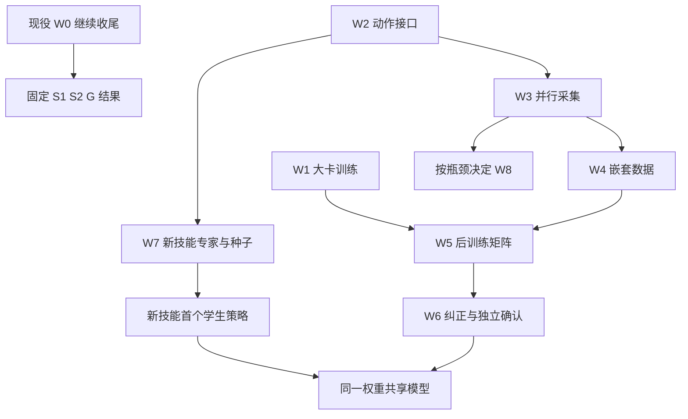

# SLA＋冻结 WBC：A40/H200 后训练、并行数据与复杂技能推进计划 V2

日期：2026-11-12，Asia/Singapore。状态：**PLANNED，待执行端按实际进度采用**。

本计划响应用户“给出详细实验推进计划，推送到 github”。目标是交付有独立闭环成绩、可普通 RGB 部署的上层 policy，并逐步扩展至开门和书架操作。发布文档不是训练、仿真或部署结果；本次只提交计划、实验矩阵与执行交接。

**当前事实基线：**[执行 PR #378][pr378]，HEAD `353bcdd1774d5f9fcbbc6d9a581d628428245bc0`，最后更新时间 2026-11-12 21:44:53 SGT。本计划写作时通过 GitHub PR collection 与实际回执核对；未把仓库快照当作服务器实时状态。文档分支从 main `6843163d641eb24a29c3b1557f868765346ba66c` 建立；main 尚未集成整条执行栈。

配套：[机读实验矩阵](SLA_GO2_ARX5_SCALEUP_V2_20261112.json) · [Codex 接手 prompt](../handover/2026-11-12/SLA_SCALEUP_V2_CODEX_START.md)。JSON 是研究计划，`execution_ready=false`，不供运行器直接当作已具备现场输入的作业配置。

## 0. 要得到什么结果

近期交付是一版在 Go2＋ARX5、冻结 WBC、body＋wrist RGB 下能执行抓取与放置的上层策略。最终交付是一份共享权重，在明确范围内完成抓放、推物、无锁柜门开启和单书指定格放置；连续整理多本书、主动走到门前和实机部署分别另立目标。

每份候选必须同时交付：模型/adapter 与处理器版本、普通 RGB 推理包、训练数据与优化预算、固定人口的逐条件闭环成绩、失败机制和实际成本。训练 loss、静态测试数、PR 数量、专家回放成功均不替代学生策略任务成功。

本计划安排三个可独立推进的工作方向：

1. **当前实验收尾：**保留 S1→S2→G 的既定比较，交付完整结果。
2. **训练与数据扩展：**单大卡真实 batch、原生多 actor、统一动作接口、嵌套数据与有限训练对照。
3. **新技能：**柜门和书架的物理可行专家、10–30 条种子、首版 learned policy，再按失败扩量。此线不等待 S1 赢过 GR00T，也不等待先凑满 1,000 条抓取数据。

若现有 GR00T 更好，任务推进使用实际更好的可部署候选，SLA 保留为有明确预算与假设的研究分支。不把“必须证明 SLA 更好”设成交付前提。

## 1. 已知事实、未知项与现役衔接

### 1.1 已有结果

| 项目 | 已核验状态 | 本计划如何使用 |
|---|---|---|
| SLA 目标数据 | 100 episodes、1,500 captures、1,450 专家窗口；50 干预记录在普通 BC 外 | 原数据与 mask 保留，不把 16,000 次访问称为新增示范 |
| S1 | 500 次真实更新、16,000 访问；完整恢复与独立进程 RGB 重建通过 | 复用固定端点，不重复训练它 |
| S1 TRAIN4 | TRAIN01 为 raw gripper 越界拒绝；TRAIN07 为初始化技术失败；TRAIN13/25 未运行 | 两个原终态保留，只接续真正未执行条件 |
| S1 执行入口 | 唯一一次 SLA 查询后，候选 H40 消费数为 0 | 优先诊断动作输出域；不能归因为 WBC 跟踪或抓取失败 |
| 固定 TRAIN 探针 | XYZ RMSE 5.674→1.266 mm；500 步完整夹爪范围合法 4/16，越界点 193/640 | 平均拟合改善与输出可执行性分别分析 |
| 资源 | 最新提交已有有限后台 waiter，状态 WAIT_ORIGINAL_GPU_HOST_CAPACITY | 后续先读同一个队列/worker，不新增重复执行者 |
| S2 / 新 DEV | S2 更新 0；S1 DEV16、G DEV16 均未运行 | 不以教师准备、输入注册或 CPU 测试计完成 |
| GR00T | 旧 SFT2000＋basis TRAIN4 有完整 4/4 回执；官方 A500 4/4 已报告且包已绑定 | A500 详细训练/逐条件终态补齐；G 作为工程参考 |
| 训练与采集实现 | learner 单 GPU、micro1×accum32；native panel 串行，当前相机使用 CPU 软件渲染 | 大卡与多环境需要有针对性的实现改动 |

证据：[S1 终态][s1]、[固定探针][probes]、[TRAIN4][train4]、[后台队列][queue]、[G 准备][gprep]、[旧 GR00T 完整 TRAIN4][g-old]。

### 1.2 不预填的现场条件

以下尚未在本轮确认：A40/H200 实际可用数量与时段、CPU/RAM/本地存储、站点软件组合与图形能力、新柜门/书架资产在目标 WBC 下的可行性、并行端到端吞吐。对应字段由实际执行端填入，不能根据显卡规格推算已经具备多少环境。

NVIDIA A40 为 48 GB GDDR6，H200 为 141 GB HBM3e；规格仅支持容量规划，不支持推断本项目加速倍数。[A40 官方规格][a40]、[H200 官方规格][h200]。

### 1.3 当前队列先查效果，再接续

现役 waiter 的仓库回执记录：首轮资源准入期限 2026-11-13 09:39:50 SGT，总队列期限 18:39:50 SGT；它只负责 TRAIN13/25→固定新 DEV16→S1 交付。执行时重新读取实际 owner、进程、已注册 group、输出与有限期限。已有排队/运行/效果不明的同一任务，不另交第二份。

原生执行源与 PR 最新 HEAD 可以不同；在途任务消费自己的固定 source，禁止为追上 GitHub HEAD 而热改。资源等待期间可做独立代码、数据、教师和已分配大卡的工作，不把 Core 心跳变成其他站点的控制依赖。

新计划只规定后继设计，不修改现役协议的科学定义或现场权限。正常用户空间工程修复、只读核查和本计划已授权的文档发布无需逐项再问；后续计算使用执行端已有合法资源与授权。沿用现有任务所有权与记录方式，不新增审批系统或平行账本。WBC 权重、增益、代价、solver、腿策略、2 ms 物理和原硬安全继续冻结。[仓库工作流][workflow]、[V7 工程原则][v7]。

## 2. 工作包与依赖

| ID | 工作包 | 第一项实际交付 | 推进依赖 |
|---|---|---|---|
| W0 | 现役 S1/S2/G 收尾 | 固定人口的完整终态表 | 当前实际队列与资源；S1 不必成功才可报告 |
| W1 | A40/H200 单卡与 batch | 真实梯度/恢复/部署及吞吐数据 | 单张实际分配 GPU、原模型与数据可读 |
| W2 | 动作域与轨迹接口 | 可执行的新夹爪/轨迹合同及最小学生闭环 | 先用旧预测定位；原 WBC 不变 |
| W3 | 原生 actor 与持久服务 | 合格示范/小时、无跨环境污染 | 独立世界、CPU/RAM、可靠任务专家 |
| W4 | 扩量数据 | D100_new⊂D300_new⊂D1000_new 与覆盖表 | 冻结同一任务集合、时间接口和采样支持域 |
| W5 | 有限后训练矩阵 | 4 个 D300 对照＋2 个数据规模端点 | W1、W2 与相应数据版本 |
| W6 | 纠正数据与确认 | 匹配续训对照、三 seed 最终模型 | 学生已能执行、专家能纠正其偏离状态 |
| W7 | 门、书与共享技能 | 每技能首个 learned-policy 成功，再共享策略 | 各自任务可行性；不等待其他技能通过 |
| W8 | GPU 仿真后端（条件性） | 同命令物理/任务一致性与吞吐收益 | 原生 profile 证明值得迁移 |

工作包的“通过”是具体科学/工程条件，不是新的人工审批层。满足已写清的条件后直接推进下一项有限实验；遇到真实阻断，保留事实并继续不受影响的方向。

## 3. W0：完整交付当前实验

按审计快照，尚余预算如下；接手后扣除实际已经完成的条件，不能按表机械重跑。

| 项目 | 新训练 | 尚余原生条件上限 |
|---|---:|---:|
| S1 固定500 | 0 更新 | 2 个未运行 TRAIN＋16 DEV＝18 |
| S2 固定500 | 500×32＝16,000 访问 | TRAIN4＋DEV16＝20 |
| G 官方 A500 | 复用原包，0 更新 | DEV16＝16 |
| 合计 | **500 更新／16,000 访问** | **54 条件** |

S2 从原 SLA_base 和相同公共初始化独立开始，不能从 S1_500 再训500。教师只读当前同一对 RGB；需要真实空间梯度进入部署保留的 VLM LoRA，并证明 alpha=0 的公共更新与 S1 对应。教师缓存身份绑定输入图像、预处理、相机顺序、mask 与 teacher revision；部署移除 teacher/projector。

保留既定 S1→S2→G 执行顺序。硬件发生变化时记录为因素，不默认跨硬件 bit-exact，也不把有未解释设备差异的两臂宣称为纯空间监督归因。若某臂仍资源阻断，明确 NOT_RUN；不借新计划伪造现役完成。

G 采用已绑定 A500 包。补齐其真实500更新和四条件终态摘要；不重做已完成训练，也不以旧 SFT2000 4/4 代替 A500 结果。G 是不同预训练和参数结构的系统参照，机制结论主要来自同 SLA 父模型内部对照。

W0 交付：逐条件状态、各方法主任务成绩、有效策略拒绝/技术失败/未运行分开、首失败机制、推理与物理成本。无成功也是完整可报告结果；后继改进不能回写本轮失败。

## 4. W1：先把单张大卡用好

### 4.1 资源分工

| 实际资源 | 起步方式 |
|---|---|
| 单张 A40 | 先 learner 与教师特征计算；采集与训练错峰，或 CPU 专家 actor 独立进行 |
| 单张 H200 | learner/teacher/批量推理；相机后端按实际兼容性选择，保留 CPU 采集可用路径 |
| A40＋H200 | H200 learner/teacher，A40 推理或经验证的图形采集；异步交换数据与固定策略版本 |
| 多张同类卡 | 优先独立实验、teacher、actor 分工；只有单卡 learner 成为已测瓶颈才做同构多卡训练 |

不把 A40 与 H200 先绑成同步异构训练组，不把两张卡的显存直接相加。H200 可训练不代表直接支持 Isaac Sim RTX 相机；若换后端，检查其图形要求。[Isaac Sim 要求][isaac]。当前原生软件渲染不会自动转到 A40。

### 4.2 最小实现

当前 `runtime_v1.py` 强制单 GPU，循环32个单样本并同步。新增可配置 microbatch 和数据预取，先保持 effective batch32：`B = device_count × microbatch × accumulation`。每个样本独立的 noise、flow time、state dropout 由稳定 sample/cursor 身份派生，不能让整个 batch 共享随机数。[当前 runtime][runtime]。

创建实际站点 profile，替代 Core 型号/路径硬编码；保留原 profile。记录 GPU、环境、模型/数据/cache 路径和可用 CPU/RAM；使用节点本地缓存和实际允许的存储路线。没有数据供应时不以更大卡掩盖 reader 问题。

只缓存冻结计算：可预处理 tokenizer/固定图像，可离线提取冻结 teacher 特征；VLM 有 LoRA，不能缓存 VLM 输出。SigLIP 缓存只有在输入预处理不变且梯度等价成立时采用。图像增强若改变像素，旧 teacher feature 不能继续当对应标签。

### 4.3 有限测量与验收

每种实际采用的硬件先测最多3个 microbatch 点：1为基线，再按容量选4/8或8/16；必要时以32替换一个候选点，不展开大网格。每点2个 warmup＋8个计时更新，共最多30个非候选更新。另做连续4与独立2＋2恢复，以及一次 serial/batched 有效batch对照，最多10个资格更新；最多32次固定TRAIN普通RGB生成。**每卡起步最多40更新／1,280访问，计入真实消耗，不晋级候选。** 已有同源证明复用，不对每个batch重复全套恢复。

新同卡 batch 对照预先采用：scalar loss `rtol=1e-3, atol=1e-5`；非零合并梯度 cosine≥0.999、相对L2差≤0.02，固定样本与逐样本随机流。极小/零梯度单列；跨卡自由生成只报告数值与物理动作差异，不套用未经证明的逐位要求。若对照超限，先定位 RNG、归约、精度或数据顺序，不能看 DEV 后放宽。

验收为：真实 forward/backward/update、冻结参数不变、完整状态恢复、普通 RGB 无 teacher/cache 部署、batch 数值对照、实际 throughput 和显存。至少报告稳定 samples/s、有效update/s、加载/JIT时间、GPU峰值、CPU等待；无加速也应交付原因。

显存不足时可减 microbatch、增累积维持 B32，不暗改 H40、RGB224 或参数范围。新硬件通过后立即做正式端点，不继续扩充通用资格框架。

## 5. W2：先让模型动作能被正确执行

### 5.1 夹爪范围：一个主要后继方案

先读取已保存的0/250/500共48条预测，按阶段统计端点/中间点违规、上/下越界幅度、raw与实际basis轨迹的合法率。预算为0新推理、0更新、0积分。TRAIN01末点合法但4个中间点越界，原 consumer 会先检查全部raw40点，随后只保留末点；需要把这两个检查域讲清楚。[原始回执][train4]、[endpoint实现][basis]。

首选后继 **GRIP_LOGIT_V2**：保留原nominal标签，派生`g_epsilon=clip(g,1e-4,1-1e-4)`、`z=logit(g_epsilon)`，模型在对应归一化latent上做FM。固定解码顺序为**inverse latent normalization → stable sigmoid → 原nominal-to-physical夹爪映射**，reader/provider不得重复转换。有限输入下输出位于[0,1]；NaN/Inf仍拒绝。状态输入中的actual gripper与物理anchor不做该动作变换。

这是显式的新动作表示，0/1标签的端点偏差最多1e-4 nominal，**不是完全可逆的原命令转换**。新表示的label往返显式允许该偏差，旧合同的精确标签审计不放宽。保存原label与派生label；在TRAIN边界样例和原生专家夹持中确认偏差不破坏原任务语义。若该方案不适用，记录原因后提出一个替代方案，不并行堆多个隐藏clip补丁。

初始比较复用原S1_500为R0，只新增R1：同父、原TRAIN100、500更新×32＝16,000访问、同PEFT和明确新gripper统计；没有新增空间loss。固定8个新的TRAIN诊断条件/方法，共16条件。原S1历史结果不重算。需要的是新R1实际被WBC消费的证据及完整任务结果，不以数学有界替代policy成功。

若R1和R0在新诊断中都可执行，选取满足原任务、数据语义更清楚的合同；后续所有SLA比较臂使用同一合同。此阶段不声称夹爪表示改进就是SLA空间预训练收益。

### 5.2 复杂路径与反馈节拍

当前H40为40个50ms参考，完整消费2s后才重观测；2ms是物理dt，并不是高层视觉反馈频率。当前endpoint basis将中间路径换成起终点直线＋SLERP，不足以保存门铰链弧线或书架避障路径。[时钟协议][v1]、[basis][basis]。

后继 **EEF_STREAM_V2** 首选：保留H40预测、50ms参考和2ms物理，实际执行10点/0.5s后重观测，使用可保留中间SE(3)路径的参考消费与时间一致连接。0.2s/4点仅在接触反应仍不足时作为第三个候选节拍；baseline为现有2s。

**高层重规划与底层reference续期分别计时。**原reference有效期为0.4s，原生路径在不超过0.35s时续期。新0.5s策略查询仍沿用该续期：滚动同一个已认证预测的后缀与规定的安全终端参考，不产生第二次SLA查询，不将TTL改成0.5s。每次新H40安装前仍完成原整段参考检查与ACK。不能把query cadence直接当成reference refresh cadence。[原续期实现][renewal]、[TTL合同][reference]。

不得每次截取旧2秒quintic的起始几步后重新起步。参考连接需要保留已消费边界、控制速度/加速度不连续和夹爪事件；无效参考仍由原约束拒绝。实现不能再把整条预测自动拉成起终点直线。

先用同一专家做4布局×2重启×2节拍（2s/0.5s）＝16个原生条件；接触反应仍不足时才加0.2s的8条件，总上限24。统计完成、停滞、抖动、跟踪/接触、walltime和标签可用率。若2s已经满足该任务，不强制缩短；若某节拍违反原控制约束，先修连接再做有证据的新版本，不改WBC增益。

训练标签从其后实际被专家/WBC消费的名义命令序列重组H40。跨query/anchor的每个knot先按原issuing query、frame/TCP和变换还原到统一名义坐标系，再表达为**本训练anchor**的frame/TCP/rotation约定；保存原query/anchor与变换链。不能直接拼接来自不同锚点的相对7维向量。因重规划而未消费的预测suffix不能当已执行监督，future achieved TCP也不能替代command。

本轮nominal数据采用**整窗排除**：任一knot未确认消费、被拒绝、来自学生/未知来源或不属于本轮名义专家定义的干预，整个anchor不进入FM；不临时引入逐knot loss mask改变归约。W6的专家纠正是单独允许的数据类，逐knot确认专家纠正来源与实际消费后按其recipe纳入；接管前的错误学生命令不能混入未来标签。

没有完整未来窗口的anchor不进入本轮FM。为保留终末阶段监督，新训练采集在首次完成任务并撤离后真实执行、记录至少2s安全保持，再停止记录；不合成padding。任务首次完成时间和成功期限不变，采集记录最大时长为任务上限＋2s，尾段失稳则不计合格完整示范。密集日志不改变这些规则。

W2的输出是一个明确的后继合同版本。旧2s与新0.5s结果分别报告；接下来同一学习曲线和同一比较矩阵只使用一个固定版本。

## 6. W3：原生多 actor、持久相机与推理服务

### 6.1 先消除已知串行开销

当前相机每capture有renderer/model建立、PNG读写，当前SLA native路径还有每50ms atom的固定等待。先profile物理、WBC、相机、模型、通信和写盘；复用已有event-wait与scene-reset经验，改为实际消费事件就绪，不能仅删除等待/确认。[采集性能代码][perf]。

持久renderer先在32个已保存状态上与原后端比较像素、标定和时间绑定，0新积分；再复用一个actor完整条件检查在线状态。GPU renderer若产生不同像素，记为新渲染域，不能假称字节等价。

### 6.2 actor隔离与并行度

每actor独立拥有MuJoCo世界、solver/controller历史、ROS域、时钟、随机数、reference history、输出/tmp/cache和CPU绑定。只读资产可共享，运行状态不可共享。Core原有单世界owner不被删除；新pool的所有权范围是各自独立世界，先证明没有全局资源冲突。[原生执行栈][native]。

先用Teacher-only采集，不给每个actor各装一份SLA。固定8个TRAIN性能条件，分别测1/2/4 actors，共24个新episode；技术完成率、真实任务成功、相机/命令配对均报告。目标吞吐2actor≥1.5×、4actor≥2.5×属于工程目标，未达到就使用最佳实际配置并定位瓶颈。

仅当4仍有收益且资源足够，扩8，再按实际收益考虑16；每新增并行度再运行同一8条件的新性能组。相邻倍增有效示范/小时提升<15%，停止扩并发。上限是此轮扫描点，不是硬件容量承诺。

### 6.3 持久SLA推理

一个GPU服务加载一次策略，动态batch来自多个actor的请求。初始batch1/2/4；每请求绑定actor、episode、query、native_step、RGB/codec、checkpoint、独立noise seed，响应必须匹配同一观察。跨episode重置不能读到旧图或旧结果。

16组固定TRAIN输入对照旧provider与新服务；再做1actor/2actor各一个完整闭环。复用已有RGB部署证明，不重新下载父模型。训练与采样使用固定发布的策略版本；模型更新不在episode中途替换。paused仿真walltime与真实部署延迟分开，不能用暂停掩盖实时性结论。

### 6.4 要报告的吞吐

`有效示范/小时 = 尝试episode/小时 × 数据完整率 × 任务成功率`。

同时给出unique布局/物体/任务阶段覆盖，camera-to-command p50/p95、GPU/RAM、队列等待、首失败原因。单纯physics steps/s或GPU利用率不作为采集验收。数据writer按episode提交，控制循环与压缩/共享存储写盘解耦。

## 7. W4：数据集设计与采集预算

### 7.1 先种子、再扩量

每个新任务先得到10–30条不同初态的完整成功专家种子；固定一个小数据版本即可做500更新×B32的首策略与10个预先选定诊断条件。预算每任务最多60次种子生成尝试。首次真实learned-policy成功可报告为“打通”，不能当泛化结果；若0/10但动作合法且失败清楚来自覆盖，可以进入D100；若没有候选动作能消费，返回W2。

默认首个规模数据集含 **PICK_HOLD 与 PICK_PLACE 两任务**。PLACE专家未ready时，可先建立明确命名的单任务学习曲线；以后增加PLACE要另建曲线，不能把任务增加混成纯数据量收益。

### 7.2 D100_new⊂D300_new⊂D1000_new

默认双任务的数据支持域在采集前固定：10个可达位置/姿态分层×5个训练物体实例×2任务＝100个strata；每层分别选1、3、10个独立reset/外观变化episode，得到100、300、1000。

三个数据规模都覆盖同一任务、物体家族和分层支持域；新增量来自更多有效经历，不在D1000突然增加新任务或主动底座运动。具体可达范围由专家全路径和WBC实测确定，不能凭“应该可达”填满边界。

**D100_new不是原稀疏TRAIN100。** 原100保留用于现役对照与追溯；新曲线使用统一的后继动作合同、相机和采样节拍。两者单列，避免把动作接口/频率变化说成数据量收益。若能复用满足全部新定义的历史episode，必须逐项记录身份与理由，不机械重采或改标。

原始RGB/state建议10Hz同步记录，监督anchor固定使用选定策略重观测节拍（首选0.5s，即2Hz）；H40命令仍20Hz。所有N采用相同提取规则。密集10Hz日志用于审计/后继消融，不自动把每帧都算独立示范。平均30s时，1000episode约30万相机观察对、约6万策略anchor，完整future窗口略少；实际以manifest为准。

采集分波：D100最多200次尝试；D300新增200条最多400次；D1000新增700条最多1400次。每波到达成功数量或尝试终点就结算。此前20个TRAIN专家readiness条件可计入相应数据，只要满足split与全任务定义；目标≥18/20完整成功、0硬安全事件。未达则按失败修专家，不用无限失败采样凑条数。

每层配额和episode选择规则先固定。触及尝试上限而分层未满时，报告实际`N_eff`、缺失strata和各阶段有效anchor数，以独立部分版本发布；不能用容易strata补足总数、复制样本或删除难层后仍称完整D100/D300/D1000。分别统计任务成功episode与具有合格完整H40窗口的usable episode；未满足定义的部分版本不得充作原学习曲线点。

**D1000是条件性投入：**在D300矩阵与同recipe的D100结果完成后，若完整DEV48提升至少4个成功，或主要失败有明确且可采集的覆盖缺口，则继续新增700条。4/48只是工程投入标准，不是显著性结论。若仍被错帧、输出域、不可达参考或WBC能力挡住，暂停该波扩量，先修具体问题。

### 7.3 最低数据schema

每episode保存：task/scene/object/robot/camera/split与生成seed身份；每观察的真实native step/timestamp、body/wrist RGB、可部署state；原nominal EEF/gripper command及实际消费区间；actual EEF/夹爪/关节/基座反馈；intervention与有效窗口mask；完整outcome、首次失败和expert/policy版本；frame/TCP/单位/rotation、H40周期与执行prefix。

学生输入与审计字段显式分开。物体真值、接触标签、专家阶段可用于专家/筛选/评分；只有真实部署可用且已定义的信号才可加入学生。actual aperture与nominal command不得混用。

先用10个历史episode验证新schema忠实保留原数据，再用4个新episode贯通reader→梯度→导出；不先复制整个历史数据湖。移除旧100/1450/15-anchor硬编码时保留原reader版本。[当前硬编码][config]。

### 7.4 划分与统计

按episode、实际布局、物体和初态身份划分，不随机拆相邻帧。生成示范保留seed lineage；同源轨迹重定位的相关性披露。DEV/TEST与旧正式人口几何去重，旧TEST不读图像、动作和分数。

每个N仅用自身TRAIN计算normalization；同N内所有比较臂共用stats。D100不得用D1000的quantiles。抽样先按任务、episode、阶段平衡，再取窗口，完整记录采样分布与unique窗口访问；不宣称固定访问预算遍历了所有密集帧。

## 8. W5：有限训练矩阵，回答空间监督与动作适配的问题

### 8.1 先在D300_new做2×2

| Run | 参数配方 | 损失 | 更新×B | 访问 |
|---|---|---|---:|---:|
| C00 | VLM LoRA＋action LoRA＋接口 | FM | 3000×32 | 96,000 |
| C01 | 同C00＋alignment projector | FM＋0.5 spatial | 3000×32 | 96,000 |
| C10 | VLM LoRA＋完整action expert＋接口 | FM | 3000×32 | 96,000 |
| C11 | 同C10＋alignment projector | FM＋0.5 spatial | 3000×32 | 96,000 |

共4 runs／12,000更新／384,000访问。全部从同SLA_base开始；对齐公共初始函数与LoRA初始化，绝不从前一个候选继续。SigLIP、VLM dense和WBC继续冻结；不在此矩阵再加视觉塔/全VLM解冻。

统一：RGB224双相机、无额外图像增强、state-token dropout0.25、真实相对动作anchor保留、相同D300 stats/访问序列/noise/time/dropout、同动作合同、10步生成。记录32维FM及active7/padding25分解。

优化器AdamW：公共LoRA/接口peak LR5e-5；新增dense action expert peak1e-5；projector peak5e-5；warmup150更新，其后cosine至各自peak的20%；WD1e-5，global grad clip1.0，b1=.9、b2=.95、eps1e-8，无EMA。各group明确列numel/精度/冻结指纹。

因为dense expert使用不同LR，C00/C10是**完整适配recipe比较**，不声称只隔离参数数量。空间对照在同参数配方内进行。论文和公开配置的全量/LoRA范围并不统一，当前52M PEFT是项目自己的省资源方案。[官方RoboTwin配置][up-config]、[官方真实任务配置][up-real]。

固定训练seed20261112。保存0/500/1500/3000；主评价端点为3000，中间点用于TRAIN探针和恢复，不在DEV上挑幸运checkpoint。数值异常、白名单泄漏或输入失真即保存终态并修复，不启动大超参数网格。

### 8.2 同预算数据曲线

四个D300结果完成后，根据完整DEV48选择一个recipe C*：优先完成率；差≤2/48视为接近，按0硬安全、技术完成、部署成本、训练成本依次选择较简单者。选择规则在看结果前固定；DEV选型是开发过程，不把它当独立最终检验。

新增L100、L1000各3000更新×32；L300复用已完成的C*。共6个核心runs／18,000更新／576,000访问。L100先运行，为是否扩到D1000提供依据。

每run96,000访问是固定计算预算，数据量不同会有不同重复次数；这是计算受控的学习曲线，不是“每个数据量都已充分收敛”的最佳成绩。没有单独证据时不自动追加10000/30000步。若TRAIN仍系统欠拟合但标签/接口正确，可以提出一个后继优化预算实验，保留本轮完整结果。

按同一预登记DEV选择规则，从已完成L100/L300/L1000中确定`L_selected`，绑定其实际N、stats、动作合同和recipe。D1000未投入或未完成不阻止较好的L100/L300进入纠正、确认与交付。预算仍按全分支最大值报告，未运行项明确扣除。

## 9. W6：纠正数据、匹配续训与最终确认

### 9.1 从学生实际偏离状态补监督

在TRAIN-only场景运行固定`L_selected`候选。第一波最多400次学生rollout，目标200个经专家成功纠正的片段；达到数量或尝试终点即结算。覆盖抓偏、空抓、滑移、放置偏差、接触后退让。第一波若主要问题已被定位，无需为了凑200而重复容易状态；允许交付较小但完整标识的集合，正式比较前固定其规模。

200–500纠正片段是后续目标范围；本计划首波只用至多200。若该波证明有增益且存在新的恢复状态缺口，另建至500的后继波。纠正片段数、独立episode数、失败rollout数分别计。

没有专家正确动作的失败轨迹仅做分析，不能把学生的错误动作直接作为BC监督。接管后实际消费的动作才进入纠正label；普通任务成功率中不把teacher接管算学生成功。此数据聚合方向参考DAgger。[DAgger][dagger]。

### 9.2 两个匹配续训臂

从相同`L_selected`权重出发，两臂都重新初始化同样的Adam状态与续训日程，固定1000更新×B32，公共peak LR1e-5、dense expert2e-6、50步warmup后cosine至20%。两臂继承并冻结该端点全部state/action/GRIP_LOGIT latent统计与hash；不能因为加入纠正数据而单臂重拟合normalization。

| Run | 数据访问构成 | 访问 |
|---|---|---:|
| R_NOMINAL | 100%原名义专家数据 | 32,000 |
| R_CORRECT | 80%名义＋20%纠正 | 25,600＋6,400＝32,000 |

总2,000更新／64,000访问。相同DEV48比较，不能只拿R_CORRECT对比未续训的`L_selected`然后归因纠正数据。

若纠正臂比名义续训增加至少3/48成功，且任一常规任务分组不下降超过1/12，可将其作为最终候选；这仍是单seed开发证据，不能宣称三seed因果收益。否则保留最佳普通候选，不滚动无限DAgger。

### 9.3 三seed确认

选定recipe、实际数据N与是否采用纠正后，新增seed20261113、20261114，从干净父模型各完整训练3000步；若采用续训，两seed再各按相同固定方式1000步。使用同一所选数据与统计版本；纠正集使用已固定TRAIN数据，不能从TEST挖新恢复标签。最多额外8,000更新／256,000访问。

这些复现确认的是最终方法的稳定性；若要声称纠正数据在多个seed上有因果增益，应另外为两seed补匹配R_NOMINAL，不能用本计划没有做过的对照推断。

## 10. 统一评价与可量化policy交付

### 10.1 新人口与旧人口分离

旧SLA_DEV16继续其原合同。默认双任务规模实验另建：

- **TRAIN诊断8：**每任务4个固定TRAIN条件，只用于交付诊断。
- **DEV48：**每任务6个新常规布局＋6个挑战配置，各2次restart；2任务×12配置×2＝48。挑战配置包括未训练物体实例/外观/遮挡，具体分配在模型输出前固定。
- **TEST80：**每任务12个新常规布局×2＝24；另4个DEV未见的物体实例，每实例2个新布局×2＝16；每任务40、两任务80。

所有OOD条件先由独立任务专家证明物理可完成；不把不可抓物体或不可达位置混入算法泛化测试。只做输入可行性，不用学生结果挑场景。若采用单任务曲线，上述任务维减为1，所有模型共同使用缩小后人口并在运行前写定；不能在看成绩后缩样。

每个正式候选先TRAIN8，再完整DEV48。有效策略失败保留；技术失败/硬安全停止按实际终态与原安全规则处理，未运行不补成功。已完成有效条件不挑选性重跑。技术修复后的补充结果有独立版本并保留原故障，不能覆盖原表。

### 10.2 主指标和分母

PICK_HOLD继续真实双指抓持、抬升≥20mm、保持≥1s、原standing/安全。PICK_PLACE须先把“到目标区、释放、物体由支撑面承托、稳定≥2s、末端撤离≥50mm”写入任务定义；位置容差根据固定目标区几何预登记，不能看到模型成绩再扩大。

报告两种率：`success/requested`作为交付完成率；`success/valid_policy_conditions`作为条件性策略成功率。策略输出拒绝属于valid failure。**策略输出或执行后果触发的硬安全STOP也计入valid_policy_conditions并计失败，同时单列安全事件；硬安全标志不是自动排除理由。**只有证据证明与策略无关的基础设施故障才可归为technical-invalid，仍留在requested分母与原终态。技术失败、硬安全、not-run分别统计，不能靠排除坏条件提高成绩。

每条件保留：首次失败阶段、raw/basis/IK/跟踪/接触拒绝、候选H40及实际prefix消费数、夹爪事件、滑移、base/足状态、推理时间与物理/墙钟成本。模拟成功不推出实机能力，局部DEV不推出任意空间/任务泛化。

### 10.3 预先设定的工程目标

| 层级 | 目标与允许的结论 |
|---|---|
| 首次打通 | 固定10个诊断条件中出现真实学生完整成功；只称首次成功 |
| 规模候选 | 完整DEV48、全部分组可解释；候选确实执行，具有可定位的失败结构 |
| 最终抓放交付 | 三个seed各在每任务TEST40达到常规≥20/24、挑战≥10/16，硬安全事件0；全部终态和技术失败公开统计 |
| 共享四技能后继 | 每技能独立常规≥80%、挑战≥60%的预登记工程目标，不能用合并均值掩盖某技能失败 |

上述是本计划提出的目标，不是预期成绩或总体成功率下界。未达也交付真实checkpoint和完整结果。重复restart不等于独立布局；主区间按布局聚类bootstrap，逐seed报告，物体组的样本局限明确说明。条件层Wilson区间若给出，标注其忽略聚类的描述性用途。

TEST仅在方法、权重和数据选择完成后打开；三seed固定候选共240条件。可另外用已有G做同TEST80工程参考，前提是G的任务/动作接口对这两任务已成立；不能用只学抓持的G在放置上得0再声称架构优劣。否则G只保留匹配任务子集并明确范围。

### 10.4 失败分流

| 观测 | 下一项工作 |
|---|---|
| 未进入候选动作消费 | 查输出域、codec、时钟、参考入口；不先扩数据 |
| TRAIN拟合不改善 | 固定8–16窗口做一次记忆/梯度诊断，查标签与可训练范围 |
| 开环好、接触阶段失败 | 查反馈节拍、路径和专家状态覆盖，补定向纠正 |
| 同条件专家也失败 | 修任务可行性/专家，暂停该任务批量采集；其他方向继续 |
| D100→D300无收益且没有覆盖缺口 | 暂停D1000波，定位表示/训练/视觉因果性 |
| alignment无稳定收益 | 保留FM路线，教师不成为任务推进前置 |
| 解冻action expert无收益 | 使用PEFT，停止向全VLM解冻扩散 |
| 连续两个有证据改进回合仍落后G | 用较好policy推进任务，SLA报告明确负结果，不无限加步数 |

必要时用TRAIN诊断做同state不同图像/不同目标指令、打乱图像等反事实检查，判断策略是否依赖视觉与语言；这些诊断不注入正式评价，不以单一动作RMSE推断语义理解。

## 11. W7：柜门、书架与共享策略

### 11.1 各自先证明任务能由冻结WBC执行

历史柜门/放书有未完成和参考碰撞的负结果；不得把资产“存在”当作目标整机专家已成功。[V7历史与修复方向][v7]。复用资产、保存状态和原评分，不从零重写仿真平台。

**柜门首任务：**固定可达的无锁柜门，区分推/拉，预登记初始门角与目标≥30°、持续≥2s、释放与末端撤离≥50mm、最多60s，保留原standing/硬安全。先解决握持—铰链弧线—让位的几何和外力可行性。带锁把手解锁、主动移动是后继任务，不能混称已完成。

**书架两级：**B0从已持书开始，对齐→插入→释放→撤离；B1从桌面取书开始完成全链。成功须书进入固定目标格区域、释放后由架板支撑且稳定≥2s、末端撤离≥50mm，最多60s。稳定阈值与slot几何在专家试点前锁定。B0成功只交付子技能，不冒充B1整理书架。

**推物首任务：**固定可达台面物体和预登记目标区，使用末端接触将物体推入区内，结束接触并撤离≥50mm，物体在区内稳定≥2s，最多60s；不得以抓起搬运完成推物任务。目标区边界、稳定阈值和允许接触部位在专家试点前锁定，同样走种子→首策略路线。

每技能先10–30条完整种子，最多60次尝试；先修已知抓点/掌部碰撞、IK连续性或铰链参考。专家未ready只阻断该任务的数据生产，不阻断另一技能或抓放线。原WBC力/增益/solver不因任务难而暗改。

### 11.2 学生训练与扩量

每ready技能在10–30种子时做首个500×32端点和固定10条件诊断。首版默认使用已可运行的FM/双LoRA＋接口、无空间教师配方，采用本任务已验证动作合同和自身TRAIN统计；不等待W5选型或W6确认。后续才以实际更好的recipe替换并记录差异。动作可执行且失败可解释后，扩100–300条；得到首批真实学生成功后，再按覆盖扩至每技能1,000–3,000条完整示范及300–1,000纠正片段的规划范围。每一波都设有限尝试终点与版本；不一次排入全部上限。

阶段数据必须覆盖：

- 门：接近、对齐、握持、沿铰链转动、持续接触、释放、失握/门未动后的重试。
- 书：选择、抓取、转姿、绕邻物、插入接触、卡住后退让、再对齐、释放与撤离。
- 推物：接触建立、保持推向、目标区停止、推偏后纠正。

动作专家可以使用仿真真值来规划与评分，学生只使用约定的可部署输入。参考MimicGen进行对象相对轨迹分段/重定位是后继可选实现；每条生成结果仍需当前WBC实际执行验收。[MimicGen][mimicgen]。

### 11.3 同一权重的共享四技能

四个任务各有真实学生成功和合格数据后，建立`PICK_PLACE / PUSH_TO_REGION / OPEN_UNLATCHED_CABINET / BOOK_SLOT_FULL`的任务均衡数据集。`PICK_HOLD`保留为抓持回归诊断，不冒充第五种新技能；B0不冒充`BOOK_SLOT_FULL`。规划规模先约5,000条完整示范，再按学习曲线考虑更大，20,000不是自动采集命令。不同长度任务先按task抽样，再按episode/阶段抽样，避免长任务或易任务淹没其余任务。

先使用W5/W6实际更好的recipe，从明确父权重训练一个共享候选，起步5,000更新×B64＝320,000访问；若B64改变优化配置，预登记LR与累积，而不沿用旧结果身份。每技能20个常规＋20个挑战条件，共160条件作为开发；最终模型再建立独立人口。首次矩阵之后只验证新增假设，不对每批100条重跑全部架构组合。

对已有任务记录遗忘；相对进入共享训练前的对应单技能候选，任一任务下降>10个百分点时先查任务采样和监督冲突。共享policy最终必须使用相同权重、相同普通RGB入口，通过指令选择任务；四个独立模型或外部真值phase切换不算共享四技能policy。

完整多本书整理属于更长时序问题；如出现真实阶段歧义，再单独比较可部署历史观测或任务分解。不要在缺基础接触数据时先建世界模型/RL大系统。

## 12. W8：GPU物理与在线RL的启用条件

MJX-Warp已有GPU物理和批量RGB/depth渲染；技术可行不意味着当前CPU/ROS/solver控制链已完成迁移。[MJX文档][mjx]。

先对原生采集profile。若physics只占串行关键路径20%，即使它无限快，理想上限也只有`1/(1-.2)=1.25×`；优先优化相机、WBC等待、模型与传输。只有原生并行已遇到实际瓶颈、整个采集campaign预计节省覆盖移植成本时，才开展新后端。

新后端从相同初态、相同名义命令比较TCP、关节、接触/摩擦、站稳与任务结果；原生MuJoCo保留为reference evaluator。通过后扫32/64/128/256环境，每级报告合格数据产出及图像/时钟一致性。不得把GPU步数或无相机基准当作双RGB＋SLA＋WBC闭环吞吐。

在线RL不是SLA官方离线FM后训练的自动选项。仅当已有可执行成功policy、可靠任务奖励、稳定actor服务且BC/纠正存在明确平台期时，再立单独协议：奖励与失败代价、适配flow policy的优化、固定WBC、有限rollout预算、BC保持对照。当前计划不同时实现RL、世界模型和新仿真器。

## 13. 总预算、排程与停止方式

### 13.1 本轮主实验预算

| 项目 | 更新上限 | 样本访问上限 |
|---|---:|---:|
| 现役S2 | 500 | 16,000 |
| 新gripper R1 | 500 | 16,000 |
| D300四臂＋D100/D1000 | 18,000 | 576,000 |
| 两臂纠正续训 | 2,000 | 64,000 |
| 最终额外两seed（各3000＋可选1000） | 8,000 | 256,000 |
| 主实验合计 | **29,000** | **928,000** |

另计：每实际采用硬件最多40个资格/计时更新；每新技能10–30种子的500步开发端点；W7共享模型的320,000访问。它们不能混入主矩阵效果或伪装已完成。后继技能规模波、GPU物理与RL没有被一次性自动排队。

默认双任务时：核心6候选＋纠正2候选＋新seed2候选，最多10×(TRAIN8＋DEV48)=560条件；最终三seed TEST80＝240，可选兼容G参照≤80；加现役54，**主学生评价上限934条件**。另列R0/R1诊断16、专家节拍24、actor性能24起步、种子/采集/纠正rollouts，绝不合并成同一成功率。

每种新任务必须预先有有限episode时长与查询上限：默认抓放scale最长60s；若执行prefix0.5s则最多120次query，0.2s则最多300次；2s为30次。现役W0仍原30s/15query，完全不改。到时未完成计失败，不能临时无限延长。

### 13.2 时间和费用由实测吞吐计算

`GPU_hours = Σ gpu_count × (load_compile_s + updates × measured_step_s + inference_s) / 3600`。

`collection_wall_hours = target_valid_episodes / measured_valid_episodes_per_wall_hour`；并行采集另报CPU-hours和GPU-hours，不能将wall hours当设备总消耗。

费用使用实际站点的`rate_A40`、`rate_H200`、CPU和存储报价；没有报价不填金额。容量规划预留20–30%加载/编译/写盘波动，但不把余量当额外训练许可。每个job启动前在既有run配置填入有限`max_walltime_s`、适用时的`max_gpu_hours`、模型服务/RPC超时和到限保存/退出行为；用已测加载、编译、更新与评测耗时推导，不现在虚构小时数。第一次probe使用现场调度额度给出的有限窗口；不得以尚无性能测量为理由无限等待。本表是研究预算，不是新建的人为审批额度。已有授权内的有依据后继修复可版本化推进，同一症状无新证据不盲重启。

### 13.3 条件性4–6周排程

| 阶段 | 资源可用后的工作目标 | 必须出现的实际产物 |
|---|---|---|
| 第1周 | W0接续、W1单卡、W2夹爪、W3两actor；门/书资产与专家并行 | 当前终态增量或真实阻断；一项新可执行policy诊断；实测吞吐 |
| 第2周 | 稳定4actor，D100_new/D300_new，D300四臂；ready技能10–30种子即训练 | D300候选与完整DEV；各技能专家/学生结果分开 |
| 第3周 | L100比较后决定D1000；纠正数据首波；新技能100–300 | 数据学习曲线、明确失败机制、匹配纠正对照 |
| 第4周 | 最终recipe另外两seed、独立TEST；技能进入可重复执行 | 固定推理包、逐条件成绩、失败表与成本 |
| 第5–6周 | 视技能readiness推进共享策略、覆盖扩张；仅必要时新后端 | 同一权重多技能结果；未达项与下一具体假设 |

周次是投入计划，不是无条件完成承诺。排队/资源不可用如实记录；不能用新增文档或静态测试填充“policy里程碑”。每次阶段结束只突出实际新更新、有效模型条件、完整示范、首失败机制和下一项工作。

## 14. 实现交接、证据与交付方式

新代码在独立worktree中基于实际采用的执行SHA开发，文档PR不会把main缺少的运行模块变出来。先读当前实现，优先修复已有runtime、dataset、actor和renderer接缝；不先建立新调度平台。新增文件路径在实现PR中明确，不能把文档中的拟定路径当已存在命令运行。

建议后续代码改动按可独立验证的主题提交：①站点/batch/恢复；②动作codec/consumer；③actor/renderer/inference服务；④数据schema与采样；⑤训练矩阵和新任务。每项改动验证受影响范围；共享底层变化才扩大回归。WBC/历史评分/既有运行器未改的部分复用证据，不反复重跑全部资格。

每run复用现有manifest、日志和终态，包含：source/parent/checkpoint、参数白名单、codec/camera/consumer、data/stats/sampler、seed/预算、实际更新与模型查询/物理积分、结果表、费用、首次失败。一个阶段摘要链接这些证据即可，不为每个函数新建凭据和审批记录。

公开仓库只提交代码、配置、非敏感统计和可核验摘要。原始私有RGB、权重、WBC/vendor资产、主机秘密继续走既有授权存储路径。保留负结果和旧数据，不因空间不足自行清理用户成果。

**首个执行回报的内容：**目前W0真实状态；W1实际GPU与环境；W2旧预测分解；哪个专家/任务已ready；下一项真正的模型或原生实验及有限终点。不能只返回“计划已阅读、测试已通过”。

## 15. 一手来源与固定证据

本计划中的数据规模、通过阈值、工作量和排程均为设计；已有结果仅来自第1节固定证据。SLA论文的50/100示范结果及大batch预算提供参考，不构成Go2＋ARX5的数据充分性保证；作者持续预训练成本不等于本体后训练成本。[SLA论文][paper]、[官方入口][up-readme]。

[pr378]: https://github.com/Leo-6-maker/go2-arx5-hierarchical-vla/pull/378
[s1]: https://github.com/Leo-6-maker/go2-arx5-hierarchical-vla/blob/353bcdd1774d5f9fcbbc6d9a581d628428245bc0/reports/WM02/sla-posttrain-20261112/S1_TARGET500_ACTUAL.json
[probes]: https://github.com/Leo-6-maker/go2-arx5-hierarchical-vla/blob/353bcdd1774d5f9fcbbc6d9a581d628428245bc0/reports/WM02/sla-posttrain-20261112/S1_FIXED_TRAIN_PROBES_ACTUAL.json
[train4]: https://github.com/Leo-6-maker/go2-arx5-hierarchical-vla/blob/353bcdd1774d5f9fcbbc6d9a581d628428245bc0/reports/WM02/sla-posttrain-20261112/S1_TRAIN4_ACTUAL.json
[queue]: https://github.com/Leo-6-maker/go2-arx5-hierarchical-vla/blob/353bcdd1774d5f9fcbbc6d9a581d628428245bc0/reports/WM02/sla-posttrain-20261112/SLA_NATIVE_BACKGROUND_QUEUE_ACTUAL.json
[gprep]: https://github.com/Leo-6-maker/go2-arx5-hierarchical-vla/blob/353bcdd1774d5f9fcbbc6d9a581d628428245bc0/reports/WM02/sla-posttrain-20261112/G_DEV16_REFERENCE_PREPARATION_ACTUAL.json
[g-old]: https://github.com/Leo-6-maker/go2-arx5-hierarchical-vla/blob/353bcdd1774d5f9fcbbc6d9a581d628428245bc0/reports/WM02/native-arx5-transfer-20261112/T0_SFT2000_NATIVE_TRAIN4_FINAL_ACTUAL.json
[runtime]: https://github.com/Leo-6-maker/go2-arx5-hierarchical-vla/blob/353bcdd1774d5f9fcbbc6d9a581d628428245bc0/src/go2arx5_vla/sla_adapter/runtime_v1.py
[config]: https://github.com/Leo-6-maker/go2-arx5-hierarchical-vla/blob/353bcdd1774d5f9fcbbc6d9a581d628428245bc0/src/go2arx5_vla/sla_adapter/config_v1.py
[basis]: https://github.com/Leo-6-maker/go2-arx5-hierarchical-vla/blob/353bcdd1774d5f9fcbbc6d9a581d628428245bc0/src/go2arx5_vla/world_model/task_learning_endpoint_basis_v3.py
[renewal]: https://github.com/Leo-6-maker/go2-arx5-hierarchical-vla/blob/353bcdd1774d5f9fcbbc6d9a581d628428245bc0/src/go2arx5_vla/world_model/stable_task_prefix_v1.py
[reference]: https://github.com/Leo-6-maker/go2-arx5-hierarchical-vla/blob/353bcdd1774d5f9fcbbc6d9a581d628428245bc0/src/go2arx5_vla/world_model/target_reference.py
[native]: https://github.com/Leo-6-maker/go2-arx5-hierarchical-vla/blob/353bcdd1774d5f9fcbbc6d9a581d628428245bc0/src/go2arx5_vla/world_model/target_sequential.py
[perf]: https://github.com/Leo-6-maker/go2-arx5-hierarchical-vla/blob/353bcdd1774d5f9fcbbc6d9a581d628428245bc0/src/go2arx5_vla/world_model/native_collection_performance_v1.py
[v1]: https://github.com/Leo-6-maker/go2-arx5-hierarchical-vla/blob/5ff216ce5399d1bfb78bd7bbf968951d1e4b23f8/docs/protocols/SLA_GO2_ARX5_POSTTRAIN_V1_20261112.md
[v7]: https://github.com/Leo-6-maker/go2-arx5-hierarchical-vla/blob/6843163d641eb24a29c3b1557f868765346ba66c/docs/protocols/GR00T_WBC_SCIENCE_GOAL_V7_20261031.md
[workflow]: https://github.com/Leo-6-maker/go2-arx5-hierarchical-vla/blob/6843163d641eb24a29c3b1557f868765346ba66c/docs/REPOSITORY_WORKFLOW.md
[paper]: https://arxiv.org/html/2611.08373v1
[up-readme]: https://github.com/OpenHelix-Team/Spatial-Forcing/blob/405ca8879c032a05f0a778adc7d86f4e221c5eba/SLA/README.md
[up-config]: https://github.com/OpenHelix-Team/Spatial-Forcing/blob/405ca8879c032a05f0a778adc7d86f4e221c5eba/SLA/src/openpi/external_config/train_robotwin.py
[up-real]: https://github.com/OpenHelix-Team/Spatial-Forcing/blob/405ca8879c032a05f0a778adc7d86f4e221c5eba/SLA/src/openpi/external_config/train_real_world_handover_vegetable.py
[a40]: https://www.nvidia.com/en-us/data-center/a40/
[h200]: https://www.nvidia.com/en-us/data-center/h200/
[isaac]: https://docs.isaacsim.omniverse.nvidia.com/latest/installation/requirements.html
[mjx]: https://mujoco.readthedocs.io/en/stable/mjx.html
[dagger]: https://proceedings.mlr.press/v15/ross11a.html
[mimicgen]: https://mimicgen.github.io/
