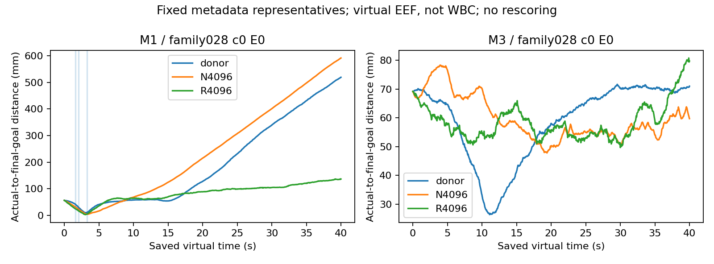

# PI0268 — completed virtual point gap decomposition

## Scope and unchanged outcome

Entry snapshot closed donor/N/R:64/64 each. This analysis reads all192 completed episodes and18,988 existing predictions (donor6400, N6210, R6378). Result/card/trajectory/query/observation hashes are bound in [SOURCE_SNAPSHOT.json](SOURCE_SNAPSHOT.json) and [CLOSED_SOURCE_HASHES.json.gz](CLOSED_SOURCE_HASHES.json.gz). No episode or V3 scorer was rerun or changed. Main-agent WBC work is independent and is not claimed complete here.

| point | task/backend | episodes | original first-hit successes | collision episodes | REJECT | requested / installed / achieved entry episodes | successful but outside at end |
| --- | --- | --- | --- | --- | --- | --- | --- |
| donor | M1/E0 | 16 | 6 | 0 | 0 | N/A | 6 |
| donor | M1/E1 | 16 | 7 | 0 | 0 | N/A | 7 |
| donor | M3/E0 | 16 | 0 | 0 | 0 | 1 / 0 / 0 | 0 |
| donor | M3/E1 | 16 | 0 | 0 | 0 | 2 / 0 / 0 | 0 |
| N4096 | M1/E0 | 16 | 13 | 2 | 0 | N/A | 13 |
| N4096 | M1/E1 | 16 | 13 | 2 | 0 | N/A | 13 |
| N4096 | M3/E0 | 16 | 0 | 0 | 0 | 0 / 0 / 0 | 0 |
| N4096 | M3/E1 | 16 | 0 | 0 | 0 | 0 / 0 / 0 | 0 |
| R4096 | M1/E0 | 16 | 15 | 0 | 0 | N/A | 15 |
| R4096 | M1/E1 | 16 | 15 | 0 | 0 | N/A | 15 |
| R4096 | M3/E0 | 16 | 0 | 1 | 0 | 0 / 0 / 0 | 0 |
| R4096 | M3/E1 | 16 | 0 | 0 | 0 | 0 / 0 / 0 | 0 |

R's virtual M1 first-hit attainment is30/32, higher than N26/32 and donor13/32; that does not erase R's offline recovery failures or its M3 collision. Every successful M1 episode in every point ends outside the original pose bounds. All96 M3 episodes fail entry in installed and achieved motion. Three donor M3 episodes contain an unexecuted H40 that independently requests a qualifying entry, yet their actual installed prefixes never acquire it. Requested future, installed prefix and achieved entry are separate events.

## Exact executed-prefix decomposition

For every saved query, `first=prediction[0]-actual_now`, `prefix=prediction[8]-prediction[0]`, `total=prediction[8]-actual_now`; index8 is0.4s on the original0.05s H40 grid. The maximum `total-first-prefix` absolute residual is8.67e-19m. SO3 first-point and relative-prefix geodesics are reported separately, never added as global rotation vectors. Gate REJECT rows would remain in the denominator; there are none in these actual closed-loop inputs.

| point | task/backend | replans | median first-point error (mm) | median 0.4s prefix motion (mm) | median first SO3 / prefix SO3 (rad) | median nearest nominal / recovery support distance |
| --- | --- | --- | --- | --- | --- | --- |
| donor | M1/E0 | 1600 | 0.530 | 6.490 | 0.00103 / 0.01386 | 29.522 / 28.698 |
| donor | M1/E1 | 1600 | 0.560 | 6.635 | 0.00114 / 0.01430 | 15.084 / 14.259 |
| donor | M3/E0 | 1600 | 0.255 | 1.757 | 0.00044 / 0.00171 | 3.583 / 2.394 |
| donor | M3/E1 | 1600 | 0.311 | 2.626 | 0.00049 / 0.00187 | 2.426 / 1.275 |
| N4096 | M1/E0 | 1477 | 0.134 | 8.042 | 0.00010 / 0.01138 | 16.297 / 15.382 |
| N4096 | M1/E1 | 1533 | 0.139 | 7.813 | 0.00010 / 0.01159 | 7.023 / 6.373 |
| N4096 | M3/E0 | 1600 | 0.135 | 2.223 | 0.00006 / 0.00102 | 0.852 / 1.041 |
| N4096 | M3/E1 | 1600 | 0.132 | 2.066 | 0.00007 / 0.00099 | 0.718 / 1.030 |
| R4096 | M1/E0 | 1600 | 0.468 | 5.433 | 0.00036 / 0.00512 | 8.225 / 7.532 |
| R4096 | M1/E1 | 1600 | 0.477 | 5.659 | 0.00036 / 0.00542 | 6.549 / 5.772 |
| R4096 | M3/E0 | 1578 | 0.398 | 2.252 | 0.00031 / 0.00327 | 1.492 / 1.209 |
| R4096 | M3/E1 | 1600 | 0.406 | 2.306 | 0.00031 / 0.00351 | 1.513 / 1.224 |

Small first-point errors do not imply appropriate progression or retention. For N M3, the median first mismatch is about0.13mm and prefix movement2.1–2.2mm, yet no requested or achieved entry occurs. E0 matches installed motion exactly; deficient primary motion therefore exists without WBC tracking error. E1 lag is a separate executor.

[CLOSED_PREFIX_ROWS.csv.gz](CLOSED_PREFIX_ROWS.csv.gz) records each target-distance change, requested entry, same-tick reference/actual error and support distances. [CLOSED_EPISODE_ROWS.json](CLOSED_EPISODE_ROWS.json) records first2s approach progress, original first hold, first subsequent exit, post-hold path length, integrated excess distance, maximum drift and original collision events. For M3, approach distance is to the original entry; final-goal distance in the plot is explicitly different. No minima at different ticks are subtracted.

Nearest support uses the exact same-task/command TRAIN minimum of `sqrt((XYZ/.010m)^2+(SO3/.060rad)^2)`, separately for nominal and recovery. The scale is the pre-existing perturbation magnitude, not a tuned OOD cutoff. This is task-space proximity, not RGB or language equivalence. N M3 can stay within roughly one such unit of nominal support and still fail, so support distance alone does not explain the failure. M1's large late distances partly reflect recorded post-hold drift; they cannot establish that OOD preceded or caused it.

Prefix-vs-full-H40 **label** RMSE is reported on matched saved offline rows in the trace report. Closed-loop distance to target is a different diagnostic and is not relabelled teacher trajectory RMSE. No teacher corrects any executed model output.

## Collisions and retention remain failures

| point/case | collision time (s) | precursor first-point / prefix (mm) |
| --- | --- | --- |
| N4096/pi0265-family-028-M1-c0-E1 | 18.42 | 0.170 / 7.763 |
| N4096/pi0265-family-030-M1-c0-E0 | 12.62 | 0.180 / 8.387 |
| N4096/pi0265-family-033-M1-c0-E0 | 17.78 | 0.184 / 6.128 |
| N4096/pi0265-family-034-M1-c0-E1 | 34.06 | 0.213 / 7.694 |
| R4096/pi0265-family-035-M3-c0-E0 | 31.08 | 0.360 / 2.102 |

Every precursor row retains the actual requested reference, original ACCEPT decision, and collision tick linkage in the episode JSON. Near-zero first-point mismatch did not prevent these collisions. No smoothing, return-to-goal controller, early stopping, late-failure removal or new success threshold is introduced.

Plot selection is fixed by family/command/backend, not scores. Vertical lines mark original first-hit times. These are saved virtual EEF arrays, **not WBC, physical episodes, a second robot, realtime execution or general transfer evidence**.
