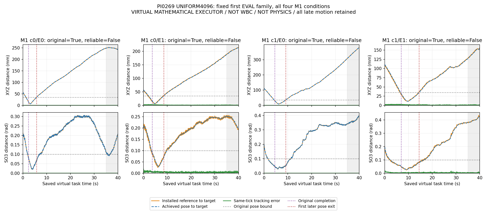

# PI0269: complete UNIFORM64 reference / tracking / drift decomposition

Scope: every saved tick of the completed UNIFORM4096 original-start64, with original static terminal targets. No new neural, teacher, renderer, physics or gradient call. This is a partial policy-point analysis while PREFIX and component diagnostics continue; final native replay, full three-point scoring and archival closure remain pending.

## Findings

- **M1:**31/32 original successes; all31 subsequently leave the original pose bounds. The median interval from original completion to first later pose exit is4.9s. The median final40s XYZ distance to the target over all32 conditions is220.400mm.
- **M3:**0/32 original successes;0/32 broad-ready and0/32 angular entries; maximum ordered-bin count0. Median final XYZ distance is57.580mm. The reverse/shortcut counters are not evidence of absence of those mechanisms: without acquired entry, the post-entry predicates are not activated.
- **E0:**all32 cases have zero same-tick XYZ tracking error. Maximum angular discrepancy is3.65e-8rad, at numerical precision. Its15 successful M1 episodes still subsequently exit the pose bounds.
- **E1:**maximum same-tick XYZ tracking error over all32 cases is3.948mm; maximum SO3 tracking error is.029299rad. Its16 successful M1 episodes also subsequently exit.

Reference-to-target, achieved-to-target and reference-to-achieved are distinct quantities at the same saved tick. Persistent target departure occurs even with exact E0 position tracking; this establishes reference/closed-loop drift in that mathematical executor, not a unique neural cause or a WBC installation failure. These executors are virtual research mechanisms, not physical robots. Do not substitute the large terminal-target errors for same-time tracking errors.

The figure uses the first frozen EVAL family and all four M1 command/backend combinations, independently of their results. Top row: XYZ distances. Bottom row: SO3 distances. Orange is installed reference-to-static-target, blue is achieved-to-static-target, green is same-tick tracking. Purple marks original completion; red marks the first subsequent pose exit; grey shading retains the full35..40s reliability window. All late motion remains. Original completion and reliable retention are explicitly separate.

## Evidence

- `UNIFORM_MAIN64_REFERENCE_TRACKING_DRIFT.csv`: all64 denominators, source record/array hashes, acquisition, ordered bins, tracking, completion/exit and final-target errors.
- `UNIFORM_REFERENCE_TRACKING_DRIFT_RECEIPT.json`: source/helper hashes, full64 summaries, fixed figure selection and zero new-call accounting.
- `VISUAL_QA.json`: main-owner visual inspection of the actual generated image; no independent-agent claim.
- `PNG_ARCHIVE_BOUNDARY_CHECK.json`: new PNG evidence is included by the unsealed archive helper; weight/private-asset suffixes remain excluded, and all35 frozen evaluation sources stayed hash-identical. No upload was attempted before full-panel closure.
- `scripts/pi0269_execution/uniform_reference_analysis.py`: NumPy analysis reusing the existing same-time arithmetic and original reliability predicate.

One CPU-only import attempt stopped before analysis because the reused reliability module was at its original PI0268/R1/code path. The isolated helper was corrected to use that path; no healthy runtime was changed and no project model query was repeated. Selected/deployment remain NONE; old FAIL and WBC PARTIAL remain.
