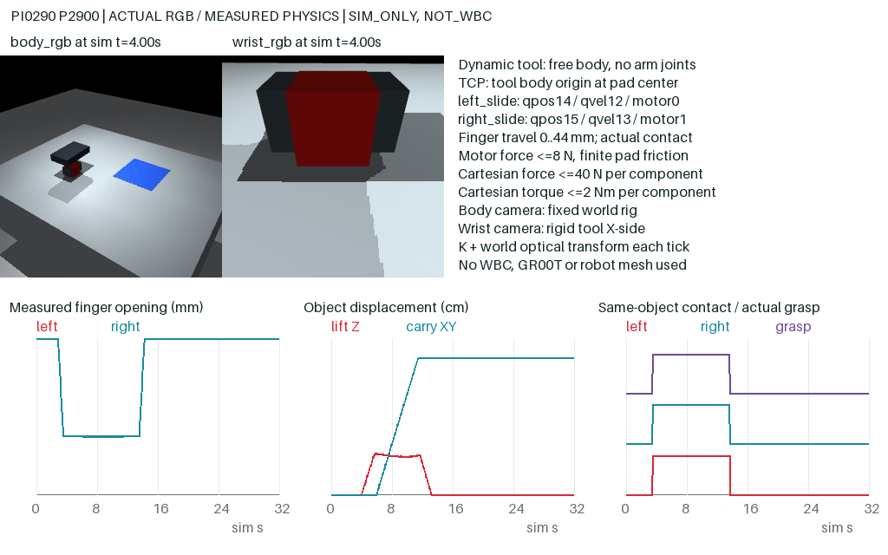

# PI0290 Actual Execution Report

Status: **INDEPENDENT_DATA_PILOT_READY**, pending scientific review. Date: 2026-10-13 SGT.
Domain: **INDEPENDENT_DYNAMIC_TOOL / SIM_ONLY / NON_REALTIME**. selected=NONE; deployment=NONE.
This is not Go2, ARX5 arm, whole-body WBC, cross-embodiment or hardware success.

## Authority And Fixed Sources

- Formal GO: Issue #11 comment 6127997973; immutable protocol release `e9918c68d03cc9a1049aa33e2bd2b0ef4eaea398`.
- Single owner: existing local PC, actual Corelab AMD -> 4080S SSH; no cloud owner, new Hopper PBS, GR00T load/forward/eval/optimizer or WBC call.
- Pilot physical/code freeze: `c4853f3b7bd9747dff485d58780a0c0abb1e3402`; seals published at `4c32b1b80822f97f4e5bee3dae9101872a41d30a` before P2900.
- Original Corelab Teacher/layout seal SHA256: `1396e915cb7812eb836ce1d7996f4049fe5d086b0eaeb4c60371fe66b3299666`.
- Independent post-pilot score/contact audit: `15562ea29eb9448ef2c6eb0b48a741d85d438d86`; raw results commit `84027ef76f18d6ead3a59ece104fe6f1267ff4a2`.
- Private archival source `03ae690569d7e58ab9f3ad1eadb0a1a71c8cf8e5`; native committed-window export source `c3e2738159d11af48dc73f6cf9361f21a81d9e33`.
- Later remote maintenance commits were merged, not overwritten. They do not amend this experiment's recipe or results.

## Actual Scene And Method

MuJoCo 3.2.7, implicitfast/Newton, dt=2ms. Table top 0.4m; free 4cm/0.05kg cube; non-contact 16cm goal marker. Every registered source/goal separation >=0.15m.
The new procedural tool is a free dynamic palm with two opposed slide fingers, not an ARX5 arm. Tool/pad masses, friction and force limits are explicitly provisional simulation assumptions. No private robot mesh or WBC source was copied.
TCP is the pad-center tool origin. left/right_slide use qpos14/15, qvel12/13 and motor0/1; each travel is 0..44mm. Limited motors <=8N; finger target slew 0.04m/s. Cartesian world-force/torque components are bounded at 40N/2Nm; position/rotation feedback acts only on the tool body. No object pose write after reset, weld, mocap, snap or magnetic grasp.
Grasp requires measured valid opposing same-cube contacts, minimum normal force 0.05N and actual relative linear motion <=0.02m/s. Contacts and safety are checked every integration. The unchanged generic T1 scoring numerics also require sustained grasp and lift >=0.30s.
Teacher transitions through approach, align, close, verify_grasp, lift, carry, lower, release, withdraw and hold using current actual feedback. H40 at 20Hz starts at the actual observation-time TCP anchor; every 0.4s only the first eight points are committed. Desired/accepted/installed/committed references remain separate from achieved state.
Dual real MuJoCo RGB is 256x256 at each 25th integration, including t0 and t32. Body is a fixed rig; wrist is rigid on the dynamic tool X side. Per-snapshot K, world optical extrinsics, object pose/eight fixed points, projections and visibility are recorded. They are not deployment camera calibration.

## Commissioning And Preserved Failures

| ID | Actual Outcome | Steps / Paired Samples |
| --- | --- | --- |
| C2900 | Safety stop FINGER_VELOCITY at t0.388s, no grasp | 194 / 8 |
| C2901 | Complete empty-grasp negative, zero left/right contact | 16000 / 641 |
| C2902 | Complete single-side negative: left contact92, right0, no sustained grasp | 16000 / 641 |
| C2903 | Complete physical pick/place: lift7.84cm, carry27.40cm, hold41/41 | 16000 / 641 |

There were exactly two substantive dynamic-tool versions. C2900 high-rate data showed rotational feedback instability propagating to finger velocity; V2 introduced inertia-aware implicit external rotational damping, without relaxing force, safety or success limits. C2900 is never admitted. Its preceding low-rate safety flags do not override its terminal high-rate failure.
C2901 physically completed, but the generic quality scorer rejected its displaced empty-grasp fixture's source-goal separation. A separate contact-negative scorer recovered only saved-data postprocessing, with no physical rerun. Its lost measured process CPU was replaced by a conservative 97.053s upper charge; the original error/result provenance remains recorded.
Visual review found original commissioning wrist palm occlusion. Those original images/videos remain untouched and commissioning is not training-admitted. An optics-only X-side camera repair was qualified on ten saved-state zero-integration diagnostic snapshots and all twelve fixed reset layouts. Parsed old/new XML excluding cameras is identical. Diagnostics are labelled NOT_ORIGINAL_EPISODE_OBSERVATION and never substituted for raw images.
Earlier D0 bootstrap/import and GPU-idle preflight failures are documented in D0/D1 receipts; the occupied GPU was not used. Actual Mesa llvmpipe CPU dual rendering was verified before C2900.

## Eight Fixed Pilots

All IDs, SHA256->PCG64 seeds, four seen layouts and four held-out reversed-Y/yaw layouts were sealed before the first pilot. No replacement, quality retry or recipe change occurred.

| IDs | Layout Family | Complete Physical Success | Final Hold |
| --- | --- | --- | --- |
| P2900, P2901, P2902, P2903 | Seen diagonal | 4/4 | 41/41 each |
| P2904, P2905, P2906, P2907 | Held-out reversed Y / larger yaw | 4/4 | 41/41 each |

Each pilot has 32.00s, 16000 integrations, 641 paired raw frames and a fully decoded 641-frame dual RGB video. Video containers are 32.05s at20fps because both physical endpoints are included; physical duration is32.00s.
All eight genuinely grasped, lifted >=2cm, carried >=10cm, released, withdrew >=8cm and passed every original corner/height/linear-speed/angular-speed/validity predicate at all41 samples t28..30. No safety/abort/reset/takeover event occurred. Independent saved-array NumPy scoring was repeated twice and exactly matched the unchanged original generic scorer. See PILOT_SCORE and all twelve attempts in PILOT_RAW_MANIFEST.

## Data Qualification

Every raw file/PNG hash, decoded RGB shape, physical time, actual TCP/finger state, control prefix and causal boundary was checked. Saved qpos/qvel/wrench reconstructed every camera and contact through mj_forward only, never new integration; contact-force agreement was approximately1e-14N or better and camera kinematic error0. Sensor time residual <=6.86e-12s.
Actual empty/single-side contact negatives passed. In-memory corruption of real recorded data for oracle leakage, sensor time, future history and rot6d was rejected. PolicyObs is an exact sensor/proprio/instruction whitelist; object truth, teacher stage, geometry consequences and scores remain outside it.
Native row-rot6d/absolute-gripper encoding and existing Cosmos fixed-revision tokenizer were executed on CPU. Additionally each pilot's640 actually committed desired points produced601 complete observation-anchored H40 windows,4808 total; all exported NPZ files were reopened and every action round-trip checked, max error<3e-15. These are recorded desired labels, not achieved poses or uncommitted plans. t32 has no invented command.
Admitted IDs are only P2900..P2907. No training statistics were fitted, no overlapping-window random split, no new blind TEST claim. **Official GR00T processor/collator and network remain NOT_RUN.** This qualification is native CPU/static-data only.

## Evidence And Retrieval

Corelab private SSD primary: PI0290/episodes/{ID}; NFS alias is only navigation and is not usable as an SSD path from AMD. The private local runmap retains actual paths and existing authentication; no token was copied or published.
Private HF dataset: `leoyuer/pi0290-independent-dynamic-tool`, repo_type=dataset.
Raw attempts, videos, immutable frozen code and receipts: revision `0fd9247ba5426eb54ebf152912432302b193b479`, prefix `PI0290/v1-c4853f3b`.
Derived native windows: revision `f70516bd0cfa541e91db6ac23b3130fe04f1851a`, prefix `PI0290/derived-native-codec-v1`.
Each raw archive's individual member SHA matches its original FILE_MANIFEST; every uploaded LFS SHA/non-LFS content SHA was checked at fixed revision, with READY last in each prefix. Hopper read only the7511-byte raw READY and verified its SHA; no raw dataset/model download or PBS occurred. See HF_TRANSFER_READY, HF_CODEC_WINDOWS_READY and HF_LICENSE_AND_ARCHIVE_CHECK.
First-success C2903 physics SHA: `2feb80c6d786fb941adf7663aeb690815c033f2b91fd120290113104b2e43e35`; original video SHA: `d4d120a4a60db54023ff85093e7e5ad8775ef3e72043f60c377601bbb15cd4d1`. It has the disclosed original wrist caveat. First admitted P2900 video SHA: `2afa9264ae957468b8377ce8fa52cd24be8e90413865aa5a3170bd7903636f0e`; both were provided promptly to the user.

## Resources And Boundaries

12/12 starts;176194/200000 integrations; setup actual0 of registered8000. Formal paired samples7059 plus34 diagnostic pairs =7093/7692, and one unpaired initial D0 probe image. GPU service total0.18144s for D0, all episodes CPU-rendered. CPU charged388.69s plus7200s conservative bootstrap upper =2.108 core-hours, below24. Current owned bytes1,216,549,178 (~1.133GiB), below10GiB; D0's temporary8GiB non-sparse allocation proof was released. Personal quota remains unreported; actual allocation/storage evidence is not a claim of unlimited quota.
Final source/resource audit reacquired the owner lock, verified all physical modules/runner/video still match the pilot seal, reran seven passing CPU tests and found zero live project simulation instances. No healthy/paused archive jobs or other-user GPU processes were cancelled or resumed.
Earlier separately authorized failed-derived-model retirement freed44,017,266,688 allocated bytes, preserving original data/metadata/full Trainers/WBC; do not recount it as PI0290 output or repeat deletion. New phase-2 storage maintenance is a separate scoped protocol and protects all PI0290 evidence.

## Next Direction

User-designated local latest WBC bundle equals the same6dd13098... archive;11338 delivery checksums pass and selected URDF/MJCF/source manifest hashes match Corelab. No WBC was run or changed. Its URDF defines opposed fingers, but native MJCF fingers are fixed visual bodies without finger actuators; target-tool data still needs an independent qualified gripper implementation.
Prioritize a new bounded ARX5/Go2-X5 asset/runtime/license/engine-choice audit, then target-geometry ARX5-only expert data; retain this independent tool as control/infrastructure. Third-party source presence is not Corelab runtime qualification. The next B0 pretrained-GR00T design is **NOT_AUTHORIZED**, deferred behind target-asset/data gates. No new data scaling, arm physics, Isaac launch, BASE controller, model service, tunnel or training is implied by this READY.
