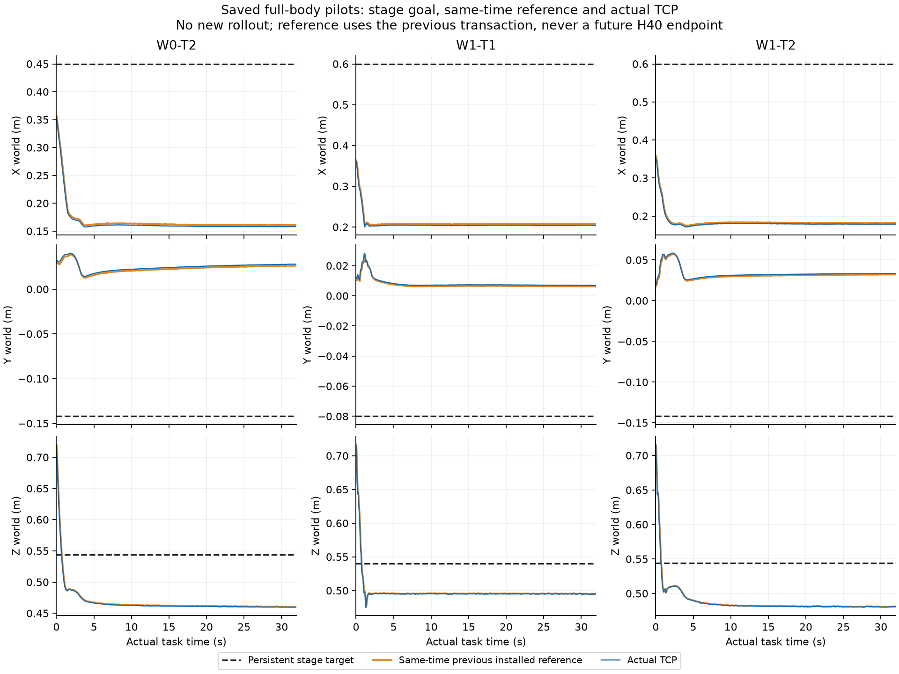
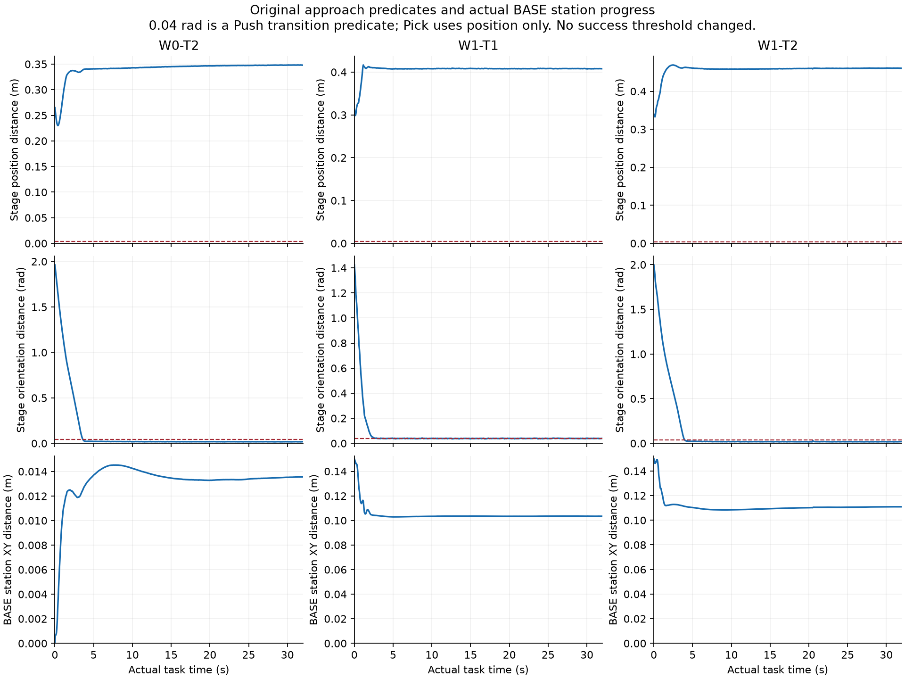

# 接近阶段复算：目标未到达，参考进度需独立修订

依据审核500ef6f76c5360ec2c293b66987ede5fcf55f638／#11 comment6187515183，
本次实际读取三条V2保存数组，重新执行原Teacher纯CPU数学并对齐原参考。
没有重新运行四条pilot；新物理、渲染、神经模型、训练和IK均0。

## 1. 主要结果

**三条轨迹的原位置条件从未成立；推送姿态多数时间已满足。** 因此不能把
失败归因于“推送0.04rad单独太严”，也不能靠放宽4mm让实际远离方块时闭爪。

| 条件 | 位置距离：初始→最近→最终 | 原位置≤4mm | 姿态≤0.04rad | 实际阶段切换条件 |
|---|---|---:|---:|---:|
| W0/T2 | 26.48→22.99→34.80cm | 0/641 | 568/641 | 0/641 |
| W1/T1 | 31.13→29.86→40.76cm | 0/641 | 499/641（仅诊断，T1无此角度门） | 0/641 |
| W1/T2 | 34.00→33.27→46.06cm | 0/641 | 561/641 | 0/641 |

三条最终距持久阶段目标分别比初始更远8.32、9.64、12.06cm。原Teacher
阶段目标与实际TCP相差很大，不是4mm边缘误判。

橙线是**此前已提交参考在当前真实物理时间的插值**；不是当前新生成首点，
也不是1.95秒之后的H40末点。蓝线为相同真实样本的实际TCP，黑虚线为持久
阶段目标。其差异说明当前参考与实际观测一起停留远处，不能用局部参考误差
小推断接近任务完成。

## 2. 同刻参考、未来预览与覆盖重置

| 条件 | 同刻上一参考—实际TCP位置差中位／最大 | 替换前参考推进中位 | H40预览长度中位 |
|---|---:|---:|---:|
| W0/T2 | 3.394／16.920mm | 3.360mm | 117mm |
| W1/T1 | 3.363／22.176mm | 3.360mm | 117mm |
| W1/T2 | 3.391／22.493mm | 3.360mm | 117mm |

640次新H40首点与该观测的实际TCP距离全部严格为0。每次仅推进0.05s，再
从新实际位置覆盖；代码标称prefix8／0.4s未被执行。按原参考source与真实
安装时间插值，替换前参考实际提供约3.36mm局部推进，中位略大于3mm是原
source距实际观测存在数毫秒间隔，并非改变采样dt。

这些是**真实采样时刻上可复算的任务参考事实**。新参考是否被某一MPC求解
结果采用、哪一条policy被native最终选中，旧日志没有ref→solver-policy身份，
仍为`UNKNOWN_NO_SAVED_REFERENCE_TO_SOLVER_POLICY_ID`。安装ACK不代替消费
证明；本次不钻入WBC优化、servo或重开D1。

约11.7cm未来端点差仍不能叫同tick跟踪误差。此处真正同刻的局部误差另列，
并不证明全局任务路径有效或唯一动力学根因。

## 3. 姿态、站位和夹垫几何

W1/T1、W1/T2对原声明15cm世界站位目标，最终仍有10.35、11.09cm的平面
残差；手—物体最终距离约40.67cm、43.67cm。W0/T2手—物体最终约31.11cm。
这些与原有效任务FAIL一致，未从新图改判。

使用真实模型和初始／16s／32s实际状态，仅做只读FK测夹垫：声明approach
目标姿态下夹垫底部约0.52m，高于0.44m桌面约8cm；不能据此把实际未到位
归因于目标夹垫必然穿桌。实际夹垫低于桌面高度平面并不自动意味着碰撞，
还需XY占据范围，原高频碰撞检查仍为权威。此处没有新IK或完整机器人扫掠
碰撞验证；可达性、整条访问路径仍`UNPROVEN`，不拿一次局部IK失败作不可达证明。

## 4. 数据与复算身份

实际执行source分别为5e361f6fa、5e706da87、12cf868ca；新分析source为
90078b0f36aa28cd4d7bf163d71a0ff6f622f598。每条检查原Teacher、config、
scene、task plant/state、BASE桥、SO3与codec共9项数值源码与其原capsule一致。
原compiled MJB和原JSONL按封存hash重验。

原Teacher重放640计划：位置与保存动作严格一致，旋转最大数值差
2.98024e-8rad；独立插值的同刻参考与保存native安装XYZ最大差≤2.85e-8m。
没有替换输入图像、修改实际state、重算实际动力学或按成绩挑样本。
逐帧目标／状态／布尔切换条件／2s进度／上一ref等细表保存在私有analysis，
每条hash在`TEACHER_APPROACH_PROGRESS.json`。汇总与两张图为本次新证据，
旧四项0/4和原所有文件未覆盖。

分类为：`STAGE_PREDICATE_NONATTAINMENT`、
`REFERENCE_PROGRESS_OR_CADENCE_MISMATCH`、
`REFERENCE_CONSUMPTION_UNOBSERVED`。当前证据支持优先改任务Teacher与
时间适配；没有证明唯一根因，没有证明WBC无法做任何物体操作。

## 5. 唯一准备方案与明确未完成项

仅准备**持久世界接近进度＋显式prefix8＋实际站位反馈**这一条候选，源码
`scripts/pi0294/persistent_approach_draft.py`。它不接入现役worker，
`launch_allowed=false`，未被称为完整抓放／推送Teacher。

- 固定任务／站位世界目标，不每50ms把游标重设成实际TCP；保留20Hz记录与
  500Hz原安全，计划0.4s提交一次，真实200步后才能新查询。
- 将参考超前量限制为原速度×一个prefix：2.4cm／0.12rad；这是明确候选
  设置，不是已授权参数，也不改实际state或补偿joint3／4偏差。
- 任务侧顺序为抬高、转向、水平接近、下降到预接触区；只对已测夹垫包络
  作保守几何准备，不宣称整臂／身体扫掠已合格。
- 原目标与实际BASE持续比较；无进展返回明确终止原因，不按timer强迫
  close，不自动挑新站位／seed。
- 实际夹垫／物体投影几何作为候选预接触诊断，远离物体不能通过。它不
  代替原最终物体成功标准、不授权闭爪或宣称抓握成功。
- CPU有连续8 vs4+保存恢复+4严格一致、任意实际扰动、不重锚定、近／远
  两任务、停滞、安全及远距离几何负例。真实姿态正在接近目标时不会仅因
  位置未改善就误判停滞。10项CPU检查通过；不是物理恢复canary。

另对三条已存真实轨迹各8个输入做纯CPU dry run；没有执行新姿态。其初始
夹垫角点包络半径约5.67cm，按真实FK绑定而非凭想象填值。三条各初始／16s／
32s的实际夹垫几何共9个负例均未被错误接纳为预接触；这仍不等于新Teacher
已实际接触物体。见`ACTUAL_INPUT_DRY_RUN_RECEIPT.json`。

本次分析／草案18份私有文件（14521903字节）已独立逐文件回读，tree：
`0cc6e3d7738e53371a489aace6c4a41c64b532e1bcd565fe65df1da5ccaef427`。
原四项终态与V1安全sentinel哈希复核未变；主积分、启动、RGB、模型及训练
计数不增加，仅扣实际CPU分析。资源／空闲owner终检见`PACKAGE_RECEIPT.json`。

尚缺完整机器人可达／扫掠资格、实际原生geometry handoff、接近至接触的
操作FSM、prefix8与20Hz标签切片接入、新ref到selected policy证据以及新
版本物理执行授权。不能把CPU草案当成这六项已完成。

具体下一运行提案见`reports/PI0294/design/PERSISTENT_APPROACH_NEXT_RUN_DRAFT.json`：
最多4条短开发＋条件2条完整任务、最多6启动／71018计账积分／4CPU coreh，
GPU、PBS、GR00T查询和训练均0，沿原时钟／总账；不是新增已获准预算。
短接触里程碑不算成功数据。原固定4条的FAIL不重试或改判。

审核第6节明确“本审核不新增物理/PBS/窗口授权”，故该候选仍
`NEXT_RUN_DRAFT_NOT_AUTHORIZED`。旧生产入口继续关闭；不以“连续推进”推翻
固定pilot终态或自行添加质量试验。成功整机TRAIN仍0，FB13仍NOT_RUN，
selected_checkpoint／deployment均NONE。
