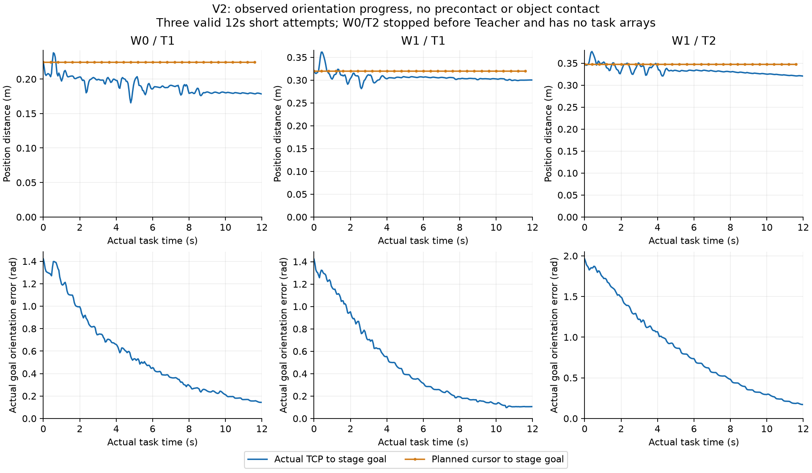

# Component Teacher V2：实际短系列终局

## 结论

**4个已采用短条件各尝试一次：3条有效12秒任务里程碑FAIL，1条任务前就绪工程不完整。没有预接触、物体接触或操作；两条条件完整任务未准入。** 执行与独立CPU完整性审核已闭合，成功整机TRAIN仍0，GR00T未开训，整体成功示范目标仍PARTIAL。不能将本报告写成“四条有效任务FAIL”、GR00T失败或WBC算法失败。

人类已明确采用[独立分量推进V2](../../../design/COMPONENT_PROGRESS_V2_HUMAN_ADOPTION.json)，采用提交 `ebf1ccab4c09e3c266e5280153d03cbbe37658e1`，#11 canonical 6189965884。物理运行固定源码 **`8e2efd4435588b03c9085bda11caa960d195d1f7`**；独立审核源码 `755182d8a4e84ed620ee1b8bce967def73e64d7e`，增加已保存BASE/角度诊断源码 `405e59c51acef2886124e3e0d080132c8c6629a1`。后续报告提交不是物理源身份，不热切换运行代码。

## 1. 原条件结果与完整分母

|条件|分类|实际任务时长|记录/查询|距阶段目标初始／最近／最终(m)|角误差初始／最小／最终(rad)|
|---|---|---:|---:|---|---|
|W0/T1|有效短里程碑FAIL|12s|241 /30|0.22458 /0.16551 /0.17835|1.42042 /0.14320 /0.14320|
|W0/T2|任务前工程不完整|0s|0 /0|未观察|未观察|
|W1/T1|有效短里程碑FAIL|12s|241 /30|0.32021 /0.28126 /0.30020|1.42189 /0.09697 /0.10595|
|W1/T2|有效短里程碑FAIL|12s|241 /30|0.34786 /0.32052 /0.32052|1.96073 /0.17134 /0.17134|

三条有效任务均有至少2cm实际距目标缩短，但最后仍是`approach`，safe_precontact/contact/manipulation均false；contact ticks=0、抓握持续时间=0、物体平面位移=0。无原生安全停止。**距目标缩短不能替代任务成功。** W1两项未通过条件短资格，故两条完整确认均NOT_ADMITTED，未为了消耗剩余启动数重复有效FAIL。

## 2. V2实际做到了什么、仍缺什么

独立平移/旋转推进合同实际执行；转向游标累计分别前进1.32、1.42189、1.80rad，实际角误差明显下降。**三条的游标平移累计仍为0。** actual与游标最大位置差约0.1069、0.1130、0.1096m；同刻上一安装参考与actual位置差中位约0.0902、0.0897、0.0751m。这些量与actual到阶段目标距离不同，不拿未来终点或两个minimum相减冒充tracking。

W1/T1、W1/T2 actual BASE最大前移分别0.17627、0.17845m，最终与声明站位XY差0.02905、0.03019m；实际身体运动没有变成物体操作。W0/T1无声明站位移动，却实际前移0.15543m，亦作为真实环境结果保留。不借此调整WBC、添加补偿或重写成功条件。

V1/V2持续时间及warmup实际状态不同；这里不宣称严格同初态跨版本因果效应。可确认的是本V2有真实角度进展、无目标平移推进和物体接触。MPC selected-policy consumption仍 **UNKNOWN**：已安装ACK不是策略实际消费的独立证明。

## 3. 工程与科学结论分开

- 原10.2秒浮点负龄期修复以整数纳秒保留；三条有效任务实际执行到12秒，未再次触发该错误。没有用CPU测试代替这一物理事实。
- W0/T2在5秒warmup后报`NATIVE_WBC_MODE_UNAVAILABLE`。仅HOLD/HOLD/WBC三条mode、EE/arm/odom存在，MPC observation计数0；没有任务输入、Teacher命令或任务RGB。**仅能确认组合就绪未通过，唯一根因尚未证明。** 不当作任务质量FAIL，不另启无限readiness或WBC归因研究。
- 三条有效任务30次查询/条，共90组H40提交/安装；原native14D安装与EEF13标签、prefix8、pause/history、源时间、实际状态字节和RGB时刻独立核验通过。全部保存H40按已采用V2算法精确重放一致，容差1e-12，无新增物理。
- 当前closure保留，资产入口拒绝`COMPONENT_TEACHER_V2_SERIES_TERMINAL_PRESERVED`。四个精确PID/start owner均终止；无CPU reservation。旧pilot terminal、原安全FAIL和V1终局SHA均未改变。

详细证据：[CPU准入](CPU_ADMISSION.json)、[逐臂独立审核](INDEPENDENT_CPU_SERIES.json)、[游标/实际诊断](PERSISTENT_REFERENCE_DIAGNOSTICS.json)、[只读最终状态](FINAL_STATUS.json)。

## 4. 原件、视频与预算

私有原件 **2323文件 /530436177字节**，源/目标逐文件SHA256回读通过，tree **`fe691552c06c973e08a3c4ca878217e9b69a08fa9c80a956c56976a69effb3f8`**。未删除源，未公开raw/WBC。见[私有归档脱敏收据](ARCHIVE_READBACK.json)。

三条有效任务各241帧/20Hz的实际双RGB视频已生成，明确水印`SHORT MILESTONE FAIL`、`NOT A SUCCESS DEMO`、`NON REALTIME`。PC回读SHA及首/中/尾帧解码通过；视频仍私有。W0/T2没有任务RGB，**没有伪造第四条视频**。见[视频身份](ACTUAL_VIDEO_RECEIPTS.json)和[本地回读](VIDEO_LOCAL_READBACK.json)。

|计账|本V2用量|V2上限|
|---|---:|---:|
|短/完整启动|4 /0|4短＋条件2完整，总6|
|积分（含warmup及保守尾部）|28012|71018|
|实际双RGB|723|2246|
|物理保守CPU秒|775.02057|总4 CPU coreh|
|连同CPU审核/归档等全部本轮父账增量秒|790.07568|总4 CPU coreh|

最后只读父账：37累计启动、345005累计积分、12007累计双RGB、Core CPU 15244.79212秒。新GPU/PBS/GR00T查询/训练更新均0。原父账、T0与截止不重置；没有训练数据或模型因此变成合格。见[实际closure](SERIES_CLOSED.json)。

## 5. 用户提供的成熟Teacher路线

已完整读取固定研究提交 `d2379367385a8669f354b5c5c1307b96037de2d0`，并进一步固定读取ManiSkill `62ff3a5896b4d5b4cf0ac4c8d79afe600c9404a3` 八个原始文件。**复用其规划/任务技能组件是下一准备方向，不继续第三轮游标阈值修补。** 实际组件适配审核见[ManiSkill→EEF13具体差异](../../../../../docs/reviews/2026-10-15_MANISKILL_PINNED_SOURCE_TO_EEF13_ADAPTER_AUDIT.md)。

没有安装/运行新仿真器、没有下载成功种子或产生新物理。Panda joint动作、源PickCube成功条件、world-X推送假设、失败重试/只计成功循环均不能原样迁移。需要目标本体可行的Cartesian路径、完整机器人碰撞覆盖、实际EEF13提交和原任务释放/撤离/保持验收；MimicGen扩增仍需先取得目标本体成功seed。

**终局：V2_EXECUTION_CLOSED / THREE_VALID_SHORT_FAIL_ONE_PRETASK_ENGINEERING_INCOMPLETE；成功整机示范目标PARTIAL，selected/deployment=NONE。** 新规划组件物理资格需要独立明确范围和预算，本研究材料不自动增加执行权限。
