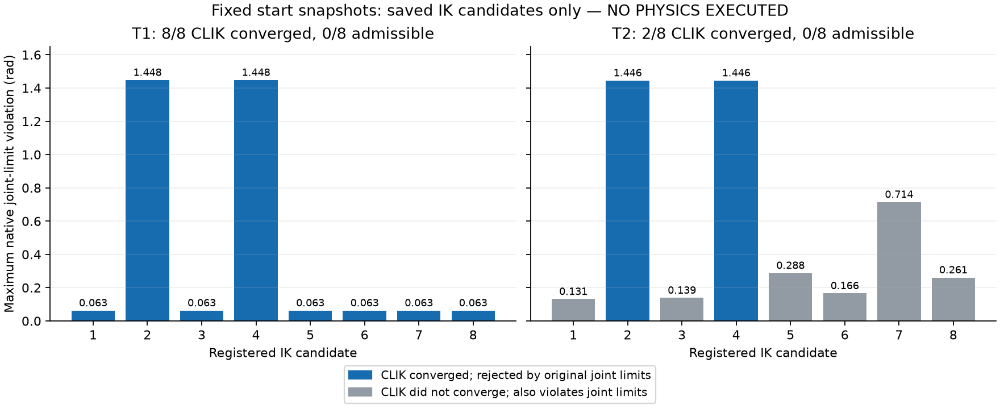

# ManiSkill组件接入：固定起点规划资格负结果

## 结论

**本次已经执行到方案规定的科学停止点；不是停在CPU_READY。** 隔离环境、完整本体规划资产、24项CPU接口检查已完成，12个固定actual输入全部只规划一次；其中7个后续输入可生成合法H40路径，5个失败。**T1、T2各自的固定首个输入均没有合格IK候选**，原生FK/原限位独立复核确认后，按已采用方案第6节P0/P1首段准入和第8节有效失败停止规则，封存`STOP_FIXED_START_NO_ADMISSIBLE_REGISTERED_IK`。

**新增物理启动/积分/RGB/GR00T/训练均0，真实接触和完整成功seed均未取得。** 两条短开发NOT_ADMITTED，两条完整任务NOT_ADMITTED；不能写成物理0/4 FAIL、WBC任务FAIL或GR00T FAIL。没有挑选后续可行帧替代固定起点，没有改变目标、seed、限位或WBC来取得PASS。

人类明确采用固定方案 **`13713019077cb128b55090ab6b7a513e162b975e`**；[采用收据](../../../design/MANISKILL_COMPONENT_HUMAN_ADOPTION_V1.json)发布于`87b34ae356756895be5bad3b079388a6d96ad5e8`。原T0/绝对窗口与父账保持。实际CPU审核源 **`59045165b518837fc1cf8fb369f52752caa31ee5`**；GitHub报告发布源不是一个新的物理运行源。

## 1. 实际完成的接入

|环节|实际证据/结果|不能据此宣称|
|---|---|---|
|独立planner环境|MPlib0.2.1、NumPy1.26.4、SciPy1.13.1、TOPPRA0.6.3；后者实际从固定sdist编译wheel；pip check通过|安装成功不等于路径或任务PASS|
|固定源码一致性|已安装`mplib/planner.py` SHA256 `785f77233baf4159f3327b664fae2507572c189223a6075f42546c1133ddfa0e`与固定上游相同；实际扩展/依赖artifact封存|版本号不是全部二进制身份|
|本体规划资产|从原native模型导出26个机器人body、12腿/6臂/2夹爪关节、30个原生碰撞几何；capsule保留圆柱＋两球体积|不是只用缺腿ARX5 URDF，不证明未来腿部动力学可行|
|坐标/几何|跨进程FK与native同姿态位置误差约1e-16–1e-15m、旋转误差≤4.3e-8rad；pad滑动轴/零行程中心另读回核对|不是WBC跟踪精度PASS|
|CPU接口检查|24项通过，含缺腿覆盖拒绝、碰撞pair/原穿透门、附着必须有真实grasp、时钟、源绑定、旧终局保持、8 vs4+JSON恢复+4、晚期失败保留|没有物理、渲染或模型查询；合成scorer fixture不是示范|
|实际规划|12个固定保存输入、96个内部IK候选、7次RRTConnect；原始request/response均保留|后续7条可规划不替代两个起点的失败|

原生NumPy2环境未降级。native和planner通过带SHA的请求/结果文件交互；规划关节轨迹只在CPU做FK/几何检查，没有向执行器发送joint action。原WBC/安全/最终物体评分源码和12个现有native源/二进制成员身份复核一致，没有重新构建WBC。

代码已接入`mp_teacher/mp_client/mp_backend/mp_worker`；**mp_worker没有实际启动，不能称其物理接入已验收**。对应冻结Task/FrameRecorder、SafetyGate和native14D仍须由未来获得自身首段资格的任务实际验证。

证据：[环境](ENV_RECEIPT.json)、[依赖锁摘要](DEPENDENCY_LOCK_SUMMARY.json)、[原生成员身份](FROZEN_NATIVE_READBACK.json)、[CPU完整收据](CPU_ADMISSION.json)、[pad/TCP实际绑定](TCP_PAD_BINDING.json)。

## 2. 完整12输入分区

T1源：原V2的`V2_DEV_W0_T1`；T2源：原固定pilot有效attempt `TASK-PILOT-W0-T2-engineering04`。样本hash和帧序在采用前已冻结，使用各自实际native journal与同帧mount/RGB绑定，没有生成替代观测。

|原task elapsed(s)|T1抓放|T2推送|
|---:|---|---|
|**0.0（固定首段）**|**IK失败，无合法候选**|**IK失败，无合法候选**|
|0.4|IK失败|IK失败|
|0.8|H40规划/密集native检查通过|IK失败|
|1.2|H40规划/密集native检查通过|H40规划/密集native检查通过|
|1.6|H40规划/密集native检查通过|H40规划/密集native检查通过|
|2.0|H40规划/密集native检查通过|H40规划/密集native检查通过|

这7条路径是对**原失败轨迹中保存状态**的零物理步规划，不是新执行、不形成成功视频/seed。后续状态的root、arm等均与起点不同，结果只说明该固定规划方案对actual状态敏感，不能据此证明“仅BASE后退”是唯一根因。更不能将后续帧作为新的初态。

每个输入仅一次已登记IK调用、最多原8起点；成功者再一次原RRTConnect。工程收口读取首次封存输出，没有第二seed/目标/备用规划器。全部12份输入/结果hash见[首次计算索引](PLANNING_FIRST_RESULTS.json)。

## 3. 起点为什么未准入

独立复算直接读取已保存的16个起点候选，在隔离native MjData中做FK及等价角限位核对；**新增IK/RRT/物理均0**，没有把不合法候选安装到真实执行器。

|固定起点|CLIK数值收敛|通过全部原native限位|具体结果|
|---|---:|---:|---|
|T1|8/8|0/8|主要分支joint4约−1.73391rad，低于原−1.671rad下限约0.06291rad；另两分支还违反joint3/5/6|
|T2|2/8|0/8|两条收敛分支joint4约1.97505rad、joint5约3.11652rad，分别高于原上限1.671rad约0.30405/1.44552rad；其余6条未收敛且亦越界|

对数值已收敛候选，native FK相对目标的位置残差为微米量级、姿态约1e-5rad，支持导出的运动学/目标frame一致；不是把坐标系错误误当不可达。pad关节实际轴也与TCP正/负Y一致，实际零行程中心按原几何读回，没有拟合tracking误差。

**这只证明固定起点、固定目标与已登记8候选中没有合格解，不证明全局IK无解，更不证明完整Go2＋ARX5或冻结WBC不能完成任务。** 没有尝试其他目标、站位或新候选来将本次FAIL改判。

逐候选原限位/原生FK证据：[FIXED_START_NATIVE_RECONCILIATION.json](FIXED_START_NATIVE_RECONCILIATION.json)。图中蓝色是CLIK数值收敛但仍被原限位拒绝，灰色是未收敛且同样违反限位；图不是实际运行关节曲线。

## 4. 工程问题的实际处理

保留全部12份工程transport原件及CPU账，没有把工程错误算新科学FAIL：

- 系统ensurepip缺失：通过已有pip的目标解释器管理创建独立venv，不安装系统包、不改原生profile。
- 共享pip cache无写权限：改用本系列注册根下专属cache/tmp；未全局清理或触碰其他项目。
- 既有OwnerLock不是context manager：按其原close接口最小修复；此错误发生在任何规划请求被登记之前。
- CPU harness失败后游标未对应下一固定输入：修正为固定索引并读取已有request/response，禁止重复IK/RRT。
- 旧保存样本没有mount字段：从**同帧既有committed intent**读取原mount，未重建B0/B1、RGB或状态。
- 时钟负例原误以为`actual_source_age`本身抛错：修正检查其原有负龄期返回值，并调用原receiver验证拒绝；没有改原时钟/TTL/容差。

首次backend request/response始终是科学原件；早期重复审核中派生NPZ有重复序列化，数值对应同一首次计算，未新增路径查询。随后改为逐数组检查并复用缓存，保留重新审核前的metadata快照。11次密集窗口验证（7个独立规划窗口，部分在工程复核中重复验证）共11011个2ms网格点，仍无积分或新候选；不把它们写成11条新规划/示范。

工程接口问题均已修到当前24项检查通过。终止原因是两个起点的实际规划资格失败，**不是编译失败、等待签字或CPU_READY里程碑**。

## 5. 物理条件与预算

|逻辑条件|实际状态|
|---|---|
|MP_DEV_W0_T2|NOT_ADMITTED_FIXED_START_PLANNING_FAIL|
|MP_DEV_W0_T1|NOT_ADMITTED_FIXED_START_PLANNING_FAIL|
|MP_FULL_W0_T2|NOT_ADMITTED_OWN_SHORT_PREREQUISITE|
|MP_FULL_W0_T1|NOT_ADMITTED_OWN_SHORT_PREREQUISITE|

本系列实际：**0/6启动、0/59018积分、0/1764新双RGB、12/232规划请求、96/1856内部IK候选、7/232 RRT调用**。CoreLab父账登记CPU增量 **25.346073673秒**；这个数是该父账的远端计算用量，不是本机编辑/绘图或完整墙钟用量。GPU/PBS/神经查询/optimizer均0。

最终父账仍为**37启动/345005积分/12007双RGB**，Core CPU累计15270.13819312814秒；没有预算重置或新T0。所有旧terminal/安全SHA保持，CPU reservations为空；新scope实际入口拒绝`MANISKILL_SERIES_TERMINAL_PRESERVED`。见[最终只读状态](FINAL_STATE.json)及[终局记录](SERIES_CLOSED.json)。

## 6. 私有封存与交付限制

新增科学原件、固定包artifact、源码/环境/原生身份收据及工程原件：**87文件/72135365字节**逐文件源/目标SHA256回读PASS，tree **`3d375027e9a1f2d8270e2f25403030e69d8919c732f17d3ab104f858d785796f`**。源未删除，raw/WBC未公开。

安装后的venv与cache/tmp留在原注册工作根，**没有宣称整个venv已复制归档**；固定primary wheel/sdist、实际编译wheel、完整安装artifact/扩展身份与freeze另有私有记录，可按其重建隔离环境。原native模型与源actual数组继续依赖此前已回读、保持不变的私有旧原件。见[归档范围与回读](ARCHIVE_READBACK_SUMMARY.json)。

本轮没有任务RGB，因此**没有新实际闭环视频**，也不会拿旧V2视频、规划动画或理想FK冒充新Go2＋ARX5物理执行。

终局是 **VALID_PLANNING_QUALIFICATION_FAIL / PHYSICAL_NOT_ADMITTED / SUCCESS_SEED_NONE**。整体取得真实接触和成功示范的目标仍未实现；不追加候选、姿态/seed/loss搜索，不转入WBC调参，不启用未获准的扩采或训练。selected/deployment=NONE。
