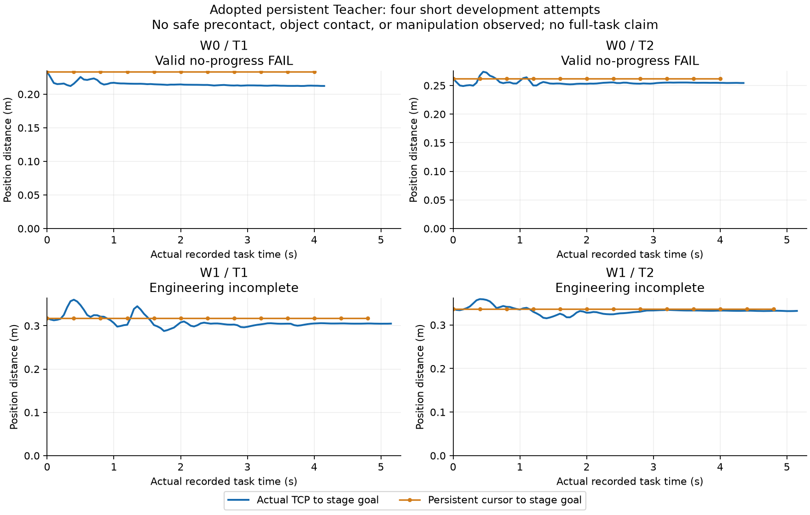
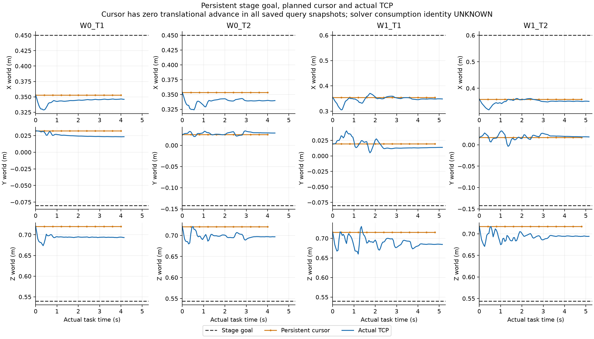

# 新整机 Teacher：独立短开发系列实际结果

## 结论

**四个已采用的短条件已各启动一次：两条有效无进展 FAIL，两条工程中断。没有安全预接触、机器人—物体有效接触、抓握或短推动；两条完整任务确认未准入。整机成功示范仍为0，数据—学习主线仍 PARTIAL。** 不能把这份结果称为“四条有效质量 FAIL”、完整任务0/4，或GR00T失败。旧固定pilot 0/4及原安全失败保持原字节。

这是人类直接回复“采用新 Teacher 开发与资格系列”后的实际执行。采用收据固定 `7a0930cf706efb283412ff37de07f27f1f56d4fa`；原提案9e03d0caaf的未授权历史不回写。沿原Oct15 14:10SGT T0／Oct16 01:10新工作截止／02:10收口和父账，未重置资源。

## 1. 已实施及实际验证

- 新版本 `FULLBODY_PERSISTENT_TEACHER_QUALIFICATION_V1`；实际物理执行源 **`4a12eef87c10d437b4c204e9b6abbd83abefa1f0`**。独立目录与条件ID，不重新运行旧四个pilot。
- 采用持久世界站位／阶段目标／轨迹游标、有界参考超前、真实夹垫—物体几何阶段以及无进展停止。没有强迫按时间进入闭爪／接触。
- 原完整Go2＋ARX5、原WBC/MPC/腿RL、原安全观察器和已验收pause二进制保持；沿用V2有限夹爪工作行程，未调增益、代价、限位或物理参数。
- 实际20Hz记录、每8个间隔／0.4秒提交H40，500Hz安全及真实物理积分。非实时等待保持physics/FSM/腿history不变。TTL仍0.4秒；仅在精确停止的前缀边界等待替换，没有放宽TTL，也不允许未替换就继续物理。
- 初始16项CPU检查及三个保存输入dry run通过；时钟修复后17项本机检查、服务器新增负龄期回归通过。**CPU通过不是物理任务通过。**
- 对380个实际观测逐一核对qpos/qvel/ctrl原字节、双RGB实际时间与高频积分journal；核对48次提交／接受／安装事务及prefix8动作标签。236条保存native14D安装消息的最大XYZ差 `2.790e-8m`、四元数归一化分量差 `1.284e-8`，原容差1e-6；native12D输入全零。
- **安装不是MPC实际选中policy的消费证明。** 该身份仍UNKNOWN；未新增WBC归因运行。完整机器人动态可达性也没有被CPU原件证明，不能以reference几何代替实际执行。

## 2. 四个短条件

距离均为真实TCP到该条持久阶段目标，非H40未来端点差。20Hz距离／几何与500Hz物理接触独立复算，完整原件见 `INDEPENDENT_CPU_SERIES.json`。

| 条件 | 实际任务记录 | 距阶段目标 初始→最近→最后 | 实际结果 |
|---|---:|---:|---|
| W0/T1 抓放 |4.15s，84双RGB，11查询|23.34→21.21→21.22cm|超过2cm接近里程碑；随后原定4秒无进展窗停止，有效FAIL|
| W0/T2 推送 |4.35s，88双RGB，11查询|26.19→24.91→25.44cm|未达2cm接近里程碑；无进展停止，有效FAIL|
| W1/T1 移动抓放 |记录至5.15s；物理至5.20s，104双RGB，13查询|31.78→28.79→30.50cm|时间表示检查中断；只有已保存前缀完整性PASS，非质量终局|
| W1/T2 移动推送 |记录至5.15s；物理至5.20s，104双RGB，13查询|33.70→31.53→33.23cm|同一工程中断；非质量终局|

四条实际物体接触ticks、持续抓握、水平搬运／推动均为0；安全预接触和操作里程碑均未满足。原生安全停止0。W1末尾还有25个实际物理步没有对应下一张20Hz图像，保存在journal中，并在审计中明确列为未录制终端间隔，不能伪称完整数据。

## 3. 科学证据：持久游标没有进入目标平移段

保存的全部查询快照显示，四条游标位置的累计平移均为0；停留在抬高／转向的route段0或1，**没有进入XY平移段2**。原始参考不再每50ms重锚定，但“持久目标存在”没有自动形成有效接近。

当前组件先以初始高度抬高／转向，再平移／下降。实际初始TCP高度约0.715–0.721m，阶段目标约0.54m；初始目标角差约1.42rad（T1）／1.97–1.98rad（T2）。在设计速度0.3rad/s下，完整名义转向本身需要约4.7–6.6秒，不能把转向段尚未平移单独当bug。

更具体的源码与数组证据是：`_advance` 在处理旋转之前，先用**候选参考相对actual的绝对位置距离≤24mm**决定是否整步拒绝。四条actual相对游标最大偏离约46.7／38.3／57.4／42.0mm；保存快照中，下一位置候选超出绝对包络分别10／8／8／8次。这个Teacher自身的耦合检查会阻止后续游标推进，值得作为下一版的单项设计问题；**本轮没有修改该科学设置后追跑成功**。

同刻上一安装参考与actual的位置差中位约28.3／28.3／31.4／24.3mm；它与距最终阶段目标21–33cm分开报告。原50ms版本的3.4mm不能直接当新prefix8的成功门，也不能跨版本只凭这些差值证明唯一动力学原因。

这支持继续处理任务Teacher／轨迹进度，不支持开始WBC调参、用失败示范做成功BC、或推断GR00T无法学习。geometry的远处负例与实际接触计数均没有被放宽来制造阶段切换。

## 4. 独立工程问题：10.2秒浮点表示

两条W1均在native step5100、下一次查询尚未提交时，被 `ACTUAL_OBSERVATION_SOURCE_CLOCK_NOT_BOUND` 停止。实际MuJoCo raw time为 `10.200000000000076`，现有原生ROS时钟为 `10.2`；旧代码把raw浮点自身作为source，再与整数纳秒时钟比较，得到 `-7.638334409421077e-14s`，触发严格负龄期检查。

零物理步CPU已逐条复现，见 `CLOCK_REPRESENTATION_FAILURE_CPU.json`。源 **`a2dc4a2293117d4ad7c04b02683af2a2eb57b030`** 将source绑定到**同一真实packet的原生整数纳秒时钟**；保留raw time原件，年龄窗口仍0–25ms、TTL仍0.4秒，未来／陈旧负例仍拒绝。不是刷新时间戳冒充新观测，未改时钟域或容差。

修复后新物理0。四次短开发启动上限已用完；两条完整确认又要求短里程碑通过，因此没有挪用其条件权限，也没有把工程中断重标质量FAIL。修复只有CPU收据，尚非实际运行资格。

## 5. 资源、归档与交付

| 项目 | 本系列实际 | 本系列上限 |
|---|---:|---:|
| 短条件物理启动 |4|4|
| 条件完整确认 |0，未准入|2，须先通过里程碑|
| 含warmup与保守尾部积分 |19462|71018|
| 实际双RGB |380|2246|
| CoreLab父账新增CPU |427.872秒，含本系列已入账CPU／保守物理服务费|14400秒|
| 新GPU／PBS／GR00T查询／训练更新 |全部0|全部0|

终账：父账33启动／316993积分／11284双RGB／14454.4898827 Core CPU秒。无活动CPU预约，四个episode owner均terminal。`SERIES_CLOSED.json` 和实际入口拒绝已终结系列；没有新T0、旧lease重开或有效失败追跑。selected/deployment仍NONE。

独立私有存储**1302文件／440579732字节**逐文件复制、原件再核对及完整readback；tree **`18b8b418e015df2be123812be674eb59666a8b65fceffa5fbba0d459b7c7ca2f`**。原件未删，WBC/raw/视频没有公开上传。四段真实双RGB视频已有FAIL或工程中断水印，按20Hz播放，标非实时；本机下载SHA一致，并逐条解码首／中／末帧核对。图表PNG与PDF已目视检查。

小证据：`FINAL_EXECUTION_RECEIPT.json`、`INDEPENDENT_CPU_SERIES.json`、`PERSISTENT_REFERENCE_DIAGNOSTICS.json`、`CLOCK_REPRESENTATION_FAILURE_CPU.json`、`PRIVATE_ARCHIVE_READBACK_SUMMARY.json`、`ACTUAL_VIDEO_RECEIPTS.json`。完整原件、成员hash、视频和运行路径绑定保留在原私有登记存储。

## 6. 当前停止点

**停止本已采用短系列，完整确认NOT_ADMITTED；原科学总目标未完成。** 下一版应先针对Teacher自己的绝对位置包络与转向／平移进度耦合建立单项、有限的设计与资格条件，并复用本轮原件；不能只修时间表示后把两条W1或两条有效失败无条件再跑。该建议不是新科学GO。WBC、原始失败、最终物体评分与GR00T训练边界不变。

## 7. 后续零物理步精确复核与未采用草案

后续按原actual输入严格重放44个查询间cursor更新，矩阵逐元素相同。34次由位置检查提前拒绝，且34次候选平移增量全部为零；其余为3次零运动计划路点完成、7次只转向推进。见`EXACT_CURSOR_TRANSITION_CPU.json`。这把源码机制证据从“可能拦住”收窄为“这些保存更新确实被位置分支拦住”，不改变旧物理结论。

只准备了一个[分量独立推进V2草案](../../../../../docs/protocols/PI0294_COMPONENT_PROGRESS_V2_QUALIFICATION_DRAFT.md)：只对变化的平移／旋转分量执行原24mm／0.12rad新值准入，被拒分量保留旧参考，actual不改；不再保证actual漂移后整个位姿绝对包络始终成立。**这是科学合同变化，不是例行工程修复。** CPU两个任务fixture及原44输入的独立单步提案检查通过，没有反事实连续物理rollout；`COMPONENT_PROGRESS_V2_DRAFT_CPU.json`明确launch_allowed=false。

V2如需物理，必须先采用新科学合同及有限系列额度；原V1已停止、原短4启动已用完、原条件完整确认不能自行挪用。新草案准备不代表新执行获准。原raw／1302文件归档不改，后续CPU收据另作小型私有完整回读。
