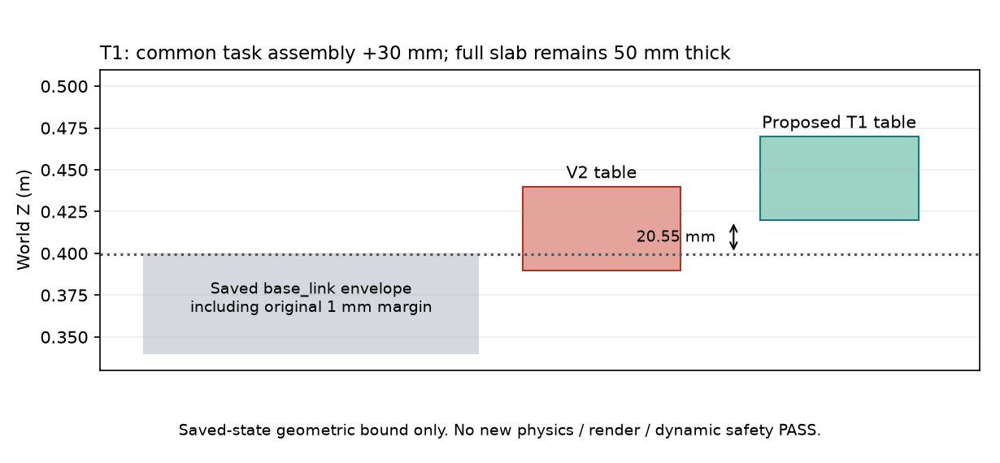

# V3准备报告：T1固定H47净空；T2固定首contact接入

**准备/发布完成不等于新物理GO。** 依据V2固定终局`3b607bbbf4373f61a53280d5b06afc3651e35f54`及#11 **6195800940**，本次只读保存数据、核算几何/源前缀和预算；新增IK/RRT/渲染/physics/神经/训练均0。新V3运行适配NOT_IMPLEMENTED，变更相关CPU契约0/12，launch_allowed=false。原V2 native安全FAIL和全部旧结果不改。

## 推荐的最小修改

|task|固定候选|依据与限制|
|---|---|---|
|T1|桌面/方块/目标/source参考共同上移30mm，桌高.47m，桌面完整尺寸/厚度/摩擦不变|原5300 root包的直属碰撞几何最高Z含margin=.399445131m；新桌底.42m，净空20.554869mm。只覆盖旧保存包络，不是新动态PASS；不搜索其他高度|
|T2|从000/001/002的原contact索引223/231/223接入，初态为原working-closed .002m|截去前缀和首接入采样无pad–cube接触、grasp/lift/carry或水平移动；保留后缀15.50/16.25/16.10s。不是实际触碰已发生或完整路线可行|

T1原机器人/姿态/gain/WBC/安全、桌面面积/厚度均不变。T1评分使用原冻结`score_episode`的显式table_height=.47、goalZ=.49参数；所有相对任务阈值及完整32秒/保持/原生安全AND不变。旧.44身份包装继续拒绝H47，新scope只接受固定H47。没有把raw actual搬回.44或放宽高度容差。此项scene/评分参数适配需随本固定方案明确采用，不能沿用旧W0授权偷偷执行。

T2为保留闭爪推送的功能，显式将新task夹爪初始化/reset固定到原working-closed .002m，并同步最初command/previous targets；只改新增夹爪两DOF，机械范围/2mm margin/速度力/gain以及原生根/腿/臂启动不改。初态不构成抓持，不复制源关节/物体状态。CPU原保存open-actual/closed-tool规划view不能冒充新actual；实际新观测/RGB与warmup需重新绑定，新输入不能用旧response伪装cache。

## 实际证据及反证边界

- [T1几何包络](T1_SAVED_GEOMETRY_BOUND.json)：原native模型SHA `70663bf41a235f8f2baf179447720bd1ca845ce1abf847898ba884a46559fc55`，journal SHA `9d8987b78d40360562c90a0abcf5dc24d5bb167b7d70c9ee2334758f79c69536`。base_link直接附属碰撞geom11/12/13；geom11最大AABB-Z=.398445130547m、原margin=.001m。首末保存状态与原生mj_forward的world几何中心最大差0。
- [T2源前缀R1](T2_SOURCE_CONTACT_PREFIX_AUDIT_R1.json)：原source model geom ID cube78/pads75、77，逐条解析contacts的`geom0/geom1`，三源起点及之前均只有table–cube接触；最大水平位移0，Z沉降约.125127mm。源阶段名contact不是传感器接触成功。未删掉已发生推送，不拿未来actual当动作监督。
- R0准备helper曾错误查找contact的a/b名字字段，得到的pad-contact计数无效；[原R0 helper](PREPARATION_HELPER_R0_DO_NOT_REUSE.py)和原小收据私有保留，以[实际R1 helper](PREPARATION_HELPER_R1.py)及R1原geom-ID收据更正。没有新solver/physics或改动source。R0的root几何计算另经保存状态校验通过。
- helper通过已有受检PC→CoreLab入口在固定d507f0dc76d3a66c199d620988ef63a890892b64只读capsule上导入公共代码执行；helper normalized源码在准备后随本包发布，不能宣称它们在执行前已有新Git release。实际远端接入/CPU收据及私有封存保留；未来科学执行必须消费本固定新source capsule，不能从stdin临时改活跃运行。
- 本次准备没有构建新场景模型、查询新IK/RRT、渲染图像或运行物理。示意图由保存标量绘制，不是MuJoCo新渲染；它不证明腿/臂/未来root运动安全。

## 预算和真实资源

本次远端实测CPU **1.675332356s**（含R0/R1/保存变换核验），PC编辑/传输未观测项UNOBSERVED；父账 **39启动/358808积分/12361双RGB/15856.836595361141 CPU秒**。本run消费者0、CPU reservation0，原V2 closure/search/archive-index hash不变，见[准备收据](PREPARATION_RECEIPT.json)。13个准备payload成员17013字节私有逐文件回读，tree `efb2245f73a072e2d2b1adc72911bc3cae776ad8570335414b5962f9fa8d7c2d`，原件未删。

拟V3两条完整32s，≤4启动/42012积分/1282双RGB/14000 CPU秒（≥1800收口）、4CPU/1worker。新164bundle、165goal/2640CLIK、660RRT、166166dense/830830local预扣。先12项变更CPU契约与各task自身CPU/实际warmup，合格直接完整任务，不增加短质量门、不等待辅助签字或例行GO。

MP-S2＋源V1/V2现已53bundle、122goal/1952CLIK、78RRT、48048dense；加V3最坏217bundle/287goal/4592CLIK/738RRT/214214dense。**显式将后继局部200/205205分配改为217/214214**，仍在较早外层222/221221内；加旧ManiSkill V1的11011dense为225225≤232232，旧预扣不退账。物理最坏父账43/400820/13643≤原43/404023/13771，CPU父账≤29856.836595361141；source14400 CPU allowance仍保留。不是免费再给旧V2一套预算。

沿原T0 **1792044600**、新工作截止 **1792083759（10月16日01:02:39 SGT）**、收口 **1792087800（02:10）**；发布/采用不续时。执行前再次刷新实际消耗与lease，过期统一报告资源缺口，不自动开启新窗口。

## 采用后执行终点

T1→T2，各一次；任一有效native安全FAIL停本V3全部新物理，普通有效任务FAIL不重试该task。两task独立准入，未完成前缀不报完整成功率。任务物体真实接触、grasp/搬运/释放/保持和完整原任务成功分别报告；仅真实安全成功episode可成为该scope一个种子，不自动扩采/GR00T训练。持续保留实际双RGB、500Hz物理、原gate/安装/actual TCP和CPU独立复算及私有全文件readback。

[完整方案](../../../../../docs/protocols/PI0294_TABLE_CLEARANCE_AND_CONTACT_ENTRY_SEED_V3.md) · [任务卡](../../../design/SOURCE_ACCESS_V3_TASK_CARD.json) · [固定条件/随机表](../../../design/SOURCE_ACCESS_V3_CONDITIONS.json)。WBC/安全/原任务阈值冻结，不再循环修FSM。selected/deployment=NONE。
