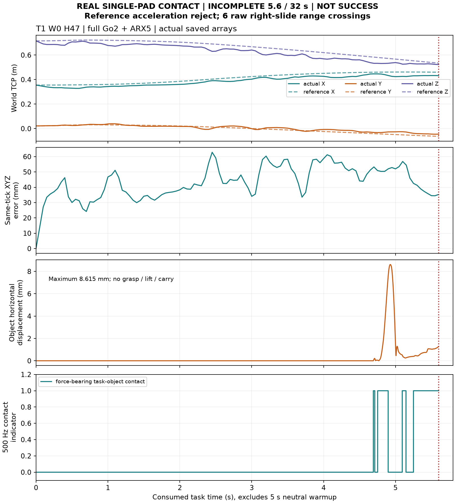

# PI0294 V3终局：取得真实单侧接触，未取得完整成功种子

**实际执行已到固定合同停止点 `STOP_V3_VALID_REFERENCE_FAIL_NO_SUCCESS_SEED`。整体目标仍为 `PARTIAL_TRUE_CONTACT_NO_COMPLETE_SUCCESS_SEED`。** T1在完整Go2＋ARX5上取得真实右夹垫－方块接触，运行到任务5.6秒时，下一段尚未安装的参考触发原1.0 rad/s²关节加速度门；不继续物理、不重采样。独立500Hz复算另检出右夹爪6个原始机械范围越界点，本段不能作为合格示范。T2自己的10秒入口门与两dense窗口预算未闭合，未运行物理。没有完成任何32秒任务，不能报告完整episode成功率0/2。

固定采用：`60cef8283f4a44baa3367d6f264db5250f52f5bb`，包括明确累计搜索预算重分配；[人类采用收据](../../../design/SOURCE_ACCESS_V3_HUMAN_ADOPTION.json)。沿原T0 `1792044600`、工作截止`1792083759`、收口`1792087800`，不重置预算。旧V2原生安全FAIL及全部历史原件/hash保留；WBC/MPC/腿RL/增益、原SafetyGate/native安全、原任务评分阈值冻结。无FSM阈值循环、额外场景/source/seed、模型查询、训练、GPU/PBS或扩采。

## 1. 实际准入与两个任务的完整分母

12项受影响CPU契约**实际PASS**，见[CPU收据](CPU_ADMISSION_SUMMARY.json)。保留原20基线契约，不重复历史科学查询。CPU PASS只证明被测契约，不是动态任务PASS。

|条件|固定改动/源|CPU实际结果|真实物理/完整32秒|
|---|---|---|---|
|T1 W0_H47|完整桌/方块/目标/源reference共同worldZ＋.03m；桌面.47、桌底.42；原完整5cm厚桌及碰撞规则不变。三源仍30..257，姿态/夹爪/时间不改|首条000路线7.659492049s＋原后缀15.633403722s合格。其余源不追分搜索|同源actual warmup重算入口7.215003468s；任务5.6s后有效参考加速度FAIL；未完成|
|T2 W0_CONTACT_JOIN|固定contact索引223/231/223，完整保留后缀15.50/16.25/16.10s；只改任务夹爪初始/reset到.002m|000的两路线dense均PASS，但入口10.346340387/10.466796546s均超10s；用完两dense窗口。001仅1RRT未认证，002未评价|未启动；当前actual闭合reset为UNOBSERVED，不能用CPU keyframe代替实际初态收据|

T2两路线**入口＋后缀25.846340387/25.966796546s均≤28s**；阻断是单独10秒入口cap，而非总28秒上限。001为`NOT_CERTIFIED_DENSE_BUDGET`，002为`NOT_EVALUATED_DENSE_BUDGET`，不能称三源全质量FAIL或全局不可达。[独立时间/分母复算](T2_TIME_AND_DENOMINATOR_AUDIT.json)。三T2接触goal复用原consumer精确缓存，0新T2目标IK；旧closed-tool规划视图不冒充当前actual观测。

T1三新目标共48个保存CLIK：数值收敛14/13/14，原native合法候选见证10/10/11，各1去重goal。按000首条合格冻结，不按成绩换源。[保存解/缓存复核](SAVED_GOAL_NATIVE_AUDIT.json)。原机器人root/腿/arm初态不变，实际首步前`mjData`与预执行一致，qpos SHA `bff841f92c2e4ffdfe396b17d441629389aa61f5098dc5106d3a61660856a7d3`，T1双指初始.042m。

## 2. 真实接触、参考安装与实际任务结果

实际**1启动、5300原生积分**（中性warmup2500＋任务2800，dt2ms）、**113组双RGB/226图像、14提交与ACK安装事务/70安装消息**。父账按原＋3尾步规则保守扣5303，不把预扣当实际物理步。

- 首个有力右夹垫－方块接触：step4846，contact source任务时刻**4.690s**，保存采样**4.692s**；normal force2.371712N，signed distance−.010278mm。
- 285个500Hz有力contact ticks，累计**.570s**，最长连续**.352s**；464条contact记录与285独立ticks不是同一分母。仅右pad，峰值normal force**33.585346N**，最深pad-cube穿透**2.255110mm**，原4mm规则不改。原native stop记录为空，任务5.6秒前机身－桌面contact ticks0。
- 物体最大水平位移**8.615348mm**，实际grasp ticks0；尚在approach，未到close，没有抓起、搬运、释放/撤离或持续任务成功。**真实接触不等于合格抓取或成功种子**。[接触独立复算](TASK_CONTACT_RECONCILIATION.json)。
- BASE软速度意图为0，但实际根位移ΔXYZ=[+.268843482,−.019609852,+.015973312]m，norm27.003057cm；零意图不是物理固定底座，也不足以证明唯一WBC原因。未开展额外低层控制诊断。
- 实际TCP初始[.355067313,.022296076,.715586205]m，最终[.432213122,−.044977205,.522757279]m；最终同tick参考[.460189835,−.063002447,.534511552]m，XYZ差35.295450mm、中位42.531725mm、SO3差.062151584rad；实际TCP最大位移21.831208cm。这些为诊断，不重新引入保持RMS数据前置门。
- 原source H40/夹爪20Hz逐值重放一致，安装XYZ最大差2.97745e−8m、quat3.30295e−8，原1e−6容差不变。actual root/DOF/ctrl/FK、图像hash及时间、pause/history检查通过。原score `clock_valid=false`来自未收齐32秒/641帧；不能当成已保存prefix时钟错误。

### 有效参考加速度FAIL：未来窗口未安装

query14在actual任务5.6s，固定1001点/2002局部迭代的保存预览被原门拒绝：最大reference关节速度.244563578rad/s＜.7，最大reference关节加速度**4.012846783rad/s²＞1.0**，峰值关节x5_joint3；原相对容差1e−10不变。峰值差分stencil为窗口[1.70,1.75,1.80]s，中心预测任务时刻7.35s，约在连接末端7.215s后.135s。[独立重算](REFERENCE_ACCELERATION_RECONCILIATION.json)。

这是**尚未安装/执行的参考**二阶差分，不是实际WBC测得的关节加速度，也不是已证明唯一join算法根因。原停止`VALID_PLANNING_FAILURE: FROZEN_SOURCE_JOINT_ACCELERATION`保留，拒绝输出不安装；有效质量FAIL不重试。

## 3. 高频原始机械越界：原20Hz输出保留，R1独立补充

[原独立审计](INDEPENDENT_PHYSICS_AUDIT.json)保留原20Hz `quality.safety_valid=true`和native stop=[]，SHA `a616f00d2c22d6f831e265e7ff03a5fbff97d18c5fe4d923581c36c8ea5479a2`不改。**这不能证明全500Hz机械范围合格。** [全20个limited joints/5300步复算](ALL_JOINT_RANGE_AUDIT.json)发现唯一raw越界关节：

|关节|原范围|实际最大|最大上越界|样本/物理时间|任务时间|
|---|---|---|---|---|---|
|task_right_slide|0..44mm|44.065533771mm|**65.533771µm**|6点，steps4933..4938，9.866..9.876s|4.866..4.876s|

其余19个limited joints保存样本均在原范围；右指最小35.901036mm，左指40.278719..43.291333mm。6个采样对应名义12ms，首末采样时间差10ms，不能混用。原observer没有触发安全停止；不伪造native stop，也不忽略真实raw越界或放宽限位。两slide motor命令峰值.798440/2.449605N＜原8N；接触normal force33.585N与motor command是不同物理量。

[补充R1](INDEPENDENT_PHYSICS_AUDIT_R1.json)判定为 `VALID_REFERENCE_ACCELERATION_FAIL_WITH_HIGH_RATE_RAW_GRIPPER_RANGE_EXCESS`、`successful_data_admission=false`、`high_rate_joint_range_all_PASS=false`。这是原高频证据补充，**不是重写原评分或旧失败**。本段只保留为接触/失败证据，成功seed和合格训练示范均0。

## 4. 累计内部搜索、CPU及物理账

[搜索账](SEARCH_ACCOUNTING.json)：新增**18bundle=2CPU＋1warmup＋15live**，14live安装、最后1live拒绝。**19新目标IK/304CLIK/19RRT**；dense预扣/实际均19019，local预扣95095/实际34034。内部槽全部COMPLETE。严格零路程首live不调用随机RRT，T2旧目标0新IK；没有免费重抽或质量重试。

累计MP-S2＋source V1/V2/V3实际**71bundle/141目标/2256CLIK/97RRT/67067预扣dense**，另旧Mani V1 11011dense，合计78078。采用的累计上限217bundle/287目标/4592CLIK/738RRT/214214dense，仍在原外层222/221221内；含legacy dense原外层232232。显式采用的旧local 200/205205→217/214214重分配实际生效，预算未重置；剩余额度不构成失败后重试授权。

[父账结算](SETTLED_ACCOUNTING.json)：新增**1启动/5303扣账积分/113双RGB/163.5450618044 Core CPU秒**；累计**40启动/364111扣账积分/12474双RGB/16020.3816571656 Core CPU秒**。实际原生5300步；物理CPU实测116.5091687s，按4×服务墙钟保守扣153.4086670754s。CPU仅远端纳入账本范围；PC编辑/传输/绘图和部分只读metadata CPU为UNOBSERVED，不声称跨机器精确总CPU。新T0=false，无预算重置。无新神经、GPU/PBS、GR00T训练或正式数据扩采。

## 5. 最小工程修复与实际源码身份

1. 首次CPU使用bare机器人XML，缺交付场景floor导致geom数不一致，IK/物理前拒绝。改用已有合格完整compiled场景作baseline，逐属性核对，仅保留获准场景/reset差异；不是改碰撞体。
2. 原CPU stage不可重复，拒绝重复票据；新工程stage完成实际12项。旧失败/票据保留，已有效科学查询不重跑。
3. 物理audit后读取附加文件时00索引拼接错误；原审计已保存，修读取路径后直接复用，无新物理/求解。
4. 高频全范围断言暴露真实右slide越界，保留原失败及R1，不将它当日志bug抹除。无observer、安全、native或gain修改。

|身份|固定SHA|
|---|---|
|采用V3|60cef8283f4a44baa3367d6f264db5250f52f5bb|
|采用/版本化V3首发|2067eca893f2980620da87925660c34fe3625e85|
|实际12CPU及T1物理|68a6da3c40e01e60cd7dd8bbf0e3a326b8c9b71a|
|只读接触/保存解/视频审计|badd66f5e422f93c02b11fe3afe679d379673437|

[原生source/config/model/policy/binary及已有pause binary收口hash](FROZEN_NATIVE_READBACK.json)一致；物理与后续audit各自RUN_MANIFEST/SOURCE_SEAL独立封存，不用audit SHA覆盖实际运行身份。公共冻结核心与旧证据hash保持。报告提交不需要热切已结束runtime。

## 6. 原件、视频与终态

[私有全文件回读](ARCHIVE_READBACK_SUMMARY.json)：**662成员/115442467字节**，tree `44a6eed7df0b9947af25679705de46997458808c7e08679eed32b1471eaa270e`；最终索引SHA `23e3c2bde57a71e14897d7d861c3d36eb0fb91c5473dfad82c5473f78e98e4cf`。包含首次查询/原源与时标、实际RGB/physics/journal、1001点预览、原始工程错误、CPU票据、实际视频、20Hz/R1审计和结算账；逐文件源/归档hash一致。原件未删，raw/WBC未公开。新增报告侧只读文件读取不产生新的物理或查询。

实际MP4从已保存113组双RGB生成，512×352、20Hz、113帧，任务5.6秒、播放5.65秒含初帧；水印标记ACTUAL FULL Go2＋ARX5/V3/NON REALTIME/VALID_TASK_OR_PREFIX_FAIL及原停止原因，明确为失败prefix。SHA `f15b727a13d87c780d7df92622f034fa105ad02638d4da1f77ecf58a7289f2a7`，355676字节。[视频收据](ACTUAL_VIDEO_RECEIPT.json)，私有本地视频与图表交付；不公开raw视频。原视频未改，R1高频越界作为独立证据随报。图表只复用保存数组，不新增渲染/神经/物理。

[终态](FINAL_STATE_SUMMARY.json)：本run活动消费者0、CPU reservations0、结算未变、旧证据hash不变；终局后的新物理dispatch已实际验证拒绝`SDR3_TERMINAL_PRESERVED`。执行完成到明确停止点与质量PASS分开：真实接触已观察，完整成功种子未取得，整体PARTIAL；**selected/deployment=NONE**。不借剩余预算继续尝试，不继续WBC/FSM阈值、限位、gain或种子搜索。
