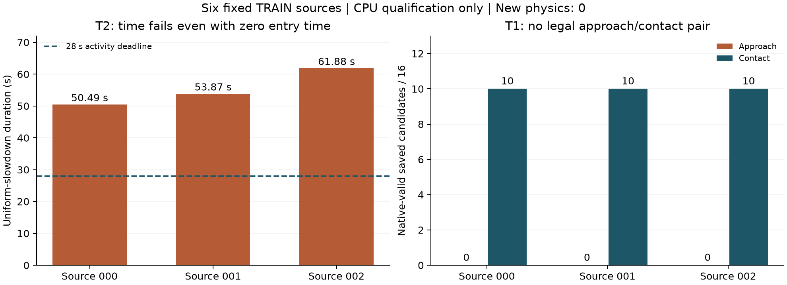

# PI0294 自有成功示范重定位：六源已执行，固定候选池未准入

**实际终局：`STOP_FIXED_SOURCE_POOL_NOT_ADMITTED`。** 已按明确采用的 `e7d6537facc3c670cdd197e64302eac913965534` 执行到协议第5、9节规定的科学停止点。六条自有TRAIN全部提取并检查，两任务均无满足原合同的源路径。**没有获得新的真实接触或完整成功种子；整体任务数据目标仍PARTIAL。** 这不是CPU_READY，也不是WBC物理任务FAIL。

## 1. 结果先行

|固定源尾号|T2：即使连接耗时为0，活动片段仍需|T1：活动片段时间|T1接近端合法候选/16|T1接触端合法候选/16|T1成对路径|
|---|---:|---:|---:|---:|---:|
|000|50.494535 s|17.699492 s|0|10|0|
|001|53.866355 s|17.268415 s|0|10|0|
|002|61.882846 s|17.430597 s|0|10|0|

T2上限为活动完成时间28秒，尚未计入自由连接。因此三个来源均已不可能满足本版时序，不消耗其IK/RRT槽。T1时间下界未超限，但三个源首点均未找到符合原生限位的接近解，无法组成approach/contact配对，尚不能检验完整连接时长。

图中接触端10个是16次已保存CLIK初值中通过独立原生FK/限位/碰撞检查的候选，**不代表10个不同分支**；原规划器去重后每个接触端保留1个合法goal。三个接触端均有解，不能写成“接触全局不可达”。

## 2. 实际做了什么

1. 在无健康消费者的边界登记人类采用，绑定原窗口/累计父账；原MP-S2未执行辅助槽登记为被新方案替代，既有PARTIAL与有效FAIL/hash保留。
2. 从固定v3.0源池按顺序读取T2/T1各000、001、002，逐一核验原TRAIN身份、成功/准入证据和raw成员。六源各641个实际观测、80个H40、640个唯一实际提交点；共3840行submitted监督与原安装first8逐值一致。没有把601个导出锚点当641帧，也没有用未来actual EEF充当命令。
3. 从真实源模型及目标模型读功能夹垫坐标、闭合轴和行程；只做零物理步FK，源actual首帧与模型FK一致。独立检查源/目标功能工具矩阵差异≤1.5e-16；模型/WBC原件私有。按原事件向首个不早于事件的20Hz提交点切片，未补造后缀。
4. 逐源执行唯一双锚重定位、姿态变换及uniform slowdown。独立重建与已保存目标pose最大差0，时间计算一致。16项窄CPU契约通过；这不是动态安全或任务成功收据。
5. T2三个时间下界均失败。T1三个实际保存输入各执行1个固定bundle：共6目标IK调用、96次CLIK初值；全部首结果保留，不重抽、不替换源。原生独立复算没有新增IK、RRT、渲染或物理。

## 3. 具体阻断与解释边界

### T2：原提交参考边界的速率峰值使统一减速超时

|源|重定位前原提交最大线速度|重定位后最大线速度|uniform slowdown|峰值原source索引|
|---|---:|---:|---:|---|
|000|0.186386 m/s|0.187596 m/s|3.126597|375→376|
|001|0.192560 m/s|0.194698 m/s|3.244961|367→368|
|002|0.222461 m/s|0.225029 m/s|3.750475|383→384|

三个峰均跨越原first8参考边界，且在未重定位的原submitted轨迹中已存在。按本版0.06m/s与0.3rad/s、仅统一减速的规则，完整片段最少50.49–61.88秒。**这是该片段/重定位/时参合同的适配负结果，不是否定源任务成功或证明必须修WBC。** 没有平滑、丢弃峰值、压缩时间或切掉阶段追通过。

### T1：接近端数值收敛不等于合法关节解

三源接近端分别13/16、15/16、14/16数值收敛，但独立native限位检查均0/16合法；主要涉及joint4，亦有其他关节越界。接触端16/16数值收敛，各10/16保存候选具有原生合法见证；规划器去重后各1个goal。两端必须AND，故三源均无合法pair，RRT及dense未启动。

这里只证明**本版固定初值预算及源目标下**未找到合格首段，不证明全局IK无解，不证明WBC执行不了任务，不把后续可行接触目标替换成已授权源首点。未切换外部参考库、第四条源、姿态、seed或FSM阈值。

## 4. 工程修复与原件保留

初次独立审计的汇总布尔值误把“任意端点有合法见证”视作完整性异常；三个本来已被接受的contact端因此触发告警。原96个候选、FK、限位、碰撞复算数据本身未改变。窄修后改为核对“原规划器拒绝的端点是否有意外合法见证”及“两端都有解却没有配对”。保存结果复用，**新增求解/物理均0**。原审计文件SHA `8a2c659a9bc32260b72fb7a1541bf4586e9a96379adf405b4877529e12a4614b` 保留；R1汇总已闭合且无未解决异常。

运行源：提取 `37427a3e2c2de97e6739d489a1e1ed5533bee537`；CPU规划 `723de717f1ba42c4502d44ea463f08e47b854bb7`；独立复算 `61e57d99ac1ca98ce1289e9d39eab7333afcb781`；只读汇总修复/收口 `544abbe48e858fff8c6cf3d5ab14964eee057a65`。报告提交不改变已封存运行源。一次SSH连接关闭后先确认无closure、无reservation，再恢复收口；没有重复科学查询。

## 5. 完整分母、消耗和未执行项

|项目|实际|
|---|---:|
|固定来源提取/候选|6/6|
|窄CPU契约|16/16|
|CPU输入bundle / 目标IK / CLIK初值|3 / 6 / 96|
|RRT / dense点|0 / 0|
|新整机启动 / 物理积分 / 双RGB|0 / 0 / 0|
|新真实接触 / 完整成功seed|未观测 / 0|
|GR00T查询 / 训练更新 / GPU / PBS|0 / 0 / 0 / 0|

两个完整32秒条件均为 `NOT_RUN_OWN_SOURCE_PREREQUISITE_FAILED`，不是两个已运行物理FAIL，也不能报“0/2任务成功率”。无新task RGB，因此没有伪造或复用旧录像作为本版实际视频。物理500Hz/20Hz复算没有新数组可做；完成的是源20Hz重建、时间/重定位和保存CLIK的独立CPU复算。

远端父账结算CPU增量 **5.104707980000967 core秒**；最终累计38启动、353508积分、12248双RGB、15619.141820450666 Core CPU秒。该数字是远端CPU-stage账本，**不含PC编辑/传输/绘图或墙钟**；后者UNOBSERVED，不估计为0。原T0、截止和预算未重置，无活动CPU reservation/本run消费者。

## 6. 原件、回读与终局

私有归档75文件、2070694字节，逐文件SHA读回一致，含六源提取/重定位NPZ、首次请求/响应、原及R1独立审计、实际源码封存和CPU结算收据。最终tree `dc4cfd31d4701c73a881b797e02987dd3f668dc3a9933311084a15898c0f83c8`；索引SHA `5447f044c0d5914673a75e6183734435d7174dfd2e22616040fb7c8b8c4479be`。原raw bank及本轮原件保留，私有位置由注册runmap保存；未删除、未公开raw/WBC。索引不将自己递归计入tree，索引本身另做逐文件回读。

原native源码/配置/策略/二进制与已合格pause二进制逐项hash不变；WBC、安全、评分无改动。关闭后的科学入口已实际拒绝 `SDR_TERMINAL_PRESERVED`。

依据采用协议第9节，两task都无合法source-route，**封存这一有界假设的负结果并停止**。实际接触/完整种子目标仍未达成；没有新增成功数据，不能进入扩采或GR00T训练。selected/deployment=NONE，原FAIL永久保留。

## 可检查收据

- [六源身份、原成员SHA、切片与事件](SOURCE_EXTRACTION_SUMMARY.json)
- [16项CPU契约](CPU_CONTRACT_CHECKS.json)
- [独立时间/FK复算与R1汇总更正](INDEPENDENT_CPU_RECONCILIATION_R1.json)
- [原生冻结身份](FROZEN_NATIVE_READBACK.json)
- [终局及两条未执行条件](SERIES_CLOSED.json)
- [最终账本](SETTLED_ACCOUNTING.json) · [最终无消费者状态](FINAL_STATE.json)
- [私有归档小收据/原件hash](ARCHIVE_READBACK_SUMMARY.json)
