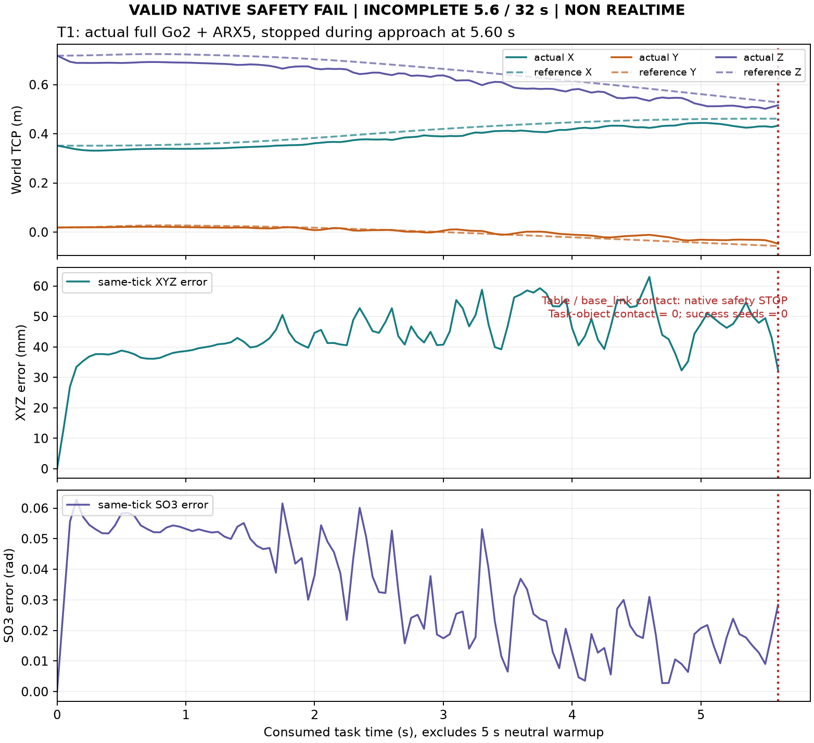

# PI0294 V2实际终局：T1进入真实执行后触发原生安全停止，未取得成功种子

**终局：`STOP_V2_VALID_NATIVE_SAFETY_FAIL_NO_TASK_SEED`。执行已推进到协议明确停止点；真实接触与完整成功种子的整体目标仍PARTIAL。** T1运行到任务5.6秒时，原生`base_link`附属几何体与桌面非法接触；未进入close，目标物体接触/抓持/成功种子均0。T2三源的局部时间表通过XYZ/SO3速率算术，但接近端无满足原限位的登记IK，因此没有运行T2物理。两条件都没有完成32秒，不能写成完整episode的0/2成功率。

固定采用：`5a0cceeeb7e79f6f326a5aa17168a453acb65180`；[人类采用收据](../../../design/SOURCE_RETIME_JOIN_V2_HUMAN_ADOPTION.json)。原T0 1792044600、工作截止1792083759、收口1792087800不重置。WBC/腿RL/MPC、动力学、gains、SafetyGate/native安全、场景、W0/seed0、BASE软速度零及原任务评分全部冻结。没有新增物理重试、FSM阈值调整、模型/训练/GPU/PBS或扩采。

## 1. 两个任务的原分母与实际进展

|条件|CPU实际结果|物理结果|完整32s|任务物体接触/成功种子|
|---|---|---|---|---|
|T2 W0|000/001/002局部片段18.60/19.40/19.10s；三源接近端合法IK均0，接触端各1个去重goal；无approach/contact pair|NOT_RUN，自己的源路径前置不通过|否|未观察，未运行|
|T1 W0|按000优先锁定，CPU连接8.0607279362s＋原close→hold后缀15.6334037218s；连接和保留后缀预算合格|warmup5s后实际任务5.6s，14次提交/安装，ILLEGAL_CONTACT|否|0 / 0|

T1只删除原索引0..29的非接触align段；保留30..257共228源结点及原uniform slowdown、gripper值和完整抓放后缀。T2只改变时间分配，所有源pose/rotation/gripper结点与原顺序保留；没有平滑、截断或actual重锚。六源的切片/原hash/阶段与事件映射见[实际CPU及源程序收据](CPU_ADMISSION_SUMMARY.json)，完整逐区段时间数组在私有原件中。

20项窄CPU检查实际通过，而非只存在代码断言。CPU两batch仍保留六候选分母；T1选择首条合格000后不继续查询001/002的route，不把它们记作质量FAIL。warmup对同一锁定源重新使用真实actual输入，未换源或seed。连接CPU/有限native preview通过不表示整条动态任务安全保证。

## 2. 原生实际安全事件及同刻跟踪

- 实际原生积分5300步：中性warmup2500＋任务2800，dt=2ms；任务保存113个20Hz观察、113组双RGB（226图像），14个已提交且ACK安装的chunk。第15次规划输入在当前实际状态遇到原生碰撞后失败，未安装拒绝输出。
- 原生安全observer在step5300记录`ILLEGAL_CONTACT`。首次保存接触来源时刻5.598000000000209s，20Hz终点采样5.6000000000000005s；两个接触记录同属`task_table`(geom1)与未命名geom11。
- 原生geom11附属`base_link`，类型box，body祖先链只有`base_link`。首个接触signed distance为**+0.000481103238m**、normal force **125.2827984N**，原geom contact margin **0.001m**。这是原边界内激活的非法接触，**不能写成负距离穿透，也不能因距离为正忽略有效安全停止**。
- BASE软速度命令为零，但实际根平移ΔXYZ=[+0.252020691,−0.016335157,+0.016849230]m，幅度**0.253110969m**。零意图不是物理固定底座。该观测说明存在真实整机运动，尚未证明唯一WBC根因；不追加低层归因、hold或调参实验。
- 实际TCP从[0.351421773,0.018430295,0.717598703]m到[0.432555920,−0.047457787,0.515861370]m，最大位移**0.235668102m**。最终同刻参考[0.461244730,−0.056577520,0.527683736]m，XYZ差**0.032341703m**、SO3差**0.028386916rad**；XYZ中位差0.043405109m。这是同tick误差，不是两个minimum之差，也不是新任务准入阈值。
- source仍为approach，未到预定close；目标物体水平位移0，实际任务物体contact ticks=0、grasp ticks=0。机身碰桌面不是目标真实接触里程碑，也不是抓放成功。

[独立物理复算](INDEPENDENT_PHYSICS_AUDIT.json)逐包核对actual root/DOF/ctrl/FK、原score flags、500Hz接触与113个20Hz数组。14个事务/69条实际installed参考，XYZ最大差2.97990658e-8m、quaternion最大差3.35369593e-8，均在原1e-6容差；原H40、source数值与gripper 20Hz标签逐值重放一致。113组实际相机时间与226图像hash一致；暂停等待CPU时sim/MPC/history保持。任务非实时；没有teacher修补actual输出。

## 3. T2独立保存解复核

[96个已保存CLIK的native审计](T2_SAVED_GOAL_NATIVE_AUDIT.json)无新求解/物理/渲染，原search账hash不变：

|源|approach数值收敛/16|approach native合法见证|contact数值收敛/16|contact native候选见证 / 原去重goal|
|---|---:|---:|---:|---:|
|000|4|0|16|11 / 1|
|001|3|0|16|11 / 1|
|002|5|0|16|10 / 1|

接近端保存解存在原x5_joint4/3/5等关节限位冲突；数值收敛不等于原限位合格。contact候选有合法见证，不宣称整个目标全局不可达、所有姿态IK无解、源示范失败或WBC不能完成任务。本V2没有继续扩大搜索或调整目标。

## 4. 实际内部计算与累计预算

[逐bundle/内部槽账](SEARCH_ACCOUNTING.json)：18输入bundle＝2 CPU＋1 warmup＋15 live，其中14 live成功安装、最后1个有效规划FAIL；22新goal IK、352实际CLIK初值、16RRT，17017预扣dense点/85085预扣local迭代，实际**16017 dense点/30032 local迭代**。未消费的预扣容量不返还重试；incomplete内部槽0。首个live连接是严格相同q的零路程，未调用随机RRT，显式记录而不算一次隐藏查询。

[结算父账](SETTLED_ACCOUNTING.json)：本V2新增**1启动/5300积分/113双RGB/234.7490390285 Core CPU秒账本增量**；累计**39启动/358808积分/12361双RGB/15855.1612630051 Core CPU秒**。物理进程实际CPU116.463326391s，按4×服务墙钟保守扣149.497799153s。setup遗留进程已核实不存在，CPU未实测项按上界保守扣79.521137476s，**不是观测CPU用量**。其余被测远端CPU收据保存；PC编辑/传输/绘图与部分元数据读取CPU为UNOBSERVED，不声称全部机器总CPU精确可知。准备metadata 1.270403526s已一次性计入起账，无预算或时钟重置。

没有第二次物理启动或严格任务前工程替换。因有效native安全FAIL停止全部V2物理，不因还有额度继续；没有质量重试、换源、换seed、下载外部候选、GR00T训练或PBS。

## 5. 工程修复与源码身份

所有工程原始失败/消耗保留，未修改旧V1/MP-S2/历史FAIL：

1. Windows工作文件CRLF与Git提交LF造成采用SHA不一致，在IK/物理前拒绝；改为绑定实际Git字节`ad84276c…`，原采用文件不改。失败setup遗留reservation在确认PID消失后保守结算，原票据与reconciliation保留。
2. prefix准备JSON的声明hash来自CRLF；原Git LF文件另存，重建声明CRLF字节后SHA为`e680310d…`，解析内容完全相同，未改科学值。
3. 一次CPU环境缺DISPLAY在求解前失败；改用已有native+xvfb profile后执行正式20项，不复跑已有效科学查询。
4. 严格零路程连接直接保存相同q的两点，不新增距离阈值或随机搜索。gripper按原20Hz首8点经原packet ABI提交，原actuator/gain不变。
5. 安全停止后仅增加只读closeout/audit通道；实际新物理dispatch已验证拒绝`SDR2_NATIVE_SAFETY_FAIL_PRESERVED`，写终局后拒绝`SDR2_TERMINAL_PRESERVED`。没有把审计权限扩为物理权限。

|身份|固定Git commit|
|---|---|
|采用方案|5a0cceeeb7e79f6f326a5aa17168a453acb65180|
|实际20CPU/源程序|fc2227751de282f6d514e029e4a76321ffe95243|
|实际T1物理|dc9a066d0d4063becf395e518f1e511745ec154e|
|只读物理审计/closeout入口|fc62edb274abe152920be50fddd7e5c32ab12d92|
|只读T2保存解审计/视频|d507f0dc76d3a66c199d620988ef63a890892b64|

[原生源码/配置/模型/策略/二进制及pause二进制](FROZEN_NATIVE_READBACK.json)在收口再次逐项hash一致；公共冻结核心21成员也核对。实际运行manifest/source seal分别封存，后续审计source更新不改写物理source身份。报告提交不切换已终止的运行源。

## 6. 原件、实际视频与关闭状态

[私有全文件回读](ARCHIVE_READBACK_SUMMARY.json)：**636个payload成员、116754243字节**，tree `baadfc70671afb606addf258bc5e9277bd809aa6f580ec26159bc73838e17fe7`；最终索引SHA `b5b2cb011f1f52857f8cd7c2f765889004a8288e5728122ea389ae6d32f7510e`。包含六程序、全部首次查询、实际journal/physics/RGB、native场景、独立复算、实际视频、物理与审计source seal、原始工程失败、CPU票据及结算账。原件未删除，raw/WBC未进入Git或公开HF；最终索引本身单独字节回读一致。

实际视频由保存的113组RGB制作，512×352/20Hz/113帧，实物理任务prefix5.6s，播放5.65s（含初始帧）。水印标记FULL Go2＋ARX5、V2、NON REALTIME、VALID NATIVE SAFETY FAIL/NOT SUCCESS。SHA `409927b6ca87b02596a8a2b5c914070efec972b567efdeca79159b904b0885bf`，338031字节；[小型视频收据](ACTUAL_VIDEO_RECEIPT.json)，实际MP4作为私有本地交付副本提供，不公开raw视频。原视频逐帧chunk角标使用下一段索引，初始帧显示1/14而当时尚未安装；这是显示偏差，真实安装时间/计数以原ACK和独立审计为准，未修改原视频或科学记录。图表只复用保存数组，无新仿真/渲染/模型查询。

[终态](FINAL_STATE_SUMMARY.json)确认本run活动消费者0、CPU reservation0、旧证据hash不变、结算数未变。物理安全FAIL与完整任务未完成、学习未开始分别报告。停止本V2，不继续FSM/WBC调整或追成功重试。**selected/deployment=NONE。**
