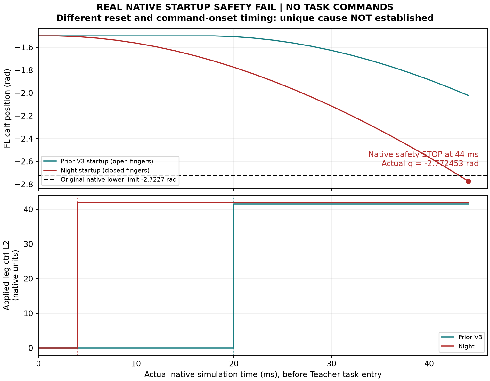

# TF-NIGHT终局：原生启动安全FAIL，成功示范及数据集仍为0

**`NO_TARGET_SUCCESS / STOP_UNRESOLVED_SHARED_NATIVE_STARTUP_SAFETY`。** 已从采用、CPU准入推进到真实完整Go2＋ARX5原生启动；T2在第22步、原生仿真0.044秒触发原始`REGISTERED_JOINT_SAFETY`，尚未进入Teacher任务。左前腿calf实际−2.772453483rad越过原下限−2.7227rad。原件审计及私有回读完成，数据闭环未完成。

|任务|新原生启动|完整任务成功|启动安全FAIL|未完整启动|新任务RGB|独立TRAIN/DEV/配对|
|---|---:|---:|---:|---:|---:|---|
|T1|0|0|0|0|0|0/0/0|
|T2|1|0|1|1|0|0/0/0|

T1是NOT_RUN，不记有效任务质量FAIL。T2记录**启动安全FAIL**；任务评分、41点保持与完整64秒均未开始，不报完整任务0/1或双任务0/2成功率。冻结数据版本NONE，独立消费者NOT_RUN；下一次训练没有本夜新bank可直接使用。实际环境worker最大1，2/4worker资格与生产吞吐未达到；没有新任务RGB可制作夜间视频。

## 1. 一次采用与原账承接

固定采用[夜间完整方案354e45ab](https://github.com/Leo-6-maker/go2-arx5-hierarchical-vla/blob/354e45abe2aa11107ffd99339c34f1ab9f58f1ea/docs/protocols/PI0294_TEACHER_FACTORY_OVERNIGHT_20261016_V1.md)，[三文件固定回读](NIGHT_AUTHORITY_READBACK.json)。[NIGHT_ADOPTION](NIGHT_ADOPTION.json)一次记录实际T0 **2026-10-16 00:23:27 SGT**；09:00停止新工作、10:00硬收尾不重置。原V3已于[canonical6196807780](https://github.com/Leo-6-maker/go2-arx5-hierarchical-vla/issues/11#issuecomment-6196807780)实际终结、无健康在途进程；旧40启动/364111扣账步/12474双RGB及全部旧失败/hash/lease保留。原V3真实接触不计为本夜新seed。

新run/manifest/源capsule/lease与账本独立登记在统一工作区。新旧消耗未双计。CoreLab现役任务按原状态保留，未重启其他项目、未提交GPU/PBS。独立新scope现已关闭，旧启动器仍保持拒绝旧系列；[新终局](GOAL_CLOSED.json)。

## 2. CPU、有限源规划与工程修复

[六组受影响CPU检查](CPU_CHANGED_CONTRACTS.json)实际通过，包括独立scope/deadline、冻结compiled属性、原机械边界拒绝负例、T=32等价、64/96/128的41点保持及晚失败/假接触负例、局部时参和prefix8恢复。H47/closed零物理初态与评分平移另有实际CPU收据。fixture PASS不证明物理安全或数据就绪。

- 固定源池仍为已核验自有TRAIN T1/T2各000/001/002。本夜实际新目标查询只覆盖**T2三个来源×H44/H47两版本**，不称六个不同任务源均已运行。
- TFN_V1：三T2入口路线合格；将机身固定在旧采样位置的完整源预测，在245/266或253/274个结点后的撤离末段遇到原关节边界。保留诊断，0原生启动；它不等同于自由机身实际任务FAIL。
- TFN_V2：使用已授权H47共同Z＋.03m，原桌完整尺寸/5cm厚度、摩擦/碰撞和源空间结点/夹爪值/事件顺序保留。仅对有合法静态关节见证的局部区段改时间；未解后缀明确UNWITNESSED、原空间和区间时长保留。每个实际新H40仍须原native速度/加速度/碰撞检查，未宣称全源动态安全。
- 首个000入口10.621863534s、变更后的完整后缀30.000000000s，含末尾4秒后选择最小**SEED_SLOW64**；它只是在任务开始前冻结的时间域，没有实际64秒PASS。旧V3单独10秒入口FAIL不改判。
- 时间量化重新引入邻接加速度的算术问题以同一路径局部重算修复；已有效入口route/原输入hash复用，未新增IK/RRT追分。源码import/旧scope入口残留与子进程ROS环境问题均在首次相关原生启动前最小修复，原日志/预算票据保留。

独立实际源/审计固定SHA：物理 **34e9ac3a09dae4cea385478a0ae468b97a4d8c30**，只读审计 **257d9b9ebcb2d0e51c41106854229d190cc6ef40**；[15/16个累计变更文件分别完整Git blob回读](CODE_READBACK.json)。编译/源码发布和实际执行收据分开。

## 3. 实际22步与安全停止

[独立原生审计](INDEPENDENT_STARTUP_AUDIT.json)和[全部20个limited joints逐步复算](ALL_JOINT_RANGE_AUDIT.json)：

- 实际`mjData`初态与预执行一致，指关节均.002m、table top .47m，qpos SHA `7b73d50c4979863d0ac3c28fc12d70cf05ae74088f72862dc139c5fd5babf3c2`。原生18机器人关节及新增有限夹爪的初始范围合法。
- 真实22步、dt2ms，原生时间0.044s；**Teacher提交0、任务观察0、任务双RGB0**，未完成中性warmup，更没有安装任务参考。
- 唯一raw越界关节`FL_calf_joint`：原范围[-2.7227,-.83776]rad，最低**−2.772453483rad**，下越界**0.049753483rad**，第22个保存点。原生observer同步记录`REGISTERED_JOINT_SAFETY`。夹爪仍在原机械范围内，未记录pad－cube任务接触。
- 模拟器后续退出码139记录在原件；最先触发的是已保存的关节安全事件，不能把后续退出或Feedback缺失另当唯一根因。其他三个owned子进程已退出。
- 原始500Hz安全observer实际生效；新增journal范围检查的CPU负例及事后全22包复算成立，额外在线warmup检查尚未到达，不夸大为新的实时安全器已验证。

[原生source/config/policy/binary和已有pause/task adapter逐项hash](FROZEN_NATIVE_READBACK.json)不变，新native build0、gain/安全/原评分阈值改动0。当前安全FAIL原样保留。

### 因果结论与停止依据

保存对照初始qpos差异仅两指.042→.002m，但腿命令首次实际生效时刻也不同：新run第2步(.004s)，旧V3第10步(.020s)，命令值也不同。前22步wall间隔新.041659s、旧.047390s，对应sim间隔均.042s。**这不是成对因果实验，没有证明闭爪是唯一原因，也没有证明时钟加速、某FSM阈值或WBC核心必须修改。** 不用换一次线程/启动相位追成功来替代定位。

协议第5/11节规定未知共享native安全问题停止受影响的新物理。此次发生于共用原生启动、Teacher尚无输入；当前没有另一条已资格的夜间任务lane，也没有已获证实的任务层实现缺陷及范围内修复。该停止分支现已执行，未把“第一条普通质量FAIL”泛化为预算耗尽，未等待例行签字。原新dispatch拒绝已经CPU实测，唯一owner及worker终态/预留归零已核对。

## 4. 预算、存储和失败原件

[结算资源](RESOURCE_FINAL.json)：新**1原生启动/22积分/0双RGB**，另1次Python子进程import失败在任何原生启动前结束；raw launcher尝试2。开发物理1、生产0，Teacher实质版本2。派生累计41启动/364133扣账步/12474双RGB；旧父账未改。

新增8bundle（2个预query工程失败＋6实际源规划），**6目标IK/96CLIK/6RRT/6006dense点/6006局部IK迭代**；全局预扣与静态重复计算均保留在资源收据，未返还以重抽。实际物理进程CPU3.274066067s、保守扣12.845140700s。已计入metered阶段保守CPU638.923109427s；这不是跨机器全部实际CPU。

[CPU全窗口保守核对](CPU_BUDGET_RECONCILIATION.json)连同归档及只读元数据的余下窗口上界合计≤**27.763 core-hours**，小于新64coreh；明确为保守上界，不是实测消耗。PC CPU未完整计量，写UNOBSERVED。停止原因是原生安全，资源及时间并未耗尽。

新run原件逻辑字节104290624；原件＋私有恢复副本上界小于96GiB，SSD/NFS实际free均大于20GiB。共享free不当作user quota；未声称删文件释放空间。[本机新/更新工件保守纳入统计](LOCAL_STORAGE_RECEIPT.json)小于8GiB。无历史删除、大下载、公共raw/WBC上传。

[私有最终逐文件回读](ARCHIVE_READBACK_SUMMARY.json)：**3581成员 / 105089877字节**，tree `ac0f30c69d0f6292da95691b30d8134ab7c31914bff34576af4c6c1f725dfdfb`，索引SHA `580572628d20c9c674207a9750455fd27271d75b41a56e4bc4b609f1bd37793c`；索引及receipt也独立字节回读。源未删，外部WBC/environment依赖仍按固定角色/hash保护，本归档不冒称可独立重分发整套WBC。实际失败journal、初始化、控制、模型、原生stop、源seal、CPU票据、工程错误及结算均保留。

归档中出现目标父目录free查询和SSH回执中断：只恢复文件收据；核查原归档进程已结束、最终索引已存在后重新读取，完整字节相符。没有为补报告/归档重跑物理。原SSH入口及备用入口有MaxStartups，备用地址保留同一已固定主机密钥；临时只读会话及goal coordinator均已结束，没有新增账户monitor/mail/cron。

## 5. 各阶段交付状态

|交付|真实状态|
|---|---|
|NIGHT_ADOPTION、change/attempt账、冻结边界|已登记、原账/hash保持|
|完整成功seed、2/3重复性|0 / NOT_REACHED|
|2→4 worker采集与吞吐|NOT_QUALIFIED；实际最大1|
|TRAIN/DEV/共同初态配对bank|0/0/0；NOT_CREATED|
|dataset manifest、modality config、statistics|明确NO_DATA/SCHEMA_ONLY/NOT_FIT，不是空集PASS|
|官方CPU codec/loader独立消费者|NOT_RUN_NO_QUALIFIED_BANK|
|私有恢复原件|全文件回读PASS；非训练dataset/HF交付PASS|
|新任务视频、GR00T/FB13训练、GPU/PBS、真机|0|

原生slow域还有未闭合工程：继承的task actuation quota上限20000尚未为64/96/128秒真实运行重新资格；本次仅运行22步，未触及该限制。其未来兼容性不被CPU时间wrapper的PASS覆盖；当前未改它或任何力/安全阈值。

[Teacher release](TEACHER_RELEASE.json)、[split](SCENE_SPLIT_MANIFEST.json)、[dataset card](DATASET_CARD.md)、[manifest](DATASET_MANIFEST.json)、[模态草案](MODALITY_CONFIG.json)、[stats](statistics.json)、[消费者收据](INDEPENDENT_CONSUMER_RECEIPT.json)、[私有交付](PRIVATE_DELIVERY_RECEIPT.json)、[后续恢复边界](RESUME.md)均按实际状态交付。**selected/deployment=NONE。** 当前goal完成的是明确安全停止和证据收口，Teacher数据生产闭环没有成功。
