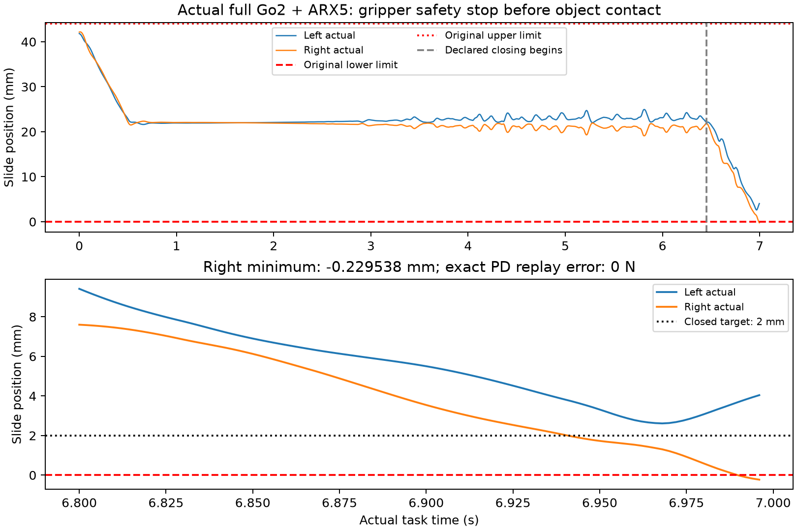

# TF-NIGHT R1进展04：工程恢复已进入真实执行，右指原生安全FAIL；完整成功seed仍0

## 当前结论

用户“允许不断重试debug直到teacher跑通”已按固定采用落实：工程debug/启动再资格不再受任意次数门限制；旧FAIL、累计资源、原T0与原科学条件不变。本次没有停在CPU_READY：固定T2真实执行到原安全停止，取得完整安装/真实输入/RGB/动作标签及独立复算。**尚无完整成功seed、合格TRAIN/DEV或独立实际bank消费。Goal未达成，不标执行目标完成。**

本轮六个有效科学开发条件现已用完：raw development12＝有效科学6＋任务前工程3＋源/原件绑定的中途工程3。工程失败成本全记、未知默认科学；不能把最后的真实机械范围FAIL改成工程不完整以取得第7个科学条件。新物理已停止。原52总启动和CPU余额尚有余量，不能将余额等同于新的科学分支许可。

## 固定T2配对入口与实际结果

沿已登记的4/2/1cm有限入口顺序：4cm原限位IK无合格pair，2cm完整静态入口通过。锁定同一原TRAIN源，原H44片段只做共同H47的已绑定坐标平移，原姿态/技能点、原速度/加速度门及H40当前夹爪几何认证不变。实际6.45s开始从22mm工作中点闭向原2mm目标；不宣称未来已闭爪来绕过几何门。

| 项目 | 实际证据 |
|---|---|
| 最后运行source | `d3135982f157b72d67788a22cd31f7e5f17220e6` |
| 实际物理 | 5998步，含2500步启动；任务3498步/6.996s |
| 最后完整20Hz观察 | 6.950s；140双RGB、18事务安装 |
| 原安全 | 右slide第5995—5998步低于0；最低−0.229538482mm |
| 原注册stop | 第5996/5997/5998步；版本隔离 |
| 其余关节/接触 | 其余19个限位关节合法；非法接触0 |
| 真实物体结果 | 物体接触0、抓握0、推动0、成功seed0 |
| 安装/标签 | 源EEF及20Hz夹爪标签精确重放；安装位置最大差2.981e−8m，四元数分量差2.435e−8，原容差1e−6 |
| 夹爪实现 | 5998物理包/140命令逐步PD复算误差0N；目标集合22mm/2mm，映射一次 |

最后已写夹爪命令执行23步后中止，下一20Hz观察未保存；原件保留，未插值补出RGB/状态。实际参考跟踪残差另报，不拿它作为物体任务全局门；本次拒绝依据是真实关节安全。没有证据将最后FAIL归因于包丢失、重复映射或安全观察器误报。

图为原5998步journal的派生图，不新增物理/渲染/模型查询。中点到原closed目标的动态安全未得到证明，CPU静态几何PASS不能代替它。

## 工程中断与本次修复，分别记账

1. 初轮PC2在5250步/110观察时因ROS源龄期检查中断；原20个限位与接触全合法。原生看门狗随后HOLD，包装层未确认native接收到的命令，独立收据归为中途工程不完整。所有参考/标签与暂停history复算通过，没有完整任务质量结论。
2. 追加只读native command sequence/age/mode收据。首次收据混用了墙钟与既有仿真时钟，报告巨大龄期并在任务前拦住。**此前“墙钟超时”归因错误，明确撤回**：实际封存clock adapter用仿真时间计算原500ms看门狗；没有修改看门狗。
3. 第二次恢复严格要求同一个冻结时刻再收到更大序号，错误拒绝已经age0的命令；第三次又被新增且无原协议依据的100ms门拦住。两个自有wrapper错误均保留，源绑定独立复算无安全/接触问题。撤掉重复命令要求及100ms门，按原500ms余量覆盖下一50ms积分，并等实际policy覆盖下一段。记录coverage不等于宣称最新reference已被MPC消费。
4. 最后一轮真实越过这些工程点，到6.996s原生关节安全FAIL。它是**新的有效物理结果**，不是另一项可豁免工程中断；不原样重跑。

所有修订均经GitHub固定提交逐blob回读、停止边界换capsule，无健康runtime原位改码。任务pause overlay新增只读收据；原WBC/actor/增益/夹爪PD/物理/安全/评分公式不变。原有两个安全启动资格保留。

## 原件、资源与停止状态

05/06/07三批新增私有全成员回读分别428/244/475文件，202273275/187634342/119425790字节；原始文件未删、旧档案未重复上传。原生/WBC/raw视频不公开。私有真实视频已生成并标有效安全FAIL，未用视频观感改判。

05:41:07SGT停止快照：20总启动、57909扣账物理步、768实际双RGB；R1 CPU账3303.15s（快照本身结算另计），父夜间保守99946.0768428s继续保留。316 bundle；实际查询计数133目标IK/2128CLIK预留/121RRT。安全FAIL计数R1=7、父=1，不清零。全部自有原生PID/start终态，native lease可取得，无其他CPU预留；无GPU/PBS/GR00T/真机/清理/monitor/mail/merge。

[实际安全汇总](PC2_ACTUAL_SAFETY_RESULT.json) · [资源/私有回读](PROGRESS04_RESOURCE_AND_ARCHIVES.json) · [科学开发停止收据](SCIENTIFIC_DEVELOPMENT_STOP.json) · [工程修订及纠错说明](NATIVE_COMMAND_RESUME_BARRIER_NOTE.md)

## 可接续边界

当前是`STOP_NEW_PHYSICS_VALID_SCIENTIFIC_DEVELOPMENT_CAP`，**整体PARTIAL/NO_TARGET_SUCCESS**，不是Teacher已跑通。无bank故不拟合空statistics、不宣称consumer PASS。只读原件/有界CPU准备仍可继续。

后续若要新增物理条件，需要明确新的科学预算及独立任务夹爪工作闭合/动态准入约束；不能以debug名义修改原2mm映射、PD、物理、安全或原任务评分，也不转入WBC调参。先保留本次精确负结果与可恢复原件。原09:00停止新工作/10:00硬收口不自动重置，selected/deployment=NONE。
