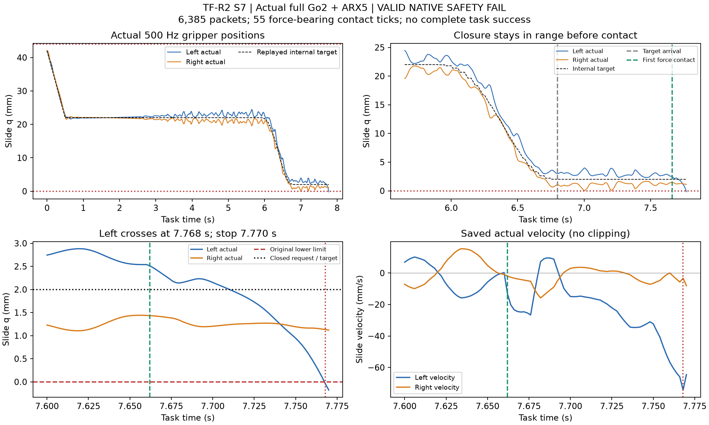

# TF-R2 S7：取得实际物体接触，接触后夹爪安全 FAIL

**状态：BLOCKED_NO_SAFE_SEED / VALID_NATIVE_SAFETY_FAIL_INTEGRITY_RECONCILED。成熟可用 Teacher 与数据闭环尚未取得。**

## 本次采用与真实执行

用户直接要求“不要担心预算上限，以跑通科学主线获得一版成熟可用teacher作为最大目标”。采用完整 TF-R2 `13c72eca98d682280fa67ec316b909f1aa1fdd5b`，取消累计 CPU／启动／积分／RGB／搜索额度阻断，逐项保留成本。见[采用收据](R2_ADOPTION_AND_BUDGET.json)。原 WBC、MPC、腿 RL、夹爪 PD/动力学、原安全与任务评分不变；本次仍先单 worker，未申请 GPU/PBS、未运行 GR00T。

本次 run `20261016T032943Z-tf-r2-closure-to-dataset`；T0 **2026-10-16 11:29:43 SGT**，原采用窗口 18:29:43 停新启动、19:29:43 硬收尾。旧 run、截止、8 个历史原生安全事件和费用均未改。当前停于安全分支，**没有耗尽资源、没有到窗口截止**。

- 实际物理 source：`86eb210d66a5ff540d4bb694e20e187e39efd9e2`。
- 独立复算 source：`50c4a5f4f363d8d1e01d74fdb886955a108fffb1`。
- 同一原 T2 TRAIN source `PI0294-TRAIN-F0-000-T2`、seed0、H47/open、PC2、2cm、96s，自己实际 startup/入口重新计算。没有安装旧 qpos/ctrl/history。
- 唯一 S7 科学改变是入口 22→2mm 的 0.95 秒五次请求曲线；后续源技能与原 EEF 计算、50ms 命令、2ms slew/原 PD 不变。

## CPU 与工程经过

[8项窄 CPU 检查](S7_CPU_ADMISSION.json)通过：旧保存输入上 48,001 点 EEF 逐值回归、固定端点/到达/ACK、一次工作行程映射、H40/prefix8 一致性、原 slew 数值重放、50503 步 quota、原 startup/receiver/actuation/clock/contact/geometry hash，以及原随机包不变。CPU 证据不等于动态安全。

有两项同语义工程修复，均先封存再继续：新记账模块缺 `resource` 导入；首次原生启动因缺少已资格化的 expected-command 元数据，在 **0 物理步、0 task 观测、0 安全事件**时终止。补入原件 hash `6183ddacbb58e5eee976e05663b000773df96916eb998e47cd7d90e60a9a8ada` 后，用相同科学卡/随机包接续 E1。保留原结果和费用。

另一次请求因工程卡尚未登记，在 `require_card` 处退出，未进入 native reservation、未启动物理子进程。该请求和准入前记账导入失败的 CPU 开销 **UNOBSERVED**，不虚记为 0；所有 request/log 原件保存。两次正式 native reservation 中，一次为上述零步工程中断，另一次才是 S7 的唯一有效科学结果。

独立复算还修正一处 **仅审计的浮点输入重建**：`seq*.4` 在 seq12 得到 4.800000000000001，而实际消费时刻为4.8，平滑曲线因而产生约9.71e-16的 fraction 差。按已保存的实际消费时刻重放，并断言与实际样本时钟相同，20个 H40 的夹爪标签恢复逐值相等。没有放宽容差，没有修改物理/旧结果或重跑。

## 实际结果与时间关系

|项目|结果|
|---|---|
|原生 startup|实际2500步/5s进入原 WBC|
|总原生包|6385，含 task3885步/7.770s|
|保存双 RGB|156对，末个完整观测7.75s；末次命令后另有10个原生步，未补图|
|原 gate 安装|20个chunk；全部 reference/clock/history 复算闭合|
|真实承力物体接触|左pad，55个原生tick，累计/连续0.110s，原0.05N门|
|最大物体水平位移|1.277126mm；未达到原推送要求|
|抓握/完整推送/释放保持|均未完成；成功seed/TRAIN/DEV/正式窗口均0|
|非法接触记录|0；桌面–base_link接触0|
|限位|20个受限关节中仅左slide出现2点下越界|
|左指最小q|−0.177229529mm；原下限0mm|
|右指最小q|+0.039755664mm；未越界|
|原生停止|REGISTERED_JOINT_SAFETY，step6385|

本次自己的入口计算得到 **5.85s profile开始、6.80s目标到达、6.85s ACK**；它们不是旧 E4 fixture 的6.00/6.95/7.00s。实际入口终点13.6s，终止时还在接近阶段。

|事件|task时间|原件解释|
|---|---:|---|
|S7曲线开始|5.850s|实际两指并非理想静止22mm，未人为重置|
|2mm目标到达|6.800s|actual左2.998mm、右1.034mm；均合法|
|首次承力接触|记录7.662s，接触源时刻7.660s|左pad接触方块，约6.387N|
|左指首次q<0|7.768s，step6384|−0.048144mm|
|原生停止|7.770s，step6385|左−0.177230mm，dq约−64.543mm/s|

[原始范围/FK/RGB/参考/标签独立复算](S7_INDEPENDENT_CPU_AUDIT.json)、[承力接触复算](S7_CONTACT_RECONCILIATION.json)、[闭合–接触缺陷包](S7_CLOSURE_CONTACT_DEFECT.json)、[PD重放摘要](S7_GRIPPER_PD_REPLAY_SUMMARY.json)。**6385/6385 原生步的原夹爪 PD 重放误差0N，156个请求均消费，原 ±8N/被动阻尼3保持。**

图仅来自已保存 actual journal 与原 PD 重构目标；[独立PDF](S7_ACTUAL_CLOSURE_CONTACT_STOP.pdf)及[图源/hash收据](S7_PLOT_RECEIPT.json)。没有新增物理或渲染。带真实失败/非实时标注的312张实际RGB视频保持私有，见[视频收据](PRIVATE_ACTUAL_VIDEO_RECEIPT.json)。

## 能得出的结论与不能归因的部分

本次在首次承力接触前，两指均保持原范围内；接触后左指出现向内运动并越界。它与旧 E4 的“无物体接触时右指下越界”有不同的实际时序。**S7没有取得整个任务的安全资格；不能把通过无接触闭合段写成成熟夹爪或Teacher PASS。** 新旧是实际独立启动，不能仅凭一次差异宣称唯一因果或成功率改善。

停止时左ctrl已向外约+1.0423N，actual速度仍向内。少量保存 post-step 状态的只读 `mj_forward` 分解显示接触约束项可向内；它不是原求解器 warmstart，不是因果干预，不能据此宣布唯一根因、调gain/摩擦/阻尼/力限，或转入WBC研究。

下一项问题已具体化为 **原有限夹爪在接触载荷下的参考–驱动–实际关节安全**。更慢一点、换端点、换seed、跳过/放宽原机械范围，均没有在本次负结果下得到许可。下一版如提出接触感知/状态速度约束的任务夹爪参考，必须说明其科学变化和具体采用边界；不能伪称S7同语义修复或直接启用S8。

## 实际停止、数据与交付

TF-R2第6/11节明确：**S7真实安全FAIL关闭新task物理，不进入S8/S9，不换profile/终点追成功。** 原生已自行终止；source release已 quarantine，`TASK_PHYSICS_STOP`保留。此次无限累计资源更新不删除这条科学停止分支。没有原样重试安全失败，没有用有效失败回填成功数据。

[13项导出/因果标签fixture](DATA_CONTRACT_FIXTURES.json)通过，两个本次失败development记录均被实际导出准入拒绝。导出成功数、TRAIN-only统计拟合、真实bank、官方CPU consumer均 **0/NOT_RUN**；不是空集PASS。S8/S9、重复性、生产20池未运行。

当前仅交付本轮增量原件私有全文件校验、实际失败视频和公开脱敏结果；不反复上传旧archive。完整账本与实际回读见[收口收据](RESOURCE_AND_PRIVATE_READBACK.json)。本轮执行到明确科学停止点；**目标未达成，selected/deployment仍NONE**。
