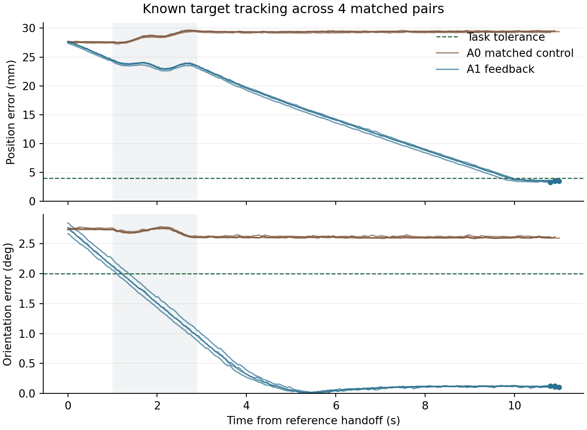

# F2 冻结 WBC 外环的原生配对结果

**4/4 个预登记的 F1 对照均获得匹配 A1，并通过已知目标的绝对精度门。** 在同一静止 TRAIN01 场景、原 B2 初态容差和固定张开夹爪的条件下，A1 从已确认的世界系参考继续，使用实测 TCP 反馈调整下一条命令。各卡在 9.8–10.0 秒进入位置 ≤4 mm、姿态 ≤2° 的范围，并连续保持 1 秒。底层 WBC、OCS2、PD 和原生安全门沿用冻结版本。[门槛及几何推导](F0_ACTUAL.md) · [事前原生登记](F1_F2_REGISTRATION.json)

| A1／A0 配对 | 进入保持 s | 同一停止时刻 A0／A1 位置误差 mm | A1 保持段最大位置误差 mm | A1 保持段最大姿态误差 ° | A1 全段绝对位置 RMS mm |
|---|---:|---:|---:|---:|---:|
| F2-01／F1-02 | 9.8 | 29.24／3.31 | 3.769 | 0.128 | 16.84 |
| F2-02／F1-03 | 9.9 | 29.60／3.53 | 3.975 | 0.128 | 17.10 |
| F2-03／F1-07 | 10.0 | 29.41／3.56 | 3.898 | 0.132 | 17.13 |
| F2-06／F1-11 | 9.9 | 29.41／3.57 | 3.986 | 0.132 | 17.09 |

每一对的期望世界系轨迹在共同的 2 ms 网格上逐点相等。任务先保持 1 秒，随后先沿 X 再沿 Z 各平移 4 mm，在 2.9 秒达到最终期望位置。图中灰色区间为目标运动段；绿虚线为各自的精度门，圆点为 A1 完成保持的时刻。每对 A0 的曲线截取到相应 A1 的结束时刻。[逐卡原始分母、误差、接触与执行身份](F2_ACTUAL.json)

## 外环补偿了多少

A1 从历史交接参考累计移动 39.15–39.94 mm，单次 100 ms 更新的平移上限为 0.40 mm。最终发出的命令相对于**任务目标**偏移 34.01–34.17 mm，以世界 X、Z 正方向为主。停止时低层 PD 目标关节构型的 FK 仍比实际 TCP 高 24.35–24.48 mm。外环通过持续修正参考使实测 TCP 接近目标，底层受载跟踪间隙依然存在。[最终命令相对目标的逐轴偏移](DECISION_ACTUAL.json)

配对终点的实际位置误差下降 87.9%–88.7%。在覆盖整个收敛过程的共同时间段，A0 的绝对位置 RMS 为 28.93–29.16 mm，A1 为 16.84–17.13 mm；增量位置 RMS 分别为 2.23–2.37 mm 和 14.57–14.64 mm。增量指标以各卡实际起点为零，A1 主动补偿的初始位置偏差也计入相对运动。保持门评定的是最终 1 秒的绝对位姿。当前证据支持该工作点的慢速终点收敛，快速运动、接触中跟踪及跨场景泛化均待测。[匹配原生对照](F1_ACTUAL.md)

## 分母与阶段决定

F2 在最多 12 个启动位中实际使用 6 个。F2-04、F2-05 在施加 A1 前因初态超差筛除，其余 4 个覆盖全部预登记对照，按规则关闭剩余 6 个启动位。共 56,018 个新物理 tick，其中 21,800 个为测试积分，436 次参考安装、872 个消费区间均有求解器回显。每张配对卡在确认保持完成的暂停边界结束；四张卡从判定到该边界均为 0 tick。逐 tick 复核记录中，禁止接触、机器人与方块接触、原生物理安全停止均为零。所选 MRT 策略 ID 和年龄未导出。

F1 与 F2 合计 18 次启动、172,454 个新物理 tick，18 个租约均已关闭。F0、F1、F2 的 SLA 前向和训练更新均为零，D1/D3 的历史分母另计。[资源核算与阶段决定](DECISION_ACTUAL.json)

**本轮保留冻结 WBC。** 已知目标可以进入后续接口研究，当前直接证据限于一种固定场景和四个匹配初态。学生夹爪仍有 0/16 合法接管，8 个持物窗口请求张开。F4 的抓放对照仍待合法的学生自 reset 或所有权移交，冻结 SLA 的目标域抓放成功率尚未测量。[夹爪证据](../SLA_MEMORY_V15/B3_GRIPPER_REPLAY.md) · [教师命令与实测状态的离线区别](F0_TEACHER.json)
