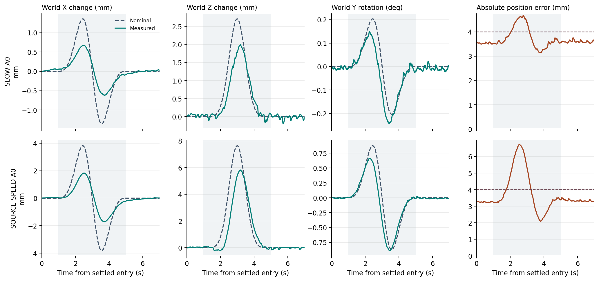

# 两档 A0 均产生可测的动态跟随，运动段仍越过 4 mm

按 #472 的原登记执行四次独立 reset。慢速 A0 和源速度 A0 进入稳定区并走完整条曲线。两张 A1 均在参考分配生效前被原 B2 初态门筛除。四份独占租约均已关闭，合计 40,762 / 84,812 tick。四次运行均无物理 STOP、接触违规或遗留进程。

| 登记条件 | 原生 tick | 稳定进入 tick | 运动段平移 Q／增益 | 运动段旋转 Q／增益 | 位置 RMS／最大 mm | 同时在 4 mm／2° 内 |
| --- | ---: | ---: | --- | --- | --- | ---: |
| SLOW A0 | 14,653 | 11,153 | 0.792／0.603 | 0.855／0.873 | 3.804／4.675 | 72.4% |
| SLOW A1 | 5,703 | 初态筛除 | — | — | — | — |
| SOURCE SPEED A1 | 5,703 | 初态筛除 | — | — | — | — |
| SOURCE SPEED A0 | 14,703 | 11,203 | 0.756／0.603 | 0.892／0.846 | 4.234／6.741 | 63.1% |

两条已执行轨迹各有 70 次被接收并安装的不同参考、70 次依新时钟重采样的 80 点回显、140 个完整消费区间及 3,501 个连续的四足着地状态。每段运动用原 50 ms 名义结点，按位置线性与最短弧姿态插值到 2 ms 后，使用完整 2,001 个同步样本计分。未优化时延。重建同时覆盖实际发送、实际消费以及原始状态日志中的 TCP。MRT 最终选中的策略 ID 在原接口中仍为未知。每个条件只登记了一个样本。

前三列分别相对各自的稳定进入位姿，最后一列保留任务绝对误差。阴影是固定的四秒运动段，虚线水平线是原 4 mm 门槛。已发参考的平移和旋转形状得分均为 1。两条实际轨迹的平移增益都约为 0.60。末端沿 X 的增益分别为 0.484 和 0.462，沿 Z 为 0.685 和 0.699。运动最大姿态误差为 0.243° 和 0.557°。先前四个实测静止对照的平移 Q 在慢速曲线为 −0.0034 至 +0.0062，在源速度曲线为 −0.0009 至 +0.0026。[历史保持对照](../../SLA_HIERARCHICAL_V16/KNOWN_CURVE_CONTROL_ACTUAL.md)

进入时仍有 3.578 mm 和 3.301 mm 的绝对位置误差。扣除各自进入时的平移误差**仅用于诊断**，运动期间增量误差 RMS 分别为 0.602 mm 和 1.826 mm。最后一秒静止保持均全程入区。现有证据定位到执行端的绝对偏差与动态衰减，尚不能把原因分配给特定 WBC 关节、模型或增益。两条轨迹都未取得原全程动态资格，学生原生动态与接触抓取仍待后续独立证据。

## A1 尚缺的证据

原 A1 对“当前名义任务位姿与实测 TCP 的差”做有界增量，再叠加到上一真实消费参考。总参考增量受 0.40 mm／0.06° 每 100 ms 限制，代码中没有单列的名义运动前馈。在源速度的 40 个运动间隔中，26 个名义平移增量与 24 个名义旋转增量分别超过对应上限。慢速两项均为 0/40。这是逐间隔精确跟随能力的离线检查。A1 的真实运动结果仍为空。新的独立样本申请先补齐 A1，不将本批次两次筛除重新计数。

## STOP、版本和复核

#470 的接收器在二进制中写死了旧卡的 6,503 tick。经单独批准，仅重新绑定新卡硬上限 21,203。原版重建字节完全一致。两种构建在同一封存状态流上的有效、过期、超速三种回放结果相同。有效通过至 6,453，后两种均在 6,439 STOP，后续交付 0。这四张新卡没有注入 STOP 故障。首次工程回放因临时文件权限过宽被接收器拒绝，恢复原要求后重跑。另一次 CPU 启动因导入顺序中止，修复后才签发首张现场租约。

第一次独立评分将后续 80 点重采样回显同首发 41 点错位比较，因而拒绝输出。修复为分别按各自绝对时钟验证每个位置和姿态后，完整重读四个回合。现场运行期间一次离线视觉代码复制短暂写入了启动脚本副本目录，已恢复启动版本。已载入的现场进程没有重启或重载。冻结原生二进制、已发参考及原始科学记录均经独立回读。

[完整原生结果及筛除阈值](ACTUAL.json) · [回放与接收器对照](RECEIVER_REPLAY.json) · [切换预检](PREFLIGHT.json) · [四张卡的实载执行器指纹](FROZEN_EXECUTORS.json) · [回读摘要](ARCHIVE_READBACK.json) · [原 A1 增量上限](A1_DEMAND.json) · [独立后继登记](A1_COVERAGE_REQUEST.json)
