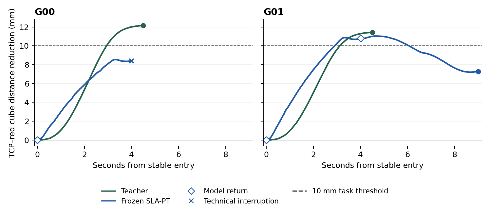

# 官方 SLA-PT 在站立 Reach 中产生了自身动作后的反馈，G01 未达任务门槛

G01 的官方策略在独立重置后产生动作、驱动实际末端运动，再根据同回合的新图像和本体状态返回第二段动作。临近截止时，参考和实际末端均明显偏离目标方向。固定四张卡全部进入仿真，教师两张通过。学生两张中，G01 完成评分并失败，G00 在第二次前向前因 GPU 资源中断。合计 35,812 tick，3 次冻结前向全部返回，训练更新为 0。两个开发布局用于机制验证。[固定分母及逐卡证据](ACTUAL.json) · [登记与决策门槛](REGISTRATION.json) · [整机 STOP 与两布局资格](../E1_NATIVE/ACTUAL.md)

| 布局与策略 | 积分步 | 实际前向 | 末半秒至红块距离最小减少 | 结局 |
| --- | ---: | ---: | ---: | --- |
| G00 教师 | 8,453 | 0 | 12.01 mm | 通过 |
| G00 官方 SLA-PT | 8,203 | 1 | 未到任务终点 | 技术中断 |
| G01 教师 | 8,453 | 0 | 11.29 mm | 通过 |
| G01 官方 SLA-PT | 10,703 | 2 | 7.21 mm | 未达 10 mm，另有方向和终点误差超限 |

图中实线来自原生 TCP 和红块位置。虚线表示末半秒必须持续达到的单项进展要求。G01 学生一度达到这一距离要求，随后回落；全过程横向、姿态和终点要求分别计分。菱形标记产生了真实网络返回的查询时刻。[曲线数据](RED_DISTANCE.json)

## G01 的反馈与任务方向

首次查询在 6,203 tick，第一段动作的接续时间为 3.30 s。在已进入模型源轨迹的区间内，安装的参考平移 1.234 mm，实际 TCP 沿该参考方向移动 1.023 mm，达到事前登记的非平凡运动条件。在 8,203 tick，系统用当时的双相机 Memory 和实际本体发起第二次前向。两次模型调用均返回 50 × 32 采样与 50 × 16 解码动作，后继参考取得求解器消费回执。夹爪按无接触 Reach 约束固定打开，原始模型开度另存。仿真在查询时暂停，此批只验证因果顺序。[查询、动作与消费](ACTUAL.json)

G01 全部 180 个 50 ms 区间均有求解器匹配回执。接续或保持的 121 个区间累计缩短红块距离 9.28 mm；源时钟前进的 59 个区间中，实测 TCP 行程为 10.66 mm，至红块距离累计增加 2.00 mm。相对任务初态，最后半秒最小方向投影为 −18.61 mm，最大终点误差为 74.74 mm，最大姿态偏差为 16.45°。最小机器人至两块净空为 27.86 mm。统计只计入位姿时钟已前进的源区间时，也未达到方向及距离门槛。[分段读数](ACTUAL.json)

**偏离已经出现在安装参考中。** 学生参考最大横向偏离为 64.18 mm，实际末端为 64.03 mm，任务上限为 8 mm。教师的安装参考沿任务方向移动 20 mm，G01 教师实际末端最终投影为 13.69 mm。以各自起点消除固定偏置后，G01 终点跟踪误差分别为教师 6.79 mm、学生 7.02 mm。对本回合，优先检查官方模型输出、坐标映射与接续生成的参考方向。以上读数只覆盖此站立仿真任务。[参考与实测误差](ACTUAL.json)

## 两个独立对照

**原始模型输出。** 在冻结的坐标映射下，G01 第一和第二条 50 点原始预测从各自首点到末点分别使至红块距离增加 100.01 和 110.10 mm。G00 首条预测增加 53.95 mm。这些数值描述完整源预测的几何，实际执行使用受时限、原安全门和反馈更新约束的短区间。对三次真实返回，在 CPU 上用原始网络采样和各自的实测状态回放官方解码，逐值恢复了留存的物理动作。[原始方向](ACTUAL.json) · [解码对照](DECODE_CONTROL.json)

**同一新状态上的旧采样。** 把 G01 第一条原始网络采样重新用第二次实测状态解码，与真实第二次返回相比，右臂位置 RMS 相差 21.26 mm，姿态 RMS 相差 8.94°。两布局使用事前固定的种子顺序，第一次为 [0,0]，第二次为 [0,1]。这个差异同时包含输入和采样种子的变化。该回合直接验证了学生在自身执行反馈后再次推理，但无法单凭此差异估计观测变化的独立因果效应。[原状态逐值复现与反事实解码](DECODE_CONTROL.json)

## G00 的中断与共享 GPU0

G00 首次推理后，源参考位移为 1.325 mm，实测沿参考移动 1.060 mm。新的 8,203 tick 输入已经保存。当时 GPU0 出现了其他计算进程，原独占检查在第二次模型调用之前终止。最后实际积分及最后申请均为 8,203 tick，4 个归属进程退出，租约关闭。保存的新输入仅用于 CPU 解码对照。原回合保留完整分母。[G00 实际记录](ACTUAL.json)

收到 GPU 共用许可后，仅执行尚未启动的两张 G01 卡。保持相同模型、任务、种子顺序、WBC 和门槛。G01 学生卡从独立重置至退出持续持有本项目的 GPU 租约和独占仿真租约；两次推理前均有 1 个其他计算进程，板上可用显存均为 28,192 MiB，同模型既有实测峰值为 8,598 MiB。四张卡全部释放仿真资源，共享 GPU 上的其他任务由各自持有者管理。[续行预检](G01_PREFLIGHT.json) · [私有证据归档指纹](ARCHIVE.json)
