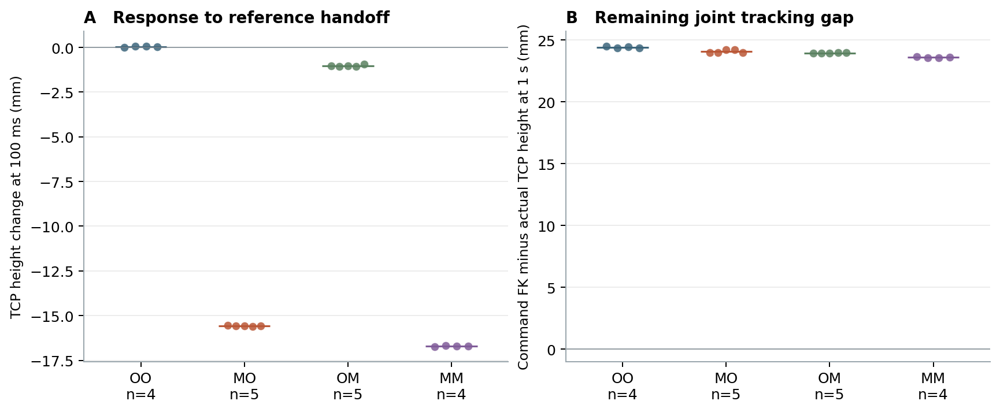

# D1 匹配 B2 初态的四条件原生实验

预登记 40 次启动，实际启动 40 次。18 次通过原匹配门并完成 1 s 测试，22 次在第 5,703 tick 筛除，技术停止 0 次，未启动 0 次。合计 237,120 个新原生 tick，其中处理后 9,000 个。新增 SLA 前向和训练更新均为 0。

每个入组初态都与两张 B2 历史锚点及此前所有入组初态逐项比对，沿用原登记的 16 个容差。每凑齐四个合格初态就完成一组预排的 OO、MO、OM、MM 对照。下表按组内实际处理汇总，含末尾不完整组的已完成卡。高度变化以向上为正。

| EEF／底座参考 | 完成数 | 实际 TCP 前 100 ms 高度变化，均值 [范围] mm | 低层目标 FK 前 100 ms 高度变化，均值 mm | 1 s 内绝对位置 RMS，均值 mm |
|---|---:|---:|---:|---:|
| OO | 4 | 0.040 [0.004 至 0.066] | -0.077 | 27.60 |
| MO | 5 | -15.566 [-15.592 至 -15.541] | -20.181 | 20.42 |
| OM | 5 | -1.030 [-1.080 至 -0.940] | -0.289 | 29.11 |
| MM | 4 | -16.704 [-16.728 至 -16.686] | -20.436 | 21.85 |

O 表示继续生效的旧世界系目标，M 表示第 5,703 tick 的实测世界系位姿。两项都继续以 10 Hz 发出新的合法参考。

| 完整四条件对照 | 实际 TCP 的 EEF 主效应 mm | 底座主效应 mm | 交互项 mm | 低层目标 FK 的 EEF 主效应 mm |
|---|---:|---:|---:|---:|
| 1 | -15.618 | -1.114 | -0.146 | -20.095 |
| 2 | -15.615 | -1.123 | 0.001 | -20.184 |
| 3 | -15.659 | -1.113 | -0.047 | -20.027 |
| 4 | -15.624 | -1.112 | 0.014 | -20.143 |

在这批匹配初态上，只重设 EEF 已产生早期下沉，底座主效应较小。低层位置目标的 FK 同时发生更大幅度的下移。无论参考组合，1 s 时低层目标 FK 的 TCP 仍高于实测 TCP 23.54 至 24.48 mm。参考重设解释早期运动，负载下的稳态位置间隙仍会限制绝对精度。

每点为一张完整原生卡，短线为该条件均值。22 个筛除初态全部已超过两张历史锚点的容差；仅因与此前入组初态不相容而被筛除的数量为 0。完整四条件对照共 4 组，余 2 张完整卡单列在逐卡记录。这里报告预登记的描述性对比；初态筛除和未进入完整对照的卡均保留在原始分母。

[逐卡数据、效应与证据摘要](D1_VERIFIED.json) · [事前登记](REGISTRATION.json) · [原 D1 波次](../SLA_MEMORY_V15/D1_WAVE_A_ACTUAL.md) · [D2 跟踪间隙归因](../SLA_MEMORY_V15/D2_POLICY_AND_PD_CLOSURE.md)
