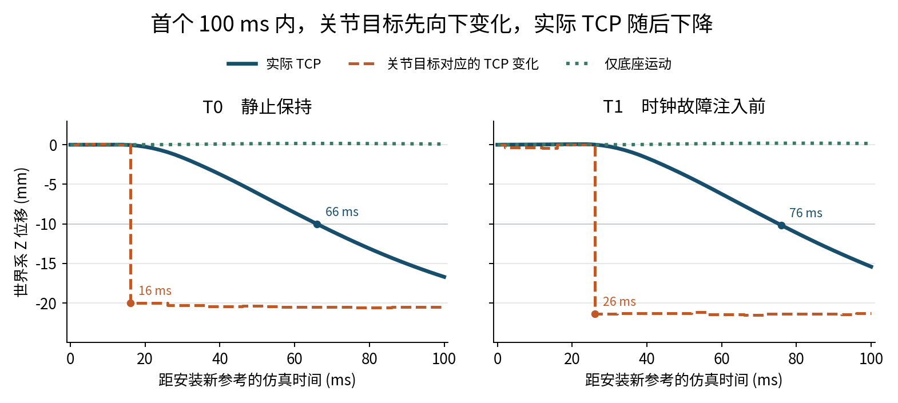

# B2-D0 · 静止 TCP 偏差归因

**首 100 ms 的下降来自机械臂相对底座的运动。** 用实测底座轨迹保持机械臂初始姿态，T0、T1 在这 100 ms 内的 TCP 三维位移最大只有 0.19 和 0.23 mm。与此同时，两张卡在 100 ms 时的实际 TCP 分别下降 16.71 和 15.42 mm。

**第 5,703 tick 是一次参考切换。** 初始化一直在维持旧目标。测试开始时，以当时已偏离旧目标的实测位姿生成了新目标。旧、新原生窗口之间，EEF 参考分别移了 27.64 和 28.22 mm，底座参考也同时改变。测试段内的新目标保持固定。这个边界区分了“继续保持同一参考”和“重新以当前实际位姿为目标”两个实验条件。[原技术卡](B2_NATIVE_TECHNICAL_CARDS.md) · [本次逐卡数值、输入哈希与时间序列](B2_STATIC_BIAS_ATTRIBUTION.json)

## 参考、底座和机械臂

下表均为世界系有符号差值。参考切换取接收器最后一次发布的旧窗口、第一次发布的新窗口；运动量从第 5,703 tick 的物理状态开始计算。两张卡在切换时均已处于 WBC 模式。

| 量 | T0 | T1 |
|---|---:|---:|
| 新减旧 EEF 参考，XYZ（mm） | −12.83, −3.10, −24.28 | −12.70, −3.24, −24.99 |
| EEF 参考姿态变化 | 2.74° | 2.84° |
| 新减旧底座参考，XYZ（mm） | +17.71, +2.74, +10.16 | +17.62, +3.17, +10.15 |
| 底座参考姿态变化 | 3.15° | 3.20° |
| 100 ms 时实际 TCP 的 Z 变化 | −16.71 mm | −15.42 mm |
| 其中仅底座运动的 Z 贡献 | +0.09 mm | +0.16 mm |
| 其中机械臂相对底座运动的 Z 贡献 | −16.79 mm | −15.58 mm |
| 100 ms 时实际机身高度变化 | +0.05 mm | +0.08 mm |
| 100 ms 时机身 roll / pitch 变化 | −0.004° / −0.006° | −0.006° / −0.012° |

反事实取原生模型的 `base_link` 与 `x5_ee`。在每个 2 ms tick 上将初始的底座到 TCP 变换放到当前实测底座上，得到仅底座运动时的 TCP。逐 tick 冻结六个机械臂关节再独立做一次正运动学，得到相同的位置。世界系有符号向量满足“总位移 = 底座贡献 + 臂相对运动贡献”。

完整状态日志分别有 6,203 和 6,678 个连续 tick。对其中 500 和 975 个测试 tick 全量计算，保留了两张卡各自的起点。59 个已归档的 50 ms 端点全部重现了原 TCP。按原端点口径复算的位置 RMS 分别为 22.43 和 23.07 mm。对这两个与实测起点重合的恒定目标，绝对误差与起点增量误差在每个 tick 上相等。动态实验仍须分别记录这两项量。

## 关节指令先改变，实际 TCP 随后下降

取积分前最近一次原生 PD 回调中的六轴位置目标，把它们放进同一模型做正运动学。下面的橙线是关节目标相对第 5,703 tick 低层目标的变化，转到当前世界轴表达。蓝线是实际 TCP 相对测试起点的变化。原生接收器发布的 EEF 新目标在此期间恒定。

以向下越过 10 mm 作为描述运动先后的共同标记，T0 的关节目标和实际 TCP 分别在 16 和 66 ms 越过，T1 分别在 26 和 76 ms 越过。两次相差 50 ms，其中包含被控机械系统响应。六轴关节请求中已有任一轴较起点变化超过 1° 的最早消息分别在 10 和 20 ms。100 ms 时，两张卡的实际第 4 轴已分别转动 −2.23° 和 −2.02°，对应 PD 位置目标变化为 −2.99° 和 −2.96°。全部六个关节的位移、速度和目标差见数值回读。

把**结束时的绝对偏差**再分为“PD 关节目标对应的 TCP 减上层目标”和“实际 TCP 减 PD 关节目标对应的 TCP”，可以看清不同方向上的误差形成在哪里。

| 结束时的有符号偏差 | T0 · X / Z（mm） | T1 · X / Z（mm） |
|---|---:|---:|
| PD 目标对应的 TCP 减上层目标 | −9.73 / +3.89 | −9.94 / +4.31 |
| 实际 TCP 减 PD 目标对应的 TCP | −2.53 / −24.16 | −2.61 / −24.64 |
| 实际 TCP 减上层目标 | **−12.26 / −20.27** | **−12.55 / −20.33** |

低层关节目标与实际关节之间的高度差在交接前已存在。起点时，按关节目标重建的 TCP 分别比实际 TCP 高 24.38 和 25.46 mm。结束时，这项差值仍有约 24 mm。X 方向的终点误差则主要已体现在低层位置目标中。拟合单个固定的 Z 或 XYZ 补偿值仍缺乏跨姿态依据。

## 命令时间、控制模式和选中策略

以源仿真时间计数，区间为开左闭右的测试段；机械臂请求使用消息头，solver 回传使用其初始观测时间，PD 使用原生回调时间。暂停在同一仿真时刻重复触发的回调按实际记录保留。

| 测量通道 | T0 · 1.00 s | T1 · 1.95 s |
|---|---:|---:|
| 2 ms 物理积分 | 500 | 975 |
| 机械臂请求 | 197，197.0 次/s | 383，196.4 次/s |
| 带初始观测时间的求解器 policy 回传 | 197 | 381 |
| 低层 PD 回调（含重复时刻） | 340，其中重复时刻 140 | 665，其中重复时刻 272 |
| 六轴请求位置可逐值匹配至原生 PD 的请求数 | 165/197 | 329/383 |

与冻结二进制关联的恢复源码将控制节点墙钟定时器默认设为 200 Hz，并在源时钟重复时直接返回。本卡启动参数没有覆盖该频率。求解器日志另列 MPC 期望 100 Hz、MRT 期望 400 Hz。按仿真秒统计的约 197 个命令请求符合该链路存在独立发布循环的事实。仅从这些计数无法推定漏掉了一半控制周期。

对能够唯一按六轴位置匹配的请求，首个相同低层目标与请求的源时标差两卡中位数均为 4 ms，p95 均为 6 ms。首 100 ms 两卡各匹配 17/20。其余分别有 32 和 54 份全段请求未找到同值后继；限频、覆盖、限幅或观测顺序各自占多少仍未知。消息接收先后与实际执行回执分别处理。首份新参考的精确 solver 回显到达独立记录端时，两卡最新完成的积分均为交接后 14 ms。记录端的墙钟间隔分别为 25.2 和 33.6 ms。

340 和 665 个测试时段原生模式采样均为 WBC。独立模式通道在技术卡结束时才收到 HOLD。接收器与 solver 回显之间可按轨迹内容匹配，命令和低层 PD 之间可按六轴位置匹配。冻结控制器内部调用 `updatePolicy()` 和 `Evaluate()`，归档中缺少每次求值实际选中的 MRT policy ID。原生仿真跟踪内的腿部策略版本属于另一条链。对齐结果能定位指令出现的时间，仍无法将具体机械臂请求唯一归给某次 solver 回传。

## 力矩、速度与接触

六轴电机输入在全部测试 tick 上达到模型输入限值的次数均为 0，最大占比分别为 24.29% 和 24.98%。每个受检接触采样均为四脚支撑，T0 为 20/20，T1 为 39/39。原安全门记录的失去支撑时间均为 0。

以第 3 轴为例，两卡起点的实际速度仅约 −0.002 和 +0.005 rad/s，PD 目标速度却为 +0.211 和 +0.186 rad/s。按归档姿态、零速度复算的第 3 轴刚体重力项均约为 +5.51 N·m，起点记录的电机输入分别为 +5.58 和 +5.21 N·m。测试段 PD 目标的显式力矩前馈字段六轴均为零。比例项和速度项都可能承担维持负载的作用。逐回调用同戳状态估算的 PD 算式与记录输入仍有残差，第 3 轴最大约 1.44 和 1.32 N·m。现有观测支持负载下存在位置目标与实际关节的持续间隙，尚不能定量断言缺少某种动力学补偿。

## D1 应区分的条件

已有证据将首 100 ms 的位移定位到了机械臂，并识别出参考交接、低层位置目标变化和实际运动的先后。EEF 和底座参考在同一个边界一起改变，这两张卡无法分别估计二者对选中控制策略的作用。

下一组静止对照可从相同初始化条件开始，将 EEF 和底座各自的“继续旧目标／改用实测目标”交叉为四种条件。优先保留两者都继续的基线，四组保持同一 WBC 模式、开度、接触门和 100 ms 传输刷新。上层一次绑定与 P10 修订可在相同传输刷新下另作配对。直接停发超过原 400 ms TTL 会引入到期 HOLD，需要单列条件。比较前登记绝对和增量误差容限，同时报告初始间隙、首 100 ms 和稳态。

为区分“仍在评估旧策略”与“新策略主动给出这组关节目标”，最小补测是同一次求值的选中 policy 标识或内容哈希、绑定参考标识、求值用观测时间和优化关节位置／速度，以及随请求传递到 PD 的序号。若继续归因稳态力矩，还需同一执行采样的关节状态、限幅前后输出和补偿分量。以上是待独立注册的实验条件。

本交付新增原生请求、物理积分和模型前向均为 0。第一次离线分析在导入角度计算依赖时中止，改用已冻结运行环境中的旋转函数后完成。最终读数以两张已关闭技术卡的原始文件及其哈希为依据。[离线复算入口](../../scripts/sla_transfer_v14/b2_static_bias.py)
