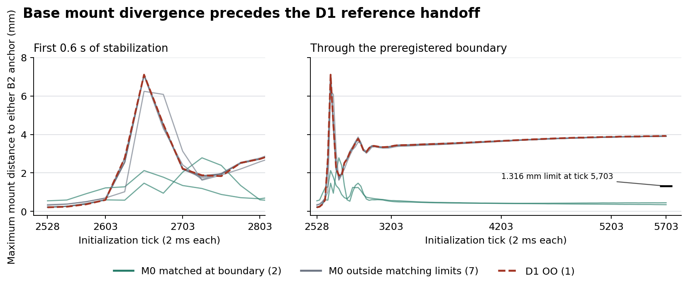

# 初始化偏离发生在第 5,703 tick 之前

相同冻结场景下，OO 与 B2 T0、T1 的重置 qpos／qvel 相同，第 1 tick 的记录逐项相同。第 2,503 tick 的底座原点距离均小于 0.0002 mm。随后比较同一 native tick 上、积分前已应用的 PD 位置命令和积分后的关节状态。所查 3,200 tick 中未发现 PD 目标在一条积分内部变更。

| 两次启动 | 手臂目标差首次 >0.1° | 腿目标差首次 >0.1° | 底座原点距离首次 >1 mm | 第 5,703 tick 的底座原点距离 |
|---|---:|---:|---:|---:|
| T0 vs OO | 2,504 | 2,511 | 2,616 | 4.287 mm |
| T1 vs OO | 2,504 | 2,511 | 2,622 | 4.918 mm |
| T0 vs T1 | 2,504 | 2,511 | 2,642 | 0.638 mm |

0.1° 和 1 mm 仅用于事后定位时间。表中的底座原点取自自由关节；D1 准入门的 3.922 mm 是底座安装系与两个历史初态的最大距离。T0、T1 也有早期命令差异，并在边界重新接近，故首次差异时间不足以识别最终偏离的唯一原因。当前日志无法把偏离归属于一次特定的 MPC 策略选择。

另用原封匹配器回查既有 M0 面板的 12 张登记卡。1 张早停于 2,529 tick，2 张因原 yaw 隔离而未运行，9 张到达边界。其中 2/9 匹配两张历史初态，7/9 超过相同的五项界限。七张的安装系位置最大差均在 3.906–3.923 mm 附近，新 OO 为 3.922 mm。M0 面板沿用其原接收器，仅提供独立的启动历史。这个重复出现的偏离值得用同步的启动事件验证；现有结果不能指定一个获选策略，也不足以事后扩大容差或筛选启动样本。此分析额外消耗 0 个物理 tick。[逐条件回读](D1_PREFIX_AUDIT_ACTUAL.json) · [两张 B2 与 OO 的初始状态回读](D1_WAVE_A_ACTUAL.json)

图中每个点是同一原生 tick 下，一个启动与两张 B2 历史卡的安装系距离之大者，间隔 25 tick。绿色和灰色按最后一个 tick 的完整匹配结果分组，新 OO 独立绘制。最后一个点的两组历史范围分别为 0.349–0.449 mm 与 3.906–3.922 mm。1.316 mm 门限只在第 5,703 tick 生效。[绘图数据与来源哈希](D1_MOUNT_DIVERGENCE.json)
