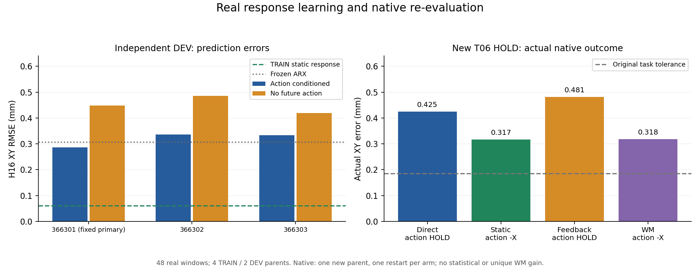

# FUSION-NIGHT1 · real balanced data → small response WM → exact recovery → native re-evaluation

2026-11-06, Asia/Singapore. **Goal ACTIVE.** Fixed plan `f965a2c568ec26e9cecb8301fac0785f96a575a8`; independent execution PR #366, no main merge or active-capsule edits. This is simulator-state local calibration, not online GR00T task transfer. Earlier [first actual calibration/real frozen-GR00T query](FUSION_FIRST_CALIBRATION_AND_REAL_VLA.md) remains unchanged.

## Actual identities and effects

- Balanced native source **`6a49dad87b39c4d04bde0a010913d9c5cbb7d3bc`**, immutable C10 executor **`f30450e669236724a63c125cc88df86bb28aad9136ee644b1c8328e088b0adea`**. Input **`b51ba9f9f85bd20f159fbc00a0e6b53898700d113e9ccbd75cca35052bcc44a9`**, panel **`ca10a6ede336e16d9b0de3a211f243d95591640adda98895a0255fdefb0f41c4`**. Same original owner/registry/Journal, valid finite FUSION supplement, two qualified CPU/ROS slots; every new scene first qualified alone.
- **6 scene qualifications +48 actual response episodes =54/54 native PASS,221,562 ticks**, clean shutdown, exit0, CLOSED/MainPID0. Four new TRAIN and two new DEV parents, all four legal actions and two independent restarts per action/parent, balanced across both slots. **Only2/48 local task successes;46 task failures remain valid response data.** No score-based retry or exclusion, no TEST read or exact hidden-state fork.
- Real replay **`e5139d792d8d2f28e49ea28d7f57fbabbd5e79378e5358b747b2896c851ed795`**:48 windows, **32 TRAIN/16 DEV**,768 measured post-choice50ms transitions,46 negative task outcomes,0 exclusions. Same8-history/current and16-real-response reconstruction, measured source-age mask and installed/solver-reference proof; exporter integrated0ticks. The prior4-window/64-transition dataset remains separately retained and is not silently called balanced TRAIN.
- Successful model/native refit source **`0f235865a30f94cd877b7648598823d2039fa6ae`**. Original frozen ARX **`c69ae25164b023cb005e17aaa0c6a45b9d75f756963a1887c782597e7acf55d1`**, unchanged task **`5e0653617bc735dd39ec75cac1598d4b76488d1c6d72ecc50e30ae6d6d6c7b24`**. Primary seed366301 was fixed before DEV; all six models are retained, never select the DEV-best seed. Primary checkpoint **`ca5fe2a4afb30349732220ab8ca36b538f09fb8d40950e2addb61beb603972e8`**, NumPy **`5a267c76c061ceb9a905dacd7d6d730a57bf9dd5146a9d534d14ed3840bfd19a`**. New TRAIN static rule **`f51d59764b8316a903e5e953205bb90805e82bd0f1d2ead157207213364aa0d9`**.

[Full per-run identities, native feedback, model contrasts and actual costs](BALANCED_RESPONSE_LEARNING_AND_REFIT_ACTUAL.json). These are installed-command responses, not expert labels or future achieved-pose relabeling.

## A real engineering failure, repaired without changing the experiment

The first GPU worker used source `0c8f06d77aae51cc2fe12386c9cde67bd75f4a2c`. It performed **200 actual optimizer calls**, then exited1 when its second progress snapshot used the create-exclusive immutable-artifact writer. There was no complete checkpoint or recovery endpoint; none is claimed. The failure was file recording, not nonfinite loss, OOM or WBC/physics failure. Preserve all200 calls and4.024s wall/2.652s child CPU in the denominator: [actual failure evidence](RESPONSE_TRAINING_WRITE_FAILURE_ACTUAL.json).

A new committed capsule changes only mutable progress/cumulative completion snapshots to the existing atomic-replacement writer. Immutable artifacts still reject overwrite. Regression test covers repeated progress and a second completed arm, plus existing model/sampler/native tests. New worker02, fresh registered lease; old worker01 remains CLOSED1 and source unchanged. The48-window physical dataset is reused; no physics is repeated to repair a JSON write.

## Actual small-WM study and limitations

Two matched arms, three predeclared seeds,2,000 updates each, exact global shuffle, batch32, FP32/TF32 off. A32-hidden-unit TCP residual starts exactly at its own frozen ARX base. TRAIN-only own-arm normalizers; blind arm removes the future candidate from **both** neural features and ARX base, retaining the same past. Outputs are16-step TCP XYZ only, not complete robot state or FK-consistent joint predictions.

**12,000 completed-model main updates +6 exact-recovery probe calls**. All six optimizer/model/RNG/normalizer/sampler recovery errors and checkpoint reload errors are0; all NumPy exports meet the0.2µm bound. Including the failed worker, FUSION actually spent **12,200 main calls +6 probes**. New Actor/GR00T optimizer updates are0.

| Seed | Model | DEV H16 XY RMSE (mm) | DEV action-minus-HOLD XYZ RMSE (mm) | Full restore error |
| ---: | --- | ---: | ---: | ---: |
| 366301 | ACTION_CONDITIONED | 0.286735 | 0.130179 | 0 |
| 366301 | NO_FUTURE_ACTION | 0.448538 | 0.363316 | 0 |
| 366302 | ACTION_CONDITIONED | 0.336076 | 0.128811 | 0 |
| 366302 | NO_FUTURE_ACTION | 0.485067 | 0.363316 | 0 |
| 366303 | ACTION_CONDITIONED | 0.333308 | 0.132022 | 0 |
| 366303 | NO_FUTURE_ACTION | 0.419462 | 0.363316 | 0 |

Matched DEV H16 XY baselines: frozen C08 ARX **0.306340mm**, new TRAIN mean-response **0.061253mm**, current-pose hold0.487313mm, constant velocity0.422743mm. All three action-conditioned fits outperform their blind controls, but **all remain worse than the strong static rule; two are worse than frozen ARX**. This is limited action-conditioned predictive evidence, not a reason to promote the neural model or buy larger-GPU capacity. Independent action-minus-HOLD pairs have maximum prefix mismatch0.971984mm; they are not exact forks or measured Jacobians.

## Actual post-learning native HOLD diagnostic

[Predeclared protocol](../../../docs/protocols/WM02_FUSION_REFIT_HOLD_DIAGNOSTIC_V1.md): fresh unseen TRAIN parent T06, nominal HOLD, desired outcome equal to the actual decision TCP. Same four methods, timing, information, action domain, original0.185844566mm tolerance and frozen WBC. New static rule and new response WM are frozen for every arm. Single-world first, no model selection from this result.

**5/5 native PASS /20,515 ticks**, exit0, clean CLOSED/MainPID0. Four method evaluations, **0/4 local task successes**. The HOLD qualification is separate and is not a task success.

| Method | Selected action (0 HOLD,2 −X) | Actual XY error (mm) | Original task pass |
| --- | ---: | ---: | --- |
| B2_MATCHED_FEEDBACK_ONLY | 0 | 0.481093 | False |
| B1_TRAIN_STATIC_CALIBRATION | 2 | 0.317205 | False |
| B0_DIRECT | 0 | 0.424580 | False |
| B3_HISTORY_CONDITIONAL_WM_CORRECTION | 2 | 0.318250 | False |

Static and WM both choose−X, with similar0.317/0.318mm errors versus direct HOLD0.425mm. This records reduced drift in these independent restarts while the original task threshold is still missed. It **does not establish statistical or unique WM gain**. The previous T01 diagnostic used a+X desired outcome; do not compare those different tasks as a before/after gain. Solver-target confirmations remain actual; controller-selected-reference provenance stays explicitly derived. No clipping, new WBC gain, timestep or safety change.

This completes the first **new TRAIN → real model update → exact recovery → new-parent physical feedback** chain. It does not complete the full FUSION goal. Exported replay currently totals52windows/832post-choice transitions across the prior4 and new48; T06 raw native feedback is preserved separately and is not counted as an already exported training dataset.



## Local resource result and actual costs

- Balanced collection:1376.112s wall,4.560s coordinator CPU +3931.136s child-subtree CPU. Systemd CPU3943.334s and memory peak4,292,263,936B are separate measurements, not added to those CPU counters.
- Replay exporter:13.627s wall/13.528s CPU;0integration/0updates.
- Failed worker01:4.024s wall/2.652s child CPU,200uncheckpointed calls.
- Successful worker02:24.015s wall/20.052s child CPU; training function22.432s wall/18.726s CPU overlap that envelope. **Torch peak allocated70,614,528B (67.34MiB), reserved71,303,168B**; not total-process VRAM. CPU process peak RSS1,134,992KiB. Actual shared CORELAB4080S GPU0, single neural worker; other tasks untouched.
- Native refit:208.040s wall,0.314s coordinator CPU +356.976s child CPU; actual5nativePASS as above.

For this small response WM, the16GB class has ample model-allocation margin. Full original-FP32 GR00T is a separate earlier13.32GB Torch measurement on actual GPU0 reporting32760MiB, not a newly qualified16GB full-VLA run. GPU free memory changes during sharing; every new GPU admission rechecks it. No A40/H200 allocation or job was submitted; monetary billing is unavailable.

## Continuation and commands

Actual local route commands, exit0 except the original worker01 exit1 retained above (dispatch itself exit0):

```bash
python3 "$WM02_CORE_ROUTE" "$FUSION_PRIVATE/dispatch_identification.py" 60
python3 "$WM02_CORE_ROUTE" "$FUSION_PRIVATE/dispatch_response_learning.py" 60
python3 "$WM02_CORE_ROUTE" "$FUSION_PRIVATE/dispatch_response_learning02.py" 60
python3 "$WM02_CORE_ROUTE" "$FUSION_PRIVATE/dispatch_refit_calibration.py" 60
python3 "$WM02_CORE_ROUTE" "$FUSION_PRIVATE/audit_response_learning_actual.py" 45
```

Executed registered runtime modules: `scripts.wm02.run_fusion_identification --input`, `scripts.wm02.build_fusion_replay --manifest --output`, `scripts.wm02.train_fusion_response --spec --output`, `scripts.wm02.run_fusion_calibration --input`. Full concrete argv/spec/exit/lease records stay in the original private owner journal; published IDs bind those effects. Final source has **316 world-model tests passed**,37FUSION tests passed; CI not run.

The implemented next command is a fresh finite frozen DEV continuation, not a repeat of the completed studies:

```bash
python3 "$WM02_CORE_ROUTE" "$FUSION_PRIVATE/dispatch_four_arm_dev02.py" 60
```

Only after actual refit CLOSED0/five native PASS: six new DEV parents, four known intents, four arms,two independent restarts,192evaluations +6single-world qualifications; planned812,394ticks, original two slots, primary366301/static model frozen regardless of scores. [Preregistered comparison and TRAIN-only practical-gain threshold](../../../docs/protocols/WM02_FUSION_FROZEN_DEV_PANEL_V1.md). Consult [live-state snapshot](FUSION_NIGHT1_STATUS.json) for actual dispatched/current versus planned counts; a dispatched panel is not completed physics.

The first outstanding F4 limitation is unchanged: real GR00T H40 spans150.646mm/22.169°, outside the qualified1mm family; source desired-outcome and live target camera mapping remain unresolved. No target VLA command is silently projected or executed. `REAL_VLA_INFERENCE_DONE=true`, `FROZEN_VLA_NATIVE_COMPARISON=false`, `TASK_TRANSFER_GAIN=false`, no formal control-gain claim. Original parent deadline2026-11-07 19:54:21.739793SGT; supplement ends19:34:21.739793SGT with20minute reserve. Goal remains ACTIVE; continue legal READY branches and retain all failures/costs.
