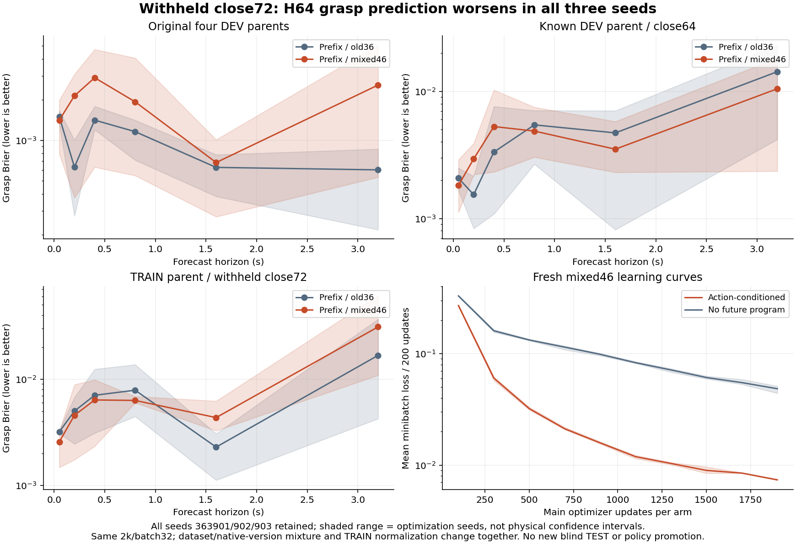

# FUSION-NIGHT1: implemented first calibration path; healthy PILOT2 panel retained

Fixed plan `f965a2c568ec26e9cecb8301fac0785f96a575a8`; implementation `3aea7dbe2043ed7f6d1deaae344d8771bd174c65`.
The independent execution worktree merges the plan and the latest PILOT2 execution `ca4eb16bc15f440cf2e5ccd6cc2e49d650204f36`, preserving both parents. No main merge or active capsule edit. This report is an intermediate cold-adoption preparation, not the morning or completion report.

## Actual FUSION work and current physical owner

Implemented source/rotation/frame/gripper/time decoding, whole-final-H40 qualification envelope, four matched single-decision correctors, a supplement in the existing registry, and a finite calibration driver using the original native worker. The native safety, WBC and physical clock remain the existing implementations. New native code still requires actual commissioning; CPU tests do not establish native qualification.

World-model regression: **299 tests / 110 subtests passed**, 21.02s. Optimized Python: **20 FUSION tests / 57 subtests passed**, 1.23s. Existing unrelated deprecation and pytest optimized-assertion warnings are retained. All three new CLIs return real `--help`; CI was not run.

At epoch 1793933467.8730855, original unit `wm02-pilot2-c10-b1-frozen-transfer-dev-panel-02` has live MainPID 1500051, ACTIVE lease and 27 complete pairs / 54 measured evaluations of 144, after six native scene qualifications. The currently running child is not precounted. Its immutable source remains `ca4eb16bc15f440cf2e5ccd6cc2e49d650204f36`. Healthy PILOT2 work continues naturally; no FUSION physical job/scope has been launched and the old CLOSED roles remain closed.

FUSION actual counts: **0 physical integrations, 0 VLA queries, 0 WM/Actor/GR00T updates**. M0/M1/M2/M3 remain unachieved. The implementation does not substitute a calibration command for GR00T output. Original site deadline remains 2026-11-07 19:54:21.739793 SGT, with 20 minutes reserved for closeout. First future morning checkpoint at activation is **2026-11-07 09:00 SGT**, not an automatic extension.



## Sealed PILOT2 evidence carried into the handoff

- Timing cohort: **11 new native PASS / 71,133 ticks**, 10 actual KEEP/RELEASE microtasks pass. Twelve C10 episodes include two retained close56 episodes; **2,016 real task atoms / 1,908 correlated anchors / 10,020 valid multi-horizon labels**, one TRAIN parent and one known DEV parent. No new independent TEST. Data SHA `6e4941e18d7486f5461ebd54e47f9617a6777385bfb018085b6e1abd162e72d6`.
- Frozen prospective observer: **108 actual pause points × four frozen models**, skipped0, unchanged native steps, Replay input hash mismatches0 and NumPy prediction discrepancy0. Dense all-anchor metrics are separately retrospective; sparse pause points must not replace natural-distribution reporting. Actual first-pad delay after close .548–.566s and first-grasp delay .570–.582s; delayed commands shift actual events by approximately .4/.8s.
- Actual two-slot qualification: two duration HOLD runs **8,206 ticks** and two full static contact runs **13,406 ticks**, all native PASS and clean shutdown. ENTER request/receive/apply totals **868/868/868**, completed-but-unapplied PD steps0. The two full contact runs log18 same-pause forecast points. Qualification task atoms contribute **zero learning data**. Proof details are in [the actual two-slot audit](C10_STATIC_TWO_SLOT_ACTUAL.json).
- Static adapter source `ca4eb16bc15f440cf2e5ccd6cc2e49d650204f36`; native binary unchanged `f30450e669236724a63c125cc88df86bb28aad9136ee644b1c8328e088b0adea`. The adapter requires matching actual single programs, duration and full dual proof, preserving the original safety and owner.
- Mixed46 replay: original C09 scripted36 plus C10 T01 TRAIN close56/64 and V02 known DEV close56/64/72. **46 episodes / 7,728 atoms / 7,314 anchors / 38,410 valid forecasts**, 8 TRAIN and4 DEV parents. Data SHA `866a095900b6f4e07409070841b4170d158ad55ace0acf9ba16e8e84785bfcc8`. The two TRAIN-parent close72 episodes are excluded from fitting; they are timing holdout, not independent physical TEST.
- Three fixed seeds363901/902/903 × action-conditioned/NO_FUTURE_PROGRAM × fresh2k: **12,000 new main WM updates +6 restore probes**, all worker exits0 and CLOSED. All full restore/endpoint reload discrepancies0; NumPy/Torch differences remain below1e-4. New peak Torch allocation388,027,904B/reservation576,716,800B; these are not total-process GPU occupancy.

### Negative timing-generalization result, all seeds retained

H64 grasp Brier (lower is better), old prefix36 → mixed46, same architecture and fixed2k/batch32 endpoint:

| Seed | Original four known DEV parents | C10 known DEV close64 | T01 withheld close72 |
| --- | --- | --- | --- |
| 363901 | 0.000861 → 0.000533 | 0.023167 → 0.010821 | 0.004252 → 0.020912 |
| 363902 | 0.000217 → 0.005075 | 0.015506 → 0.018278 | 0.036591 → 0.061153 |
| 363903 | 0.000732 → 0.002083 | 0.004187 → 0.002357 | 0.009330 → 0.010879 |

All three seeds worsen on withheld close72. New timing TRAIN coverage did not establish out-of-time improvement. Dataset exposure, native version mixture and own TRAIN normalization changed together; this is a package comparison, not a pure timing causal ablation. Do not select a best seed or promote a Policy from these scores. Action-conditioned forecasts remain better than action-blind long-horizon baselines, but no new control-gain claim follows. [All matched identities, curves and common metrics](C10_MIXED46_MATCHED_ACTUAL.json).

Costs: timing coordinator892.673s wall /1.684s own CPU plus1624.913s worker-subtree CPU; duration qualification45.444s wall /142.302s CPU incl.children; static contact qualification89.511s wall /313.328s CPU incl.children. Mixed replay builder9.637s wall (CPU not separately measured); new neural cohort68.153s wall, summed worker child CPU65.415s, CUDA event intervals61.835s. These scopes overlap and are not total campaign runtime or monetary charges. Model/hash inspection costs are separate receipts. No cloud allocation, H200 or multi-GPU work.

Before this live B1 panel, the sealed PILOT2 total is **504 native attempts /499 PASS /5 retained historical FAIL /2,371,843 ticks**. The first C10 B1 admission exited1 with missing `pilot2_plan_sha`, **0 native constructor/tick**; it remains a separate admission rejection, not a sixth physical failure. Fresh successor02 supplies the field and passed six actual scene qualifications. No CLOSED identity was reused. Across the inherited PILOT2 models: free Actor216,000+25 probes; contact Policy26,000+13; contact WM68,000+34; total310,000 main+72 probes. These are multiple-model totals, not one model's age.

## Frozen GR00T assets: present, not yet actual FUSION inference

Read-only inventory found E1 fixed512, selected by earliest existing compatible entry, not TEST ranking. Historical checkpoint manifest `383ad9b8fc3b81efffde132d4f06de92fb96fbdf9ec0b6c92c097e0f58eb2a8d`; official source `51d4c89f72fda44cbf77285c6a8114b52676b8a1`. All three shard files exist, totaling **12,576,200,896 bytes**. Configuration/processor/statistics small-file hashes match. All three full shard hashes now match the historical identity in a read-only audit: 12.576 GB read, 8.089s wall /5.738s CPU, all file stat identities stable; 0 model loads or inference calls. All 3,144,016,000 stored parameters are FP32. [Actual weight verification](FROZEN_E1_WEIGHT_IDENTITY.json).

An existing isolated GR00T/Transformers environment and legitimate original two-RGB/state dataset exist. The small WM environment has no GR00T/Transformers and remains unchanged. Checkpoint metadata declares source `new_embodiment` category10 with 40 relative EEF+absolute gripper outputs and preserved processor statistics. This is a fixed-base source, not a proven Go2 embodiment or resolved task intent. No fake tag, zero-padding or target image claim is made.

GPU availability is a live startup check. The observed GPU0 free9,220MiB/GPU1 free3,199MiB cannot be treated as a reservation; other-user workloads remain untouched. Original FP32 checkpoint payload alone is larger than either free snapshot. A later independent snapshot showed GPU0 free15,144MiB, demonstrating why the startup check must be live. No inference/peak-memory qualification has been attempted. Source command→desired-outcome semantics and target camera mapping still require evidence before F4.

## Actual commands and next readiness

Development commands used in the isolated worktree:

```bash
PYTHONPATH=src "$WM02_TEST_PYTHON" -m pytest -q tests/world_model
PYTHONPATH=src "$WM02_TEST_PYTHON" -O -m pytest -q tests/world_model/test_fusion_contract.py tests/world_model/test_fusion_native.py
PYTHONPATH=src "$WM02_TEST_PYTHON" -m scripts.wm02.register_fusion_scope --help
PYTHONPATH=src "$WM02_TEST_PYTHON" -m scripts.wm02.run_fusion_calibration --help
PYTHONPATH=src "$WM02_TEST_PYTHON" -m scripts.wm02.infer_fusion_vla --help
```

All five exited0. The private, existing Core route executed `read_fusion_assets.py`, `read_vla_candidates.py`, `read_frozen_e1_assets.py`, `audit_c10_mixed46.py` and `audit_c10_static_dual.py`; completed audits exited0. Mixed46 audit first exited1 on a missing legacy metadata key, then read normalization from actual arm results; no fitting or physics was repeated.

Next currently executable action is the existing read-only Core status query. Only after authoritative MainPID0, CLOSED terminal panel and canonical locks are confirmed: seal B1 outcomes, create a fresh FUSION supplement and new immutable source, prepare a genuinely new TRAIN scene, then run the already implemented calibration CLI with the registered input. The 1+4 group is not yet registered, so no fictitious READY input path is supplied. A VLA blockage continues to permit the calibration/contact branches. This goal remains ACTIVE.
