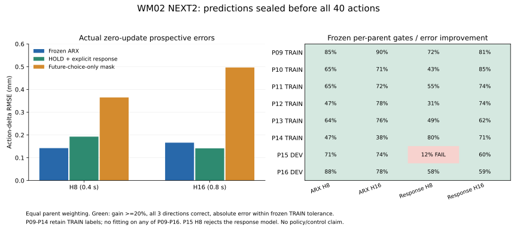

# WM02 NEXT2 实际执行交付

2026-11-05，Asia/Singapore。计划基线为未合并 PR #358 固定提交 `4c1e4cb83a1cd5e83d4849e2c0e84d31daef0910`；从独立 checkout 执行，没有假设 main 已有计划，没有热改现役 capsule。

**ARX 的新父场景前瞻预测通过；同进程预接触连续性通过；实际接触对齐未通过。** 本轮已执行全部 READY Gate，按原 owner/registry/Journal 结算为 `CLOSED_SCIENTIFIC_PARTIAL`。旧 NIGHT1/NEXT1 CLOSED lease 没有复用。未启动正式 Actor、GR00T、真机、行走或4环境；冻结 WBC、腿策略、增益、cost、solver、原限位/碰撞判据和0.002s物理步长保持。

| 标签 | 实际结论 |
|---|---|
| LOCAL_RESPONSE_PREDICTOR_READY | ARX通过；显式响应候选保留 |
| PROSPECTIVE_RESPONSE_VERIFIED | ARX在P09–P16全部通过 |
| PRECONTACT_CONTINUITY_VERIFIED | 原几何＋低速连续12.90s，完整原生证据通过 |
| TARGET_CONTACT_TRANSITIONS_AVAILABLE | 否；真实接触正例0 |
| POLICY_READY | 否；没有在线选择收益或完整任务成功证据 |

## 逐 Gate 成果

| Gate | 实际工作与结果 | 新物理/学习 |
|---|---|---|
| E0 | 只读确认旧窗口CLOSED、原父campaign有效、唯一owner与两把原锁；登记新6h/96次/600000tick有限scope | 0积分/0更新 |
| M0 | 原ARX逐数组误差0，模型文件SHA完全复现；4个TRAIN父留一交叉验证，每折重拟合normalizer；窄future-choice-only消融；相同特征/一步目标的线性神经优化诊断；FREE/teacher-forced、FK与递推算子审计 | 200主更新＋2次恢复比较调用 |
| M1 | TRAIN-only选择constant HOLD＋显式XY响应，ridge0.1，严格R(0)=0；冻结ARX、窄消融和响应模型及TRAIN容差后开始新面板 | 43次主审计闭式模型拟合；另3次受控/数值审计复现，共46次/79个线性方程组 |
| V | 8次scene资格＋40次生产，2个既有CPU原生slot，生产每次先封存4候选×3模型预测，再安装所选实际动作 | 48次/196944tick；40窗口/960回放atom，新面板拟合0 |
| C0 | 对8条旧接触记录重建首次进入/离开、引用、TTL、solver关联、pad余量、BASE/arm运动；首次离开为X重叠丢失，引用恒定 | 0新增积分 |
| C1 | 同原生进程INIT→STEADY→APPROACH→PRECONTACT_HOLD；首次20s运行追踪容量溢出，修复后新身份复验通过 | 2次/25006tick；合格分段数据400atom |
| C2 | 原20mm候选因link3/link5自碰静态拒绝；独立25mm几何候选16个原始证书通过。当前同进程重证预接触后下降，实际对齐未达门槛，保持开爪并撤离 | 1次/12503tick；真实分段数据400atom；接触0 |
| FINAL | 所有76条worker lease关闭、28个精确运行单元MainPID=0、99项冻结文件无变化；原子关闭NEXT2子scope并回读 | 0新增积分/更新 |

## 模型线：前瞻结果

P09–P14保留原TRAIN标签，P15–P16保留DEV标签；本轮八父均零更新前瞻，今后不得再称这些数据未曝光。每父HOLD/+X/−X/+Y各一次，再一条独立HOLD重复，共40次；全部分母保留。960回放atom包含320个burn历史atom及640个决策后预测atom。匹配独立重启，**不是完整MPC/WBC状态的严格分叉或oracle regret**。

历史NO_ACTION清除了历史和未来全部17维参考，本轮窄消融只去未来所选EEF位置，保留历史、未干预BASE/旋转/夹爪与clock。旧神经M0 FAIL原样保留。

| 预测器 | H8动作差RMSE/mm | H16动作差RMSE/mm | H8绝对TCP RMSE/mm | H16绝对TCP RMSE/mm | 冻结晋级 |
|---|---:|---:|---:|---:|---|
| 冻结ARX | 0.1422 | 0.1662 | 0.1096 | 0.1310 | 全部通过 |
| HOLD＋显式响应 | 0.1927 | 0.1413 | 0.1399 | 0.1281 | P15/H8失败 |
| 只遮蔽未来选择的ARX | 0.3650 | 0.4966 | 0.2946 | 0.4188 | 对照 |

ARX相对窄消融H8/H16误差下降61.0%/66.5%，八父均3/3方向正确。显式响应H16平均误差较好，但P15/H8仅改善11.54%；绝对误差0.2113mm，相对ARX的0.1332mm超出冻结的0.06686mm容差，故不晋级。没有看DEV改超参数或延长训练。



数值详见[逐父结果](PROSPECTIVE_RESPONSE.json)、[公平性与TRAIN交叉验证](MODEL_FAIRNESS_AND_CAUSALITY.json)。误差按父等权计算；每父仅两条HOLD，重复噪声属探索性证据，不作精确显著性宣称。

相同ARX因果特征、全TRAIN标准化、106维一步delta目标及相同ridge目标下，Torch线性层200步Adam得到近似训练拟合，却在FREE递推中发散。其212维状态/前态递推谱半径13.534，闭式ARX为1.000313；teacher-forced DEV TCP RMSE约0.0551mm，而FREE H16达到4.34e11m。checkpoint/optimizer/RNG恢复误差均0。这说明本受控诊断包含有限优化后的递推不稳定性，不能把原GRU差异仅归因于网络结构，也不能把该线性谱直接当作原GRU或WBC稳定性的定因。ARX本轮只验收16步局部预测，未获全局稳定或规划安全资格。

200步TRAIN惩罚目标7.6483，闭式最优7.1790，未达到预登记的>1.1倍欠拟合延长条件，因此未延长至800。实际optimizer调用202次：200主更新、1次期望续训和1次独立恢复续训。没有新残差网络、事件头或Actor。FK审计中ARX H16独立TCP与预测qpos重建TCP的RMS差约0.987微米；失稳神经预测的离线FK有奇异性警告，完整保留，未用于物理。显式模型只输出TCP/BASE/BASE-relative TCP9维，不能充作完整安全world model。

**工程失败保留：** 8次scene资格运行的预测误用了整段任务2s时钟，实际冻结训练窗口原点是排除HOLD40后的0s。原始预测保留、排除正式模型成绩；根据旧TRAIN回放确认并修复后才启动全部40次生产。原生资格本身通过，没有重采这些资格来挑成绩。

## 接触线：连续性已解决，实际到达仍阻断

旧PRECONTACT80在6028首次进入、6278首次离开，X重叠余量变为−0.0486mm；同期目标参考变化0、TTL有余量、solver target关联成立。BASE平移/旋转与arm分量均有记录，selected-policy ID仍DERIVED，不能仅凭几何归因于某个WBC bug。

新C1首个20s任务段实际保持12.85s，但87540条追踪超出旧65536容量，丢22004条，整体验收FAIL。新131072容量只更改追踪DSO，原生C08、controller、solver、observer、actuation均未变。辅助加载检查两次误将追踪器加载到taskset，发生零物理SIGABRT；修复为仅在最终exec加载，原失败均保留。随后新C1记录89117/89117事件、丢失0，当前原几何＋0.015m/s低速连续12.90s，原生资格通过。

原20mm名义目标的静态下降在TCP距物体中心20.5mm处触发x5_link3/x5_link5（geom68/71）自碰，原判据拒绝。保持失败后，以25mm作为独立几何抓点检查；16块下降/撤离证书全部通过。它是几何碰撞修复版本，原pad接触谓词不变，没有按WBC实测误差做分轴目标补偿。

C2在同一进程当前6753tick完成连续1s＋额外0.5s预接触，以11.5s剩余预算进入下降。计划下降2.5s后又等待约2.8s；106个下降段反馈全部确认solver目标，TTL最小余量约50ms，但实际对齐样本0。9403tick尚余6.2s时保持开爪进入WITHDRAW，实际撤离通过。CLOSE/SUPPORTED_HOLD/RELEASE没有被强行触发。

退出下降前参考TCP为(0.458,−0.080,0.484893)m，实际为(0.420232,−0.068918,0.540874)m，误差68.433mm；下降过程中最近pad底部仍高于接触上沿至少39.714mm。完整10000个任务native tick内接触正例0。**剩余确定阻断是实际接触到达/跟踪误差。** 当前证据确认安装与solver目标，控制器实际选用ID仍未直接导出，尚不能将误差定为单一控制缺陷；继续核对实际选用、FK模型与BASE/arm协调。

原C2回执的`precontact_continuity_verified=false`来自当时只计算C1末态保持的字段语义，不代表C2未通过当前前置门槛；6753转移与1.5s记录证明当前门槛通过。原回执保留，后继代码已分开“过程中通过”与“结束时保持”，没有因此重跑或改写实际物理结果。

[接触证据摘要](CONTACT_RESULTS.json)包含失败、修复与实际阶段；两种分段数据保留实际安装H40、执行索引、时间、所有原生接触及夹爪8项内部记忆。C2也保留每25个native tick内的短暂接触聚合，未用末态漏掉正例。完整MPC/WBC隐藏状态恢复仍未验收。

## 实际数量、成本与关闭

- 原生51次＝8次新scene资格＋40次生产＋3次接触运行；50 PASS/1追踪证据FAIL。234453tick＝51×2503启动tick＋4272×25任务tick；完整任务成功0。
- 封存40窗口/960局部回放atom，另有C1/C2各400条piecewise转移，共800。两种schema分开，均未再次用于本轮训练；接触正例0，Actor更新0。
- Core已计量CPU4298.197秒（1.194核时）：运行单元4255.815秒，离线审计42.382秒。GPU诊断进程wall2.710秒，训练段wall1.131秒；CUDA event时间未采样。Torch分配峰值67.96MiB、预留70MiB，计数不含CUDA上下文。新NEXT2目录逻辑占用21.407GiB，包含源码副本、原始数据及失败记录；未清理。
- 失败构建、早期只读/传输和PC工程CPU未采样，不估算其核时；实际退出与wall区间留在私有command/SSH回执。未把未计量项写成0成本。
- 最终源码152项相关单元测试在普通Python与`-O`各通过。GitHub CI不冒称PASS。76条worker lease和NEXT2窗口均CLOSED，28单元均MainPID=0，99项冻结文件核验无变化；原截止未延长，旧窗口未重开。

完整[计数和成本](COUNTS_AND_COSTS.json)、[76条运行身份/退出码索引](RUN_RECEIPTS.json)。`NATIVE_STAGE_PASSED`是原生阶段资格，不是完整T1成功或模型控制收益。

## 完整源码、数据与模型身份

| 用途 | 实际SHA/SHA256 |
|---|---|
| 计划固定提交 | `4c1e4cb83a1cd5e83d4849e2c0e84d31daef0910` |
| scope注册源码 | `b371b04b8f7758a61b19e4521f23853a7622eb19` |
| ARX/CV/显式拟合源码 | `130393ccf8a701e65a17603ac393f4b8fa6037fc` |
| 神经诊断源码 | `beaf8deb201cbc5fbdc03769147e1a92be60cb3e` |
| 正式前瞻采集源码 | `88428686d6c9009b19b82cf19d34df24797ff86c` |
| 合格C1源码 | `81ed282dbe9a6acf11546ba550bfad221d88e581` |
| C2实际运行源码 | `b18573a67bec91c1edb1d5b93a09dbb138cea3ed` |
| 终态审计/数据封存源码 | `b32995daa146bf059de6a73d189fe24403a3cf3b` |
| 冻结FIT回放 | `0b889a835a155b5e2697e3a139b49a4e35ae83e096e05a97d4e3b2c50d74a0de` |
| 新父前瞻回放 | `178c7e3395b5476393b094c8f208848ac71bfc1de76911a5a5cfceb4f535b822` |
| ARX模型 | `c69ae25164b023cb005e17aaa0c6a45b9d75f756963a1887c782597e7acf55d1` |
| 窄消融ARX模型 | `84538fe1c1c3533c888499ddba1a8ed742ac679de57d2c5c6e577a996b615f5c` |
| HOLD＋响应模型 | `73b7c9570c1b8e34448c1192c8ac8014224267f56be16e7a43d342a181884767` |
| 神经诊断checkpoint200 | `46a19982a2b61ac11361b554bc147f733f532bf4c6a83bc64771dd6205ad0606` |
| C1分段回放 | `c9cac67da421a6dc7225b6b311faf976bf146c5af7eaad221be2dbb6db4f1e99` |
| C2分段回放 | `e7bdc5dc79ad4638dce0aa0d5071ef2936e3d1dcbdd3440aa7fbb89329e70cc8` |
| 冻结执行器 controller_binary | `9e8ce46837d09bc39ae04d4b49f1ce4dd8c8c2d31bea39eac56c5806d108c1f3` |
| 冻结执行器 native_binary | `29b261541b9dc2b2ed5c6df065026b33a11c3019181b9a8cfa980a7878d91df2` |
| 冻结执行器 observer_library | `87423cf290dae9aa767e1286ab1a7573216c546fde76db9ac866fbbc841a3eb7` |
| 冻结执行器 outer_library | `65692aa1cfd37c287bd8c77f3c26b64d46bd840d3981cd05c9d99929d21c20b6` |
| 冻结执行器 solver_binary | `4a5f5aa6e0b9d4bde62f4d1da73135ef97e5268945a0cecf114d9190d3e04fd0` |
| 冻结执行器 trace_library | `bd92a15c9ec4e435c3ee435878d94ed2e94075d38d6590d593c7c1201706eaea` |
| 新追踪DSO（仅容量/加载链） | `1a6868e81cda34ddcbf6bf13fd00860c6e84af8f6d3f6f691f3ebf46ae9f2bea` |

[模型/数据身份](MODEL_AND_DATA_IDENTITIES.json)及[SOURCE_MAP](SOURCE_MAP.json)给出执行源码到GitHub同树提交的映射和原始Git commit对象；连接器生成的发布commit SHA与执行SHA分开报告，每个源码树均校验一致。没有上传原始私有数据、checkpoint权重、vendor资产、主机绑定信息或凭据。

## 实际执行入口与退出码

下表把真实目录替换为已绑定的私有变量；完整argv、source/spec hash和stdout/stderr保留于原`LAUNCH_INTENT`、`COMMANDS`及Journal。它们是已执行入口，不是计划中的假CLI；CLOSED动态命令不可重放。

| 实际入口 | 实际退出 |
|---|---|
| `python -m scripts.wm02.register_next2 --binding "$NEXT2_BINDING"` | 0 |
| `python -m scripts.wm02.audit_next2_models --spec "$MODEL_SPEC" --output "$MODEL_OUT"` | 0 |
| `python -m scripts.wm02.train_next2_feature_diagnostic --spec "$RUN_SPEC" --output "$FIT_OUT" --run-id fit-01`（原worker调用该main） | 0；200主更新＋2比较调用 |
| `python -m scripts.wm02.audit_next2_optimizer --spec "$OPT_SPEC" --output "$OPT_AUDIT"` | 0 |
| `python -m scripts.wm02.audit_next2_consistency --spec "$FK_SPEC" --output "$FK_AUDIT"` | 0；失稳预测FK警告保留 |
| `python -m scripts.wm02.parallel_target --spec "$BATCH_SPEC" --output "$BATCH_OUT" --run-id batch-01`（原worker） | 24批均0；48原生子运行均0 |
| `python -m scripts.wm02.commission_target --spec "$CHILD_SPEC" --output "$NATIVE_OUT" --run-id native-01` | 2slot实际子进程入口 |
| `python -m scripts.wm02.build_target_replay --manifest "$V_MANIFEST" --output "$V_REPLAY"` | 0 |
| `python -m scripts.wm02.evaluate_next2_prospective --spec "$V_EVAL_SPEC" --output "$V_RESULT"` | 0；ARX通过、B未通过 |
| `python -m scripts.wm02.collect_target --spec "$CONTACT_SPEC" --output "$NATIVE_OUT" --run-id native-01`（原worker） | C1旧追踪1；新C1为0；C2为0 |
| `python -m scripts.wm02.check_next2_contact_path --spec "$STATIC_SPEC" --output "$STATIC_RESULT"` | 原20mm先1、诊断版2；25mm为0 |
| `python -m scripts.wm02.build_next2_contact_replay --spec "$PIECEWISE_SPEC" --output "$PIECEWISE_OUT"` | C1/C2各0 |
| `python -m scripts.wm02.next2_status --binding "$NEXT2_BINDING" --output "$STATUS_OUT" --gpu-query` | 0，关闭后再次回读0 |

另外两次loader doctor为SIGABRT/−6、0物理；第一次一致性review误指向已存在目录，FileExistsError拒绝、未覆盖，随后新review通过。原生20mm抓点从未绕过静态拒绝启动。

## 下一条可执行命令与接续判断

在Core绑定原环境和私有变量后执行只读回读（入口已实现，并已在关闭后实际返回0）：

```bash
PYTHONPATH="$WM02_SOURCE/src:$WM02_SOURCE" "$WM02_TARGET_PYTHON" -B   -m scripts.wm02.next2_status   --binding "$NEXT2_BINDING"   --output "$WM02_PRIVATE/NEXT2_READBACK_FRESH.json" --gpu-query
```

ARX可进入另版、有限的局部动作选择对照，证明预测之后还需证明选择收益；本轮没有自动在线selector。接触线优先核对实际控制器选用、FK模型和BASE/arm协调与68.4mm到达残差，保留20mm自碰和25mm未到达两类证据。原始任务评分不改、不能补偿WBC偏差强闭爪，不能把1mm模型指挥100mm接近，也不能把已有曝光的P09–P16再当新盲测。新的物理/GPU端点由原机制登记新有限scope，旧CLOSED lease保持关闭；正式Actor仍未启动。
