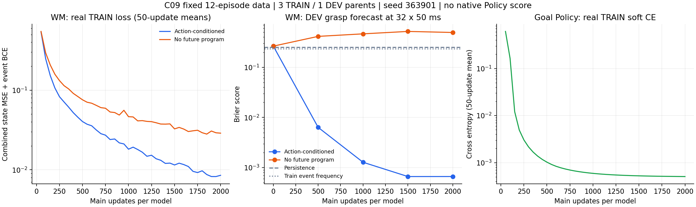
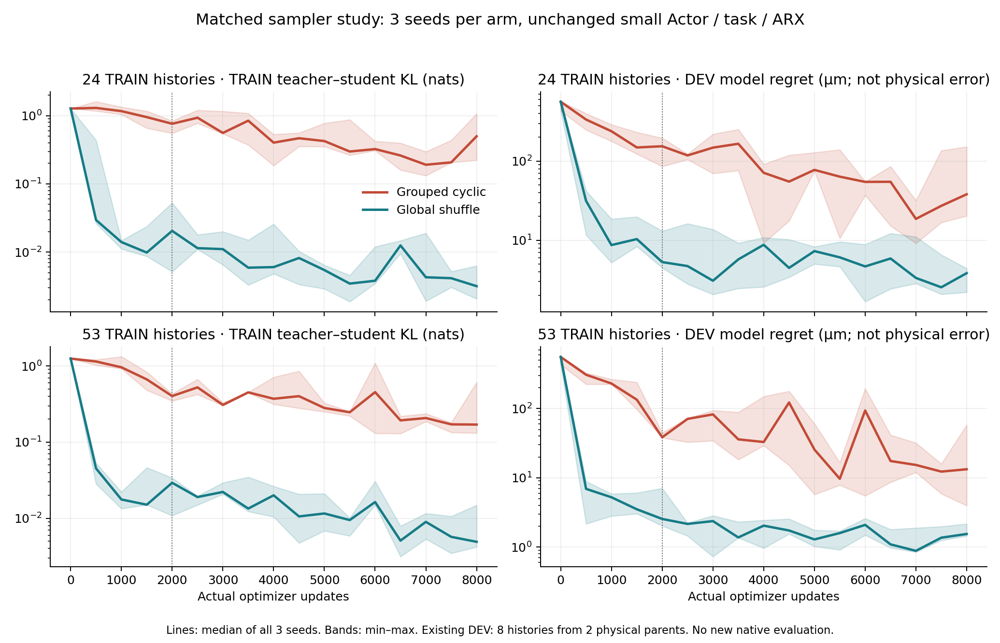
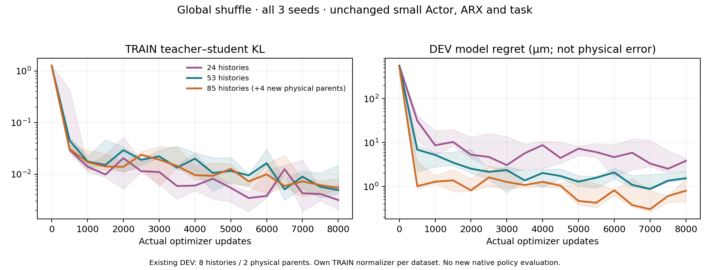

# PILOT2 实际进展：先修采样，再增加物理父

2026-11-06，Asia/Singapore。执行计划固定于 `6d82fa23c892f167001abe743dd5eadfca6fd777`（PR #363，未合并）。本报告是中期封存，**PILOT2 尚未完成**。

最新状态：B1 双环境 DEV 面板已失败封存，128/144 次实际尝试中126原生PASS、2FAIL、16未执行；新TEST未构造。C09 T04/T05/V03接触覆盖已完成，新的WM匹配对照和FSM教师Policy已经真实训练并恢复；T06/T07/T08/V04物理采集正在执行。以下各阶段旧水位按封存时间保留；以本段和最新摘要为准。

## 最新学习：C09新父数据、预测正结果与待验收Policy

T04/T05/V03完成3次新前缀资格＋9个真实接触程序，12/12原生PASS，72636tick，exit0/CLOSED。新C09-only Bundle SHA256 `01c27053ee91776dfcbcbef0d6ce4cd1dcfd1fcdffa9e5c711c121657cb75aae`，含12个episode、2016 raw atom、1908历史anchor、10020有效预测标签；3 TRAIN父（T01/T04/T05）和1 DEV父（V03），不含TEST。

使用同seed363901、相同网络／optimizer／batch32／fresh 2000更新和各自TRAIN-only normalizer，完成动作条件／无未来程序两个WM（各2000）及一个目标Policy（2000）。三次完整恢复探针和端点重载误差均0，NumPy/Torch预测检查通过。是新增4000 WM＋2000 Policy主更新和3个探针，不是单模型6000步。训练源码 `e2ba4a9d61c5af9a9c1199a7c98b2d608d134e33`，旧C08 checkpoint没有用于warm start。

| V03自然分布grasp Brier | 动作条件 | 无未来程序 | 持恒 | TRAIN事件频率 |
| --- | --- | --- | --- | --- |
| 1×50ms | 0.001035 | 0.005814 | 0.006289 | 0.212395 |
| 8×50ms | 0.002422 | 0.109276 | 0.052632 | 0.217663 |
| 32×50ms | 0.000666 | 0.494718 | 0.250000 | 0.235650 |
| 64×50ms | 0.020741 | 0.689711 | 0.472222 | 0.249228 |

这是一个新DEV父上的有限动作条件预测正结果；无未来程序臂32步TRAIN Brier为0.012001、DEV为0.494718，存在明显泛化失败，不能把整个差距唯一解释为动作信息的因果贡献。64步动作条件误差也高于32步。相邻anchor不是独立试验，尚无多seed区间或原生Policy增益。Policy对FSM教师的TRAIN 12标签／DEV 4标签一致率都是100%，两目标各选择KEEP和RELEASE；仍待真实原生评价。

只读比较WM教师与FSM：16个状态目标组合的动作argmax全部相同；TRAIN软标签最大差0.000221、DEV差8.17e-7，输入差0。实际父均值return教师与FSM软标签完全相同。这说明当前微任务的强规则已经很好，不能由预测改进直接推为更好的动作选择；实测对照仍保留FSM和恒定动作基线。

| 模型 | 完整checkpoint SHA256 | NumPy模型 SHA256 |
| --- | --- | --- |
| C09动作条件WM | `8052814a35ba4b0bb98ec854b65af511cd1858cc8fbfd9b67fb85869a7187b96` | `a9ce33544f3771dd3ba9e51874c4f7f32982382da2dd3f5bf4fbd9d1da622ec9` |
| C09无未来程序WM | `f36859195adf08db18e7b88c1baa79d92da2e799b0079f5ecb2852767130b8e8` | `c3ed5e1e6961014f9a08c62ce9b5f1e44315fe8e9bdf0c549a1b46623168f5f0` |
| C09 FSM教师Policy | `4f5602505fde5dbf40e0f13db79ded32a2e98fc4fa7b063e30b1b034f1c02b32` | `9836535c673d0c50ab837f4077ffe015755866026c5286e6629ed37e3f317226` |

GPU cohort实际33.080s wall、两个trainer子进程CPU合计29.575s；WM／Policy Torch峰值保留分别134／68MiB，并非整个进程NVML用量。先登记神经任务，再登记下一物理批次，沿用原owner与单GPU共享范围。下一组T06/T07/T08/V04正在单路分级采集，16项计划不预记PASS；冻结12-episode模型保留，不用V04回头选择当前checkpoint。

完整cohort水位：366次原生尝试、363PASS/3FAIL、1573728tick；自由Actor216000＋25探针、接触Policy22000＋11、接触WM20000＋10（跨模型累计）。曲线、全部视野／事件／位移指标、恢复、显存、教师比较与证据hash见 [C09实际神经结果](C09_CONTACT12_NEURAL_ACTUAL.json)。新增首个FSM双路接触资格配置已经实现并通过软件测试，尚未部署或原生执行，不能称新接触双路已通过。

## 最新封存：完整双路时长与真实接触通过

C09 T01完成1次前缀资格＋3个真实程序，4/4原生PASS、24212tick。KEEP56持续支持夹持4.0s，RELEASE56先保持1.2s再连续释放2.236s；OPEN64夹持目标失败，作为有效负例保留。新C09独立Bundle SHA256 `9cc75b185c7fb8bb02491e32f293023781030b7094036f581635b260f3a7bf40`，504个raw atom、477历史anchor、2505个有效多视野标签，1 TRAIN父／0 DEV父；没有把它标成新DEV或混入旧C08数据。

在同执行器单路4103tick和双路3103tick证据之后，新有限HOLD-only时长检查也已实际完成：两路各4103tick，2/2原生PASS/exit0/CLOSED。128个raw任务atom明确只作资格记录，进入TRAIN为0。没有放宽生产检查；这个单独版本先核对真实单路资格、短双路原生结果和相同二进制/observer，且只允许HOLD。源码 `e2ba4a9d61c5af9a9c1199a7c98b2d608d134e33`，二进制仍为C09 `e4119a7c655c036939d948c03dcaca761d3a3672e6545e330825f34e3bc3c21c`，未热改活动capsule。

本次同场景单路HOLD资格观测为91.69 tick/s；双路时长检查聚合190.25 tick/s，约2.075倍。这是一次单路与一次双路的实际吞吐观测，不是多次匹配性能基准，也不意味着4环境或GPU物理后端已经获准。双路worker wall43.133s、CPU136.916s。接触coordinator wall298.391s，四个native worker CPU合计541.148s，自身CPU0.538s；builder CPU未单独计量。完整结果和成本见 [C09接触与时长](C09_CONTACT_AND_DURATION.json)。

另用已冻结的C08 18-episode／每臂6k接触WM，**不训练、不重拟合normalizer**，预测上述C09 T01记录。动作条件模型抓持网格转换检出162/163、误报0；无未来程序消融为84/163、误报111；检出条件时间MAE为14.20ms／539.29ms，分母不同。32步grasp Brier为0.000677／0.305960。OPEN事件仍有动作条件模型误报13，不能只报好项。这是旧训练父上的新执行器预测检查，477个重叠anchor不是477个独立试验；不构成新父泛化、2ms首次通过时间或控制收益。CPU检查耗时0.256s/0.207s CPU、优化及积分0，见 [冻结模型跨执行器检查](C09_FROZEN_MODEL_TRANSFER.json)。

当前完整cohort已封存累计354次原生尝试、351PASS/3FAIL、1501092tick。自由Actor216000＋25恢复探针、接触Policy20000＋10、接触WM16000＋8（跨模型累计）保持；本次接续新增模型更新0。已按原owner登记下一组T04/T05/V03，每个新接触条件先单路；12个计划原生任务不预记成功。实际封存后才绑定该C09数据做匹配GPU学习，并在下一物理批次前登记神经任务，以便并行运行。当前goal继续ACTIVE。

## 最新接续：C09单／双环境资格通过，接触按新执行器检查

应用时钟V2候选实际编译成功，binary SHA256 `e4119a7c655c036939d948c03dcaca761d3a3672e6545e330825f34e3bc3c21c`，build源码 `5786f73073aaaa4562f0240fe0038f2cfc83dc96`。原C08二进制和失败数据保持。六项G1、参考事务、站立保持/续约、+X、+Y共11次单环境检查全部原生PASS，20440 tick，所有已记录积分均在首个真实动作应用后执行，“推理完成但未应用”窗口为0。

TTL第12项因旧适配器把初始化25tick暂停点覆盖掉，在首次积分前退出1、0tick；工程失败保留。源码 `8e215be272218cf8f7f2bd772a1a459335f0528e` 修复白名单集合顺序，新身份仅接续TTL，2706tick原生PASS，没有重跑11项已通过检查。原native、安全和TTL判据未变。

两路冷启动各50tick原生PASS，但父批次旧汇总代码强读学习episode清单而KeyError，父exit1保留，两个子项不改写。源码 `ea346297bde386b9b3d1fed17d736b7b832d300a` 将该资格路线明确记为QUALIFICATION、学习atom0；新身份接续双保持和短采集：两路各2528＋3103tick，共11262tick，双批次均PASS/exit0/CLOSED，动作应用窗口均0。没有为获得父PASS重复已完成的两次冷启动。

上述资格共19个原生尝试、18PASS/1个零积分FAIL、34508tick；两个coordinator工程失败另列，不把其中的PASS子项虚报成原生FAIL。当前PILOT2已封存348次尝试、345PASS/3FAIL、1468674tick；新增WM/Actor更新0。新接触单环境检查已登记并执行中，未预记PASS、未默认C08接触资格对C09有效。几何文件及原静态检查保持，C09目录明确绑定新执行器，真实接触数据单列C09域。

这组资格worker加build合计阶段wall296.228s、CPU460.716s；不含编辑时间和未计量只读审计，没有货币成本计量。253项world_model测试通过，相关并行8项及暂停4项在`-O`下通过；GitHub CI未取得回执。原生资格与应用时序改善是有限工程正结果，仍不能证明Actor胜过规则或完整操作成功。继续一个owner、至多两个合格CPU slot和单GPU神经工作；新接触先单环境。逐项结果、失败、成本、源码／二进制与证据hash见 [C09实际资格](C09_ACTUAL_QUALIFICATION.json)。

## 最新结案：原生 DEV 负结果与初始化应用时序缺口

6新DEV父×4目标×3方法×2独立重启的144条件，实际完成128次尝试、521063 tick，批次退出1、父/子lease均CLOSED，所有所属进程退出，物理owner锁已只读核实空闲。126个有效测量均保留，产生8064个DEV任务atom，未混入TRAIN。累计PILOT2为329次原生尝试、327PASS/2FAIL、1434166 tick。

| 方法 | 实际尝试／有效测量 | 严格任务成功 | 有效测量平均XY误差 |
| --- | --- | --- | --- |
| 强TRAIN均值规则 | 42／42 | 12/42 | 0.215011mm |
| 冻结ARX | 43／42 | 10/43 | 0.303020mm |
| 主seed36001 Actor | 43／42 | 10/43 | 0.271839mm |

仅5个完整父可用于配对连续cost分析；V01的未完成部分只在该项配对分析排除，全部尝试仍在部署分母。Actor相对规则的父等权cost改善为 **−0.059138mm**，层次bootstrap95%区间[−0.130570, −0.004655]mm；ARX为−0.093362mm。两者均无LOCAL_CONTROL_GAIN。这是未完成DEV面板的有限负结果，不能推为完整TEST结论，也没有更换成DEV最优seed。

第64对的slot1在1785tick（3.57s）触发原REGISTERED_JOINT_SAFETY：RL/RR小腿分别越过原上限0.039049/0.024479rad。slot0依原机制在2300tick停止。两者均早于2500tick初始化完成、WBC切换及3703tick任务Actor决策；无任务决策文件，不能将该越限归因于学习Actor。STOP之后实际积分0，原安全按预期截断，未放宽关节阈值。

只读追踪发现明确的软件交接缺口：失败进程首个腿推理与对照输出相同，已完成并发布，但前三个tick的applied版本仍为0、腿力矩仍为0；同父正常对照从第一步即应用版本1。失败记录452/1785步、正常记录1081/4103步存在“推理完成但尚未实际应用”的窗口。V1只等待inference completion，未等待PD消费q/dq。该缺口已证实；它是否直接造成3.57s越限尚待原生验证。正常记录也存在缺口，不能把相关性当完整因果证明。

已实现独立V2应用时钟候选：在原短锁发布内标记policy bucket、真实消费后确认应用，物理积分同时等待推理完成与PD应用。原V1代码保留可复现；原PD、推理、target/torque及mj_step公式可逐字逆还原。新版本要求两个时钟header的实际hash绑定，不能只填版本布尔值。离线慢推理/延迟消费并发回归通过；**尚未完成新候选原生资格**，不将软件测试当现场PASS，不复活旧lease或补跑失败行。下一步是独立有限build，再依原机制分级原生资格，合格后恢复至多双CPU环境。

本B1成本：coordinator wall2821.674s（47.03min），自身CPU9.935s；64个batch自身CPU15.924s、后代CPU8670.874s，合计8696.733s CPU（子树只计一次），batch wall合计2739.307s。新增WM/Actor优化0；无货币计量。模型水位仍为自由Actor216000＋25探针、接触Policy20000＋10、接触WM16000＋8（跨模型累计）。冻结executor `29b261541b9dc2b2ed5c6df065026b33a11c3019181b9a8cfa980a7878d91df2`，本B1源码 `3a2d5ec0b9996e4e4e7b5d5d243a198f6502464b`。完整聚合、面板/数据/模型链接与私有证据hash见 [本次结案摘要](B1_PARTIAL_DEV_AND_STARTUP_FAILURE.json)。

## A0/A1：匹配数据、采样顺序与 seed

保持原 ARX、任务、两层 128 网络、batch128、AdamW lr0.001、纯软教师 CE 和 TRAIN-only normalizer。12 模型设计为 24/53 TRAIN 历史 × 原 grouped cyclic/global shuffle × seed36001/36002/36003。每历史的256目标是合成教师标签，不是256个物理父。DEV仍为来自两个物理父的8条历史，没有读取旧 TEST。

| 8k 主更新端点 | TRAIN 教师动作一致率，三个 seed | DEV 教师动作一致率，三个 seed |
| --- | --- | --- |
| 24 / grouped cyclic | 83.69%, 64.52%, 87.08% | 91.02%, 62.06%, 87.35% |
| 24 / global shuffle | 99.07%, 98.75%, 99.35% | 95.65%, 96.24%, 97.36% |
| 53 / grouped cyclic | 92.55%, 89.45%, 73.38% | 94.63%, 95.75%, 80.22% |
| 53 / global shuffle | 98.71%, 97.63%, 98.81% | 97.66%, 97.17%, 96.39% |

曲线为全部三个 seed 的中位数和 min–max。右列是 **ARX 模型评分的 regret**，不是本体物理误差。自然 CE 含教师熵，不要求接近零。2k/8k 是等更新主对照；20/40完整标签 epoch 为单列辅助对照：24窗口在960/1920更新，53窗口在2120/4240更新。二者不能混称等 compute。

完整 sampler 保存 permutation、PCG64 generator、epoch、offset、draws，恢复探针同时核对模型、优化器、normalizer、Python/NumPy/Torch/CUDA RNG 和 sampler。12个模型均恢复误差0；原24/53 cyclic seed36001 的2k端点与既有 checkpoint 的模型和优化器完全一致。两个数据版本各自六个模型的 normalizer 数组哈希分别完全相同；不同数据版本仍使用各自 TRAIN 拟合，未声称只隔离了覆盖的单一因果因素。

按事前冻结的 TRAIN 高 margin 错误、2k→8k KL下降和 DEV 非劣化规则，arm0/1/5/8获得有限20k后继。每个从8k完整状态新增12k更新，其余八个未为凑步数继续训练。四个后继恢复误差均0；端点 TRAIN/DEV一致率依次为95.25/95.46%、92.60/96.83%、94.83/97.27%、97.17/97.90%。这些结果支持继续使用 shuffle 基线，不支持无限增加 cyclic 更新。

实际累计：12个不同模型，96,000主更新；4个延续新增48,000；合计144,000 Actor 主更新＋16个单次恢复探针。WM更新0，原生积分0。各 checkpoint、数据和逐父/目标/类别指标见 [匹配曲线数据](A1_MATCHED_CURVES.json) 与 [条件延续及normalizer审计](A1_CONDITIONAL_CONTINUATIONS.json)。

## B0：新物理父和真实动作覆盖

采集前固定18个新父及分区（12 TRAIN、6 DEV），仅改变允许的初始 root/object XY；四个原动作和原时钟不变。面板 SHA256：`8e502a719431b43db807ddec0994fea32080a0b91f41e0123b15011a8731b944`。已完成首批 P2T01–P2T04：

- 4次单场景资格＋16次双槽动作批次（32个动作 episode），36/36原生PASS，147,708个2ms tick，worker退出0且lease CLOSED。
- 每父 HOLD/+X/−X/+Y各两个独立重启，动作顺序和repeat/slot在采集前随机化；没有按教师喜好挑动作。
- 新增32个可用 TRAIN 窗口、768条晚决策50ms转移；原始动作采集记录2048个atom。完整prefix及raw记录不冒充768个独立初态。
- 合并后85 TRAIN/8 DEV，既有DEV保留，TEST未读。Replay SHA256：`89aa357c5bf90746ac4869fe720bdcfc21375061e3c0affa17193319df11ffa0`。
- 三个fresh seed使用同一shuffle配方各8k更新，24,000新增主更新＋3恢复探针，全部退出0/CLOSED、完整恢复误差0。TRAIN一致率98.13/98.57/98.52%，DEV97.02/97.90/98.14%。尚未选择唯一最佳 seed，也未执行新原生策略评价。三种子完整曲线及20/40标签epoch辅助端点见 [85窗口曲线](B0_85_THREE_SEED_CURVES.json)。

| 动作 | 8个实际episode平均TCP响应 XY，mm | 同动作独立重启平均/最大差，mm |
| --- | --- | --- |
| HOLD | (0.4566, −0.2401) | 0.0544 / 0.1356 |
| +X 1mm | (1.0954, −0.2508) | 0.0625 / 0.1700 |
| −X 1mm | (−0.1408, −0.2862) | 0.0915 / 0.2089 |
| +Y 1mm | (0.5002, 0.2026) | 0.0410 / 0.0761 |

这是独立重启，**没有完整 MPC/WBC 中点恢复，不能称 exact fork 或精确 oracle regret**。HOLD自然运动及最大0.209mm重启差异说明，后续B1必须保留重复、按父分析并预登记实用改善阈值。采集阶段目标只是固定合同字段，任务成功率不作为策略收益证据。逐episode、pair、checkpoint与模型身份见 [首批实际数据](B0_FIRST_BATCH_ACTUAL.json)。

## C0/C1：真实接触与新训练入口

SC07B同一原生进程中，三个不同的有限新任务均已原生PASS（各6703 tick/168 atom，退出0/CLOSED）：KEEP64持续3.6s受支撑夹持；RELEASE56先保持1.2s、末端连续释放2.236s；OPEN72始终打开，夹持目标失败，保留为有效负例。累计20,109 tick/504 raw atom，均为脚本行为，不能算Policy学习或完整lift/carry/place。

随后固定了8 TRAIN＋4 DEV新支持布局（object/support XY各在原布局±0.5mm内同时平移）。每个布局检查229个完整初始化轨迹离线状态，12/12通过静态筛查、积分0；该结果不是动态PASS。新布局先单环境原生检查，首对新TRAIN/DEV的8次执行已全部原生PASS；其余10布局尚未动态验收。

已实现 `build_pilot2_contact` 与 `train_pilot2_contact_wm`：真实历史条件直接预测1/4/8/16/32/64个50ms步的TCP/物体位移及原生接触/双侧grasp/支撑/物理打开事件。未来输入仅由预登记程序生成，过去信息在action-conditioned和no-future-program消融中相同；实际未执行或跨安全回退的预测后缀被mask。按自然、事件转换、稳定区间分别报告Brier/precision/recall和位移误差，不将部分状态头当自由rollout模拟器。完整模型/优化器/RNG/sampler恢复和数据扩大时明确冻结旧TRAIN normalizer的接口已有软件测试；随后已完成两个真实bootstrap训练对照，见下文；非恒定Policy的真实训练和原生闭环仍未完成。

## 源码、命令与验证

- 采样/诊断/矩阵：`8219ef1ba32f5a3408df282462640e5a19ac475a`。
- 可变进度写入修复：`b75cac1b393bc53d3ff9cb53034500de80a123ff`；模型trainer字节未改。
- 支撑接触程序及20k后继：`c01ad06c82a07e8515eb049363c3e71cfdfeed5e`。
- B0真实随机动作、分区安全Replay与85窗口训练：`1506dc223ba8b5851c18c442d4eb5b648bba2b14`。
- 接触多视野builder/trainer：`49ba05dde242ec5dfcfc43afe9b271682fe603c4`。

实际模块包括 `scripts.wm02.train_pilot2_matrix`、`scripts.wm02.train_pilot1_actor`、`scripts.wm02.pilot1_native_worker`、`scripts.wm02.pilot1_parallel_worker`、`scripts.wm02.build_pilot2_coverage`；使用登记的不可变spec与实际Python。完整实际argv/退出码在各私有worker/build回执中保留，不把宿主机绑定信息或私有数据发布进Git。

本地验证命令：`PYTHONPATH=src <model-native-env>/bin/python -m unittest discover -s tests/world_model -q`，218 tests通过，退出0。新增多视野4项测试在`-O`下也通过，含真实训练函数的软件夹具恢复；这些夹具不计科研模型更新。GitHub CI尚未得到执行回执。

## 失败、成本和接续

第一矩阵worker在完成一个有效8k模型后因对可变进度调用exclusive writer而退出1；旧失败和完整模型保留。修复后fresh worker核对结果/spec/checkpoint/旧lease CLOSED及trainer字节，直接复用完整arm，未重训。初次B0传输曾遇SSH握手reset；独立只读核对无源目录/无登记/无dispatch后，才经原入口用已核验不可变父源码＋Git delta传输；没有修改网络或重放不明写入。

A1两矩阵worker合计144.650s wall/134.686s子CPU；四个20k延续worker合计78.004s wall/70.747s子CPU。16个训练阶段CUDA事件累计187.920s，峰值Torch reserved556MiB；该事件计时不等于全进程GPU成本。B0采集coordinator实际892.866s wall（含14.199s Replay build），20个独立qualification/batch worker合计55.374s自身CPU＋2416.569s子CPU，批次子树只计一次；不能用coordinator自己的2.363s CPU冒充全成本。85窗口三种子worker合计43.668s wall/41.350s子CPU。所有大数据、模型和日志均写入已验收的非根本地数据盘。

累计已封存PILOT2学习为168,000 Actor主更新＋19探针、真实新WM更新0；这是多模型累计。尚缺余下B0父、B1带重复DEV及冻结新TEST、C0布局动态验收和C1真实学习闭环。下一步实际入口为新接触试批的原worker及builder，封存后按原owner登记有限神经任务；其它READY批次继续接力。冻结WBC、安全、2ms dt和唯一owner均保持；未构造GPU物理多世界、未使用H200或分布式。

## 冷边界更新：接触新布局采集通过，封存依赖缺陷已修复

首对新 TRAIN/DEV 支持布局已完成2资格＋6脚本采集，8/8原生PASS，48,424 tick；KEEP64和RELEASE56在两布局均达到目标，OPEN64在两布局均为有效负例。接触采集是1008个raw atom，来自两个物理父，不能称1008个独立初态。

原coordinator在后续builder阶段退出1，原因是NumPy数据模块通过模型类导入了Torch，而原生ROS/MuJoCo环境没有Torch。原失败结果和CLOSED lease保持。修复源码 `ca070be5daef79b4837ebe3d1ad8211eac941752` 将过去状态特征和直接Replay与Torch网络分离；219项测试通过，新增子进程测试禁止Torch导入。未往原生环境安装Torch，未改WBC/系统依赖，也未重跑任何物理任务。

以新有限CPU身份重建已有6条episode，退出0、耗时0.900s、积分0；Bundle SHA256 `f3306c3cea0c2175107d944b479977638bf1f11290f7e9452c235926ef6f9228`，954个历史anchor、5010个有真实执行依据的多视野标签，1 TRAIN父＋1 DEV父。该bootstrap数据规模只能检查学习可行性，不代表完成8 TRAIN/4 DEV覆盖或可靠控制收益。下一步是已实现的双消融接触WM有限训练，同时恢复B0下一个四TRAIN父双槽采集；正式C1仍需新增TRAIN反馈、非恒定Policy和冻结原生评价。

## C1首个真实数据训练：已完成可行性检查，保留负结果

两个接触模型在上述6个实际episode上各做2000次主更新（总4000＋2次恢复探针），源码 `ca070be5daef79b4837ebe3d1ad8211eac941752`，worker退出0、lease CLOSED；完整恢复/端点重载误差均0。TRAIN和DEV各477历史anchor，均只来自1个物理父。GPU事件8.124s，worker wall10.939s/子CPU9.482s，Torch峰值保留90MiB。checkpoint SHA256：

- action-conditioned：`7b81e7bb68eca4039c5ba5924df3b8f8c50786dda9821fa1d26611ab24e3ae82`。
- no-future-program：`8852e635f13987490a8b9eb49fb3b08853447b4e2f90ccedad5620b7cce2e6ce`。

DEV 32步（1.6s）自然分布：grasp Brier分别0.06197 / 0.43165 / 0.25（动作条件/动作盲/持恒）；打开且支撑Brier为0.02760 / 0.48305 / 0.25。转换区间grasp为0.17063 / 0.34992 / 0.75591。存在有限的长视野命令预测正证据，但不能只挑这些结果：一步grasp Brier动作条件0.03919，输给持恒0.00629；恒定真实支撑的持恒Brier为0，神经头较差。动作盲模型DEV泛化很差，也可能受单父覆盖/优化/归一化影响，不能将其全部归因于动作因果性。

完整自然/稳定/转换分层、位移和四事件混淆计数见 [C1实际bootstrap](C1_ACTUAL_BOOTSTRAP.json)。这次两臂共享 action-conditioned TRAIN normalizer；未来已实现的受控分支可各用自身输入的TRAIN-only normalizer，保持历史部分一致，并导出经过NumPy/Torch核对的部分预测头。该后继尚未执行，旧结果不替换。

PILOT2当前已封存47次原生PASS、216241 tick、168000 Actor主更新＋19探针、4000 WM主更新＋2探针；B0第二批正在执行，其进行中尝试另列，不预计成功。C1的非恒定Policy、真实反馈更新和冻结评价尚未完成，本goal仍ACTIVE。

## 最新冷边界：117 TRAIN历史，归一化对照和待验收Policy

B0第二批P2T05–P2T08再次完成4资格＋32动作采集，36/36原生PASS，147708 tick，新增768条可用转移；869.137s coordinator wall，Replay build14.251s。两批累计新增8个物理TRAIN父、64个真实动作episode、1536条可用转移；总117 TRAIN/原8 DEV。新Replay SHA256 `9ce72009c7bf3505e196627c6ee170941d823cbe43fc3c30455cbb826b6f0791`。三种子各8k更新/完整恢复0，DEV教师一致率98.68/98.44/98.54%；这仍不是新物理DEV任务收益。三checkpoint、完整身份和成本见 [第二批](B0_SECOND_BATCH_ACTUAL.json)。

第二接触训练仅改变normalizer方案（同seed363101、同6个episode、每臂2k），新源码 `a02762212f71476d63b6c5afe52aaf60e76efa4c`。action-conditioned模型/优化器与首次对照最大差0，属于重复控制，不是新独立seed。动作盲臂改为自身TRAIN输入拟合normalizer后，DEV32步grasp Brier为0.50768，未改善原0.43165；不能把泛化问题简单归咎于这个归一化选择。两臂完整恢复0；NumPy/Torch预测最大差3.27e-6以内，便于后续原生环境不加载Torch。实际额外4000 WM更新＋2探针和成本均计入，见 [归一化控制](C1_NORMALIZER_CONTROL.json)。

已实现共同close56前缀的目标条件Policy训练CLI、三类教师接口（原目标FSM、真实父均值return、部分WM事件代理），以及5303原生tick暂停边界的NumPy决策。每个新场景必须先有KEEP56、RELEASE56两项真实成功资格，已持续500个原生tick支持夹持，且模型真实训练/恢复/哈希通过。失败prefix沿原开夹爪路径记录为ineligible；不伪造策略选择成功。新策略反馈数据只在实际选择之后才把未来program供给WM，禁止把自适应未来命令泄漏到早期历史。227项测试及新增13项-O测试通过；**真实Policy模型更新和原生Policy评价当前仍为0**。

当前单环境有限timing后继正在补齐原面板中的KEEP56/KEEP72/RELEASE64/RELEASE72，每布局先单环境；已完成资格和前三程序不重跑。完成后才推进真实Policy和新TRAIN反馈。B0仍缺最后4 TRAIN父、6新DEV父和B1重复/冻结TEST；C0仍缺更多动态父覆盖。

当前已封存累计83次原生PASS/363949 tick、192000 Actor主更新＋22探针、8000 WM主更新＋4探针。进行中的timing任务另列，未预记PASS。原生执行器C08 SHA256 `29b261541b9dc2b2ed5c6df065026b33a11c3019181b9a8cfa980a7878d91df2`；原ARX、任务和冻结WBC保持。PILOT2 goal继续ACTIVE。

## 实际双槽接触与首次训练策略反哺

源码 `1063aa1954d1ea09156925db409d352f3d48e826` 新增严格的双槽支持Policy合同：每子任务先有匹配scene/goal/method/model的真实单槽资格，原owner的最大2实例不变。首次commission只允许已通过单槽的两项TRAIN规则目标；生产必须再有6703 tick的实际双槽完整时长证明。不以任务成功筛除安全但失败的策略结果。GPU物理后端/4环境/分布式均未启动。

首次启动因父进程CPU绑定8–11与登记0–7不匹配而退出1，0物理积分；两个实际未启动子lease经独立核对后关闭，未复活CLOSED父任务。修正运行参数后以新身份双槽执行：两子各6703 tick、168 raw atom，分别KEEP/RELEASE且目标均成功；worker退出0、父子lease CLOSED，wall84.807s，自身CPU0.600s＋子CPU297.735s，一个物理owner。后续源码 `c4d7a486d9828f43739f8bcd5ecdb39de49462d3` 已增加“尚无启动marker且无native输出”时的严格未启动lease收尾；231项测试通过。两次私有bootstrap路径守卫错误也保留为前准入失败，未产生登记或物理效果。

真实Policy已有两个各2k的训练条件：规则教师与WM事件代理教师。它们TRAIN4标签均100%，DEV4标签均75%；WM教师尚未改善策略。规则教师Policy checkpoint `4caea9fe3643555e9ce1b172a4b65fa9d88dd22c2700957438ad03443a877d09`，NumPy `34eb468b587a09beefb9f66fa2008442766b41de614cf11f86642fb8bc1f5c84`；WM教师Policy checkpoint `6ffd494b2bb1c2d0edf23400dd199dda872e5d5ea3ad35a3937af9f1b6e62abf`。后者尚未原生评价。

规则教师Policy已在TRAIN同一物理父上完成KEEP/RELEASE各一次单槽执行，又完成一次双槽独立重启：四个真实rollout均原生PASS且微任务成功。每次于5303 tick暂停边界用过去状态＋已知目标推理并封存选择后才安装动作；KEEP总支持保持4.0s（含决策前1.2s、决策后2.8s），RELEASE要求先实际支持夹持再打开。双槽训练策略采样wall85.121s，自身＋子CPU298.235s。它们不是四个新父，也不是完整控制状态fork或独立TEST。逐模型与原生事实见 [C1模型/首次原生](C1_MODELS_AND_FIRST_NATIVE.json)。

四个真实Policy TRAIN rollout已加入旧14 episode，封存18-episode Bundle：`abed558af5d0e9a22e5493540b9c30bfb5dc807dbd4d34f0feba129396c646ab`。3024 raw atom、2450历史anchor、12586个有效多视野标签；自适应未来程序仅在实际选择之后作为WM输入。新增4000 WM主更新＋2恢复探针，以及Policy新增2000主更新＋1探针均完成，所有worker退出0/CLOSED、恢复误差0。

此次是真实“训练→原生策略采样→新TRAIN→更新”，但尚无泛化正结论：更新Policy TRAIN12个标签仍100%，原DEV4个标签由75%降至50%。新checkpoint `4258c4a6001164f13bc983910ed8341114df2586e3b88fd9634edd3202bf31f6`，须冻结后做原生DEV验证，不能用原训练父的4/4成功替代。接触数据仍为1 TRAIN父＋1 DEV父，下一优先级为独立父覆盖及输入泛化审查，继续叠加同父更新没有证据支持。具体更新、负结果与成本见 [真实策略反哺](C1_REAL_POLICY_FEEDBACK_UPDATE.json)。

当前已封存99次原生PASS、471197 tick；自由空间Actor192000主更新/22探针，接触Policy6000主更新/3探针，接触WM16000主更新/8探针。合计Actor/Policy198000主更新/25探针，均为跨模型累计。B0第三批P2T09–P2T12正在实际执行，未预记其32条计划窗口。新DEV/TEST控制收益、完整8 TRAIN＋4 DEV接触覆盖仍未完成，goal保持ACTIVE。

## 2026-11-06冷边界：12 TRAIN父完成，接触输入条件对照

B0第三批P2T09–12完成4资格＋32随机动作episode，36/36原生PASS、147708 tick，worker均退出0/CLOSED。三批合计12个新物理TRAIN父、96个实际动作episode、2304条可用晚期转移；合并149 TRAIN/原8 DEV窗口，Replay SHA256 `d25d0f6f668f266a4b5846d05fc466f6bb09cdd853dfc6dcbee645451ac68392`。第三批coordinator 880.994s wall；20个qualification/batch worker自身＋子CPU合计2470.924s，子树只计一次；Replay build14.604s wall/13.918s子CPU。三种子各8k新增更新与完整恢复探针通过，模型见[完整身份及曲线](B0_TWELVE_TRAIN_PARENTS_ACTUAL.json)、[曲线图](B0_149_MATCHED_CURVES.png)。8k的旧DEV教师一致率98.633/98.682/98.584%；这些2048个目标标签仍只来自旧2个DEV物理父，不是新DEV原生收益。三训练worker合计72.508s wall/69.371s子CPU，CUDA事件合计57.281s；峰值Torch reserved662MiB。

C0追加P2CT02/P2CT03/P2CV02三个布局，每个先单槽资格，再KEEP56/RELEASE56/OPEN64：12/12原生PASS、72636 tick，coordinator849.808s wall，12 worker自身＋子CPU1538.190s。每布局KEEP实际支持夹持4.0s；RELEASE先保持1.2s、末端连续释放2.236s；OPEN三个夹持失败均保留有效负例。没有reset/teleport，完整搬运成功仍为0。新增1512 raw atom后，27-episode Bundle SHA256 `5109d718446530a9eb9a652de2caa568e5089f15693ad40a56f3dcaebed42336`，4536 raw atom、3881历史anchor、20101有效多视野标签，3 TRAIN/2 DEV父。8 TRAIN/4 DEV覆盖尚未完成。

对旧18数据和三个冻结Policy的只读审计发现：929维输入中336维normalizer被clamp到1e-4；实际历史绝对z最大136.82，更新4k模型首层DEV预激活|x|>3占92.97%。将历史归一化值诊断性置零、保留目标后三个模型均100%教师一致，但这不是实际部署或物理改善。由此建立新假说，而非继续在同父上加epoch。

源码 `3a2d5ec0b9996e4e4e7b5d5d243a198f6502464b` 在新隔离capsule实施fresh模型的匹配normalizer对照：同27数据、同seed363201、同网络/教师/shuffle/batch32/lr/各2k更新，仅输入normalizer为旧TRAIN或当前TRAIN。两者TRAIN20标签均100%；DEV8标签分别87.5%和100%，只来自2物理DEV父。DEV首层饱和比例15.23%→1.56%，abs-z最大140.13→6.12。两者恢复误差0、退出0/CLOSED；合计4000新增Policy主更新＋2探针，coordinator24.721s wall，两worker合计24.192s wall/22.078s子CPU，Torch reserved各68MiB。这是受控输入条件改善的有限证据，尚未实际原生评价。全部旧模型、50%负结果和失败保留，见[新接触数据与归一化对照](C1_EXPANDED_COVERAGE_AND_INPUT_CONTROL.json)。

当前27数据上，FSM与实际父均值return教师的输入、软标签最大差均0（TRAIN20、DEV8标签）；此数据中的经验教师并非独立不同监督方法，不重复训练一个字节等价的模型来增加“模型数量”。WM事件教师尚无控制优势证据。

强规则也未削弱：用12预登记TRAIN父×4动作×2真实重启、父等权拟合新响应表，源码/CLI `scripts.wm02.fit_pilot2_mean_rule` 实际退出0，1.468s wall/0.328s子CPU，积分/神经更新0；模型SHA256 `68e6ab05ebcedd265acf7fa53d42696d58488fb1c4a56eedba8a3e675fdb246f`。原任务、goal生成和score不改，原历史规则仍可复现。TRAIN同动作重启差p90=0.171247mm，结合原任务效用预登记改善阈值0.085624mm，不能把同动作不同重启当作策略收益。

B1重复DEV已实现panel生成与父/goal/独立重启层次bootstrap分析，144条件按方法交叉平衡两slot；新TEST需要候选、阈值和分析全部冻结后才开。[预登记](B1_REPEATED_DEV_PREREGISTRATION.json)选择原主seed36001，非新DEV最佳seed；另外两seed仅作离线敏感性。DEV结果不授予LOCAL_CONTROL_GAIN。新6 DEV父48动作采集已登记、dispatch退出0，正在执行，未预记其成功或1152条计划转移。下一冷边界核对封存后才启动B1。

完整cohort水位：PILOT2 147次原生PASS、691541 tick；自由Actor216000主更新＋25恢复探针，接触Policy10000＋5探针，接触WM16000＋8探针，全部为多模型累计。进行中DEV批另列。当前代码239项world_model测试通过（15.363s，退出0）；GitHub CI未执行。所有新bulk仍在合格非根本地盘；现场GPU1后来已有其他工作，仅在共享许可、实际余量及1GiB allocator内运行小Policy。2个CPU-native与单GPU神经工作并行；未扩展到4环境/GPU物理/H200/分布式，唯一owner和原deadline保持。

## 冻结接触WM的网格转换时间诊断（0新增训练／积分）

新增只读CLI `scripts.wm02.inspect_pilot2_contact_predictions`，源码 `653de5d5909c23cc1260e19f70c949e77001c833`，对冻结18-episode/每臂6k WM在27-episode真实数据上执行NumPy预测，退出0、1.994s wall/1.865s CPU，无Torch/GPU/优化器/物理积分。两个portable SHA256分别为action-conditioned `c4bf80a226d1ddbc034b3a524a0e0669f68e7d8908f20139cd966b59c6fe77bf`、no-future-program `b0e3c20eca4e7f7a59b4dd796f6b6fe15a58948ab7793e2f746b6efbc57a7924`；原模型/数据字节不修改。

DEV两父、10 episode上的抓持事件：action-conditioned在672个实际网格转换anchor中检出661、漏11、误报2，召回98.36%、precision99.70%；no-future-program检出493、漏179、误报177，召回73.36%、precision73.58%。只在两者均检出各自事件的条件下，网格时间MAE分别28.29ms（661项）和468.66ms（493项），不能把不同检出分母当配对时间收益。PERSISTENCE漏掉全部672；TRAIN事件频率常数虽全部检出，却误报596。全部事件、各horizon及稳定/转换分层指标保留于[完整诊断](C1_FROZEN_CONTACT_GRID_TIMING.json)。

新增且原模型训练未使用的DEV父PILOT2_C0_V02：477重叠anchor、163抓持网格转换；action-conditioned检出160/163、误报0、检出条件时间MAE28.75ms，盲臂108/163、误报8、445.83ms。这个单新父结果是动作条件预测的有限正证据，尚不是跨大量独立父的统计验证或原生控制收益。相邻anchor不是独立episode。

时间定义严格限于1/4/8/16/32/64个50ms的直接预测网格，报告进入/退出、未检出、误报和实际可观察后续长度；不是2ms原生首次接触时间，也不能定位两个网格点之间发生又消失的事件。漏检不填0时间误差，未执行后缀不作真值。新增离线夹具含禁止Torch导入的实际CLI调用，243项全套测试通过（15.406s），随后观察时长分层修订的10项相关测试通过（3.309s）。这些软件夹具不计科研更新。

因此后继不追加一组同配方WM epoch：先以已显示预测能力的冻结WM作匹配Policy教师，并补做归一化控制的另外两个预登记种子；原生DEV对照仍是下一门。该后继尚未登记／执行，必须等当前B0 DEV实际封存冷边界。

## 全部新DEV采集封存，B1原生对照已实际启动

新增6个DEV父P2V01–06完成6资格＋48动作episode，54/54原生PASS、221562 tick，新增1152晚期验证转移，TRAIN新增0；全部worker退出0/CLOSED。合并Replay SHA256 `6c8301805694574bf71afdb9c5322535894625fc12810e195da937e3617efb1a`，149 TRAIN/56 DEV（旧8＋新48）。实际逐数组核对旧149 TRAIN、旧8 DEV的状态、目标、历史目标、source_age及窗口时钟完全相等，未导入TEST。coordinator1320.241s wall；30个qualification/batch worker合计1261.263s wall、自身＋子CPU3685.441s，Replay build21.378s wall/21.009s子CPU。

三冻结149-TRAIN Actor的全新DEV只读审计（2.205s wall/2.095s CPU、0优化／积分）得到教师一致率95.285/95.096/96.484%，低于旧DEV约98.6%；高margin错误率2.13/2.20/0.78%。新父V05分别86.67/84.28/92.53%，暴露真实覆盖泛化差距。保持原预登记主seed36001，不事后替换成此处最佳seed。初次只读helper把原生spec的task字段用在神经spec上，退出1且尚未创建输出；已核对无输出后按实际frozen_task字段修复，新调用退出0。一次本地更正脚本路径准备错误也保留，0 SSH／积分／更新。数据、分父审计及失败见[新六DEV实际封存](B0_SIX_DEV_PARENTS_ACTUAL.json)。

归一化控制另外两个种子363202/363203与匹配WM教师Policy均真实完成，各2k主更新＋1恢复探针，所有5个worker退出0/CLOSED。三种子合计：旧TRAIN normalizer的DEV一致率87.5/87.5/100%，当前TRAIN normalizer100/100/100%；仍为相同8标签/2物理DEV父，不能把三seed当6新父。与主seed363201、同27数据/网络/当前TRAIN normalizer/2k的FSM学生相比，WM教师学生同为TRAIN20及DEV8标签100%，尚未显示额外优势。新WM教师Policy checkpoint `58d6c0f004bebbe1c442dd7cbc255c4839bc8d908a90f3ab78e09fffcb3bd63a`，portable `c12fd9ef6669cf24877d6c2c3c93b1fd1515a04d839364617321da78af44ac97`。新增10000 Policy主更新/5探针，coordinator71.813s wall，5worker合计69.821s wall/56.563s子CPU；未增加WM训练。完整身份见[三种子与匹配WM教师](C1_THREE_SEED_AND_WM_TEACHER.json)，新模型原生评价仍待执行。

在真实冷边界，沿用原owner登记B1 144条件有限新作业，实际dispatch退出0：panel SHA256 `16ac561e7ebc9c5338f935a6ef6542e7c3c3513dd143bdaf5caaacb1e6cbd26f`，input SHA256 `cd4459c6dd122ab1acbcda3199efcdbe02ca006f4cd551b58b32695450770255`。使用3a2d5ec0源码、原C08、冻结Actor/ARX/新TRAIN强规则，6父×4goal×3method×2独立重启，方法跨CPU0–3/4–7交叉平衡，ROS220/221，一个实际物理owner。初始两pair已正常执行，整个panel ACTIVE；未据部分结果作选择、未预记144成功，未打开新TEST。

截至完整cohort水位：PILOT2 201次原生PASS、913103 tick；自由Actor216000主更新/25探针，接触Policy20000/10，接触WM16000/8，均为跨模型累计。B1进行中另列。原goal继续ACTIVE，下一冷边界依证据接力剩余5 TRAIN/2 DEV接触布局及冻结新TEST，不因报告／2k检查点退出。

## 新父预测诊断：接口完全一致，共同漂移项仍是ARX短板

对12新TRAIN/6新DEV父、每父4动作×2真实重启的144条窗口，冻结ARX的0.8s端点平均XY误差为TRAIN0.347123mm／DEV0.359181mm；新TRAIN父等权强均值规则为0.060214／0.068317mm（TRAIN为拟合内成绩，DEV六父独立）。这不是任务成功率或原生方法对照成绩，而是固定动作的实际响应预测检查；数据/模型/逐父/动作指标见[完整诊断](FREE_RESPONSE_AND_MAPPING_AUDITS.json)。新DEV ARX误差显著大于原任务0.185845mm容差，因此不能只提升学生教师一致率后假定控制有效。

进一步逐条比较全部144个真实决策回执与Replay：9步实际历史、过去参考、source_age、决策TCP、末端TCP、实际安装goal及按在线相同构造重算的16步ARX预测，最大差全部0。该检查退出0，16.731s wall/0.386s CPU（多文件读取占主要wall）；未发现本批数据的动作/时钟/输入接口差异，不能用这个原因解释上述模型误差。

一个未晋级的后验DEV诊断仅将ARX共同HOLD预测替换成原12 TRAIN的均值HOLD，保留冻结ARX的动作增量：DEV误差降至0.072087mm，但仍未优于原强均值规则0.068317mm。它没有拟合新参数、没有改WBC或发送补偿参考；说明在本数据中，跨动作共有预测项贡献了大部分误差，而新增复杂模型尚无优于简单规则的证据。该组合没有用于当前已冻结B1，未根据此DEV结果启动新的Actor/残差训练。旧NEXT2显式HOLD响应模型原P15/H8失败保留，本次未重新拟合或宣称它晋级；其旧权重未在当前已绑定ARX旁发现，未遍历宿主目录寻找。

两项响应审计分别0.079s/0.075s wall（CPU0.067/0.067s），全部优化／积分0。当前主要科学问题已由“只提升学生拟合”转为“教师绝对响应与简单规则的差距，以及任务是否需要复杂模型”；原生B1仍按原预登记完成，不热改候选。

新的有限接触Policy评价CLI `scripts.wm02.run_pilot2_supported_panel` 已实现于 `c395708ab1c182003317b113a928c0d7fc652895`：先单槽40条件资格及评价，再20个双槽独立重复，四DEV父、两目标、规则/两恒定命令/同27数据FSM学生与WM学生，共80计划评价。每条件两次跨slot，单槽安全且前缀合格即可晋级重复，不按任务成功筛除失败。仍使用原registry/Journal/owner和原worker，没有新调度器。247项全套测试通过（16.659s），相关4项在-O下通过（1.265s）；模拟worker夹具不计真实Native。入口和未来capsule尚未在Core动态执行，需先完成剩余C0布局真实资格。旧更新4k模型另保留两目标的原生DEV诊断后继，未假报执行。

### C09 second coverage cohort and frozen-model new-parent validation

Runtime source `e2ba4a9d61c5af9a9c1199a7c98b2d608d134e33`: T06/T07/T08/V04 prefix and three contact programs completed 16/16 native PASS, 96,848 ticks, exit 0/CLOSED. The C09-only 24-episode bundle SHA256 is `f879c6c0818f1adb1d275ade47d8d2825ec37487b301938c846f03ba09522faa`: 4,032 raw atoms, 3,816 forecast anchors and 20,040 valid multihorizon labels, six TRAIN/two DEV parents. C08 data were not mixed. Wall 1,192.477 s; native worker child CPU 1,697.164 s; coordinator own CPU 2.079 s; builder CPU not separately metered.

Frozen12 models were evaluated before any data expansion/refit. On new DEV parent V04, action-conditioned versus no-future-program grasp Brier is 0.000397/0.209967 at 32 atoms and 0.011995/0.277125 at 64; on prior DEV V03 the previous 0.000666/0.494718 at 32 is reproduced. Frozen FSM-student teacher agreement is 4/4 on V04 and 4/4 on V03. These correlated anchor predictions and offline action labels do not establish native control gain.

A matched WM-teacher Policy completed 2,000 main updates plus one exact-restore probe, errors 0, exit 0/CLOSED. Same frozen12 data, seed363901, network, batch32/lr0.001, own TRAIN normalizer and fresh start as the FSM student; only the teacher changes. Checkpoint SHA256 `223f36faa3f8af7aa4cea8e4218bdd00b4325843ee6dd7acda9ad4fc355aeed4`, portable `f8007026ab23bf637b6b9b8325b1fb4a1272a9a166923dfa0177b913982376d1`. TRAIN12/DEV4 agreement is 100%; native execution still pending at this watermark. Worker wall12.138 s/child CPU10.735 s, Torch reserved68 MiB, not whole-process NVML. Current teachers have identical argmax, so equal native performance is a valid result.

At this sealed watermark PILOT2 has 382 native attempts = 379 PASS + 3 FAIL, 1,670,576 ticks; free Actor216000+25 probes, contact Policy24000+12, contact WM20000+10 across models. The new C09 FSM supported dual commission is ACTIVE under source `5a7423d74f6d605d2477d14e8dbf61988efc1e0c`; it is excluded from the sealed totals until terminal. Details and strong baseline forecast metrics are in [C09_CONTACT24_FROZEN12_AND_TEACHERS.json](C09_CONTACT24_FROZEN12_AND_TEACHERS.json). No new TEST or native control gain is declared.

### C09 full supported-policy dual qualification

Source `5a7423d74f6d605d2477d14e8dbf61988efc1e0c` has now actually run: two T01 TRAIN FSM single goals followed by their opposite-slot paired independent repeats, 4/4 native PASS, 26,812 ticks, 4/4 strict supported microgoal successes, no invalid prefix/evidence or safety STOP. Coordinator exit0/CLOSED; wall267.870 s. Native child leases are all CLOSED; full supported6703 dual qualification now exists for this C09 executor. This is FSM qualification, not learned Policy gain. The two matched frozen12 learned students are now ACTIVE in a separately registered eight-rollout TRAIN feedback panel, single first per goal/model; these planned attempts are excluded from totals.

Sealed cumulative native totals are 386 attempts = 383 PASS + 3 FAIL, 1,697,388 ticks. Frozen WBC, original safety,2ms physics, unique canonical owner and original deadline remain. [C09_SUPPORTED_FSM_DUAL_ACTUAL.json](C09_SUPPORTED_FSM_DUAL_ACTUAL.json) records actual decisions, physical hold/release times, source/native/evidence SHA and measured costs.
