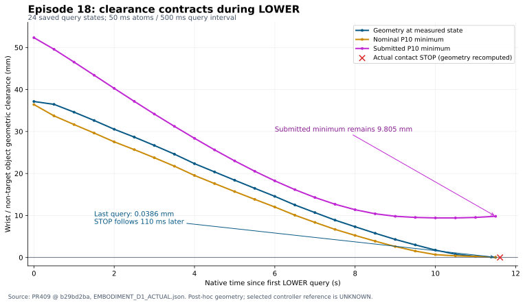

# D1 终态：失败机制、性能与并行审计

日期：2026-11-18，Asia/Singapore。依据 PR409 固定报告 head `b29bd2badc976e2288f9d009e4bf14cc41b769af`（13:29:23 SGT 更新）；第17/18条实际执行 source 是 `a83803fb71c76937020e88f210a592fd1524bf80`。本报告是 GitHub 报告与代码审计、封存数据的算术及绘图，不是 Core 原始私有 trace 的独立重跑。本次新原生请求、tick、模型生成及训练更新均为0。

## 1. 取得了什么，停在何处

[最新逐条件记录](https://github.com/Leo-6-maker/go2-arx5-hierarchical-vla/blob/b29bd2badc976e2288f9d009e4bf14cc41b769af/reports/WM02/sla-source-native-shared-v6-20261118/EMBODIMENT_D1_ACTUAL.json)中的权威终态字段是 `fixed_teacher18_terminal_and_original_gate_exhaustion`；根层仍保留较早快照，不能拿根层计数覆盖嵌套终态。

| 指标 | 已发生 |
|---|---:|
| 原 Teacher 科学请求 | 18/48 |
| 完整成功 / 接触 STOP / 任务预算耗尽 / 技术失败 | 9 / 8 / 1 / 0 |
| 科学积分 | 526,198 tick = 1,052.396 s 原生时间 |
| 接口请求 / 积分（单列） | 2 / 11,906 tick |
| 成功回合 G7 复核 | 813组RGB/H40、8,130个完整消费atom |
| M训练更新 / 优化访问 / 模型生成 / 学生原生请求 | 全部0 |
| F1 PLACE-red-left | 0/3；只余1次，最高1次成功，低于每格2次 |
| 服务终态 | 13:27:58 SGT 已关闭，MainPID=0、cgroup为空、lease=CLOSED |

旧人口剩余30条不能继续作为原资格试验。9/18是多次 Teacher 修订期间的开发累计，不能当作同一冻结 Teacher 的成功率估计。已有9条完整正例具有价值，但它们不证明新冻结策略的覆盖或源迁移收益。

第13条红物体右放已完成抓持、抬升、入区、释放、撤离和稳定；37.72mm抬升、57.23mm撤离、1.368s释放后稳定。第14条蓝物体左放、16/17条HOLD也成功。说明完整PLACE链条可实现，并非所有红物体或所有移动抓放不可行。

## 2. 第18条的因果链

### 2.1 已执行的候选与真正失败的阶段

- 第12条提高搬运高度后没有碰撞，但在CARRY耗尽90s任务时间；静态扫描得到−20°、[8,8]mm落点候选。
- 第18条实际执行了该候选：28203tick开始锁定转腕，41043tick进入左区，42203tick最后CARRY偏航残差约−0.04446°。该值是旋转向量z分量，不是完整SO(3)与末端位置对齐的证明。
- 42453tick进入LOWER；48258tick腕端 `x5_link6` 接触非目标蓝方块。目标仍被夹持，没有释放/撤离，STOP后积分0。
- 所以候选获得了“搬运/转腕/入区”的动态证据，尚未获得完整安全放置证据。第15条在DESCEND碰桌，根本没有执行其+30°/[4,−4]mm搬运候选。

### 2.2 代码确认的缺口：LOWER缺少持续剩余路径复核

[Teacher代码](https://github.com/Leo-6-maker/go2-arx5-hierarchical-vla/blob/b29bd2badc976e2288f9d009e4bf14cc41b769af/src/go2arx5_vla/world_model/multitask_teacher_v6.py)在CARRY检查搬运净空，并在切入LOWER前要求投影下放路径距离大于0。进入LOWER后则持续追逐支撑高度目标，没有每次查询重新检查剩余下放、释放和撤离扫掠路径，也没有预留实际跟踪与过滤器余量。

[几何实现](https://github.com/Leo-6-maker/go2-arx5-hierarchical-vla/blob/b29bd2badc976e2288f9d009e4bf14cc41b769af/src/go2arx5_vla/world_model/multitask_carry_geometry_v6.py)是复制当前状态后，投影远端几何的平移/绕物体中心旋转。它不是移动安装座、全臂、接触约束与WBC闭环的动力学预测。静态正净空不能当作完整动作安全证书。

封存状态的事后几何复核显示：

| query / tick | 实测状态锚定腕部净空mm | nominal P10最小mm | submitted P10最小mm |
|---|---:|---:|---:|
| 147 / 42453 | 37.144 | 36.418 | 52.341 |
| 163 / 46453 | 7.315 | 5.253 | 11.370 |
| 167 / 47453 | 1.754 | 0.671 | 9.419 |
| 170 / 48203 | 0.0386 | 0.0386 | 9.805 |

图中三条曲线均由已发布封存记录绘制，不是新增传感器测量。实测锚点曲线是对实际状态重算的几何距离。STOP几何重算值−0.000829mm与原接触观察器的穿透距离口径不同，不互相替换。

最后名义/提交路径的净空差约9.77mm，**这是不同锚定轨迹上的几何净空差，不是直接测得的TCP跟踪误差**。accepted reference也不等于最终controller selected reference；后者仍为UNKNOWN。

### 2.3 可证实与待证实的解释

| 解释 | 证据级别 | 对应处理 |
|---|---|---|
| LOWER只在入口检查、余段不复查 | 代码确认，接触前净空连续下降 | 用当前状态反复检查剩余下放/释放/撤离，并提前改变Teacher目标 |
| “大于0”没有动态余量 | 末query只余约39微米，110ms后碰撞 | 在工程开发中推导并校验有限余量，不能据此改STOP阈值 |
| actual / nominal / submitted链路差异 | 数据确认，selected仍未知 | 对齐native tick与参考身份；只读增加最终消费身份日志 |
| 绕物体中心的几何投影与实际TCP运动不同 | 模型简化，具体贡献未定量 | 用实际TCP→物体变换、完整SO(3)、mount/qvel做敏感性分析 |
| WBC本身应调参或加固定偏置 | 尚无足够归因 | WBC保持冻结；先修Teacher几何、阶段转移及参考证据 |
| 必须马上增加previous-command学生输入 | 本轮D0不支持该结论 | 暂不改输入；保留针对动态状态歧义的后续研究 |

[最新D0](https://github.com/Leo-6-maker/go2-arx5-hierarchical-vla/blob/b29bd2badc976e2288f9d009e4bf14cc41b769af/reports/WM02/sla-source-native-shared-v6-20261118/EMBODIMENT_D0_ACTUAL.md)检查了31,366个跨episode候选对；34个近邻状态对中，上一夹爪命令的可行区间不相交为0/34，且尚未检验RGB等价。因此输入缺历史可能是研究问题，但不能当作当前已经确证的主因。accepted参考距实测TCP的中位差12.8–25.9mm也出现在成功回合；不能直接当作控制故障。

### 2.4 “更安全但更绕”仍可能超时

[连续Teacher](https://github.com/Leo-6-maker/go2-arx5-hierarchical-vla/blob/b29bd2badc976e2288f9d009e4bf14cc41b769af/src/go2arx5_vla/world_model/mobile_continuous_teacher_v2.py)的平移参考速度上限7.5mm/s、角速度上限0.02rad/s；每P10共0.5s刷新反馈。按参考上限，20°转腕约17.45s，额外36mm抬升约4.8s，60mm撤离约8s，OPEN阶段至少2s。实际阶段可能并行或受跟踪影响，这些是规划量纲检查，不是物理时间的严格下界。

第18条STOP时，任务段已用85.11/90s。即使消除了这一次接触，剩余4.89s也明显不足以轻松完成当前参考轨迹下的释放和撤离。必须在抓取前就选择完整可落地的构型/姿态/路线，减少反复等待与搬运绕行；不能只在末端加高度或自动延长旧任务时限。

## 3. 速度审计

### 3.1 实测为端到端RTF约0.13

| 条件 | tick | 原生s | wall_s | RTF |
|---|---:|---:|---:|---:|
| #10 | 23,203 | 46.406 | 345.503 | 0.13431 |
| #13 | 37,453 | 74.906 | 572.316 | 0.13088 |
| #14 | 37,703 | 75.406 | 549.832 | 0.13714 |
| #17 | 23,453 | 46.906 | 354.044 | 0.13249 |
| #18 | 48,258 | 96.516 | 714.092 | 0.13516 |

RTF = tick×0.002/wall_s。wall_s包括启动、执行、关闭及最终日志审计，不能称为MuJoCo step内核的速度。本轮Teacher模型生成0，SLA推理不是它的耗时来源。CPU_s用Python worker的process_time，遗漏sim/solver/controller子进程，不能据此估计整机剩余CPU。

### 3.2 明确的固定处理窗口

[consume](https://github.com/Leo-6-maker/go2-arx5-hierarchical-vla/blob/b29bd2badc976e2288f9d009e4bf14cc41b769af/scripts/wm02/mobile_boundary_runner_v1.py)每推进25tick（50ms原生）后调用 `adapter.spin(.15)`；[spin](https://github.com/Leo-6-maker/go2-arx5-hierarchical-vla/blob/b29bd2badc976e2288f9d009e4bf14cc41b769af/src/go2arx5_vla/world_model/target_sequential.py)没有predicate时处理满150ms墙钟。包含ROS callback及guard，不能全部叫空等。

第18条有1,702个完整任务atom，另有128个初始化consume：
(1702+128)×0.15 = **274.5s，占714.092s的38.44%**。
这只量化窗口，并不保证删除窗口就省38.44%；窗口变化会改变异步WBC/solver的推进时序。

旧[事件就绪辅助函数](https://github.com/Leo-6-maker/go2-arx5-hierarchical-vla/blob/b29bd2badc976e2288f9d009e4bf14cc41b769af/src/go2arx5_vla/world_model/native_collection_performance_v1.py)已经实现settle_atom，但受旧construction角色约束，当前mobile未调用。应建立移动版新协议并保留旧路径，不能放宽旧角色校验或直接删spin。

### 3.3 尚待profile的CPU/I/O项

- 每query通常安装两次参考；完整固定根证书在有两历史点时最多扫描1,051个2ms点，每点最多5次IK更新。shadow rejection可能提前退出；尚无计时支持其占比。[证书](https://github.com/Leo-6-maker/go2-arx5-hierarchical-vla/blob/b29bd2badc976e2288f9d009e4bf14cc41b769af/scripts/pi0294/task_path_model.py)。
- accepted_boundary仍遍历累积ROS证据；installed_target_identities遍历planner events。可做增量索引，原始日志保留。
- ROS message转dict/JSON与写日志、几何投影、图像render、最终seal/audit需要分别计时。
- 当前policy hash已有按event-ID缓存；PlannerEventLog已增量读；LiveWriter已有常驻camera/MjModel和16帧异步npz分片。不能把这些作为尚未做的优化，也不能把另一条通用capture路径中的逐帧PNG/fsync归因给本轮。

每项报告exclusive与inclusive wall、次数及分布，避免重复相加；资源覆盖完整cgroup/子进程。短probe之外，使用第18条完整封存历史做纯离线增长回放，定位随着1,702atom累积的查询/序列化退化。

## 4. 多环境可做，已有原生先例

[2026-11-13双world实绩](https://github.com/Leo-6-maker/go2-arx5-hierarchical-vla/blob/b29bd2badc976e2288f9d009e4bf14cc41b769af/reports/WM02/sla-corelab-v3-20261113/PARALLEL_EPSILON04_TWO_WORLDS_TERMINAL_ACTUAL.json)中TRAIN01/07各21,203tick、均成功，同时存活和per-world owner成立。但报告明确matched_throughput_claim=false；旧静态抓取资格不能代替当前移动双物体G7。

当前[父runner](https://github.com/Leo-6-maker/go2-arx5-hierarchical-vla/blob/b29bd2badc976e2288f9d009e4bf14cc41b769af/scripts/wm02/sim_only_campaign_v51.py)以同一锁和domain串行for循环；[adapter](https://github.com/Leo-6-maker/go2-arx5-hierarchical-vla/blob/b29bd2badc976e2288f9d009e4bf14cc41b769af/src/go2arx5_vla/world_model/target_sequential.py)使用进程级ROS_DOMAIN_ID、默认rclpy context和固定topic。正确的并行单位是**一个独立OS进程树中的完整sim+solver+controller+planner+adapter**。

每world必须独立：ROS domain、CPU集合、输出/控制/tmpfs/cache、quota/ACK/STOP、参考事件、相机状态、lease及所有子进程。只共享不可变资产。复用[旧world owner](https://github.com/Leo-6-maker/go2-arx5-hierarchical-vla/blob/b29bd2badc976e2288f9d009e4bf14cc41b769af/src/go2arx5_vla/world_model/corelab_world_owner_v3.py)的隔离设计，创建移动版新合同，不绕过旧角色和锁。tmpfs每world设计上限8MiB控制+768MiB trace，四world约3.03GiB，仅是该部分容量，另需统计全进程内存和EGL渲染资源。

MuJoCo官方说明独立样本可以并行，每worker独立mjData、模型只读共享；同一轨迹的时间积分仍有顺序依赖。官方rollout池也不自动涵盖本项目外部ROS/WBC链。[官方simulation](https://mujoco.readthedocs.io/en/3.2.7/programming/simulation.html#multi-threading)、[Python rollout](https://mujoco.readthedocs.io/en/3.2.7/python.html#rollout)。

当前学生[request_policy](https://github.com/Leo-6-maker/go2-arx5-hierarchical-vla/blob/b29bd2badc976e2288f9d009e4bf14cc41b769af/src/go2arx5_vla/world_model/sim_only_mobile_v51.py)写同一个REQUEST.json，是串行父进程的单槽邮箱；直接开两个学生world会覆盖请求。先并行Teacher；学生随后做有界队列+单个常驻GPU worker、batch1顺序生成，按environment/episode/capture/tick/request/model/package身份路由。动态batch和多个模型副本不在本轮默认范围。

## 5. 后续决策

1. 原18/48永久封存；旧30不再派发。
2. 新Teacher开发人口与冻结资格人口分开，不再边改Teacher边消耗资格名额。
3. 优先修LOWER持续路径判断、抓取/落点联合选择和完整时长；性能profile与双world开发可并行。
4. event-ready无法证明消费就绪时，保留legacy固定等待，仍可资格验证legacy双world。
5. 最终Teacher、backend与人口冻结后再收集48；每个family×指令至少2/4完整成功，失败及技术成本全部保留。
6. 只有目标数据完整后才启动新的M2-BASE/M2-SRC身份，使用原M尚未使用的训练预算；源数据混合兼容封锁和历史TEST继续保持。
7. 实时资格仍未建立。提高离线暂停仿真的批次吞吐不等于机器人连续实时部署资格。

完整执行顺序、条件预算、停止规则见[长程协议](../../../docs/protocols/SLA_D2_TEACHER_AND_PARALLEL_20261118.md)。

