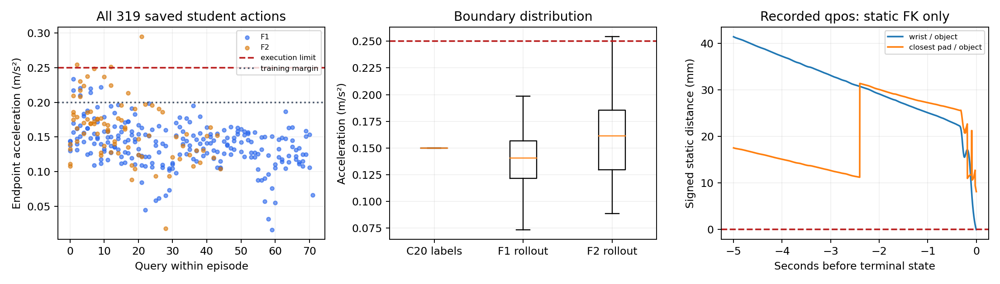

# V5.2 D0：存量边界与接触归因

固定计划`90d39196bdc345b977ee54ed64e750cf3561aa72`，执行source`4b59cd7c53882e4b04357d25e6e62660de89e715`。Core一次有限CPU服务已exit0、lease CLOSED、主PID0/cgroup空；墙钟6.127s、进程CPU3.023s。**实际读取320输入、319动作、1376个C20标签、8匹配专家的550份H40，以及碰撞前连续2501个2ms状态；新模型生成/积分/训练更新/优化访问均0。** [JSON与逐query派生数值](D0_BOUNDARY_CONTACT.json)。

## 边界假说得到支持，尚不等于干预有效

全部C20标签的首/尾最大加速度分别0.149999968/0.149999999998m/s²，1376条均未超过原0.25门，最小余量约0.10。8个实际匹配专家550条H40得到相同约0.15端点上界，内部最大0.035985。没有发现“专家标签本身已把端点顶到0.25”的反证。

319份学生动作（316份原通过也包含）中，F1首/尾最大0.233538/0.195157；F2首/尾最大0.294609/0.254252m/s²。逐份desired/reference原几何重算一致，并重新核对原319条通过/拒绝身份：仅原三条F2拒绝，没有重解释有效失败。逐query同时保留夹爪速度、上一实际width接缝、底座移动与reference/actual误差；原执行门未改。

这支持执行同父、同预算的B1普通FM500与B2端点余量loss500，以辨识额外优化和边界目标的作用。**D0没有证明B2一定有效，更没有产生新闭环成绩。**

## 接触和视觉

在已记录qpos/qvel/ctrl上逐tick做静态FK，禁止所有mj_step类入口；没有solver/controller完整状态恢复。末端重建腕部–方块距离约−0.0510mm，腕部–桌面仍有24.63mm，左右pad–物体约14.22/8.12mm、pad–桌面约10.18/9.36mm。原生接触日志的首次−0.0026mm属于其原pre-step接触记录；这里是末端qpos重建，两者不混用或覆盖。

按TCP相对物体位置从同族专家状态中找近邻，最近样本仍差7.712mm，其腕部–物体净空6.792mm。它是不同状态、不同控制历史的静态比较，**不形成同状态专家配对，不能作学生失败输入的纠正标签**。control-selected reference继续UNKNOWN。

核看接触前query35与44的原body/wrist RGB，红色目标在两视图可见，body视图有手部遮挡；不能据此认定模型正确识别或排除视觉/状态分布问题。320输入另计算红像素数量作为可追踪颜色代理，不冒称全体语义可见性认证。真实专家阶段、对象位置及分析真值未送入学生。

## 数值实施与下一动作

三项本地定向检查通过。Core另用CPU JAX验证零位移有限零梯度、超限梯度方向、tau mask、micro4对full32等价、lambda0与FM梯度逐位一致、刚体坐标不变性；没有加载SLA、生成动作或做模型更新。

新SHIFT7后继训练类、显式lineage RGB包及500步worker正在实现；它们不伪造旧C20 parent1000合同。训练尚未启动，先完成按实际几何/初态簇隔离的DEV32/TEST40封存与两臂共同起点核验，再执行两个500端点和三臂24次真实闭环。所有原#403条件与失败保留，不新增泛化或policy成功声明。
