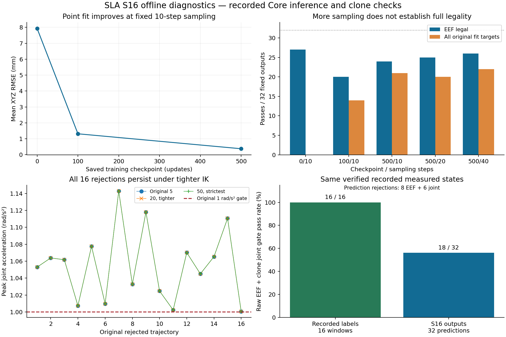

# SLA V7.1：拟合误差、IK数值与生成采样的分离诊断

2026-11-15，Asia/Singapore。以下是Core实际推理与保存状态上的克隆诊断，新增优化更新0、训练访问0、物理请求0。继承S16的500更新／16000访问，不再次累计。PD4前瞻原生资格另记，不与这里的离线分母合并。原WBC、完整H40门、旧RP8及历史任务失败保持。

**新证据：16个核实过的专家记录状态上，记录执行参考标签16/16通过原克隆认证；S16的32条预测只有18/32通过EEF及关节两层检查。原V6的16条关节拒绝在更严格IK下仍16/16拒绝。** 这是固定底座构型、当前局部IK认证下的证据，不是完整动态WBC不可能执行的证明，也不是历史学生状态上的专家最终计划配对。

[逐项数值与证据hash](ACTUAL_20261115.json) · [图](DIAGNOSTICS_20261115.png) · [原S16真实训练端点](../sla-s16-joint-suffix-v7-20261114/S16_20261114.md)

## 1. 旧32条输出：内部曲率、夹爪速率与标签余量

复用原500端点的16窗口×噪声0/1，未重新选择窗口或噪声。EEF 24/32、原联合拟合目标21/32，逐项复现原分类；联合目标要求EEF通过，且XYZ RMSE≤2 mm、平均SO(3)误差≤0.01 rad、nominal grip MAE≤0.02。额外3条EEF合法但拟合失败均为夹爪MAE超限。

平移加速度失败3条**全部在H40内部**，不是首末补零静止边界；夹爪速度失败6条、7个区间。TRAIN21/anchor26/noise1同时违反二者，所以并集是8条，不能算9条。其余三项速率／角加速度无拒绝。

下表H40索引从0开始，加速度k使用点[k−1,k,k+1]，速度区间i表示i→i+1。

| 窗口／噪声 | 失败项与索引 | 峰值／原阈值 |
|---|---|---:|
| TRAIN01 / a0 / n0 | 平移加速度，k23 | 1.08345 |
| TRAIN10 / a2 / n1 | 平移加速度，k37 | 1.00880 |
| TRAIN21 / a26 / n1 | 平移加速度，k18；夹爪区间4、5 | 1.03312；1.06847 |
| TRAIN13 / a21 / n0 | 夹爪区间35 | 1.09503 |
| TRAIN16 / a22 / n1 | 夹爪区间13 | 1.01433 |
| TRAIN25 / a25 / n0 | 夹爪区间0 | 1.31774 |
| TRAIN25 / a25 / n1 | 夹爪区间0 | 1.15679 |
| TRAIN13 / a24 / n1 | 夹爪区间3 | 1.29571 |

16个双噪声配对：9组均通过、6组一过一败、1组均拒绝（TRAIN25/a25）。两个噪声不足以估计完整生成分布。

这些标签的余量并不普遍贴边。16个窗口的最小“阈值−标签峰值”分别是：

| 原约束 | 阈值 | 最小标签峰值余量 |
|---|---:|---:|
| 平移速度 | 0.05 m/s | 0.0293375 m/s |
| 角速度 | 0.25 rad/s | 0.228691 rad/s |
| 机械夹爪速度 | 0.04 m/s | 0.0102460 m/s |
| 平移加速度 | 0.25 m/s² | 0.112826 m/s² |
| 角加速度 | 1 rad/s² | 0.858535 rad/s² |

逐点预测／标签差分、同位置标签余量和保守4ε/Δt²界都在机读报告。**不能把本批S16失败归因为已经证实的“标签几乎没有余量”。** 小点位误差仍可形成较大的二阶差分，但这不能单独选择输出表示、优化或损失为根因。

## 2. 原16条关节拒绝：48次收敛敏感性检查

同一原动作、原场景、原测量qpos/qvel/ctrl及最近两条真实执行参考。隔离诊断只改变原认证器的迭代数、收敛阈值，并插入只读轨迹记录；局部IK更新、固定根部／非机械臂关节、2 ms插值、50 ms差分、接触假设、0.7 rad/s与1 rad/s²门均保持。禁止物理积分和控制回调。原5次设置逐条复现保存的关节轨迹，最大分量差容差1e−12。

| 最大更新次数 | 位置收敛阈值 | 旋转收敛阈值 | 关节加速度拒绝 |
|---:|---:|---:|---:|
| 原5 | 1e−5 m | 1e−4 rad | 16/16 |
| 20 | 1e−7 m | 1e−6 rad | 16/16 |
| 50 | 1e−9 m | 1e−8 rad | 16/16 |

原5次的峰值加速度范围1.000699–1.142835 rad/s²。20次相对原设置的最大峰值变化1.38e−12 rad/s²；50次最大变化1.09122e−5 rad/s²。两种更严格设置的首次超限关节及H40三点索引均16/16保持。

最大位置残差由2.91338e−6 m降至6.19839e−9、9.99963e−10 m；旋转残差使用原arccos度量报告，浮点分辨率会使它在约1e−8 rad量级停留，不能声称严格1e−8阈值已由该度量全面证明。

因此，本批拒绝对这些收敛设置稳定，显著降低“主要是这组IK停止精度造成”的解释。仍未证明关节奇异、分支跳变或完整WBC动态不可行。原16条的joint3集中和前后缀集合关系继续沿用旧报告，不与下一组S16人口混算。

## 3. S16记录状态：标签与预测的同状态克隆对照

16个固定窗口都找到了原STATE包；native_step、场景／源spec／状态hash、真实消费历史均核实。标签state映射后的TCP与原包FK最大分量差3.22e−15；BASE hold读取原命令日志并验证整段不变，未用EEF反推关节状态或构造近似状态。

同一个真实记录测量状态和最近两条参考上，标签与预测分别走原FiftyMsProgram。标签是冻结数据集的记录执行参考；预测使用500/10原序列化动作包。没有重新锚定、平滑、裁剪或减速。对通过EEF门的计划，三种IK设置各检查一次。

| 输入 | 原始EEF编译通过 | 原5次IK通过 | 20／50次IK通过 |
|---|---:|---:|---:|
| 16条记录执行参考标签 | 16/16 | 16/16 | 各16/16 |
| 32条S16预测 | 24/32 | 18/24（全部预测18/32） | 各18/24 |

120次克隆认证＝16标签×3＋24个EEF合法预测×3。另8个预测停在原EEF门，不能计为已进行关节检查。

新增的6个S16关节拒绝，首次超限分别为joint1×1、joint3×2、joint4×3；4条内部，2条最近参考接缝。它们与原V6的16条关节拒绝是不同人口。记录标签的原IK加速度峰值最大0.929511 rad/s²；不能把所有标签都说成具有很大关节余量。

这里首次支持“**这些专家记录状态上，合法执行参考标签与学生预测存在可复现的关节认证差异**”。它不支持“历史学生状态上专家最终计划一定合法”：后者配对仍0；完整MPC／WBC状态恢复仍false；实际原生执行仍0。

## 4. 固定检查点与采样：160次真实新增推理

1次SLA父权重实际加载，逐个恢复保存的0／100／500 active数组；未恢复优化器、无梯度更新。每个配置都是同16窗口×原噪声0/1，初始噪声hash跨配置一致。500/10的normalized与physical输出hash全部与旧32条一致。20／40步是独立诊断，正式策略仍10步；没有逐窗口取最好结果。

| 保存端点／采样步数 | 平均XYZ RMSE | 平均SO(3)误差 | 平均夹爪MAE | EEF通过 | 联合拟合通过 |
|---|---:|---:|---:|---:|---:|
| 0／10 | 7.934 mm | 0.003749 rad | 0.135338 | 27/32 | 0/32 |
| 100／10 | 1.312 mm | 0.000950 rad | 0.045557 | 20/32 | 14/32 |
| 500／10 | 0.372 mm | 0.000231 rad | 0.009454 | 24/32 | 21/32 |
| 500／20 | 0.406 mm | 0.000272 rad | 0.009702 | 25/32 | 20/32 |
| 500／40 | 0.427 mm | 0.000304 rad | 0.010064 | 26/32 | 22/32 |

20步修复原10步的3个EEF拒绝，但新增2个拒绝；40步修复6个，同时新增4个。不是单调地“多采样就修复每条轨迹”。0端点较平缓但不准确，27/32几何合法不代表会完成任务。

有限训练内点误差持续下降，合法率和导数误差没有同步、单调改善。采样近似有影响，但本固定人口的20／40步不能补齐完整可执行性，也没有改善平均点误差。尚不能宣布500步完全收敛，或排除适当优化预算的作用；不自动续训。

## 5. 真实成本、工程失败与下一步

这三项新增：160/160次模型生成、1次SLA父权重加载、168次无积分克隆认证；训练更新0、访问0、物理请求0、积分0。GPU持有约409.875 s；GPU作业墙时410.443 s。原16续接作业CPU14.628 s、同状态续接CPU45.976 s；先前工程失败作业中完成的6次和15次有效克隆检查保留并合并，没有重跑挑结果，原作业仍失败。

工程记录保留：首次只读margin实现的角速度公式与原arccos不一致，在模型加载前停止，修正后严格复现旧分类；原16首查询无命令文件的读取错误；同状态对照误把仅EEF10的消费记录当成EEF10＋BASE7，修正为读取原BASE日志，已完成两窗口不重做。源码封装的首次文件数断言也保留为失败，无模型或物理效果。

PD4的新统计前瞻资格另用独立有限身份：两个冻结统计×四个固定TRAIN布局，8个上限条件，最多2个独立世界，不依赖旧RP8精确恢复。实际资格终态见[PD4原生报告](PD4_NATIVE_20261115.md)，后继训练与统一评价见[后台现场快照](BACKGROUND_20261115.md)。旧已完成4条使用N20统计的专家执行与这次新统计资格分母分开。本节三项诊断的新增训练更新为0，不代表后续PD4没有训练。

当前证据更支持优先研究完整机器人时间轴上的误差／约束一致性；没有证明某种新表示或导数目标必然有效。阶段均衡D仍取消，结构化表示／物理导数监督须另固定新标签与共同解码后比较；本轮不加关节惩罚、平滑器、参考误差输入或RL。正式旧TRAIN8与DEV失败保持；本地提交／软件检查不计训练或任务成功。
