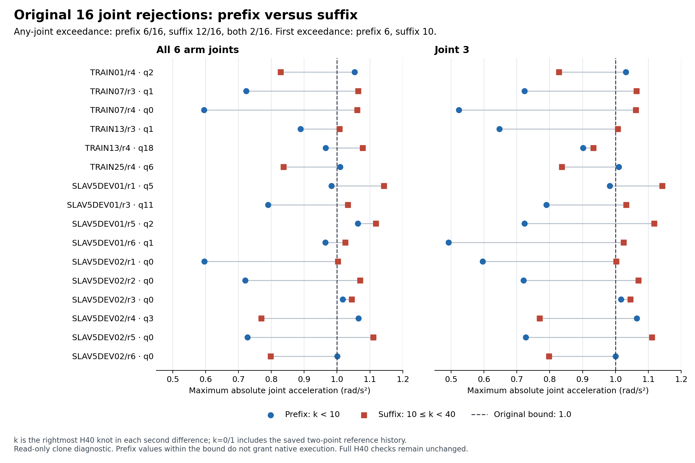

# V7：16条关节拒绝的前后缀与 joint3 分析

2026-11-14，Asia/Singapore。只读复用原轨迹、测量状态和认证器；不重新运行原任务，不修改安全阈值。

## 结果

- 前10点关节加速度超限6/16，后30点超限12/16；其中2条两段都超限。首次超限位于前缀6/16、后缀10/16。
- joint3前缀超限5/16、后缀超限11/16。15条至少一段joint3超限；另1条主要为joint4。首次超限关节仍为joint3×14、joint4×1、joint1×1。
- 在同一保存测量状态和同一完整H40上，仅移除认证器的最近两条参考历史，16/16仍被原关节加速度检查拒绝，峰值最大变化2.265e-12rad/s²。这是离线诊断，不修改正式执行接口。
- 已记录16条实际joint3位置/速度、首次joint3超限的IK位置三元组，以及64个实际/IK点的Jacobian。原始堆叠Jacobian条件数范围18.064–19.694；平移行单位m/rad、旋转行rad/rad，未归一化、未定义奇异阈值，不据此认定或排除奇异性根因。

[SVG矢量图](JOINT_SUFFIX_20261114.svg) · [由封存数值重绘](plot_joint_suffix.py)

## 16条定量表

加速度单位rad/s²，原阈值1.0。k为0起点，按二阶差分最右侧的H40 knot归属；k=0/1包含原两条历史。此表中的前缀数值通过不等于获得原生P10执行准入。

| 条件 | query | 全关节前缀max | 全关节后缀max | joint3前缀max | joint3后缀max | 首次超限k |
|---|---:|---:|---:|---:|---:|---:|
| TRAIN01/r4 | 2 | 1.052978 | 0.827983 | 1.032065 | 0.827983 | 3 |
| TRAIN07/r3 | 1 | 0.723432 | 1.063869 | 0.723432 | 1.063869 | 19 |
| TRAIN07/r4 | 0 | 0.594723 | 1.061736 | 0.523207 | 1.061736 | 24 |
| TRAIN13/r3 | 1 | 0.889320 | 1.007386 | 0.646627 | 1.007386 | 38 |
| TRAIN13/r4 | 18 | 0.965000 | 1.077616 | 0.901167 | 0.932343 | 14 |
| TRAIN25/r4 | 6 | 1.009817 | 0.837215 | 1.009817 | 0.837215 | 4 |
| SLAV5DEV01/r1 | 5 | 0.982500 | 1.142835 | 0.982500 | 1.142835 | 29 |
| SLAV5DEV01/r3 | 11 | 0.789736 | 1.032875 | 0.789736 | 1.032875 | 37 |
| SLAV5DEV01/r5 | 2 | 1.062945 | 1.117957 | 0.722961 | 1.117957 | 3 |
| SLAV5DEV01/r6 | 1 | 0.964542 | 1.024765 | 0.492313 | 1.024765 | 24 |
| SLAV5DEV02/r1 | 0 | 0.595582 | 1.002377 | 0.595582 | 1.002377 | 34 |
| SLAV5DEV02/r2 | 0 | 0.720441 | 1.070126 | 0.720441 | 1.070126 | 37 |
| SLAV5DEV02/r3 | 0 | 1.016877 | 1.045059 | 1.016877 | 1.045059 | 8 |
| SLAV5DEV02/r4 | 3 | 1.065356 | 0.769517 | 1.065356 | 0.769517 | 3 |
| SLAV5DEV02/r5 | 0 | 0.726944 | 1.110652 | 0.726944 | 1.110652 | 24 |
| SLAV5DEV02/r6 | 0 | 1.000699 | 0.797478 | 1.000699 | 0.797478 | 8 |

## 可支持的判断与边界

参考历史消融说明：在原克隆认证器覆盖的状态和检查范围内，这16条拒绝不能仅用最近两条参考解释。应优先研究H40内部时间曲率及其到当前关节构型的映射；目前仍没有足够证据将二者分开定为根因。保存状态的joint3位置范围0.440027–0.683437rad、速度范围−0.031513–0.006002rad/s；这些局部数值不构成完整状态可行域或IK分支判定。

完整MPC/WBC隐状态未恢复，同状态历史专家最终计划配对仍为0。本次不创建专家历史标签，不把去历史诊断称为原生等价认证，不把前缀计量通过当作完整H40或任务通过。原consumer仍提交完整40点，WBC实际使用后缀的程度尚未通过控制状态等价干预验证，原后缀检查保持。

关节上下文分析实测wall12.728秒、CPU6.711秒；无模型查询、训练更新、物理请求或积分。原20条任务0/20、DEV36未启动、旧RP8失败保持。D阶段均衡对照按用户决定取消，E暂缓。

[逐条件数值、状态hash、IK与Jacobian摘要](JOINT_SUFFIX_ACTUAL_20261114.json) · [原80查询归因](../sla-executable-eef-v7-20261114/QUERY_FORENSICS_20261114.md)
