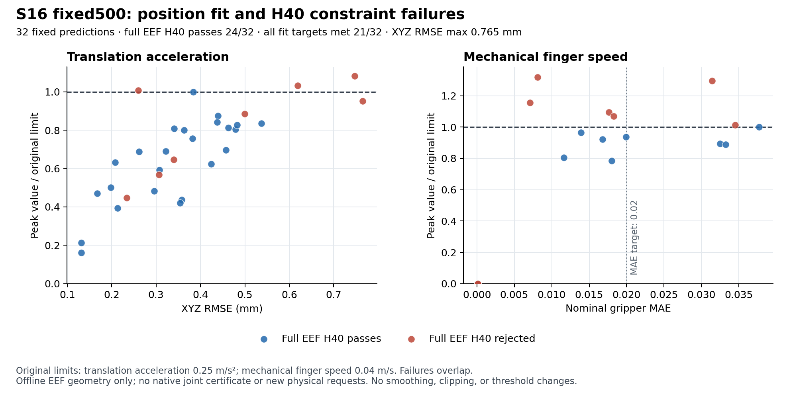

# V7 S16：固定500更新与32条预测的实际终态

读取时间 2026-11-14T23:24:56+08:00；作业于 2026-11-14T23:23:54+08:00 关闭。本轮完成**500次真实更新、16,000次目标访问、32条固定端点预测**；独立进程另重建32条，全部逐位一致。**完整EEF H40通过 24/32，全部拟合目标通过 21/32。**这仍是已见窗口的小拟合，原生关节资格、WBC状态恢复和任务成功未建立。

## 运行身份与固定条件

实际执行源码 `bbb378fca2a8b6f23845beef3af3e3df85a15c6a`，作业 `sla-s16-offline500-gpu0-v7-20261114-03`，spec SHA256 `8916058ed0b40b3729f4180e467da0c3b646b407423dfccb97a40f5aec71e609`。Core GPU0按用户允许共享；其他用户任务未修改。该源码与本地后续报告提交分开，不热改在途源码；本报告不宣称GitHub已发布或合并。

原预选16窗口／8episode／8布局，每个有效batch32恰好各窗口两次，micro8×4、原FM32、highest、25warmup、state-token dropout .25，无空间／关节loss、平滑、裁剪或额外学生输入。每窗实际访问1000次，500个梯度全部有限且非零。数据manifest `29fd45ff31a2031f70f5d32402e6bfefe2f8b644e8e81ad1d2003d4537a1a6f5`，原全N20冻结统计 `024951afc22e03586635f17b5ee8f473aead1960f107d8768384643844afb9e1`；未重新拟合统计。

父权重固定haofuly/SLA_base revision `5bbdf3012ab643554aa2eb83ddeae9ace3dce476`，父manifest SHA256 `232442c8a8c934118cbcdb890c6f307d7fc857819d7e45c2286ed8e8e5d5f3a3`，上游源码 `405ca8879c032a05f0a778adc7d86f4e221c5eba`。87个初始活动参数／Adam／RNG数组与原N20初始状态逐位一致，完整冻结dense指纹也一致。有限内存加载只在主机恢复时采用原最终精度，冻结BF16、原接口FP32，并发读取上限1GB；原默认加载分支保留。独立进程普通RGB总生成64条＝32条唯一端点预测＋32条相同输入／noise的重建；不是64个独立评价条件。

## 保存、恢复与访问核验

| 更新 | 访问cursor | 数组文件hash读回 | COMPLETE SHA256 |
|---:|---:|---:|---|
| 0 | 0 | 87/87 | `bd119cd5b55ef25e4ea660c90236ffce16cd7a0d3e8277ef1b5b148c38f96a02` |
| 100 | 3200 | 87/87 | `2e279b20383a6e6c491086e954a84708d5329d293c90477f40a50fc70d7993a6` |
| 500 | 16000 | 87/87 | `18f97e1b3b77b22b111e2a2bc8cc0aac15ef25b77966a3c1cbe6dec772f2a2a7` |

固定500状态真实恢复完整87个数组后才生成端点，恢复未增加更新。全部500行更新日志的步号／cursor连续、每个batch与固定访问表一致，访问序列hash与step500绑定相同。原始32个NPZ中的64个数组hash读回通过，独立RGB进程的32组输出hash逐项相同；冻结dense指纹未变。

## 预测与拟合结果

XYZ RMSE平均 0.372mm、最大 0.765mm；mean SO3平均 0.000231rad、最大 0.000434rad；nominal grip MAE平均 0.009454、最大 0.037701。

原全H40 EEF检查失败项（可重叠）：maximum_discrete_translation_acceleration_m_s2：3/32、maximum_finger_speed_m_s：6/32。既定目标为32/32 EEF合法，同时XYZ≤2mm、meanSO3≤.01rad、gripMAE≤.02。目标未达的预测完整保留，不延长训练、不换终点、不改阈值。

原几何阈值保持：平移速度0.05m/s、角速度0.25rad/s、机械夹爪速度0.04m/s、平移加速度0.25m/s²、角加速度1rad/s²。32条位置和方向误差均低于拟合目标，但时序约束仍有失败；这支持先研究监督／输出表示，不证明模型本身不可学习或某一种根因已经确定。

[SVG矢量图](S16_CONSTRAINTS_20261114.svg) · [由封存数值重绘](plot_s16_constraints.py)

训练FM32前25步均值 0.08147496、后25步均值 0.00168895；单次末步loss不是能力结论。生成动作的MSE32、active7、pad25另列在逐条JSON，避免将25维padding的容易拟合部分掩盖动作误差。

| 固定窗口 | 阶段 | noise | XYZ RMSE mm | mean SO3 rad | grip MAE | 完整EEF H40 | 失败项 |
|---|---|---:|---:|---:|---:|---|---|
| TRAIN01-P10-r5:00 | PREGRASP | 0 | 0.747 | 0.000255 | 0.000102 | 拒绝 | maximum_discrete_translation_acceleration_m_s2 |
| TRAIN01-P10-r5:00 | PREGRASP | 1 | 0.384 | 0.000284 | 0.000105 | 通过 | — |
| TRAIN04-P10-r5:00 | PREGRASP | 0 | 0.424 | 0.000222 | 0.000102 | 通过 | — |
| TRAIN04-P10-r5:00 | PREGRASP | 1 | 0.439 | 0.000163 | 0.000102 | 通过 | — |
| TRAIN07-P10-r5:02 | DESCEND | 0 | 0.479 | 0.000254 | 0.000100 | 通过 | — |
| TRAIN07-P10-r5:02 | DESCEND | 1 | 0.438 | 0.000192 | 0.000101 | 通过 | — |
| TRAIN10-P10-r5:02 | DESCEND | 0 | 0.363 | 0.000184 | 0.000099 | 通过 | — |
| TRAIN10-P10-r5:02 | DESCEND | 1 | 0.260 | 0.000169 | 0.000100 | 拒绝 | maximum_discrete_translation_acceleration_m_s2 |
| TRAIN13-P10-r5:21 | CLOSE | 0 | 0.306 | 0.000187 | 0.017631 | 拒绝 | maximum_finger_speed_m_s |
| TRAIN13-P10-r5:21 | CLOSE | 1 | 0.296 | 0.000182 | 0.037701 | 通过 | — |
| TRAIN16-P10-r5:22 | CLOSE | 0 | 0.198 | 0.000298 | 0.018024 | 通过 | — |
| TRAIN16-P10-r5:22 | CLOSE | 1 | 0.234 | 0.000247 | 0.034501 | 拒绝 | maximum_finger_speed_m_s |
| TRAIN21-P10-r5:26 | LIFT | 0 | 0.537 | 0.000348 | 0.011616 | 通过 | — |
| TRAIN21-P10-r5:26 | LIFT | 1 | 0.619 | 0.000265 | 0.018278 | 拒绝 | maximum_finger_speed_m_s、maximum_discrete_translation_acceleration_m_s2 |
| TRAIN25-P10-r5:25 | LIFT | 0 | 0.499 | 0.000270 | 0.008121 | 拒绝 | maximum_finger_speed_m_s |
| TRAIN25-P10-r5:25 | LIFT | 1 | 0.765 | 0.000156 | 0.007122 | 拒绝 | maximum_finger_speed_m_s |
| TRAIN01-P10-r5:33 | HOLD | 0 | 0.308 | 0.000242 | 0.000097 | 通过 | — |
| TRAIN01-P10-r5:33 | HOLD | 1 | 0.358 | 0.000255 | 0.000097 | 通过 | — |
| TRAIN04-P10-r5:31 | HOLD | 0 | 0.382 | 0.000434 | 0.000098 | 通过 | — |
| TRAIN04-P10-r5:31 | HOLD | 1 | 0.463 | 0.000367 | 0.000098 | 通过 | — |
| TRAIN07-P10-r5:01 | PREGRASP | 0 | 0.483 | 0.000144 | 0.000101 | 通过 | — |
| TRAIN07-P10-r5:01 | PREGRASP | 1 | 0.340 | 0.000132 | 0.000102 | 通过 | — |
| TRAIN10-P10-r5:20 | DESCEND | 0 | 0.261 | 0.000254 | 0.019913 | 通过 | — |
| TRAIN10-P10-r5:20 | DESCEND | 1 | 0.208 | 0.000262 | 0.013929 | 通过 | — |
| TRAIN13-P10-r5:24 | CLOSE | 0 | 0.354 | 0.000389 | 0.016768 | 通过 | — |
| TRAIN13-P10-r5:24 | CLOSE | 1 | 0.340 | 0.000259 | 0.031402 | 拒绝 | maximum_finger_speed_m_s |
| TRAIN16-P10-r5:32 | LIFT | 0 | 0.322 | 0.000264 | 0.000099 | 通过 | — |
| TRAIN16-P10-r5:32 | LIFT | 1 | 0.458 | 0.000210 | 0.000098 | 通过 | — |
| TRAIN01-P10-r5:22 | CLOSE | 0 | 0.213 | 0.000186 | 0.032478 | 通过 | — |
| TRAIN01-P10-r5:22 | CLOSE | 1 | 0.167 | 0.000156 | 0.033243 | 通过 | — |
| TRAIN01-P10-r5:57 | HOLD | 0 | 0.131 | 0.000085 | 0.000097 | 通过 | — |
| TRAIN01-P10-r5:57 | HOLD | 1 | 0.131 | 0.000088 | 0.000097 | 通过 | — |

EEF检查范围为policy-frame几何、原50ms导数和nominal到机械夹爪映射；不是完整原生关节证书。S16训练状态没有已验证恢复的完整MPC/WBC隐状态，本次不冒称完成关节可行性或原生TRAIN4。新增物理请求0、积分0，同状态历史专家最终计划配对仍0。

## 费用与保留的工程失败

成功关闭的03作业等待 0.080s、GPU所有权持有 4100.429s、总wall 4100.509s；systemd CPU 2778.295s、内存峰值 11.275GiB。500次更新wall合计 3536.118s，中位每步 6.859s，输入等待合计 12.197s。GPU持有时间包含加载／保存／推理及共享等待，不是独占GPU计算时间。

01源码690b1503在独立脚本导入时失败，未加载模型／更新／访问；unit wall0.101365s、CPU0.070606s。02源码299828d5在父权重主机恢复后、放入GPU前遭systemd-oomd SIGKILL，完整模型加载0、更新／访问0；unit wall316.921333s、CPU81.023449s、内存峰值14.506GiB。原36GiB硬上限耗尽并未得到证明。两次终态、原因、费用和关闭记录保留；03以新源码修复工程问题，没有重复有效科研失败条件。

软件验证沿用此次实际记录：本地S16配方／worker／几何7项、后缀2项；Core CPU实际6项覆盖原device reduction、非有限梯度在更新前拒绝、主机最终精度及provider。部分本地device测试因未安装JAX不能运行，其对应Core测试已通过。软件检查不计入上述真实训练、推理或物理分母，GitHub CI未运行。

## 下一动作与保持项

结合本轮固定S16端点与[原16次关节前后缀分析](JOINT_SUFFIX_20261114.md)决定后继机制研究，不自动追加优化预算。完整控制状态的专家最终计划配对仍需独立建立；[PD4配对输入与原生资格缺口](PD4_READINESS_20261114.md)已核对，先完成原生验收，才允许C两臂。D阶段均衡对照取消，E结构化轨迹研究暂缓，不能以评价时平滑替代raw结果。

原TRAIN8为0/8，DEV为0/12（计划48，余36未启动）；旧RP8失败、20条有效失败、冻结WBC和原安全保持。没有自动续DEV36、重训、原生派发或整体任务成功声明。

[完整逐条数值与证据hash](S16_ACTUAL_20261114.json) · [V7协议](../../../docs/protocols/SLA_EXECUTABLE_EEF_POLICY_V7_20261114.md)
