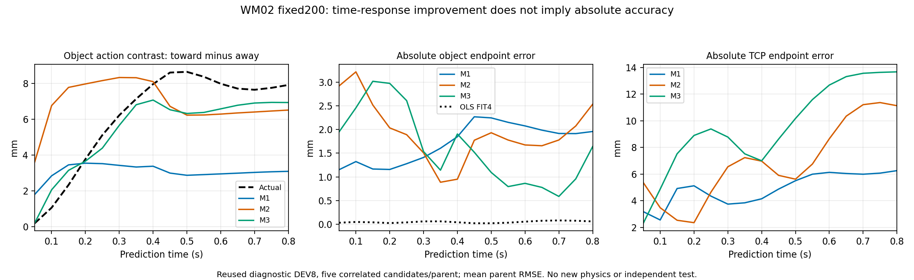

# WM02：M3时间响应消融完成，开发门槛未通过

本轮从未合并 PR #351 的固定提交 `b81cbee0cbaeeccda1e3278c972e5b1193a16cfe` 建立独立源码和运行身份；没有切换现役source或修改旧模型。**完成逐步H1–H16诊断与一次M3固定200主更新＋1续训探针，共201次实际优化器调用；新增物理转移0、Actor/Critic更新0、完整任务0。** 第一次GPU准入拒绝的模型分配/更新为0，失败成本保留。

结论是**动作效应时间监督有效，但完整WM仍不可用于Actor**：M3所有8个DEV父场景的H1/H8/H16朝向−背离效应误差门槛均通过；H1绝对物体RMSE仍差于M1，整体验收FAIL。接触建立/释放的H16抓持概率还明显退化。没有采新留出、重用旧holdout、追加更新或启动Actor。

目标线独立：只读核验并选定现有R1外层→observer→冻结MuJoCo及trace，不重编译。冻结输入和候选字节不变；没有发现本运行可绑定的有效init-only动态范围，原lease仍CLOSED。两次0.1秒冷启动、2秒/5秒保持、真实Policy/PD/STOP一律 **NOT_RUN**，目标故障尚未修复验收。



图中只使用反复分析过的DEV8，曲线为等权父场景平均；每父五候选相关，不当作40个独立样本。图表不能支持新盲测或跨任务泛化结论。

## 实际执行身份、命令和终态

| 工作 | 完整源码SHA | 退出码／实际效果 |
|---|---|---|
| B0原M0/M1/M2逐步诊断 | `0bb8855cd9b00dada7d63a8b6a6c4037460bd321` | 0；FIT24＋DEV8、三阶段、五候选、H1..16；0更新/积分 |
| M3首次GPU入口 | `050b131c55acefdfcd5be22e5645fd80b0098d18` | 1；共享GPU余量拒绝，模型分配/更新0；任务退出/lease关闭后独立核清 |
| M3同配方新容量身份 | `ddfc708195837967b50672e24149337467b49216` | 0；主200＋续训探针1，全态恢复误差0 |
| B4冻结M1/M2/M3完整评价 | `595a2a2bb8b8a311d28b86139502cd4750a4308b` | 0；新增相对姿态/原规则评分，原数据/端点不变；0更新/积分 |

[执行身份](EXECUTION_IDENTITIES.json)保存实际run、spec SHA256、退出码与时间。4个Core worker均MainPID0、NRestarts0、lease CLOSED。首次失败Journal的原INTENT保留，由入口异常、零更新记录、进程终态和CLOSED独立核清后才启动新身份；没有盲重放。同GPU随后实测恢复16GB以上空闲，不修改损失、训练长度或安全；他人进程未动。

以下是已执行调用的路径变量化表达，绝对argv在私有run的LAUNCH_INTENT.json/EXECUTION_SPEC.json。每次源码均为固定提交导出的隔离快照，沿用原registry、Journal、neural owner锁和有限用户systemd worker，没有新调度平台。

```bash
# 原生模型前的B0、冻结B4均在Core CPU，不在AMD计算。
CUDA_VISIBLE_DEVICES='' OMP_NUM_THREADS=1 OPENBLAS_NUM_THREADS=1 \
  MKL_NUM_THREADS=1 PYTHONDONTWRITEBYTECODE=1 TMPDIR="$R/tmp" \
  "$WM02_GPU_ENV_PYTHON" -B "$R/worker.py"

# 共享GPU0上的M3：4 CPU、10GiB RAM、4GiB CUDA allocator上限，
# 固定200、RuntimeMaxSec=2400、Restart=no；无其他GPU可见。
CUDA_VISIBLE_DEVICES="$WM02_GPU0_UUID" OMP_NUM_THREADS=4 \
  OPENBLAS_NUM_THREADS=1 MKL_NUM_THREADS=4 CUBLAS_WORKSPACE_CONFIG=:4096:8 \
  PYTHONDONTWRITEBYTECODE=1 CUDA_CACHE_PATH="$R/cache" TMPDIR="$R/tmp" \
  "$WM02_GPU_ENV_PYTHON" -B "$R/worker.py"
```

worker实际调用以下已实现入口的main(argv)，不是只发布接口：

```text
scripts.wm02.diagnose_temporal_response
  --spec "$R/EXECUTION_SPEC.json" --output "$R/diagnostic-01" --run-id diagnostic-01
scripts.wm02.train_temporal_model
  --spec "$R/EXECUTION_SPEC.json" --output "$R/m3-200-01" --run-id m3-200-01
```

本机还实际运行了保存结果的门槛评估CLI，退出0、结论FAIL；退出码0表示评价程序完成，不表示模型通过：

```bash
PYTHONPATH=src:. python3 -m scripts.wm02.assess_temporal_response \
  --result "$WM02_PRIVATE/TEMPORAL_RESULT.private.json" \
  --baseline "$WM02_PRIVATE/TEMPORAL_RESULT.private.json" \
  --output "$WM02_PRIVATE/DEV_GATES_ACTUAL.json"
```

同一冻结评价文件含M1和M3，baseline参数明确读取其中的M1，而非让M3与自己比较。没有在看到M3结果后调整门槛。

## B0：局部偏差、递推漂移与耦合必须分开

原V5数据SHA256：`c12293bc877758254a14d19ec112f147fe19c93ffacf4c8399ae8ebfcb42c808`，原数据源码 `7e41cd69c3c215e91cb2f85688e5426d4a7f4d2c`。训练/统计仅FIT；本轮只用原24 FIT＋8诊断DEV，旧8 holdout未评价。模型的state/history/clock/reference burn-in和hidden对所有候选完全相同。

FREE路径只接收当前state、过去8步、候选raw及当前clock；第二400ms块固定零EEF增量和末开度保持，**从预测H8 TCP重新编译**，不使用真实第二块安装参考。单独的TEACHER_FORCED_PRIVILEGED路径可以读实际未来state/reference，但只诊断局部误差，从未用于FREE/部署/Actor输入。因果接缝测试还验证第二块参考等于预测锚点、H16梯度没有detach。

| 原M2 DEV物体位置误差，平均父RMSE | H1 | H8 | H16 |
|---|---:|---:|---:|
| FREE因果展开 | 2.917mm | 0.952mm | 2.534mm |
| 实际state/history递推下的单步诊断 | 2.917mm | 1.127mm | 0.427mm |

H1错误在第一步已存在，不能都归为累计漂移；H16单步远优于FREE，支持递推/离分布漂移问题。H8自由物体端点表现好也不能证明局部动力学、TCP状态正确。

尤其应纠正“TCP的动作差正确，所以只剩物体耦合”的推断：M2 H16 TCP朝向−背离差接近真实，**绝对TCP RMSE却为11.137mm**。物体−TCP相对位置误差为13.364mm，而真实稳定抓持相对位置漂移约31μm。动作差消除了共同偏差，因此可能掩盖很大的绝对状态错误。完整H1..16、三阶段、free/teacher、接触/抓持概率及参考误差见[时间曲线](TEMPORAL_CURVES.json)、[分父搬运](PER_PARENT_TRANSPORT.json)、[其他阶段](OTHER_PHASES.json)、[评价身份](EVALUATION_IDENTITY.json)。分父JSON使用显式columns与逐行数值表保留完整精度；完整50维预测/真实状态数组与原float64命令只保存在私有运行产物。

## B1/B2：强基线结果及适用范围

OLS预先固定FIT父0–3×五候选20例，输入是建议动作累计xyz/.004，分别拟合16个时刻的真实ΔTCP和Δ物体，一次矩阵求解，不是另一版19M模型训练。恒速度使用当前实测速度；条件刚性基线保持初始TCP→物体SE(3)关系。刚性假设只对这批实际持续抓持的搬运分叉适用。

| DEV物体端点误差 | H1 | H8 | H16 | 含义 |
|---|---:|---:|---:|---|
| OLS FIT4，池化RMSE | 0.0417mm | 0.0543mm | 0.0762mm | 有限稳定抓持分布的强小模型基线 |
| 恒速度，平均父RMSE | 1.214mm | 22.463mm | 44.370mm | 当前速度不能替代执行响应 |
| 已知未来真实TCP＋刚性SE(3)，平均父RMSE | 0.0483mm | 0.0451mm | 0.0446mm | **oracle诊断**，使用未来真实TCP，不是可部署预测 |
| M2预测TCP＋刚性SE(3)，平均父RMSE | 5.388mm | 6.956mm | 11.118mm | 绝对TCP漂移会传给物体，不会自动修好WM |

JSON同时报告等权父RMSE平均和池化RMSE；不可用二者的差异宣称算法优势。上述量级都远低于/高于相应WM的部分误差，但只说明这个窄源域阶段的可辨识性和误差结构，不代表OLS能处理抓持建立、滑脱、释放或目标Go2。

## B3：一次预声明的M3固定200消融

[冻结训练定义](../../../experiments/wm02/temporal_response_v1.json)在M3启动前提交。保留M2的18,905,387参数结构和relative_tcp_v1，仅将单H8效应差监督改为H1/H4/H8/H16的因果效应差。权重各.25，λ=1；FIT720个同起点候选对的六维TCP/物体差RMS，预定下限0.5mm，得到σ= **0.500000/1.077905/2.158725/2.164573mm**。没有用DEV选权重或尺度。实际首10→末10更新均值：基本损失.45191→.03243，效应差损失.19452→.002892；训练损失下降不能抵消下述DEV绝对误差与事件失败。

基本损失、FIT720窗口、seed20261104、normalizer5736唯一状态、有效batch256/micro32、AdamW lr2e−4/WD1e−5/clip1与M1/M2一致；基本序列曝光51200。新增项使用相同抽样microbatch中的第一块候选对，48074对，与M2相同，不混父场景或第二块不同起点。效应项单独做deployable FREE16，第二块由模型预测重锚；原基本8步监督仍保留其实际安装参考定义，不能将二者混为一种输入。

M3 checkpoint200 SHA256：`7c1705fbd24fa0d7fa89391c0b5ca7a9146ddc2c76ead58ab979fd08e0d01092`。

M1 checkpoint200：`404905951041604070b128c3a99d39f56eaefc54cf77c7523883d352820ba3e9`。

M2 checkpoint200：`1536f410178ce6e07bf0fa940e706e65c484a8acef5808c68f1313e21fedaa3f`。

M3与M1/M2初始参数SHA相同：`1f933cf8f0349eb198a9ed313adb462c7b0727c159025f65e2ac7bad8305be78`。主更新200、续训探针1，首步/200完整重载和199→200模型＋AdamW续训比较误差均0。[真实训练回执与优化曲线](M3_TRAINING.json)

## B4：效应门槛通过，完整开发验收FAIL

| DEV物体朝向−背离差 | 真实 | M1 | M2 | M3 |
|---|---:|---:|---:|---:|
| H1 | 0.200mm | 1.807mm | 3.615mm | **0.216mm** |
| H8 | 7.952mm | 3.378mm | 8.090mm | **7.063mm** |
| H16 | 7.906mm | 3.093mm | 6.505mm | **6.926mm** |

不是只看均值：DEV8每个父场景均满足H1差误差≤0.5mm、H8≤1mm、H16≤1.5mm和正方向。H4及其余各步完整保留，不据较好端点选模型。

| DEV绝对物体位置，平均父RMSE | M1 | M2 | M3 | M3门槛 |
|---|---:|---:|---:|---|
| H1 | 1.151mm | 2.917mm | **1.947mm** | **FAIL，劣于M1** |
| H8 | 1.847mm | 0.952mm | 1.905mm | 披露，未设事后新门槛 |
| H16 | 1.958mm | 2.534mm | **1.641mm** | PASS |

[逐父门槛](DEV_GATES.json)的全部开发条件并未通过。M3 H16绝对TCP RMSE反而13.676mm，仍不能将比较好的物体动作差解释为全状态动力学正确。

保存数组零推理分解进一步定位：五候选误差MSE严格等于共同偏移MSE＋中心化候选误差MSE。M3 DEV H1物体误差的 **99.9844%** 来自共同偏移；共同偏移RMS1.947mm、候选差异误差RMS仅0.0243mm。配对差损失对所有候选共有的偏移不敏感，因而差分曲线漂亮仍可有绝对偏差。这是对已有数组的恒等分解，不是新的模型训练或唯一动力学根因证明。[分解与预测产物SHA](ERROR_DECOMPOSITION.json)

其他阶段还出现显著负结果，不能仅以搬运曲线授予Actor资格：

| DEV H16 native_grasp Brier | M1 | M2 | M3 |
|---|---:|---:|---:|
| preclose抓持建立 | .0734 | .1201 | **.6921** |
| supported_release释放 | .0548 | .0244 | **.7816** |

M3 preclose平均预测抓持概率.0186、实际.725；release平均预测.9898、实际.200。H16 FREE事件预测在新损失下显著退化，即使前8步基本监督仍在。不能把transport的低Brier推广到事件切换，更不能把没有support头的模型当作支撑预测器。

原规则与纯WM选择分开记录。M3在DEV搬运H1的纯WM平均Q regret为.001208、规则为0；H8/H16两者均0。现有DEV搬运上规则仍强，不以打平称增量价值；其他阶段的回归同样保留。[候选选择、原float64动作SHA、事件映射与参考检查](EVALUATION_IDENTITY.json) 三模型canonical singleton、FIT/DEV每父置换输出最大差0，后续选择按原物理命令哈希与1e−6 tie规则。没有为了成绩更改事件、动作身份或评价定义。

因此B5新独立场景采集 **NOT_RUN_DEVELOPMENT_GATE_FAILED**；旧holdout也不重评。Actor/Critic仍0。本轮不把200延到800/5000，不再针对DEV调整λ/σ/权重。后续应将狭窄稳定抓持中的执行响应、绝对共同偏差和物体耦合分开验证，并把接触切换/释放的可靠性作为独立问题；不能强迫Actor依赖这版WM。

## A线：明确运行包，原生冷启动NOT_RUN

[目标状态](TARGET_STATUS.json)已选定 `task_actuation_r1.so → observer.so → frozen libmujoco.so.3.2.7`，同一个libwm02_init_trace.so为记录器，另一个外层不叠加。候选实际构建源码 `7ae02fd40bff0ca6e52255e4a23736f340f07bc5`，来自原PR351工作；本轮只读核验，没有重新编译或覆盖它。

主程序SHA256：`7828f9f29e174ac7bf9e82edd897de577a2d365ab22e6dec438f0565b09ff488`。

实际MuJoCo SONAME SHA256：`848a26ad3daccac3a56d7269ac68167ed3497f048223f8720f4e56eb432eb6c6`。

SDK插桩源码SHA256：`278b881706e10c8a39353b977d67df4ff1cd340c4370cbd0bcc21fcb2ce4725e`。

20项冻结输入、候选源码、全部所选preload字节与加载库再核验均不变；原目标lease仍CLOSED，SHA256 `db2c30f675acb9e8dc280e3fc69d277e1bf91db10cfc2476881eeac2895be407`。本轮没有修改permission配置、重启旧lease或发送目标命令。

trace包括观测及单调/仿真时钟、推理开始/输入/history/完成、policy发布、pos/vel实际消费版本、PD目标、实际ctrl、模式、积分前后和STOP/拒绝后续调用。容量65536×840字节记录，32个payload槽（首4＋近28），每槽16384 float，10ms后台写盘。旧loader trace0事件/dropped0仍仅是加载器结果，**不能验收目标高率记录无丢失或真实STOP**；动态下dropped及记录器时序影响均NOT_MEASURED。原有同步日志不变。

首个确定动态阻断是缺少原owner通过现有机制签发、可绑定到新run的有效有限init-only范围。GPU授权与草稿PR均不替代它。真实Policy/PD频率、两队列版本、首次限位和停止后积分都未测；不能将唯一腿故障原因写成已证实，也不以本轮0积分冒称STOP后0额外积分。

有效范围成立后的顺序仍为：2次独立冷启动各最多0.1s/50tick，逐次安全检查；任一失败冻结最早异常，不推进；通过才按范围2s、5s保持，再考虑小EEF/夹爪。WBC、机械限位、原生安全不变。完整任意中途MPC/WBC/receiver恢复仍未合格，目标反事实分叉和站立T1正式Reward验收也未完成。

## 成本、测试和下一条命令

- B0 unit CPU245.259s/wall65.936s；首次GPU拒绝CPU3.049s/wall3.245s。
- M3成功unit CPU141.149s/wall129.571s；模型训练函数CPU130.392s/wall125.076s。主更新峰值allocated665,750,528B/reserved811,597,824B；包括恢复检查峰值allocated967,661,056B/reserved989,855,744B。自己的NVML采样峰值1300MiB；GPU0实际32760MiB，GPU1实际16376MiB，本轮未用GPU1，不冒充16GB卡上的实测。
- B4 unit CPU276.288s/wall77.032s。4个unit CPU合计665.744s；额外保存数组分解CPU约0.121s。测试、暂存、SSH和只读核验成本不混入该合计，也没有可核验的货币账单。
- world_model45项（44通过/1跳过）、neural36项全部通过，普通/`-O`两种模式；Core M3相关4项测试两模式均通过，完整保存恢复及真实推理已执行。仓库整体CI **NOT_RUN**。夹具/单元通过不提供目标资格。
- 所有新worker已退出/lease CLOSED，无我们的GPU残留；已知旧PID727048/3892803/1425203均不在。旧实验、现役capsule和他人任务未动。

可立即执行的真实交付复核入口：

```bash
python3 scripts/wm02/review_temporal_round.py \
  --report-dir reports/WM02/temporal-response
```

该命令只核验交付证据及返回计数/FAIL/NOT_RUN，不训练、不采样、不启动目标。已实际运行退出0。下一科学动作应基于上述共同偏移、执行状态漂移和事件切换失败证据预声明新机制；目标下一动态动作仍等待有效原owner范围。本轮不以重复编译、加采样或延长黑箱训练替代这两个条件。
